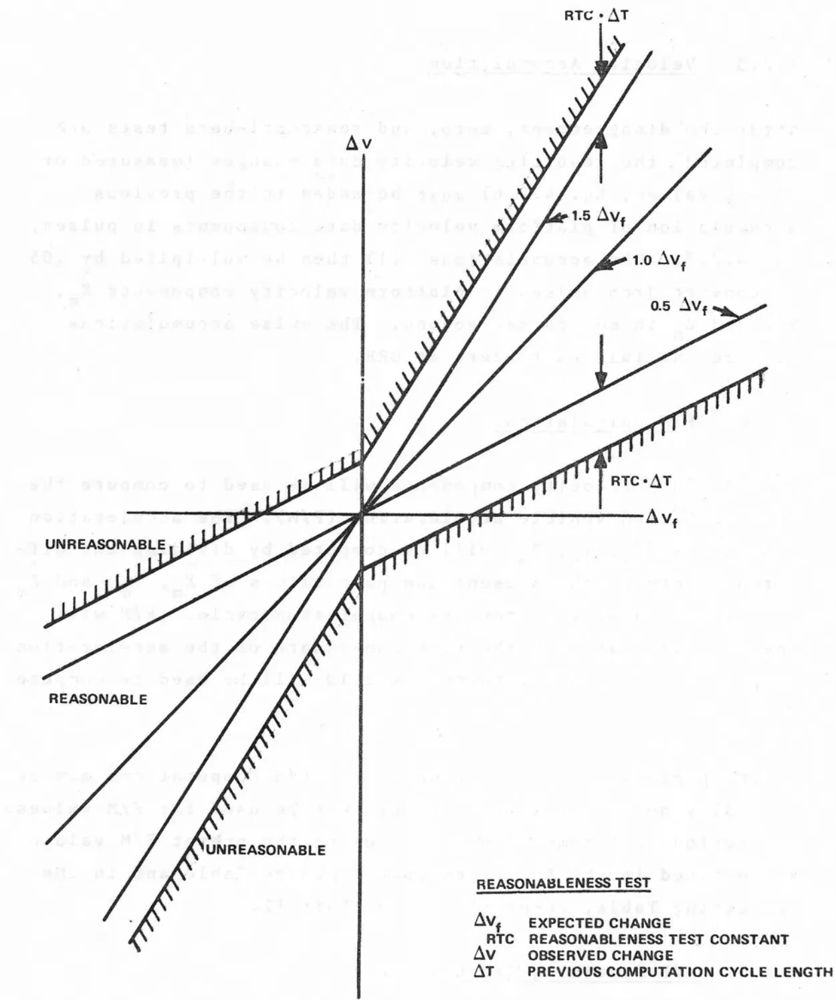
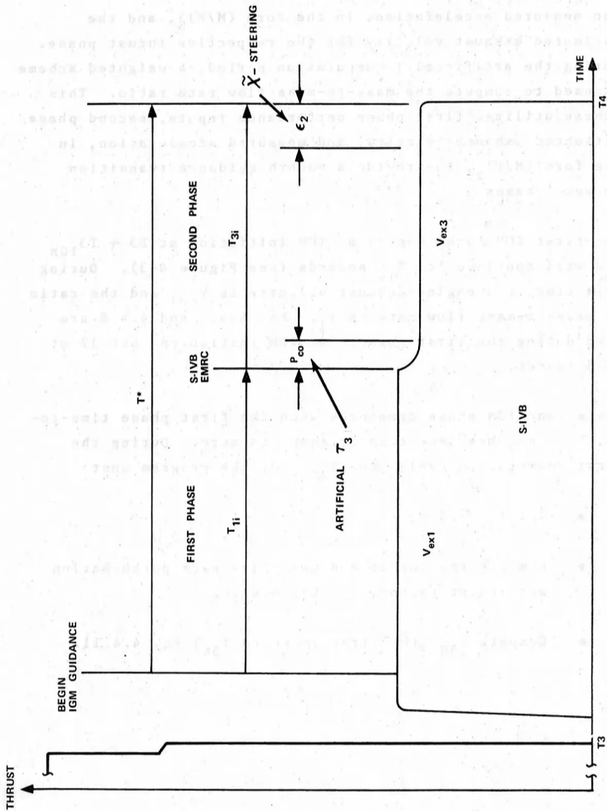

## SECTION 4

### BOOST NAVIGATION AND GUIDANCE

#### 4.1 INTRODUCTION

The boost mode of the Saturn IB flight program must provide navigation and guidance functions for the vehicle during periods when significant, measurable accelerations exist.

During the boost period, the flight program will navigate and guide the vehicle to the desired terminal conditions by performing the following functions in the given order:

1. 1. Read the accelerometers and process the data to obtain the measured velocity and acceleration resulting from engine thrust and aerodynamic forces. This will be done after flight initialization until  $T4 + BN_5$ .
2. 2. Navigate by determining the vehicle position and velocity from accelerometer data and gravitational acceleration based on a mathematical model of the earth's gravitational field. Boost navigation computations must be done after flight initialization until  $T4 + BN_5$ .
3. 3. Guide the vehicle by computing the guidance commands needed to steer the vehicle to the desired orbit. Boost guidance calculations must be made after flight initialization until  $T4 + 0.0$ .

1------------------------------------------------

A complete pass through the calculations outlined above plus discrete input checks, LVDC and LVDA telemetry, and minor loop support, as required, will constitute a boost major loop (BML) sequence. While the BML sequence is in progress, the minor loop functions (see Section 8) are processed once every 40 ms (unless interrupt-protected processing is under way). The minor loop will sample platform gimbal data, evaluate this data, and compute and issue attitude error commands for attitude control. The length of time,  $\Delta T$ , required by the computer to execute one complete BML sequence and the repetitive minor loop functions will be variable from pass to pass because of the varying program requirements throughout the boost period.

In addition, the program will perform flight sequencing functions and determine when to issue the S-IVB cutoff switch selector command.

## 4.2 ACCELEROMETER DATA DESCRIPTION

The flight program must read the velocity data measured by the platform accelerometers, test this data for accelerometer measurement errors, accumulate the measured platform velocity, and compute vehicle acceleration.

### 4.2.1 Accelerometer Data Format

Accelerometers on the inertial platform measure the vehicle velocity due to engine thrust and aerodynamic forces. An optisyn on each accelerometer produces two redundant pulse trains. These pulses (each representing .05 m/sec) are accumulated in delay lines in the LVDA. The contents of the delay lines must be read at the beginning of each BML to obtain the velocity data words. Each accelerometer data word contains the

2------------------------------------------------

redundant optisyn pulse counts in the following bit configuration: AAAAAAAAAAASSBBBBBBBBBBBBBB, where A represents the A-optisyn reading, B represents the B-optisyn reading, and S represents spare bits. The A and B readings must be separated and the differences between the current and past values for each reading must be computed. The resulting differences,  $\Delta A$  and  $\Delta B$  represent the measured velocity changes during the last BML. This process must be carried out for all three axes. The readings used to form the first changes must be established by reading the accelerometer data after flight initialization (see Section 3.3, Flight Program Initialization).

Approximately 0.6 milliseconds is required for the flight program to read and store the data from all three accelerometer channels and obtain a time reference. Since accuracy is not significantly degraded by ignoring this time differential, only one value of time associated with the accelerometer readings is required. The beginning of each BML will be defined by the real time reference taken immediately after the accelerometer data has been read and stored.

#### 4.2.2 Accelerometer Data Processing

The velocity data changes must be tested for errors using the disagreement, zero, and reasonableness tests. Erroneous changes must be replaced with computed backup values. These tests are designed only to detect gross errors in the formation of the velocity words. The tests do not correct or identify the error source, but prevent gross errors from causing corresponding large errors in the navigation and guidance quantities.

3------------------------------------------------

#### 4.2.2.1 Disagreement Test

The measured changes,  $\Delta A$  and  $\Delta B$ , for each axis must agree within two pulses (0.1 m/sec) (Eq. 4.2.1.1). If they agree, \*  $\Delta A$  will be used for the zero and reasonableness tests. If they differ by more than two pulses, the change closer to the expected change must be used (Eq. 4.2.2) for the zero and reasonableness tests. The appropriate bits of Mode Code 24 (MC24) (Table 11-13 of Section 11) must be set as indicated in Table 4-1 to denote the status of the accelerometer readings. When set, these bits must be telemetered once before being reset.

TABLE 4-1 ACCELEROMETER READING MC24 BIT STATUS

<table border="1">
<thead>
<tr>
<th>For the Z channel</th>
<th>Bit S</th>
<th>Bit 1</th>
</tr>
<tr>
<th>For the X channel</th>
<th>Bit 2</th>
<th>Bit 3</th>
</tr>
<tr>
<th>For the Y channel</th>
<th>Bit 4</th>
<th>Bit 5</th>
</tr>
</thead>
<tbody>
<tr>
<td colspan="3">Indication</td>
</tr>
<tr>
<td>Nominal (<math>\Delta A</math> in use)</td>
<td>0</td>
<td>0</td>
</tr>
<tr>
<td>Disagreement; <math>\Delta A</math> in use</td>
<td>0</td>
<td>1</td>
</tr>
<tr>
<td>Disagreement; <math>\Delta B</math> in use</td>
<td>1</td>
<td>0</td>
</tr>
<tr>
<td>Unreasonable; Backups in use</td>
<td>1</td>
<td>1</td>
</tr>
</tbody>
</table>

Expected velocity data changes ( $\Delta A$  and  $\Delta B$ ) used in the disagreement test will be obtained by resolving, through the measured gimbal angles, the total acceleration, F/M (or its preset value during periods of erratic performance), obtained from the previous BML. The resulting acceleration components must be multiplied by the previous computation cycle length and the reciprocal of the accelerometer scale factor (which converts the data from meters per second to pulses) to

4------------------------------------------------

produce the expected changes. Eq. 4.2.1 will be used to compute the expected changes. (If the backup values for acceleration are being used, use Eq. 4.2.14).

#### 4.2.2.2 Zero Test

Since an unchanging accelerometer output during propulsive boost periods is an identifiable failure mode, the velocity data changes selected by the disagreement test must be zero tested. During boost periods when zero readings are expected, for example during staging, the zero test will be disabled. All changes greater than one pulse are considered non-zero and must be tested immediately for reasonableness. \*

A change of zero or one pulse must be accepted if the zero test is disabled (no significant engine thrust is expected), or if the absolute value of the expected change is less than or equal to  $A_{c0}$  (the estimated uncertainty in the expected change computation due to thrust misalignments) (Eq. 4.2.2.1). A zero change is unacceptable if the zero test is enabled (significant engine thrust is expected) and the expected change is greater than  $A_{c0}$ . Eq. 4.2.3 will be used to compute  $A_{c0}$ . The equation containing the  $\sin(2^\circ)$  must be used except when an indication of an S-IB engine failure has been received. The equation containing  $\sin(6^\circ)$  will then be used from the time an S-IB engine failure is detected until stage cutoff. Bit 18 of MC24 must be set to indicate when the equation containing  $\sin(6^\circ)$  is in use. The times to enable and disable the zero test are also defined in the Event Sequence Timeline Table of Part II. \*

All acceptable zero changes must be tested for reasonableness. If a zero change is unacceptable, it must be replaced by a backup value derived from the  $(F/M)_c$  acceleration profile and bit 22, 23, or 19 and either bits S & 1, 2 & 3, or 4 & 5 of

5------------------------------------------------

MC24 must be set to denote an unacceptable zero reading in the Z, X, or Y channel, respectively. During periods of unacceptable zero changes, SMC calculations must be inhibited. \*

#### 4.2.2.3 Reasonableness Test

A velocity data change selected by the disagreement and zero test will be judged reasonable if it falls within a band of  $\pm 50$  percent of the expected change, enlarged by a reasonableness test constant (RTC) multiplied by  $\Delta T$ . The RTC, which may be different for each axis, is multiplied by the previous computation cycle length,  $\Delta T$ , obtained by measuring the time between BML accelerometer readings to adjust the reasonableness bounds for variations in the interval between accelerometer readings. The RTC serves two purposes. The nominal value provides a non-zero tolerance when the expected change is near zero. The large value provides a wide tolerance during portions of flight when sudden changes in acceleration may legitimately occur. \*

Eq. 4.2.4 or 4.2.5 will be used to determine the reasonableness of a measured change. Figure 4-1 illustrates the accelerometer reasonableness test boundary. The RTC values for all periods of flight are defined in the Event Sequence Timeline Table of Part II.

If a measured change fails to pass the reasonableness test, it must be replaced (Eq. 4.2.6) by a backup value derived from the  $(F/M)_c$  acceleration profile (see Section 4.2.6), and the appropriate bits of MC24 must be set to denote the unreasonable accelerometer reading. The calculation of SMC terms must be inhibited while the accelerometer reading remains unreasonable. Bit assignments are given in Section 4.2.2.1. \*

6------------------------------------------------

The figure is a graph with the vertical axis labeled  $\Delta V$  and the horizontal axis labeled  $\Delta V_f$ . The origin is the intersection of the axes. Several lines originate from the origin, representing different expected change values. The lines are labeled as follows:

- A line with a slope of  $1.5 \Delta V_f$ .
- A line with a slope of  $1.0 \Delta V_f$ .
- A line with a slope of  $0.5 \Delta V_f$ .
- A horizontal line labeled  $\Delta V_f$ .
- A line with a slope of  $0.5 \Delta V_f$  in the third quadrant.
- A line with a slope of  $1.0 \Delta V_f$  in the third quadrant.
- A line with a slope of  $1.5 \Delta V_f$  in the third quadrant.

Regions are labeled as follows:

- The region between the  $1.5 \Delta V_f$  and  $0.5 \Delta V_f$  lines in the first quadrant is labeled **REASONABLE**.
- The regions outside these lines are labeled **UNREASONABLE**.
- Specific points on the boundary lines are marked with arrows and labeled  $RTC \cdot \Delta T$ .

**REASONABLENESS TEST**

<table border="0">
<tr>
<td><math>\Delta V_f</math></td>
<td>EXPECTED CHANGE</td>
</tr>
<tr>
<td>RTC</td>
<td>REASONABLENESS TEST CONSTANT</td>
</tr>
<tr>
<td><math>\Delta V</math></td>
<td>OBSERVED CHANGE</td>
</tr>
<tr>
<td><math>\Delta T</math></td>
<td>PREVIOUS COMPUTATION CYCLE LENGTH</td>
</tr>
</table>

Figure 4-1 Accelerometer Reasonableness Test Boundary

7------------------------------------------------

#### 4.2.3 Velocity Accumulation

After the disagreement, zero, and reasonableness tests are completed, the resulting velocity data changes (measured or backup values, Eq. 4.2.6) must be added to the previous accumulation of platform velocity data components in pulses, Eq. 4.2.7. The accumulations will then be multiplied by .05 to convert from pulses to platform velocity components  $X_m$ ,  $Y_m$ , and  $Z_m$  in meters per second. The pulse accumulations must be initialized to zero at GRR.

#### 4.2.4 F/M Calculations

The platform velocity components will be used to compute the total measured vehicle acceleration (F/M). The acceleration components ( $X_m$ ,  $Y_m$ ,  $Z_m$ ) will be computed by dividing the difference between the present and past values of  $X_m$ ,  $Y_m$ , and  $Z_m$  by the length of the previous computation cycle. F/M will then be calculated as the root-sum-square of the acceleration components. Eq. 4.2.8 through 4.2.10 will be used to compute F/M.

During periods of flight in which the F/M computations may be unusually noisy, preset constants must be used for F/M values. The periods for computing F/M or using the preset F/M values are defined in the Event Sequence Timeline Table and in the Presetting Table, respectively, of Part II.

#### 4.2.5 M/F Smoothing Calculations

The smoothed reciprocal value of the measured vehicle acceleration,  $(M/F)_s$ , is required for use in IGM because the measured acceleration, F/M, may be oscillatory or noisy and cause errors in the attitude command computations.

8------------------------------------------------

The difference equation representation of the smoothed reciprocal acceleration,  $(M/F)_S$ , is of the form of Eq. 4.2.11 where  $(M/F)_1$  is the present value and  $(M/F)_2$ ,  $(M/F)_3$ , and  $(M/F)_4$  are the past three values of  $M/F$  and  $(M/F)_{S1}$ ,  $\dots$ ,  $(M/F)_{S4}$  are the past four values of  $(M/F)_S$ .

The values for  $(M/F)_1$ ,  $\dots$ ,  $(M/F)_4$ ,  $(M/F)_{S1}$ ,  $\dots$ ,  $(M/F)_{S4}$  are all initialized to  $(M/F)_0$  at or before  $T3 + 0.0$ . The  $(M/F)_S$  calculations must start at  $T3 + T3_{FM}$ , before the initiation of IGM calculations. By starting the  $(M/F)_S$  computations prior to IGM initiation, any performance adjustments of  $(M/F)_S$  due to the presetting  $(M/F)_0$  will be made. Once  $(M/F)_S$  computations begin, values of  $M/F$  and  $(M/F)_S$  calculated on succeeding passes replace the initial values. Four computation cycles are required before all initial values of  $M/F$  and  $(M/F)_S$  are replaced by computed values. The initial value for  $M/F$  and the time to initiate  $(M/F)_S$  computations are defined in the Presetting Table and the Event Sequence Timeline Table, respectively, of Part II.

The magnitude of  $(M/F)_S$  must be limited to  $0.25 \text{ sec}^2/\text{m}$ , and the magnitude of the rate of change must be limited to  $0.005 \text{ sec}^2/\text{m}$  per BML to further prevent noise and acceleration transients from being introduced into the guidance commands.

#### 4.2.6 $(F/M)_c$ Acceleration

Backup acceleration data is derived by resolving the predicted longitudinal acceleration,  $(F/M)_c$ , through the measured gimbal angles. This acceleration is computed from prestored force, mass, and mass flow rate values based on vehicle performance predictions. These values must be changed several times during the mission to represent all stages and thrust levels. The times to change these values are defined in the Event Sequence

9------------------------------------------------

Timeline Table of Part II. During Time Base 1, the force and mass flow rate values must be decreased by 12.5 percent (for the first engine failure only) when the failure is detected.

The initial mass values represent the predicted vehicle mass at the predicted time of 90 percent stage thrust. The force and mass flow rate values represent the average force and mass flow rate values over thrust intervals when the predicted thrust performance is 90 percent or better. These force and mass flow rate values are biased to ensure that satisfactory orbital conditions are achieved in the event of accelerometer failures.

Eq. 4.2.12 and 4.2.13 will be used to compute the backup acceleration. The prestored values of force, mass, and mass flow rate for all boost phases are defined in the Presetting Table of Part II.

#### 4.3 BOOST NAVIGATION

The flight program must determine the vehicle position, velocity, and gravitational acceleration relative to the plumbline coordinate system. During boost, a trapezoidal integration scheme is used to compute position and velocity components, and a gravitational acceleration model is used to compute the components of gravitational acceleration.

##### 4.3.1 Integration

The trapezoidal integration scheme determines the vehicle position and velocity from initial conditions, accelerometer data, and earth gravitation.

10------------------------------------------------

Position must be computed each BML by summing the previous position with the change in position over the last BML computed as a function of the initial velocity, the average platform acceleration over the past BML, and the vehicle velocity and acceleration changes due to earth gravitation. This position is then used to compute the present gravitational acceleration components.

To minimize navigation errors, the computations of position must be performed with extra computer precision. This is accomplished by saving all bits which would otherwise be truncated in rescaling of LVDC words representing changes in position.

The vehicle velocity components are computed by summing the platform velocity, the initial velocity, and the velocity due to earth gravitation. The velocity components due to earth gravitation must be computed as the accumulation of the velocity changes over the previous BML due to gravitational acceleration.

Eq. 4.3.1 through 4.3.5 will be used to compute the components of position and velocity in the plumbline coordinate system. The total space-fixed velocity of the vehicle must be computed using Eq. 4.3.5.1.

#### 4.3.2 Gravitational Acceleration

The potential function of the earth which is used to model the gravitational acceleration is defined by Eq. 4.3.6 through 4.3.111. However, during boost, only Eq. 4.3.6, 4.3.7, 4.3.10, and 4.3.11 are used. The values of the terms  $S_{34}$  and  $P_{34}$  are set to zero during this period. The accuracy of the boost

---

1"Natural Environment and Physical Standards for the Apollo Program," NASA, M-DE8020.008B, April 1965.

11------------------------------------------------

navigation integration scheme is not significantly degraded by neglecting the third and fourth terms in the potential expansion.

The gravitational acceleration vector  $\overline{G}_S$  is calculated by Eq. 4.3.12.

The calculation of gravitation acceleration is a three-step process. First, the present vehicle position is used to compute  $Y_G$ , the perpendicular distance from the vehicle to the equatorial plane. Next, gravitational acceleration is computed from a zonal harmonic expansion of the earth's potential. To assure sufficient accuracy in the computation of this expansion, the reciprocal square root algorithm must be used to calculate the inverse geocentric radius from the plumbline position coordinates. Finally, this gravitational acceleration is transformed into plumbline coordinate frame components.

#### 4.4 BOOST GUIDANCE

The flight program must generate steering commands necessary to guide the launch vehicle to desired orbital conditions. During the first stage burn a time dependent guidance scheme (independent of effects caused by the guidance commands) is required. A closed loop guidance scheme is required for the second powered stage of the launch vehicle. The closed loop scheme, IGM, is dependent upon effects caused by the guidance commands, and is therefore path-adaptive.

A summary of the boost guidance timeline is given in Figure 4-2.

12------------------------------------------------

![A timeline diagram showing the Boost Guidance process across three axes: Xz, Xy, and Xx. The vertical axis represents TIME, with markers for T0, T1, ~T1+11, ~T1+12, ~T1+38, T1+Tar, T3+T3IGM, and Tco. The Xz column shows states like Xz=0, Xz=g(t), and Xz=LAST COMPUTED. The Xy column shows states like Xy=0, Xy=f(t), and Xy=LAST COMPUTED. The Xx column shows states like Xx=θx and Xx=0. Maneuvers (Yaw, Pitch, Roll) and IGM Guidance are indicated at specific time points. Asterisks (*) are placed at the right margin for certain time points.](df42528039853cad8d1437ff67972630_1_img.webp)

The figure is a vertical timeline diagram titled "Boost Guidance Timeline". It is organized into three columns representing different axes:  $X_z$ ,  $X_y$ , and  $X_x$ . A vertical arrow on the left points downwards, labeled "TIME".

- **Time Markers (from top to bottom):**
  - $T_0$
  - $T_1$
  - $\approx T_1+11$
  - $\approx T_1+12$
  - $\approx T_1+38$
  - $T_1+T_{ar}$
  - $T_3+T_{3IGM}$
  - $T_{co}$
- **$X_z$  Column:**
  - At  $T_0$ :  $X_z = 0$
  - Between  $T_1$  and  $\approx T_1+11$ :  $X_z = g(t)$
  - At  $\approx T_1+38$ : **YAW MANEUVER**
  - At  $T_1+T_{ar}$ :  $X_z = \text{LAST COMPUTED}$ ,  $X_z = g(t)$
  - At  $T_3+T_{3IGM}$ :  $X_z \text{ FROM IGM}$
  - At  $T_{co}$ :  $X_z = \tilde{X}_z$ ,  $X_z = X_z \text{ CO}$
  - Between  $T_3+T_{3IGM}$  and  $T_{co}$ : **IGM YAW GUIDANCE**
- **$X_y$  Column:**
  - At  $T_0$ :  $X_y = 0$
  - Between  $T_1$  and  $\approx T_1+11$ :  $X_y = f(t)$
  - At  $\approx T_1+38$ : **PITCH MANEUVER**
  - At  $T_1+T_{ar}$ :  $X_y = \text{LAST COMPUTED}$ ,  $X_y = f(t)$
  - At  $T_3+T_{3IGM}$ :  $X_y \text{ FROM IGM}$
  - At  $T_{co}$ :  $X_y = \tilde{X}_y$ ,  $X_y = X_y \text{ CO}$
  - Between  $T_3+T_{3IGM}$  and  $T_{co}$ : **IGM PITCH GUIDANCE**
- **$X_x$  Column:**
  - At  $T_0$ :  $X_x = \theta_x$
  - Between  $T_1$  and  $\approx T_1+11$ :  $X_x = 0$
  - At  $\approx T_1+38$ :  $X_x = 0$
  - Between  $T_3+T_{3IGM}$  and  $T_{co}$ : **ROLL MANEUVER**
- **Asterisks (\*):**
  - At  $\approx T_1+12$
  - At  $\approx T_1+38$
  - At  $T_1+T_{ar}$
  - At  $T_3+T_{3IGM}$

Figure 4-2 Boost Guidance Timeline

13------------------------------------------------

#### 4.4.1 First Stage Guidance

From GRR to T3 + 0.0 the flight program must generate guidance commands to insure that the launch vehicle aligns along the platform azimuth, and flies a preprogrammed time tilt profile along the specified azimuth.

##### 4.4.1.1 Roll Maneuver

At liftoff, the inertial platform Z axis is aligned with the platform azimuth (see Section 3); the vehicle  $Z_B$  axis is aligned 90 degrees East of North. To maintain these relationships, the  $\chi_x$  guidance command is initialized and maintained at the last roll gimbal angle  $|\theta_x|$  read in the Prepare to Launch (PTL) program.

When the vehicle has cleared the LUT (when  $(X_S - \text{initial } X_S) \geq \text{GANTRY}$ ) (primary requirement), or alternatively when  $T_c \geq T_{S0}$  \*  
(backup requirement), the roll maneuver begins. The  $\chi_x$  guidance \*  
command is set to zero to align the vehicle to the proper flight azimuth and bit 2 of MC25 is set. The parameter  $T_c$  is the time from T1 biased by the constant  $T_d$  to compensate for delays between computing and commanding the attitude, Eq. 4.4.1. When  $|\theta_x| \leq 0.5$  degrees the roll maneuver is considered to be complete and \*  
bit 3 of MC25 is set.

##### 4.4.1.2 Time Tilt Pitch Guidance

The time tilt pitch maneuver is begun under the same criteria as those for the roll maneuver. When the vehicle has cleared the LUT (when  $X_S - (\text{initial } X_S) \geq \text{GANTRY}$ ), or alternatively when  $T_c \geq T_{S0}$ , computations of  $\chi_y$  begin.

The  $\chi_y$  guidance commands are computed as a function of time ( $T_c$ ) by a third-degree polynomial. The time profile for the pitch program is divided into three segments and Eq. 4.4.2 is used to compute the time tilt pitch commands during the indicated segments.

14------------------------------------------------

The minor loop attitude command  $\chi'_y$  time function must lie within a  $\pm 0.1$  degree band of the preprogrammed time tilt pitch profile, except for two BML's beginning at time tilt initiation and in the BML in which TB2 is initiated. In these two instances, the tolerance requirement may be relaxed to  $\pm 0.12$  degrees.

The time tilt continues until  $T_c \geq T_{ar}$ . At this time, bit 5 of MC25 is set and guidance commands are frozen until IGM initiation. If time tilt has not been arrested by  $T3 + 0.0$ , it is arrested after that time, guidance commands are frozen, and bit 5 of MC25 is set.

#### 4.4.1.3 Time Tilt Yaw Guidance \*

The yaw guidance commands ( $\chi_z$ ) must be computed as a tabular function of time ( $T_c$ ). Capability must be provided to store 25 values of time and 25 values of  $\chi_z$  corresponding to the stored times. The time and yaw commands are stored in tables TYAW and YAWC respectively. The yaw guidance command must be computed using Eq. 4.4.2.1. \*

#### 4.4.1.4 Engine Out Guidance Modifications \*

During the time interval from  $T1 + T_{S1E0}$  to  $T3 - 0.0$ , the program has provisions to detect both an outboard and an inboard engine failure. Engine out processing requirements are detailed below and are summarized in Figure 4-3. DI14 (outboard failure) and DI15 (inboard failure) are checked during that time to determine if an S-IB engine failure has occurred. Once either discrete is detected, further interrogation of that discrete is disabled. \*

15------------------------------------------------

Upon detection of either discrete, the corresponding S-IB engine failure will be assumed. Program modification, however, is limited to the first detected engine failure. For that first failure the engine failure time,  $T_{E0}$ , is set (Eq. 4.4.3).

For the first S-IB engine failure that occurs in Time Base 1, The  $\chi_y$  guidance command is frozen for a specified length of time,  $\Delta T_f$ , which is a function of the engine failure time  $T_{E0}$ , Eq. 4.4.3. To accomplish the  $\chi$  freeze, the  $\chi_y$  computations are inhibited for  $\Delta T_f$  seconds, and the last computed  $\chi_y$  is used as the current guidance command. All  $\chi_y$  guidance command freezes due to S-IB engine failures are delayed until  $T_c \geq T_{T2}$ . When the freeze period is completed,  $T_c \geq T_{MEFRZ}$ , the time tilt profile resumes. The time to end the  $\chi_y$  freeze,  $T_{MEFRZ}$ , is computed in Eq. 4.4.5. The time to arrest the guidance commands,  $T_{ar}$ , is modified by  $\Delta T_f$  and  $C_{arl}$  (Eq. 4.4.6) for the first S-IB engine failure detected. \*

#### 4.4.1.3.1 Engine Out Responses In Time Base 1

The flight program responses to S-IB engine failures in Time Base 1 are as follows:

- • The time tilt computations are modified as described above for the first engine out only.
- • The accelerometer backup parameters ( $\dot{M}_1$ ,  $F_1$ ) are adjusted to 7/8 of their preset value for the first failure only.
- • The  $\sin(6^\circ)$  is substituted for  $\sin(2^\circ)$  in the zero test computation, Eq. 4.2.3, until  $T3 + 0.0$ .
- • Bit 8 of MC25 is set upon detection of DI15, and bit 9 of MC25 is set upon detection of DI14.

16------------------------------------------------

S-IB CONTINGENCY ENGINE FAILURE CAPABILITY

The diagram illustrates the logic for S-IB Contingency Engine Failure Capability. It features eight inputs labeled ENG. 1 TOK through ENG. 8 TOK. These inputs are connected to two OR gates, DI14 and DI15. The outputs of these OR gates are fed into a dashed box representing the S-IB Contingency logic. Inside this box, the logic is as follows:

- **SINGLE ENGINE CUTOFF ENABLE COMMAND (T1 + 5.8 SEC):** This logic is triggered by the output of OR gate DI14 and is connected to a zero-test output.
- **ADJUST THRUST MISALIGNMENT FACTOR IN ACCEL. ZERO TEST:** This logic is triggered by the output of OR gate DI14 and is connected to a zero-test output.
- **ADJUST TIME TILT (TILT ARREST AND CHI FREEZE):** This logic is triggered by the output of OR gate DI14 and is connected to a zero-test output.
- **MODIFY (F/M)c TO 7/8 NOMINAL VALUE:** This logic is triggered by the output of OR gate DI15 and is connected to a zero-test output.
- **Timing Constraints:**
  - **T3 + 0.0:** A timing constraint associated with the tilt arrest logic.
  - **TB2:** A timing constraint associated with the nominal value modification logic.

Figure 4-3 S-IB Contingency Engine Failure Capability

17------------------------------------------------

(THIS PAGE HAS BEEN LEFT BLANK INTENTIONALLY)

I-4-16b

Rev. A

18------------------------------------------------

#### 4.4.1.3.2 Engine Out Responses In Time Base 2

The flight program responses to S-IB engine failures in Time Base 2 are as follows:

- • The time tilt computations and the accelerometer backup parameters ( $\dot{M}_1$ ,  $F_1$ ) are not adjusted.
- • The  $\sin(6^\circ)$  is substituted for  $\sin(2^\circ)$  in the zero test computation, Eq. 4.2.3, until  $T3 + 0.0$  for an outboard failure only. No zero test substitution is made for inboard failures during TB2.
- • Bit 8 of MC25 is set upon detection of DI15, and bit 9 of MC25 is set upon detection of DI14.

#### 4.4.1.3.3 Inboard Engines Cutoff Responses

The flight program responses to S-IB inboard engines cutoff are as follows:

- • The time tilt computations are not adjusted.
- • The accelerometer backup parameters ( $\dot{M}_1$ ,  $F_1$ ) are adjusted to one-half nominal S-IB accelerometer backups. Because of the small time remaining in the S-IB burn it is not necessary to adjust the accelerometer backup parameters further at this time to account for a previous outboard engine out.
- • No zero test substitution is made.
- • Bit 8 of MC25 is set upon detection of DI15.

19------------------------------------------------

#### 4.4.2 IGM Guidance

The Iterative Guidance Mode (IGM) is a path-adaptive guidance scheme which steers along a nearly optimal path toward pre-specified terminal conditions.2 The scheme is designed specifically for powered flight in a vacuum, with multiple distinct thrust levels (phases). The solutions of the fundamental equations of IGM approximate the solutions of the calculus of variations problem of selecting a minimum fuel trajectory to specified end conditions, given engine performance.

##### 4.4.2.1 General Description of IGM

IGM will generate pitch and yaw steering commands by repeatedly solving (iterating) the thrust vector steering law  $\chi = a + bt$  (where  $\chi$  is the steering command,  $a$  and  $b$  are constants, and  $t$  is time), which is approximately the optimum steering function for planar motion of a point mass.

The guidance commands enable a nominal vehicle to attain desired terminal conditions with nearly maximum payload. In addition, since vehicle performance is often non-nominal, the scheme adapts itself to perturbations (by observing the vehicle state variables) while still maintaining terminal accuracy and also an optimum path adaptive trajectory.

The IGM scheme performs two general functions: guidance computations and phasing. The IGM guidance computations provide commands which facilitate steering the vehicle to the desired orbit using navigation variables (position, velocity, acceleration), time, desired terminal conditions, and vehicle performance

---

2"General Formulation of the Iterative Guidance Mode,"  
NASA TM X-53414, 22 March 1966.

20------------------------------------------------

data. The desired orbit is uniquely determined by inclination and descending node, which define the orbital plane, and the end conditions ( $R_T$ ,  $V_T$ ,  $\theta_T$ ) which determine the shape of the orbit.

IGM phasing selects which representative preset thrust level approximates actual vehicle performance, selects the appropriate preset value of the ratio of mass-to-mass flow rate ( $\tau$ ), and estimates the times-to-go until expected changes occur in the thrust level performance. For the Saturn IB vehicle configuration and mission profile, there will be provisions for two distinct thrust levels for the S-IVB burn.

#### 4.4.2.2 Basic IGM Guidance Calculations

The guidance commands required to steer the vehicle into the desired orbit are calculated one time during each BML from the following basic information: time-to-go predictions and mass-to-mass flow rate ratios for each IGM phase, the current instantaneous vehicle navigation variables, and the desired terminal conditions. IGM calculations are performed relative to the target plane and injection coordinate systems and then rotated into the inertial coordinate system for attitude control.

This section delineates the basic IGM guidance equations for application to the two-phase, boost-to-orbit burn. Specifications for sequencing IGM are given in Section 4.4.2.3, Basic IGM Phasing.

Before commencing the two-phase, boost-to-orbit IGM calculations, it is necessary to assign values (presettings) to the following items: time-to-go for each phase ( $T_{1i}$ ,  $T_{3i}$ ); engine exhaust velocity for each phase ( $V_{ex1}$ ,  $V_{ex3}$ ); and nominal mass-to-mass flow rate ratio for each phase ( $\tau_{10}$ ,  $\tau_3$ ). The nominal time of EMRC ( $T_{10}$ ) must be set to the preset value of  $T_{1i}$ .

21------------------------------------------------

The functional representation of this scheme is as follows:

1. 1. The time-to-go and  $\tau$  values for the prevailing IGM phase are determined. (The equations and logic necessary to accomplish this are specified in Section 4.4.2.3, Basic IGM Phasing.)
2. 2. Vehicle position and velocity vector components are calculated relative to the target plane system (Eq. 4.4.18 and 4.4.19).
3. 3. A group of intermediate parameters is calculated (Eq. 4.4.20 through 4.4.28). These relate position and velocity-to-be-gained vectors to current vehicle performance.
4. 4. A total time-to-go to cutoff prediction ( $T^*$ ) is calculated by summing the predicted time remaining in the IGM phases (Eq. 4.4.29).
5. 5. The current range angle ( $\phi_i$ ) is calculated from the position vector components in the target plane system (Eq. 4.4.30).
6. 6. The terminal range angle ( $\phi_T$ ) is predicted from vehicle state variables, projected future performance, and desired terminal conditions (Eq. 4.4.31 through 4.4.33).
7. 7. The components of the desired terminal position, velocity, and gravity vectors are obtained by orienting the injection system so that the terminal position vector is coincident with the  $X_V$  axis (Eq. 4.4.34 through 4.4.41).

22------------------------------------------------

1. 8. The current position, velocity, and gravitational acceleration vectors,  $\bar{R}$ ,  $\bar{V}$ , and  $\bar{G}$ , respectively) are transformed to the injection system (Eq. 4.4.42 through 4.4.45).
2. 9. An estimated velocity-to-be-gained vector ( $\overline{\Delta V_V}$ ) is computed. This is done by computing an estimated gravitational acceleration vector ( $\overline{G_V^*}$ ) for the remaining flight time (Eq. 4.4.46). The estimated velocity-to-be-gained vector is then computed by subtracting the current acquired velocity vector and the vector representing the velocity loss during the remaining time due to gravitational acceleration from the desired terminal velocity vector (Eq. 4.4.47).
3. 10. Eq. 4.4.20 through 4.4.47 are based on a time-to-go value which is computed neglecting vehicle performance during the previous BML. To compensate for actual vehicle performance in the previous BML, improved estimates for  $L_3$ ,  $T_{3i}$ , and  $T^*$  are computed (Eq. 4.4.48 through 4.4.50, 4.4.52, and 4.4.53).
4. 11. An improved estimate of the velocity-to-be-gained is then made, based on the new  $T^*$  and the estimated average gravitational acceleration (Eq. 4.4.54).
5. 12. Preliminary guidance commands, velocity constrained, relative to the target plane system are calculated (Eq. 4.4.55 and 4.4.56).

23------------------------------------------------

13. In order to generate guidance commands which satisfy the position constraints while meeting the necessary velocity constraint, position correction terms must \* be computed and added to the velocity constraint \* guidance commands. (See Eq. 4.4.51 and 4.4.57 through \* 4.4.80.)

14. Guidance commands which will cause the vehicle to satisfy both the position and velocity constraints must then be computed in the target plane system by \* summing the commands needed to satisfy the constraints separately. (See Eq. 4.4.81 and 4.4.82.)

This completes a single iteration of the basic IGM calculations. These guidance commands in the 4-system are rotated into the inertial system, are combined with the thrust misalignment correction terms, rate and magnitude limited, and finally issued to the vehicle control system (see Eq. 4.4.83 through 4.4.87).

#### 4.4.2.3 Basic IGM Phasing

The implementation of IGM for Saturn IB missions is based on the assumption that these are two IGM phases (distinct and nearly constant thrust levels) separated by an S-IVB engine mixture ratio change (EMRC). IGM phasing calculations and logic must determine which parameters represent vehicle per- \* formance and the sequencing of IGM calculations.

A graphical presentation of the nominal IGM profile is given \* in Figure 4-4.

The most critical quantities for the successful and accurate execution of IGM are the time-to-go values and the mass-to-mass flow rate ratios for each thrust phase and during the artificial

24------------------------------------------------

The figure is a graph titled "Nominal Boost-to-Orbit IGM Profile". The vertical axis is labeled "THRUST" and the horizontal axis is labeled "TIME". The graph shows a thrust profile over time, divided into several phases and segments:

- **BEGIN IGM GUIDANCE:** The initial phase of the mission.
- **FIRST PHASE:** A segment of duration  $T_{1i}$  starting at time  $T^*$ .
- **SECOND PHASE:** A segment of duration  $T_{3i}$  starting at time  $T^*$ .
- **S-IVB EMRC:** A point on the time axis where the thrust profile begins to rise.
- **ARTIFICIAL  $\tau_3$ :** A segment of the thrust profile.
- **$P_{co}$ :** A point on the thrust profile.
- **$\tilde{X}$ -STEERING:** A point on the thrust profile.
- **$\epsilon_2$ :** A point on the thrust profile.
- **$V_{ex1}$  and  $V_{ex3}$ :** Two segments of the thrust profile, with  $V_{ex3}$  being a higher level than  $V_{ex1}$ .
- **S-IVB:** A segment of the mission.
- **$T_3$  and  $T_4$ :** Points on the time axis marking the end of the thrust profile.

Figure 4-4 Nominal Boost-to-Orbit IGM Profile

25------------------------------------------------

$\tau$  computation period. These quantities are computed from the measured acceleration, in the form  $(M/F)_S$ , and the estimated exhaust velocity for the respective thrust phase. During the artificial  $\tau$  computation period, a weighted scheme is used to compute the mass-to-mass flow rate ratio. This scheme utilizes first phase performance inputs, second phase estimated exhaust velocity, and measured acceleration, in the form  $(M/F)_S$ , to provide a smooth guidance transition between phases. \*

The first IGM phase begins at IGM initiation at  $T3 + T3_{IGM}$  and will continue for  $T_{10}$  seconds (see Figure 4-3). During this time, the engine exhaust velocity is  $V_{ex1}$  and the ratio of mass-to-mass flow rate is  $\tau_1$ . Eq. 4.4.7 and 4.4.8 are used during the first phase. At IGM initiation, bit 12 of MC25 is set.

The second IGM phase commences when the first phase time-to-go,  $T_{1i}$ , becomes less than or equal to zero. During the first computation cycle when  $T_{1i} \leq 0$ , the program must:

- • Set  $T_{1i} = 0.0$ , Eq. 4.4.9
- • Compute the thrust and mass flow rate perturbation adjustment factor,  $\alpha_f$ , Eq. 4.4.10.
- • Compute  $\tau_{3N}$  (the first guess to  $\tau_{3K}$ ) Eq. 4.4.11.

26------------------------------------------------

- • Set bit 13 of MC25.
- • Start computing the IGM real  $\tau$ ,  $\tau_{3M}$ , by Eq. 4.4.12.
- • Start computing artificial  $\tau$ ,  $\tau_{3K}$ , Eq. 4.4.13.
- • Start computing  $\tau_3$  using a weighting scheme on  $\tau_{3K}$  and  $\tau_{3M}$  to provide a smooth transition at the end of the artificial  $\tau_3$  mode, Eq. 4.4.14.

During the next BML and every BML thereafter until the time elapsed since EMRC,  $P_C$  (Eq. 4.4.15), becomes greater than the preset length of time for artificial  $\tau_3$ ,  $P_{CMR}$ , the program must:

- • Compute a predicted second phase IGM time-to-go ( $T_{3i}$ ) by decrementing the last corrected  $T_{3i}$  by  $\Delta T$  each pass, Eq. 4.4.17.
- • Calculate the IGM real  $\tau$ ,  $\tau_{3M}$ , Eq. 4.4.12
- • Calculate artificial  $\tau$ ,  $\tau_{3K}$ , Eq. 4.4.13
- • Compute  $\tau_3$  using a weighting scheme on  $\tau_{3K}$  and  $\tau_{3M}$  to provide a smooth transition at the end of the artificial  $\tau_3$  mode, Eq. 4.4.14.

At the end of the artificial  $\tau_3$  mode, the second phase of IGM continues, using the actual  $\tau_3$  based on  $(M/F)_S$ , Eq. 4.4.16. The predicted second phase IGM time-to-go ( $T_{3i}$ ) is computed by decrementing the last corrected  $T_{3i}$  by  $\Delta T$  each pass. The second phase of IGM, using an exhaust velocity  $V_{ex3}$ , continues until S-IVB cutoff.

27------------------------------------------------

#### 4.4.2.4 Terminal Steering and Cutoff

When the corrected  $T_{3i}$  becomes less than or equal to  $\epsilon_2$ ,  $\tilde{X}$ -steering will commence. Bit 22 of MC25 is set at this time. The position constraints are neglected. The position correction terms in Eq. 4.4.81 and 4.4.82 ( $K_1$ ,  $K_2$ ,  $K_3$ ,  $K_4$ ) are set to zero. This keeps the guidance equations from becoming unstable and permits the vehicle to achieve the desired terminal velocity more accurately.

In preparation for cutoff, the velocity history table for the S-IVB and the calculation of the high speed loop time bias ( $\Delta T_b$ ), Eq. 4.4.88, begins when the predicted  $T_{3i} \leq BN_1$ .

To ensure that the precise velocity required to inject the vehicle into the desired orbit is achieved, a precise prediction of when to issue the S-IVB cutoff switch selector commands \* is made. These switch selectors form a Class 1 alternate se- \* quence. See Section 9.4.1. To increase the accuracy of the cutoff prediction, a reduction in program functions is made while predicting the S-IVB cutoff time. The essential functions, which comprise the high speed loop (HSL) are:

- • Accelerometer processing
- • Boost Navigation
- • S-IVB Cutoff backup processing
- • Recognition of INT4, INT6, INT9, INT11, INT12, DI5, DI10, DI11, and DI22
- • Attitude control

28------------------------------------------------

- • Guidance Reference Failure Tests
- • Issuance of the S-IVB cutoff switch selector commands.

\*

The HSL calculations are initiated when the predicted time-to-go  $T_{3i}$  (Eq. 4.4.17) becomes less than the preset time ( $T_{HSL}$ ) plus a computed time bias ( $\Delta T_b$ ) and the velocity-to-be-gained is less than a velocity guard ( $V_{GRD}$ ).

On the first pass through the HSL, the predicted  $T_{3i}$  is decreased by the last computed value of the time bias ( $\Delta T_b$ ) which compensates for a velocity bias, Eq. 4.4.89. On all subsequent passes, the predicted  $T_{3i}$  is decremented by the length of the BML,  $\Delta T$ , Eq. 4.4.90.

The prediction of the S-IVB cutoff time is performed with Eq. 4.4.91 through 4.4.94. This cutoff prediction uses a second-degree polynomial which expresses velocity as a function of time. This polynomial is constructed using the current and two previous BML durations and velocity values. The polynomial is then evaluated to give the time at which the cutoff velocity will be achieved. The cutoff velocity is biased by the preset  $\Delta V_b$  to compensate for thrust tailoff and system delays which cause velocity gain after the S-IVB cutoff command is issued.

Beginning with the initial calculation of the predicted cutoff time in the HSL, the most recent  $T_{3i}$  value will be decremented and tested every 40 ms (a function of minor loop execution). When  $T_{3i}$  is determined to be less than 60 ms, the program must inhibit interrupts (except INT9 and INT12), continuously compare the time to S-IVB cutoff switch selector read issuance, and issue the S-IVB cutoff switch selector command sequence when the real time clock reading becomes greater than or equal to  $T_{CO}$ .

\*

\*

29------------------------------------------------

Any time that the predicted cutoff time calculation in Eq. 4.4.94 indicates that the time-to-go is less than 20 ms, the cutoff commands must be issued immediately. \*

When the read command for the S-IVB Engine Cutoff No. 1 ON switch selector is issued, bit 23 of MC25 must be set. \*

During the HSL, tests for guidance reference failure (D04 and D06) are made (see Section 4.4.3). DI5, DI10, DI11, DI22, INT4, INT6, INT9, INT11, and INT12 are honored until cutoff, and the HSL continues until cutoff.

#### 4.4.3 Guidance Reference Failure (GRF)

If GRF is detected anytime during the mission, the S/C control of Saturn capability is provided by hardware logic in response to the guidance reference failure discrete outputs (D04 or D06). This capability is never disabled once enabled. Checks for DI9 begin immediately upon detection of GRF and continue to be made once per BML during boost until DI9 is detected. Once DI9 is detected, bit 15 of MC27 is set. This bit is never reset.

Upon detection of GRF, all attitude error commands originating from the flight program are maintained at their current value until DI9 is detected. When DI9 is detected, all attitude error commands are set and maintained at zero for the remainder of the mission.

If GRF occurs prior to HSL entrance, HSL entrance is inhibited and DI9 tests are enabled.

30------------------------------------------------

#### 4.4.4 Steering Misalignment Correction (SMC)

Because of thrust vector misalignment and center of mass offset, it is possible that the thrust direction achieved in response to IGM guidance commands is in error. The steering misalignment correction (SMC) compensates for this error and achieves the desired thrust direction. To accomplish this, SMC terms in both pitch and yaw planes are calculated by determining the relative position of the acceleration vector with respect to the vehicle longitudinal axis. Eq. 4.4.83 and 4.4.84 are used to calculate the pitch and yaw SMC terms, respectively.

The values of  $\chi_y$  and  $\chi_z$  used in Eq. 4.4.83 and 4.4.84 are the minor loop  $\chi$ 's at the time the accelerometers are read.

Steering misalignment correction terms are first computed at  $T3 + T_{SMC}$ . The SMC terms are set to zero at  $T4 + 0.0$ . Calculations of new SMC corrections are inhibited during HSL and during periods when one or more of the following failure conditions exists:

- • An indication of an unreasonable gimbal angle exists
- • An indication of an unreasonable accelerometer reading exists
- • An indication of an unacceptable accelerometer zero reading exists
- • One or more minor loop guidance command is rate limited
- • The yaw guidance command is magnitude limited.

31------------------------------------------------

During periods when SMC terms are being computed, bit 10 of MC25 is set; it is reset when SMC calculations are inhibited. The SMC terms are held at their last computed values while the calculations are inhibited.

#### 4.4.5 Chi Computations

Steering commands computed in IGM and orbital guidance are converted into plumbline coordinate system guidance commands. The steering commands  $\chi_{y4}$  and  $\chi_{z4}$  are used to form the desired unit thrust vector relative to the target plane coordinate system. This unit thrust vector is then transformed into the plumbline coordinate system, Eq. 4.4.85. The inertial pitch and yaw guidance commands are then computed from the components of the unit thrust vector, Eq. 4.4.86 and 4.4.87. The SMC terms are added to the guidance commands. After the inertial pitch and yaw guidance commands are computed, the yaw command is limited to a maximum magnitude of 45 degrees. This limit is required to prevent the tumbling of the three gimbal platform by approaching the physical limitations in the middle (yaw) gimbal.

32------------------------------------------------

## SECTION 5

### ORBITAL NAVIGATION AND GUIDANCE

#### 5.1 INTRODUCTION

The coast period of a Saturn IB mission begins at  $T4 + 0.0$ , after the S-IVB engine has been shut down. In order to measure the acceleration due to thrust decay, boost navigation is used until  $T4 + BN_5$ . At this time, orbital mode processing is initiated.

When in the orbital mode, the flight program will process the following functions: orbital navigation, orbital guidance, telemetry acquisition and loss determination, attitude control, event sequencing, ground command processing, real time telemetry, and data compression. The requirements for orbit initialization, orbital navigation, orbital guidance, and telemetry acquisition and loss calculations will be given in this section. Requirements for the other functions will be discussed in appropriately named sections.

#### 5.2 ORBITAL PROCESSING RATES

In the orbital mode, the following flight program functions must be performed at the indicated rates:

<table><tbody><tr><td>Event sequencing</td><td>As required</td></tr><tr><td>Interrupt processing</td><td>As required</td></tr><tr><td>Minor loop</td><td>Ten per second</td></tr><tr><td>Minor loop support</td><td>Once per second</td></tr><tr><td>Orbital guidance</td><td>Once per second</td></tr><tr><td>Position extrapolation</td><td>Once per second</td></tr><tr><td>Discrete processing</td><td>Once per second *</td></tr><tr><td>Gimbal angle read for orbital navigation</td><td>Once per four seconds</td></tr></tbody></table>

33------------------------------------------------

<table>
<tr>
<td>Orbital navigation</td>
<td>Once per eight seconds</td>
</tr>
<tr>
<td>Telemetry acquisition and loss determination</td>
<td>Once per eight seconds</td>
</tr>
</table>

During the once per 8 second pass the functions which are processed once per second may be late by the amount of time required to process the once per 8 second functions. The processing requirements for interrupts and specific events are defined in the Event Sequence Timeline in the individual mission requirements, Part II. \*

Real time telemetry and data compression requirements during the orbital mode are specified in Section 11.

### 5.3 ORBITAL INITIALIZATION

When the flight program switches from boost mode to orbital mode, certain orbital parameters must be initialized. In initializing for orbit (T4 + BN5), the position, velocity, and acceleration components, the radius, and the total velocity to be used in orbital navigation must be set equal to the last boost navigation values.

### 5.4 ORBITAL NAVIGATION

Orbital navigation is the calculation of the vehicle position, velocity, and accelerations relative to the plumbline coordinate system during that portion of the coast period when acceleration is small. These quantities are computed by integrating the equations of motion. The accelerations used in the equations of motion are calculated using mathematical models of the earth, its atmosphere, and the vehicle: all of which approximate the effects of the physical world on the vehicle. No acceleration measurements from the inertial platform are used. Orbital navigation calculations will be performed eight seconds after orbit initialization and every eight seconds thereafter.

34------------------------------------------------

Between orbital navigation passes position must be updated for use in orbital guidance. This is done with a straight line extrapolation using the last orbital navigation position and velocity vector, and the time since the last navigation pass, Eq. 5.4.1.

#### 5.4.1 Integration

The integration method to be used is a modified Scarborough scheme, a third-order scheme which is similar to Runge-Kutta formulae. This is a self-starting scheme which permits the introduction of drag acceleration with relative ease. In addition, the self-starting feature simplifies the switching from boost to orbital navigation and the implementation of navigation updates. The integration must be performed in the following manner.

First, position and velocity vectors at the midpoint of the last eight second integration interval are calculated using the final components of position, velocity, and acceleration calculated in the last navigation pass, Eq. 5.4.2. Using the components of the midpoint position and velocity vectors, the acceleration models are used to compute the components of the acceleration vectors at the midpoint. The total space-fixed midpoint acceleration vector is computed by summing the accelerations due to gravity and drag, Eq. 5.4.3.

Next, calculations are made to predict the current position vector using the position and velocity vector from the last navigation pass and the total midpoint acceleration vector just calculated. In addition, the current velocity is predicted using the midpoint velocity and acceleration vectors, Eq. 5.4.4. Using the predicted current position and velocity vectors, the acceleration models are again used to compute the drag and gravitational acceleration vectors. Using these

35------------------------------------------------

vectors, the total space-fixed predicted acceleration vector is computed, Eq. 5.4.5.

Finally, the corrected current position and velocity vectors are calculated. In order to reduce truncation errors in the orbital navigation accuracy, the computation of these position and velocity components must be performed with extra precision. The change in the position vector is calculated using the velocity vector from the previous navigation pass and the acceleration vectors from both the previous navigation pass and the midpoint calculations. The corrected position vector is calculated by summing the position vector from the previous navigation pass and the change in position just computed. To provide for the extra precision required for these calculations, the low order bits, which are truncated when the change in position is rescaled to be summed with the previous position, must be saved. These truncated bits must be added back to the calculated change in position on the next navigation pass.

The change in the velocity vector must then be computed using the acceleration components from the previous navigation pass, the midpoint calculation, and the predicted end point calculation. The current velocity vector is computed by summing the previous velocity vector with change in velocity just computed. When the change in velocity is rescaled, the truncated low order bits are saved and added to the calculated velocity change on the next navigation pass, Eq. 5.4.6. Using the position and velocity vectors just computed, the acceleration models are again used to compute the corrected drag and gravitational acceleration vectors. Using these vectors the corrected total space-fixed acceleration vector is calculated, Eq. 5.4.7.

36------------------------------------------------

#### 5.4.2 Acceleration Models

During orbital navigation, mathematical models and tables are used to approximate the significant accelerating forces acting on the vehicle. Two models must be used: gravitation and drag. These models will be used three times during each orbital navigation pass: once after the midpoint position and velocity vectors have been computed, once after the predicted current position and velocity vectors have been computed, and once after the corrected current position and velocity vectors have been computed.

##### 5.4.2.1 Gravitational Acceleration Model

This is the same model as the one used in boost navigation; however, the third and fourth zonal harmonics are computed for orbital navigation (see Gravitational Acceleration, Section 4.3.2).

##### 5.4.2.2 Drag Acceleration Model

The drag acceleration model is used to compute the acceleration due to atmospheric drag, Eq. 5.4.13, as a function of atmospheric density, relative velocity, the vehicle ballistic coefficient, vehicle mass, angle of attack, and average presentation area. \*  
\*

The vehicle's position in the gravitational coordinate system is calculated by transforming the position vector in the plumb-line coordinate system through the [MSG] matrix. The position vector in the gravitational system is used to calculate the altitude ( $h$ ) above the oblate spheroid model of the earth, Eq. 5.4.8, where  $a_e$  is the equatorial radius of the earth model and  $b$  is the polar radius.

37------------------------------------------------

The atmospheric density,  $\rho$ , is a function of the altitude of the vehicle. Three altitude regions are considered for computation of atmospheric density. If the altitude is less than  $h_1$  meters, a constant atmospheric density is used. If the altitude is greater than  $h_1$  meters but less than the  $h_2$  meters, the atmospheric density is computed as a function of altitude through a polynomial approximation of the PRA63 Earth Atmosphere Model.4 When the altitude exceeds the  $h_2$  meters, the atmospheric density is set to zero, Eq. 5.4.9.

The relative velocity of the vehicle with respect to the earth's atmosphere is computed in Eq. 5.4.10. The assumption is made that the atmosphere rotates with the angular velocity of the earth,  $\omega_E$ .

The cosine of the angle of attack,  $\alpha$ , is computed using the relative velocity and the platform gimbal angles. The midpoint gimbal angles are used for the midpoint pass and the current gimbal angles are used for the other two passes each orbital navigation cycle, Eq. 5.4.11.

The ballistic coefficient,  $C_D$ , is calculated as a polynomial function of the cosine of the angle of attack, Eq. 5.4.12.

The constant,  $K_D$ , is a function of the mass and average presentation area of the vehicle.

### 5.4.3 Navigation Update

The capability must be provided to update the orbital navigation position and velocity vectors via the digital command system (DCS). The navigation update information will consist

---

4NASA: "A Reference Atmosphere for Patrick AFB, Florida Annual (1963 Revision)," TM X-53139, 23 September 1964

38------------------------------------------------

of position and velocity components in the plumbline coordinate system and execution time in seconds from guidance reference release (GRR).

At the specified navigation update time,  $T0 + NUPTIM$ , the following processing sequence must be performed:

1. 1. Set the truncated low order bits used to provide extra precision in orbital navigation to zero
2. 2. Reset bit 8 of MC27
3. 3. Replace the orbital navigation state vector with the state vector included in the navigation update command
4. 4. Save the gimbal angles from the last minor loop for use in computing acceleration
5. 5. Using the updated state vector, compute the end point gravitational (Eq. 4.3.6 through 4.3.12) and drag (Eq. 5.4.8 through 5.4.13) acceleration vectors.
6. 6. Compute total space-fixed acceleration vector (Eq. 5.4.7).

The above implementation may be delayed past the navigation update time by either the one second or eight second orbital processing. After the update is implemented, the normal orbital mode must be resumed with the one second and eight second passes being scheduled, respectively, one and eight seconds after the specified navigation update execution time. Since all navigation passes, after a navigation update, are scheduled at eight second intervals from the specified update time, negligible errors are caused by the possible delays in implementing the navigation update.

39------------------------------------------------

## 5.5 ORBITAL GUIDANCE

Orbital guidance is the process of computing the desired vehicle attitude during periods when no propulsive thrust is present and attitude control is provided by the auxiliary propulsion system (APS). Orbital guidance computations must be substituted for the boost guidance calculations in the boost major loop sequence (Section 4.1) from  $T4 + 0$  until  $T4 + BN_5$ . After the flight program switches from boost mode to orbital mode at  $T4 + BN_5$ , orbital guidance computations must be performed at a once per second rate until EOM. During these periods the flight program must have the capability of commanding any one of the following four basic types of maneuvers:

- ●  $\chi$  Freeze: maintain the inertial attitude defined by the gimbal angles calculated in the last minor loop before maneuver initiation
- ● Inertial Attitude Hold: orient the vehicle to a preset inertial attitude and maintain that attitude
- ● Track Local Reference: maintain a preset attitude with respect to local horizontal and the orbit plane
- ● Inertial Hold of Local Reference: calculate the desired attitude with respect to local horizontal at maneuver initiation time and hold it inertially.

(Note that inertial holds, as well as periods when rates are commanded, are considered to be maneuvers.)

40------------------------------------------------

Orbital guidance must have the capability to perform up to 5 preprogrammed maneuvers. The commanded attitudes must follow the preprogrammed attitude timeline unless altered by either S/C control or DCS commands. The preprogrammed attitude timeline is defined for each individual mission in the Orbital Attitude Timeline tables of Part II. The associated data, such as maneuver start times, types, and attitude data (when applicable), are contained in the Event Sequence Timeline and Presetting tables in the individual mission requirements in Part II.

41------------------------------------------------

(THIS PAGE HAS BEEN LEFT BLANK INTENTIONALLY)

42------------------------------------------------

### 5.5.1 $\chi$ Freeze Maneuver

At the initiation of a  $\chi$  freeze maneuver, the flight program must set the  $\chi$ 's and minor loop  $\chi$ 's equal to the gimbal angles calculated in the past minor loop. The vehicle attitude will be maintained inertially at these new guidance commands during the maneuver. Bit 11 of Mode Code 27 (MC27) must be set for the duration of the maneuver. Bits 10, 12, 16, and 17 of MC27 must be reset.

### 5.5.2 Inertial Attitude Hold Maneuver

During an inertial attitude hold maneuver, the guidance commands are set equal to predefined angles specified in the inertial platform gimbal system, Eq. 5.5.1. Bit 11 of MC27 must be set for the duration of this maneuver. Bits 10, 12, 16, and 17 of MC27 must be reset.

### 5.5.3 Track Local Reference Maneuver

During a track local reference maneuver, the program must first compute the vehicle's position vector and total radius in the target plane coordinate system, Eq. 5.5.2 and 5.5.3. The sine and cosine of the desired rotation about the  $Y_4$  axis must be computed using the vehicle's position vector and the sine and cosine of the desired in-plane attitude with respect to the local horizontal, Eq. 5.5.4. The sine and cosine of rotation out of the  $X_4-Z_4$  plane must be set equal to the sine and cosine of the predefined out-of-plane attitude, Eq. 5.5.5. These guidance commands must then be converted to the inertial platform gimbal angle commands ( $\chi_y$  and  $\chi_z$ ), Eq. 4.4.85 through 4.4.87. The resulting value of  $\chi_z$  must be limited to  $\pm 45$  degrees. The inertial platform gimbal angle command ( $\chi_x$ ) is set equal to the predefined desired roll attitude, Eq. 5.5.6.

43------------------------------------------------

Bit 10 of MC27 must be set for the duration of this maneuver. Bits 11, 12, 16, and 17 of MC27 must be reset.

#### 5.5.4 Inertial Hold of Local Reference Maneuver

During an inertial hold of local reference maneuver, the above track local reference calculations are made once and the guidance commands which result are used for the duration of the maneuver. Bit 11 of MC27 must be set for the duration of this maneuver. Bits 10, 12, 16, and 17 of MC27 must be reset.

#### 5.5.5 Nominal Control Switchover Capability

The crew will have the capability of assuming control of the S-IVB after the "S/C Control of Saturn Enable" switch selector command is issued in TB4. The check for the indication of S/C control (DI9) must be enabled when this switch selector is issued.

When the discrete is detected, the attitude error commands will be zeroed by maintaining the  $\chi$ 's and minor loop  $\chi$ 's equal to the current gimbal angles and by setting the minor loop  $\chi$  rates to zero. Bit 12 of MC27 must be set while DI9 is present and bits 10, 11, 16, and 17 of MC27 must be reset. When control is returned to the IU, the current attitude must be maintained either relative to local horizontal, or inertially, corresponding to the type of maneuver called for by the programmed attitude timeline (the preprogrammed timeline altered by the Execute Generalized Maneuver or Execute Special Maneuver DCS commands) at the time control is returned to the IU. The program will maintain this attitude until the next programmed maneuver, at which time the program returns to its programmed attitude timeline.

\*

\*

\*

\*

44------------------------------------------------

#### 5.5.5.1 Inertial Attitude Hold Maneuver After S/C Control

To command an inertial attitude hold upon the return of control to the IU, the program must set the inertial platform gimbal angle guidance commands equal to the gimbal angles calculated in the last minor loop before maneuver initiation, Eq. 5.5.7. Bit 17 of MC27 must be set for the duration of this maneuver. Bits 10, 11, 12, and 16 of MC27 must be reset.

#### 5.5.5.2 Track Local Reference Maneuver After S/C Control

To command a track local reference maneuver upon the return of control to the IU, the following processing must be done:

- • Set the desired roll command equal to the roll gimbal angle calculated in the last minor loop before maneuver initiation, Eq. 5.5.8.
- • Compute the sine and cosine of the pitch and yaw gimbal angles calculated in the last minor loop before maneuver initiation and calculate the vehicle's attitude in the plumbline coordinate system, Eq. 5.5.9.
- • Compute the components of the vehicle's attitude in the target plane coordinate system, Eq. 5.5.10.
- • Compute the components of the vehicle's out-of-plane attitude, Eq. 5.5.11.
- • Compute the vehicle's in-plane attitude with respect to the local horizontal, Eq. 5.5.12.

The results of the above computations will be substituted for the nominal track local reference parameters, Eq. 5.5.13, and the local reference computations described in Section 5.5.3

45------------------------------------------------

must be performed. Bit 16 of MC27 must be set for the duration of this maneuver. Bits 10, 11, 12, and 17 of MC27 must be reset.

#### 5.5.6 Guidance Reference Failure (GRF)

If guidance reference failure (GRF) is detected at any time during the mission, the S/C control of Saturn capability will be provided by hardware logic in response to the GRF discrete outputs (D04 or D06). This capability can never be disabled once enabled. Checks for DI9 must begin immediately upon detection of GRF and must continue to be made once per BML during boost mode or once per second during orbital mode until EOM or until DI9 is detected. Once DI9 is detected, bit 15 of Mode Code 27 must be set. This bit must never be reset.

Upon detection of GRF, all attitude error commands originating from the flight program must be frozen at their current value until DI9 is detected. When DI9 is detected, all attitude error commands will be frozen at zero for the remainder of the mission.

#### 5.5.7 DCS Commanded Functions

The preprogrammed attitude timeline can be altered by acceptance of a Generalized Execute Maneuver DCS command. Return will be made to the preprogrammed timeline upon acceptance of the Return to Nominal Timeline DCS command. (See Sections 10.4.7 and 10.4.8.)

### 5.6 TELEMETRY ACQUISITION AND LOSS

The determination of whether the vehicle is in range of a telemetry station will be done as a function of the vehicle's position with respect to the active telemetry stations. The knowledge that the vehicle is in range of a station will be used to start alternate Class 4 switch selector sequences and

46------------------------------------------------

compressed data dumps. Each telemetry station must be tested for acquisition every eight seconds during those periods in which orbital navigation is being done (see Telemetry Station Table 5-1).

#### 5.6.1 Acquisition and Loss Calculations

The determination of whether or not the vehicle is in range of a telemetry station will be made in the following manner.

The earth's rotation since  $T_{GRR}$  is calculated, Eq. 5.6.1, and a new [MSA] matrix is derived. This matrix is then used to transform the vehicle's position in the space-fixed plumbline coordinate system into the earth-fixed telemetry station coordinate system, Eq. 5.6.2. The distance of the vehicle above or below the horizon of each station,  $d_A(i)$ , is calculated. This is done by subtracting the station radius,  $R_{STA}$ , from the dot product of the transformed vehicle's position vector and the unit station vector,  $\overline{C_A}(i)$ , Eq. 5.6.5. If  $d_A(i)$  is found to be zero or positive for a station in the list, the vehicle is considered to be in acquisition of that station. The components of  $\overline{C_A}$  for each station in the telemetry station coordinate system are preset for each mission. When a station acquisition or loss is computed, the time of acquisition, TBA, or the time of loss, TBL, in the prevailing time base must be updated.

#### 5.6.2 Acquisition and Loss Sequence

The capability to start an alternate Class 4 switch selector sequence when the vehicle goes from a dark period into acquisition of at least one telemetry station must be provided. If more than one station is acquired without a loss between stations, only one acquisition sequence will be issued.

#### 5.6.3 Telemetry Dumps

Compressed data must be dumped only over selected telemetry stations, specified in Table 5-1. When it is determined that

47------------------------------------------------

TABLE 5-1 TELEMETRY STATION TABLE

<table border="1">
<thead>
<tr>
<th>i</th>
<th>Station</th>
<th>Station Type</th>
<th><math>C_{Ax}(i)</math></th>
<th><math>C_{Ay}(i)</math></th>
<th><math>C_{Az}(i)</math></th>
</tr>
</thead>
<tbody>
<tr>
<td>1</td>
<td>MILA CIF</td>
<td>Calibrate</td>
<td>0.87981</td>
<td>-0.47532</td>
<td>-0.00134</td>
</tr>
<tr>
<td>2</td>
<td>Bermuda</td>
<td>Calibrate</td>
<td>0.81395</td>
<td>-0.53253</td>
<td>0.23214</td>
</tr>
<tr>
<td>3</td>
<td>Canary Island</td>
<td>Calibrate</td>
<td>0.37533</td>
<td>-0.46339</td>
<td>0.80275</td>
</tr>
<tr>
<td>4</td>
<td>Ascension</td>
<td>Calibrate</td>
<td>0.39895</td>
<td>0.13748</td>
<td>0.90661</td>
</tr>
<tr>
<td>5</td>
<td>Madrid</td>
<td>Calibrate</td>
<td>0.17931</td>
<td>-0.64631</td>
<td>0.74171</td>
</tr>
<tr>
<td>6</td>
<td>Carnarvon</td>
<td>Calibrate and Dump</td>
<td>-0.87993</td>
<td>0.41883</td>
<td>-0.22430</td>
</tr>
<tr>
<td>7</td>
<td>Guam</td>
<td>Calibrate</td>
<td>-0.68462</td>
<td>-0.22874</td>
<td>-0.69208</td>
</tr>
<tr>
<td>8</td>
<td>Honeysuckle</td>
<td>Calibrate</td>
<td>-0.52869</td>
<td>0.57948</td>
<td>-0.62023</td>
</tr>
<tr>
<td>9</td>
<td>Hawaii</td>
<td>Calibrate and Dump</td>
<td>0.17552</td>
<td>-0.37445</td>
<td>-0.91048</td>
</tr>
<tr>
<td>10</td>
<td>Goldstone</td>
<td>Calibrate</td>
<td>0.65891</td>
<td>-0.57586</td>
<td>-0.48396</td>
</tr>
<tr>
<td>11</td>
<td>Corpus Christi</td>
<td>Calibrate and Dump</td>
<td>0.84918</td>
<td>-0.46168</td>
<td>-0.25641</td>
</tr>
</tbody>
</table>

48------------------------------------------------

the vehicle is in acquisition of a telemetry dump station, the compressed data stored since loss of the past telemetry dump station will be telemetered. No data compression will be performed while in acquisition of a telemetry dump station.

49------------------------------------------------

(THIS PAGE HAS BEEN LEFT BLANK INTENTIONALLY.)