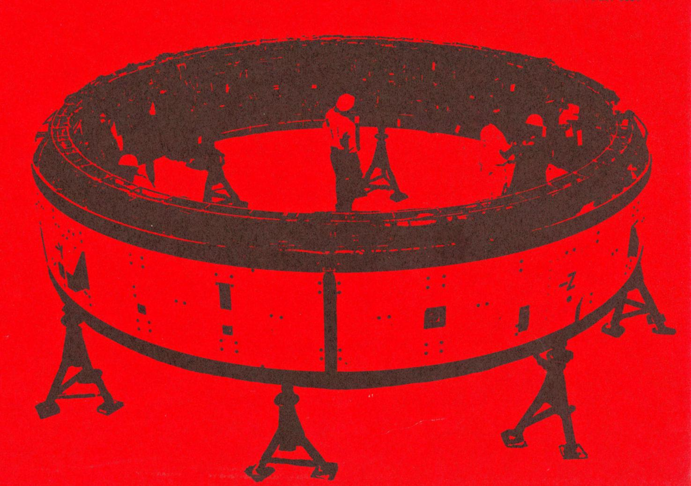
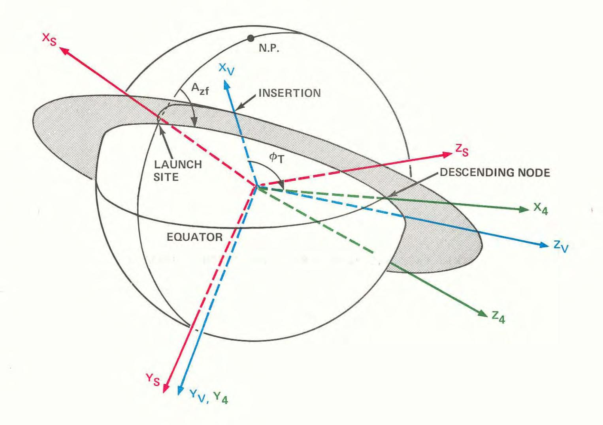
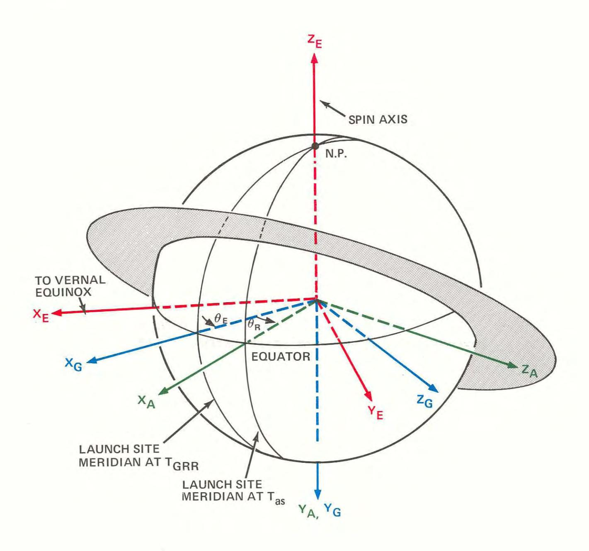
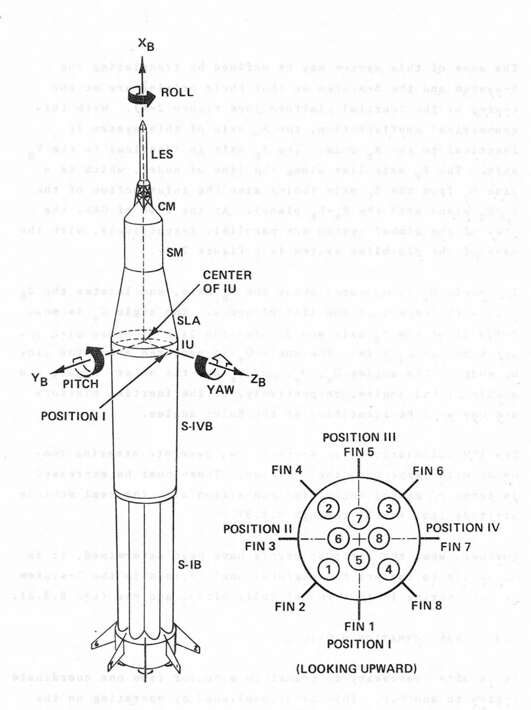
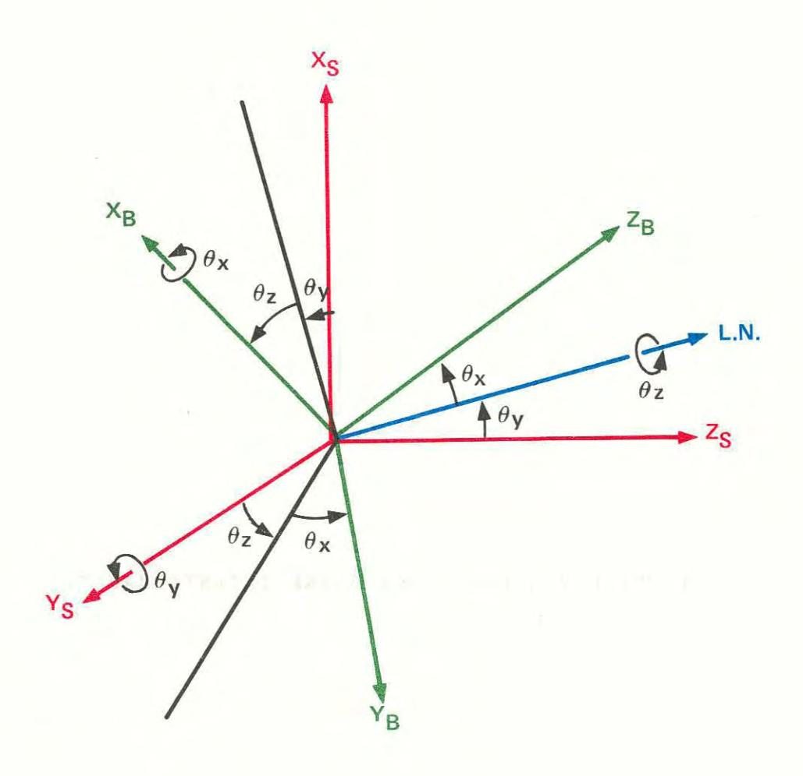
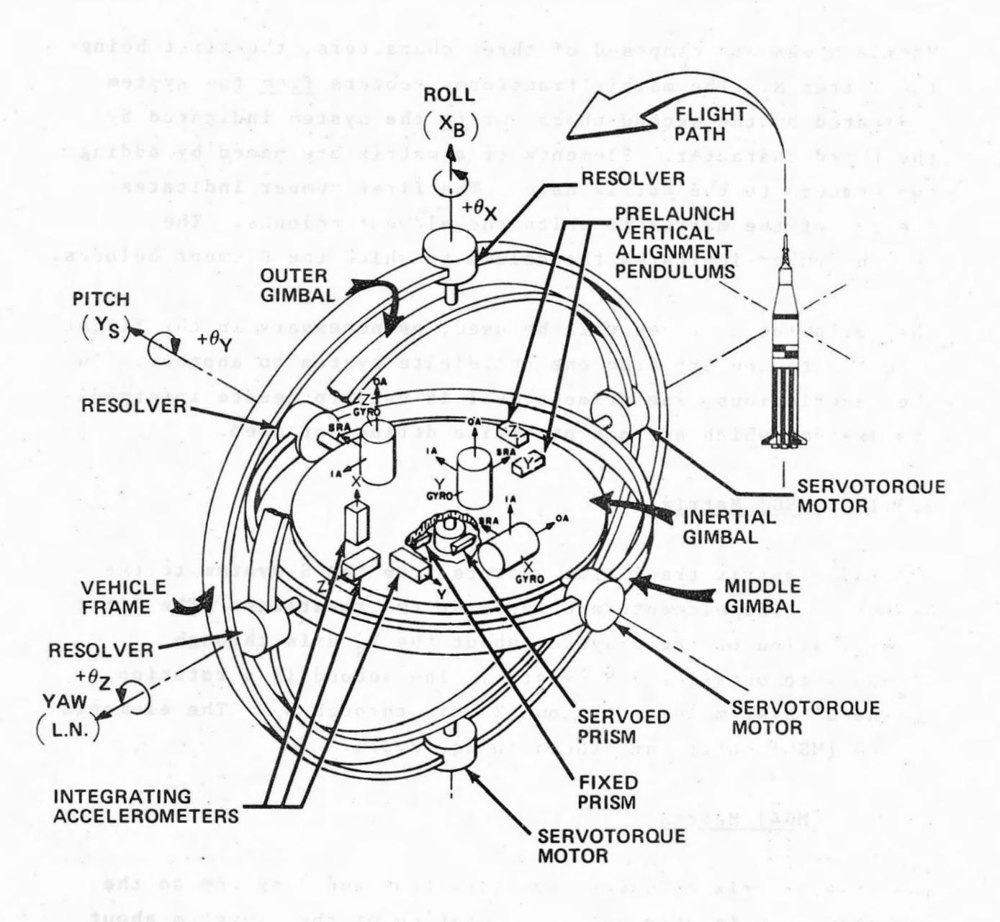
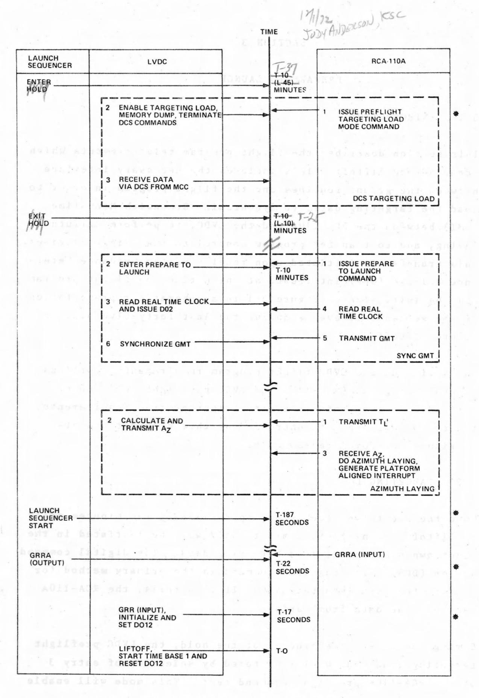

{0}------------------------------------------------

- Et Buch pe 430/12

# Saturn Instrument Unit

LVDC Equation Defining Document (EDD)

for the Saturn 18 Flight Program

Parts Land II

Revision A

11 April 1972

Meen not noon

Line Item 083

18M No. 70-207-0001

{1}------------------------------------------------

CONTRACT NO. NAS8-14000

MSFC-DRL-008A

Line Item 083

IBM No. 70-207-0001

Prepared for the GEORGE C. MARSHALL SPACE FLIGHT CENTER Huntsville, Alabama

LVDC Equation Defining Document (EDD)

for the Saturn IB Flight Program

Parts I and II

Revision A

11 April 1972

Data Manager Approval

Attalia Rockland

Program Office Approval

Classification and Content Approval

Federal Systems Division, Electronics Systems Center/Huntsville, Alabama

{2}------------------------------------------------

# PART I

# TABLE OF CONTENTS

| Paragraph  | Title                                                                                                                                      | Page              |
|------------|--------------------------------------------------------------------------------------------------------------------------------------------|-------------------|
| N/A        | EDD CONFIGURATION CONTROL PAGE LISTING                                                                                                     | viii              |
| SECTION 1: | GENERAL MISSION DESCRIPTION AND PROGRAM REQUIREMENTS                                                                                       |                   |
| 1.1        | INTRODUCTION                                                                                                                               | I-1-1             |
| 1.2        | TYPICAL MISSION REQUIREMENTS                                                                                                               | 1                 |
| 1.3        | GENERAL FLIGHT PROGRAM REQUIREMENTS  1.3.1 Applicable Document List  1.3.2 Program Functional Requirements  1.3.3 Requirements Interaction | 2 2 3 15 |
| 1.4        | PROGRAMMING GROUND RULES                                                                                                                   | 16                |
| SECTION 2: | REFERENCE SYSTEMS AND TRANSFORMATIONS                                                                                                      |                   |
| 2.1        | INTRODUCTION                                                                                                                               | I-2-1             |
| 2.2        | REFERENCE SYSTEMS  2.2.1 Plumbline Coordinate System  (X S , Y S , Z S )                                  | 1                 |
|            | 2.2.2 Target Plane Coordinate System $(X_4, Y_4, Z_4)$                                                                                     | 2                 |
|            | 2.2.3 Injection Plane Coordinate System $(X_V, Y_V, Z_V)$                                                                                  | 2                 |
|            | 2.2.4 Gravitational Coordinate System $(X_G, Y_G, Z_G)$                                                                                    | 7                 |
|            | 2.2.5 Ephemeral Coordinate System $(X_E, Y_E, Z_E)$                                                                                        | 7                 |
|            | 2.2.6 Telemetry Station Coordinate System $(X_A, Y_A, Z_A)$                                                                                | 8                 |
|            | 2.2.7 Body Coordinate System $(X_B, Y_B, Z_B)$                                                                                             | 8                 |
|            | 2.2.8 Inertial Platform Gimbal System $(X_p, Y_p, Z_p)$                                                                                    | 8                 |

{3}------------------------------------------------

|      | 2.3     | TRANSFORMATION MATRICES  2.3.1 [MSG] Matrix  2.3.2 [MG4] Matrix | 10 14 14 |
|------|---------|-----------------------------------------------------------------|----------------|
|      |         | 2.3.3 [MBS] Matrix                                              | 15             |
|      |         | 2.3.4 [M4V] Matrix                                              | 15             |
|      |         | 2.3.5 [MS4] Matrix                                              | 15             |
|      |         | 2.3.6 [MGA] Matrix                                              | 15             |
|      |         | 2.3.7 [MSA] Matrix                                              | . 15           |
|      |         | 2.3.8 [MSV] Matrix                                              | 16             |
|      |         | 2.3.9 [MEG] Matrix                                              | 16             |
|      |         | 2.3.10 [MES] Matrix                                             | 16             |
| SECT | CION 3: | PREPARE TO LAUNCH                                               |                |
|      | 3.1     | INTRODUCTION                                                    | I-3-1          |
|      | 3.2     | TARGETING LOAD                                                  | 1              |
|      | 3.3     | PREFLIGHT PREPARE TO LAUNCH                                     | 3              |
|      | 3.3     | 3.3.1 GMT Synchronizing                                         | 4              |
|      |         | 3.3.2 Azimuth Laying Support                                    | 5              |
|      |         |                                                                 |                |
|      | 3.4     | FLIGHT PROGRAM INITIALIZATION                                   | 7              |
| SECT | CION 4: | BOOST NAVIGATION AND GUIDANCE                                   |                |
|      | 4.1     | INTRODUCTION                                                    | I-4-1          |
|      | 4.2     | ACCELEROMETER DATA DESCRIPTION                                  | 2              |
|      |         | 4.2.1 Accelerometer Data Format                                 | 2              |
|      |         | 4.2.2 Accelerometer Data Processing                             | 3              |
|      |         | 4.2.3 Velocity Accumulation                                     | 8              |
|      |         | 4.2.4 F/M Calculations                                          | 8              |
|      |         | 4.2.5 M/F Smoothing Calculations                                | 8              |
|      |         | 4.2.6 (F/M) c Acceleration                           | 9              |
|      | 4.3     | BOOST NAVIGATION                                                | 10             |
|      |         | 4.3.1 Integration                                               | 10             |
|      |         | 4.3.2 Gravitational Acceleration                                | 11             |
|      | 4.4     | BOOST GUIDANCE                                                  | 12             |
|      |         | 4.4.1 First Stage Guidance                                      | 14             |
|      |         | 4.4.2 IGM Guidance                                              | 18             |
|      |         | 4.4.3 Guidance Reference Failure (GRF)                          | 28             |
|      |         | 4.4.4 Steering Misalignment Correction                          | 29             |
|      |         | (SMC)                                                           | 20             |
|      |         | 4.4.5 Chi Computations                                          | 30             |

{4}------------------------------------------------

| SECTION 5: | ORBITAL NAVIGATION AND GUIDANCE                                                                                                                       |       |   |
|------------|-------------------------------------------------------------------------------------------------------------------------------------------------------|-------|---|
| 5.1        | INTRODUCTION                                                                                                                                          | I-5-1 |   |
| 5.2        | ORBITAL PROCESSING RATES                                                                                                                              | 1     |   |
| 5.3        | ORBITAL INITIALIZATION                                                                                                                                | 2     |   |
| 5.4        | ORBITAL NAVIGATION                                                                                                                                    | 2     |   |
|            | 5.4.1 Integration                                                                                                                                     | 3     |   |
|            | 5.4.2 Acceleration Models                                                                                                                             | 5     |   |
|            | 5.4.3 Navigation Update                                                                                                                               | 6     |   |
| 5.5        | ORBITAL GUIDANCE                                                                                                                                      | 8     | * |
|            | 5.5.1 X Freeze Maneuver                                                                                                                               | 9     |   |
|            | 5.5.2 Inertial Attitude Hold Maneuver                                                                                                                 | 9     |   |
|            | 5.5.3 Track Local Reference Maneuver                                                                                                                  | 9     |   |
|            | 5.5.4 Inertial Hold of Local Reference                                                                                                                | 10    |   |
|            | 5.5.5 Nominal Control Switchover Capability                                                                                                           | 10    |   |
|            | 5.5.6 Guidance Reference Failure (GRF)                                                                                                                | 12    |   |
|            | 5.5.7 DCS Commanded Functions                                                                                                                         | 12    |   |
| 5.6        | TELEMETRY ACQUISITION AND LOSS                                                                                                                        | 12    |   |
|            | 5.6.1 Acquisition and Loss Calculations                                                                                                               | 13    |   |
|            | 5.6.2 Acquisition and Loss Sequence                                                                                                                   | 13    |   |
|            | 5.6.3 Telemetry Dumps                                                                                                                                 | 13    |   |
| SECTION 6: | (EDITOR'S NOTE: ALL SECTIONS ARE NUMBERED HEREIN FOR COMPATIBILITY WITH SATURN V EDD; THERE IS NO REQUIREMENT IN THIS SATURN IB EDD FOR A SECTION 6.) |       |   |
| SECTION 7: | TIME BASES, DISCRETES, AND INTERRUPTS                                                                                                                 |       |   |
| 7.1        | INTRODUCTION                                                                                                                                          | I-7-1 |   |
| 7.2        | TIME BASES                                                                                                                                            | 1     |   |
|            | 7.2.1 Time Base O (Guidance Reference Release)                                                                                                        | 2     |   |
|            | 7.2.2 Time Base 1 (Liftoff)                                                                                                                           | 2     |   |
|            | 7.2.3 Time Base 2 (S-IB Low Level Sensors                                                                                                             | 5     | * |
|            | Dry)                                                                                                                                                  | _     |   |
|            | 7.2.4 Time Base 3 (S-IB Outboard Engines                                                                                                              | 6     | * |
|            | Cutoff)                                                                                                                                               |       |   |
|            | 7.2.5 Time Base 4 (S-IVB Cutoff)                                                                                                                      | 6     | * |

{5}------------------------------------------------

| 7.3 | DISCRE      | TE OUTPUTS (DO)                                         | 9  |
|-----|-------------|---------------------------------------------------------|----|
| 7.4 | DISCRE      | TE INPUTS (DI)                                          | 11 |
|     | 7.4.1       | DI1: RCA-110A Sync                                      | 11 |
|     | 7.4.2       | DI2: Command Decoder OM/D "A" and                       | 13 |
|     |             | Command Decoder OM/D "B"                                |    |
|     | 7.4.3       | DI3: Spare (Wired to IU/S-IVB                           | 13 |
|     | 7 / /       | Interface)                                              |    |
|     | 7.4.4       | DI4: Spare (Wired to Control Distributor)               | 13 |
|     | 7.4.5       | DI5: S-IVB Engine Out "A"                               | 13 |
|     | 7.4.6       |                                                         |    |
|     |             |                                                         | 13 |
|     | 7.4.7       |                                                         | 14 |
|     | 7.4.8       |                                                         | 14 |
|     | 7.4.9       | DI9: S/C Control of Saturn                              | 14 |
|     | 7.4.10      | DI10: Coolant Thermal Switch #1                         | 15 |
|     | 7.4.11      | DI11: Coolant Thermal Switch #2                         | 15 |
|     | 7.4.12      |                                                         | 16 |
|     |             | DI13: Spare                                             |    |
|     |             |                                                         | 16 |
|     | 7 . 4 . 1 4 | DI14: S-IB Outboard Engine Out                          | 16 |
|     | 7.4.15      | DI15: S-IB Inboard Engine Out "B"                       | 16 |
|     | 7.4.16      | DI16: Prepare for Guidance                              | 17 |
|     | 7 / 17      | Reference Release                                       |    |
|     | 7.4.17      | DI17: Spare                                             | 17 |
|     |             | DI18: Spare                                             | 17 |
|     | 7.4.19      | DI19: Spare (Wired to IU/S-IVB                          | 17 |
|     |             | Interface)                                              |    |
|     | 7.4.20      | DI20: Spacecraft Initiation of S-IVB                    | 17 |
|     |             | Engine Cutoff                                           |    |
|     | 7.4.21      | DI21: S-IB Low Level Sensors Dry                        | 18 |
|     | 7.4.22      | DI22: Manual Initiation of S-IVB                        | 18 |
|     | ,           | Engine Cutoff "B"                                       | 10 |
|     | 7 / 22      | DIOCHE CULOTI B                                         |    |
|     | 7.4.23      | DI23: S-IB Outboard Engines                             | 19 |
|     |             | Cutoff "B"                                              |    |
|     |             | DI24: Liftoff                                           | 19 |
|     | 7.4.25      | DIS1-DIS8: Spares (Not Wired)                           | 19 |
| 7.5 | INTERRU     | JPTS.                                                   | 19 |
|     | 7.5.1       | INT1: Command LVDA/RCA-110A                             |    |
|     | ,           |                                                         | 21 |
|     | 7 5 0       | Interrupt                                               |    |
|     | 7.5.2       | INT2: S-IB Low Level Sensors                            | 21 |
|     |             | Dry "A"                                                 |    |
|     | 7.5.3       | INT3: RCA-110A Interrupt                                | 22 |
|     | 7.5.4       | INT4: S-IVB Engine Out "B"                              | 22 |
|     | 7.5.5       | INT5: S-IB Outboard Engines                             | 22 |
|     |             | Cutoff "A"                                              |    |
|     | 7.5.6       |                                                         | 23 |
|     | 7.5.0       |                                                         | 23 |
|     |             | S-IVB Engine Cutoff "A"                                 |    |
|     | 7.5.7       | INT7: Guidance Reference Release                        | 23 |
|     | 7 5 0       | TNTO A TNTO P. Comment Description                      | 0. |
|     | 7.5.8       | INT8A and INT8B: Command Decoder Interrupts "A" and "B" | 24 |
|     |             | interrupts A and B                                      |    |

{6}------------------------------------------------

|             | 7.5.9   | INT9: TLC-Simultaneous Memory                                                                                                                                                                                                                                                                                                                                                                                                                                                                                                                                                                                                                                                                                                                                                                                                                                                                                                                                                                                                                                                                                                                                                                                                                                                                                                                                                                                                                                                                                                                                                                                                                                                                                                                                                                                                                                                                                                                                                                                                                                                                                                  | 24          |
|-------------|---------|--------------------------------------------------------------------------------------------------------------------------------------------------------------------------------------------------------------------------------------------------------------------------------------------------------------------------------------------------------------------------------------------------------------------------------------------------------------------------------------------------------------------------------------------------------------------------------------------------------------------------------------------------------------------------------------------------------------------------------------------------------------------------------------------------------------------------------------------------------------------------------------------------------------------------------------------------------------------------------------------------------------------------------------------------------------------------------------------------------------------------------------------------------------------------------------------------------------------------------------------------------------------------------------------------------------------------------------------------------------------------------------------------------------------------------------------------------------------------------------------------------------------------------------------------------------------------------------------------------------------------------------------------------------------------------------------------------------------------------------------------------------------------------------------------------------------------------------------------------------------------------------------------------------------------------------------------------------------------------------------------------------------------------------------------------------------------------------------------------------------------------|-------------|
|             |         | Error Sumammus 200                                                                                                                                                                                                                                                                                                                                                                                                                                                                                                                                                                                                                                                                                                                                                                                                                                                                                                                                                                                                                                                                                                                                                                                                                                                                                                                                                                                                                                                                                                                                                                                                                                                                                                                                                                                                                                                                                                                                                                                                                                                                                                             | P-01        |
|             |         | INT10: Spare                                                                                                                                                                                                                                                                                                                                                                                                                                                                                                                                                                                                                                                                                                                                                                                                                                                                                                                                                                                                                                                                                                                                                                                                                                                                                                                                                                                                                                                                                                                                                                                                                                                                                                                                                                                                                                                                                                                                                                                                                                                                                                                   | 2.5         |
|             | 7.5.11  | INT11 and INT12: Internal Functio                                                                                                                                                                                                                                                                                                                                                                                                                                                                                                                                                                                                                                                                                                                                                                                                                                                                                                                                                                                                                                                                                                                                                                                                                                                                                                                                                                                                                                                                                                                                                                                                                                                                                                                                                                                                                                                                                                                                                                                                                                                                                              | <u>n</u> 25 |
|             |         | of the LVDC                                                                                                                                                                                                                                                                                                                                                                                                                                                                                                                                                                                                                                                                                                                                                                                                                                                                                                                                                                                                                                                                                                                                                                                                                                                                                                                                                                                                                                                                                                                                                                                                                                                                                                                                                                                                                                                                                                                                                                                                                                                                                                                    |             |
| SECTION 8:  | LAUNCH  | VEHICLE ATTITUDE CONTROL                                                                                                                                                                                                                                                                                                                                                                                                                                                                                                                                                                                                                                                                                                                                                                                                                                                                                                                                                                                                                                                                                                                                                                                                                                                                                                                                                                                                                                                                                                                                                                                                                                                                                                                                                                                                                                                                                                                                                                                                                                                                                                       |             |
| 8.1         | INTROD  |                                                                                                                                                                                                                                                                                                                                                                                                                                                                                                                                                                                                                                                                                                                                                                                                                                                                                                                                                                                                                                                                                                                                                                                                                                                                                                                                                                                                                                                                                                                                                                                                                                                                                                                                                                                                                                                                                                                                                                                                                                                                                                                                | I-8-1       |
| 8.2         | MINOR   |                                                                                                                                                                                                                                                                                                                                                                                                                                                                                                                                                                                                                                                                                                                                                                                                                                                                                                                                                                                                                                                                                                                                                                                                                                                                                                                                                                                                                                                                                                                                                                                                                                                                                                                                                                                                                                                                                                                                                                                                                                                                                                                                | . 1         |
|             | 8.2.1   | Gimbal Angle Data                                                                                                                                                                                                                                                                                                                                                                                                                                                                                                                                                                                                                                                                                                                                                                                                                                                                                                                                                                                                                                                                                                                                                                                                                                                                                                                                                                                                                                                                                                                                                                                                                                                                                                                                                                                                                                                                                                                                                                                                                                                                                                              | 2           |
|             | 8.2.2   |                                                                                                                                                                                                                                                                                                                                                                                                                                                                                                                                                                                                                                                                                                                                                                                                                                                                                                                                                                                                                                                                                                                                                                                                                                                                                                                                                                                                                                                                                                                                                                                                                                                                                                                                                                                                                                                                                                                                                                                                                                                                                                                                | 4           |
|             | 8.2.3   | Attitude Error Commands                                                                                                                                                                                                                                                                                                                                                                                                                                                                                                                                                                                                                                                                                                                                                                                                                                                                                                                                                                                                                                                                                                                                                                                                                                                                                                                                                                                                                                                                                                                                                                                                                                                                                                                                                                                                                                                                                                                                                                                                                                                                                                        | 10          |
| 8.3         | MINOR   | LOOP SUPPORT                                                                                                                                                                                                                                                                                                                                                                                                                                                                                                                                                                                                                                                                                                                                                                                                                                                                                                                                                                                                                                                                                                                                                                                                                                                                                                                                                                                                                                                                                                                                                                                                                                                                                                                                                                                                                                                                                                                                                                                                                                                                                                                   | 11          |
|             | 8.3.1   | Attitude Increments                                                                                                                                                                                                                                                                                                                                                                                                                                                                                                                                                                                                                                                                                                                                                                                                                                                                                                                                                                                                                                                                                                                                                                                                                                                                                                                                                                                                                                                                                                                                                                                                                                                                                                                                                                                                                                                                                                                                                                                                                                                                                                            | 12          |
|             | 8.3.2   | Gimbal-to-Body Transformation                                                                                                                                                                                                                                                                                                                                                                                                                                                                                                                                                                                                                                                                                                                                                                                                                                                                                                                                                                                                                                                                                                                                                                                                                                                                                                                                                                                                                                                                                                                                                                                                                                                                                                                                                                                                                                                                                                                                                                                                                                                                                                  | 12          |
| CECETON O.  |         |                                                                                                                                                                                                                                                                                                                                                                                                                                                                                                                                                                                                                                                                                                                                                                                                                                                                                                                                                                                                                                                                                                                                                                                                                                                                                                                                                                                                                                                                                                                                                                                                                                                                                                                                                                                                                                                                                                                                                                                                                                                                                                                                | 1,24        |
| SECTION 9:  | SWIICH  | SELECTOR PROCESSING                                                                                                                                                                                                                                                                                                                                                                                                                                                                                                                                                                                                                                                                                                                                                                                                                                                                                                                                                                                                                                                                                                                                                                                                                                                                                                                                                                                                                                                                                                                                                                                                                                                                                                                                                                                                                                                                                                                                                                                                                                                                                                            | 5.11        |
| 9.1         | INTROD  | UCTION EDAT MORIAATTETETOTE                                                                                                                                                                                                                                                                                                                                                                                                                                                                                                                                                                                                                                                                                                                                                                                                                                                                                                                                                                                                                                                                                                                                                                                                                                                                                                                                                                                                                                                                                                                                                                                                                                                                                                                                                                                                                                                                                                                                                                                                                                                                                                    | I-9-1       |
| 9.2         |         | D EXECUTION OPERATIONS                                                                                                                                                                                                                                                                                                                                                                                                                                                                                                                                                                                                                                                                                                                                                                                                                                                                                                                                                                                                                                                                                                                                                                                                                                                                                                                                                                                                                                                                                                                                                                                                                                                                                                                                                                                                                                                                                                                                                                                                                                                                                                         | 1           |
|             | 9.2.1   | Sequence of Operations                                                                                                                                                                                                                                                                                                                                                                                                                                                                                                                                                                                                                                                                                                                                                                                                                                                                                                                                                                                                                                                                                                                                                                                                                                                                                                                                                                                                                                                                                                                                                                                                                                                                                                                                                                                                                                                                                                                                                                                                                                                                                                         | 2           |
|             | 9.2.2   | Termination of a Command Sequence                                                                                                                                                                                                                                                                                                                                                                                                                                                                                                                                                                                                                                                                                                                                                                                                                                                                                                                                                                                                                                                                                                                                                                                                                                                                                                                                                                                                                                                                                                                                                                                                                                                                                                                                                                                                                                                                                                                                                                                                                                                                                              | 9           |
| 9.3         | TIMING  |                                                                                                                                                                                                                                                                                                                                                                                                                                                                                                                                                                                                                                                                                                                                                                                                                                                                                                                                                                                                                                                                                                                                                                                                                                                                                                                                                                                                                                                                                                                                                                                                                                                                                                                                                                                                                                                                                                                                                                                                                                                                                                                                | 9           |
| 7.1         |         | MOIREJETACO ATAR                                                                                                                                                                                                                                                                                                                                                                                                                                                                                                                                                                                                                                                                                                                                                                                                                                                                                                                                                                                                                                                                                                                                                                                                                                                                                                                                                                                                                                                                                                                                                                                                                                                                                                                                                                                                                                                                                                                                                                                                                                                                                                               |             |
| 9.4         | PRIORI  |                                                                                                                                                                                                                                                                                                                                                                                                                                                                                                                                                                                                                                                                                                                                                                                                                                                                                                                                                                                                                                                                                                                                                                                                                                                                                                                                                                                                                                                                                                                                                                                                                                                                                                                                                                                                                                                                                                                                                                                                                                                                                                                                | 10          |
|             | 9.4.1   | Class 1 Alternate Sequence                                                                                                                                                                                                                                                                                                                                                                                                                                                                                                                                                                                                                                                                                                                                                                                                                                                                                                                                                                                                                                                                                                                                                                                                                                                                                                                                                                                                                                                                                                                                                                                                                                                                                                                                                                                                                                                                                                                                                                                                                                                                                                     | 11          |
|             |         | Class 2 Alternate Sequence                                                                                                                                                                                                                                                                                                                                                                                                                                                                                                                                                                                                                                                                                                                                                                                                                                                                                                                                                                                                                                                                                                                                                                                                                                                                                                                                                                                                                                                                                                                                                                                                                                                                                                                                                                                                                                                                                                                                                                                                                                                                                                     | 11          |
|             |         | Nominal Flight Sequence                                                                                                                                                                                                                                                                                                                                                                                                                                                                                                                                                                                                                                                                                                                                                                                                                                                                                                                                                                                                                                                                                                                                                                                                                                                                                                                                                                                                                                                                                                                                                                                                                                                                                                                                                                                                                                                                                                                                                                                                                                                                                                        | 12          |
|             |         | Class 3 Alternate Sequence                                                                                                                                                                                                                                                                                                                                                                                                                                                                                                                                                                                                                                                                                                                                                                                                                                                                                                                                                                                                                                                                                                                                                                                                                                                                                                                                                                                                                                                                                                                                                                                                                                                                                                                                                                                                                                                                                                                                                                                                                                                                                                     | 12          |
|             | 9.4.5   | Class 4 Alternate Sequence                                                                                                                                                                                                                                                                                                                                                                                                                                                                                                                                                                                                                                                                                                                                                                                                                                                                                                                                                                                                                                                                                                                                                                                                                                                                                                                                                                                                                                                                                                                                                                                                                                                                                                                                                                                                                                                                                                                                                                                                                                                                                                     | 13          |
| SECTION 10: | DIGITA  | L COMMAND SYSTEM                                                                                                                                                                                                                                                                                                                                                                                                                                                                                                                                                                                                                                                                                                                                                                                                                                                                                                                                                                                                                                                                                                                                                                                                                                                                                                                                                                                                                                                                                                                                                                                                                                                                                                                                                                                                                                                                                                                                                                                                                                                                                                               | 12.         |
| 10.1        | INTROD  | UCTION                                                                                                                                                                                                                                                                                                                                                                                                                                                                                                                                                                                                                                                                                                                                                                                                                                                                                                                                                                                                                                                                                                                                                                                                                                                                                                                                                                                                                                                                                                                                                                                                                                                                                                                                                                                                                                                                                                                                                                                                                                                                                                                         | I-10-1      |
| 10.2        | DCS WO  | RD FORMAT                                                                                                                                                                                                                                                                                                                                                                                                                                                                                                                                                                                                                                                                                                                                                                                                                                                                                                                                                                                                                                                                                                                                                                                                                                                                                                                                                                                                                                                                                                                                                                                                                                                                                                                                                                                                                                                                                                                                                                                                                                                                                                                      | 1           |
| 10.3        | 'ncs co | MMAND VERIFICATION                                                                                                                                                                                                                                                                                                                                                                                                                                                                                                                                                                                                                                                                                                                                                                                                                                                                                                                                                                                                                                                                                                                                                                                                                                                                                                                                                                                                                                                                                                                                                                                                                                                                                                                                                                                                                                                                                                                                                                                                                                                                                                             | 1           |
| 10.3        |         | DCS Mode Command Verification                                                                                                                                                                                                                                                                                                                                                                                                                                                                                                                                                                                                                                                                                                                                                                                                                                                                                                                                                                                                                                                                                                                                                                                                                                                                                                                                                                                                                                                                                                                                                                                                                                                                                                                                                                                                                                                                                                                                                                                                                                                                                                  | 3           |
|             | 10.3.1  |                                                                                                                                                                                                                                                                                                                                                                                                                                                                                                                                                                                                                                                                                                                                                                                                                                                                                                                                                                                                                                                                                                                                                                                                                                                                                                                                                                                                                                                                                                                                                                                                                                                                                                                                                                                                                                                                                                                                                                                                                                                                                                                                | 5           |
|             |         | DCS Data Validation                                                                                                                                                                                                                                                                                                                                                                                                                                                                                                                                                                                                                                                                                                                                                                                                                                                                                                                                                                                                                                                                                                                                                                                                                                                                                                                                                                                                                                                                                                                                                                                                                                                                                                                                                                                                                                                                                                                                                                                                                                                                                                            | 6           |
|             |         | DCS Error Message                                                                                                                                                                                                                                                                                                                                                                                                                                                                                                                                                                                                                                                                                                                                                                                                                                                                                                                                                                                                                                                                                                                                                                                                                                                                                                                                                                                                                                                                                                                                                                                                                                                                                                                                                                                                                                                                                                                                                                                                                                                                                                              | 7           |
|             | 10.5.4  | A Company of the Company of the Company of the Company of the Company of the Company of the Company of the Company of the Company of the Company of the Company of the Company of the Company of the Company of the Company of the Company of the Company of the Company of the Company of the Company of the Company of the Company of the Company of the Company of the Company of the Company of the Company of the Company of the Company of the Company of the Company of the Company of the Company of the Company of the Company of the Company of the Company of the Company of the Company of the Company of the Company of the Company of the Company of the Company of the Company of the Company of the Company of the Company of the Company of the Company of the Company of the Company of the Company of the Company of the Company of the Company of the Company of the Company of the Company of the Company of the Company of the Company of the Company of the Company of the Company of the Company of the Company of the Company of the Company of the Company of the Company of the Company of the Company of the Company of the Company of the Company of the Company of the Company of the Company of the Company of the Company of the Company of the Company of the Company of the Company of the Company of the Company of the Company of the Company of the Company of the Company of the Company of the Company of the Company of the Company of the Company of the Company of the Company of the Company of the Company of the Company of the Company of the Company of the Company of the Company of the Company of the Company of the Company of the Company of the Company of the Company of the Company of the Company of the Company of the Company of the Company of the Company of the Company of the Company of the Company of the Company of the Company of the Company of the Company of the Company of the Company of the Company of the Company of the Company of the Company of the Company of the Company of the Company of the Company of the Company of the Company of the Comp |             |
|             |         |                                                                                                                                                                                                                                                                                                                                                                                                                                                                                                                                                                                                                                                                                                                                                                                                                                                                                                                                                                                                                                                                                                                                                                                                                                                                                                                                                                                                                                                                                                                                                                                                                                                                                                                                                                                                                                                                                                                                                                                                                                                                                                                                |             |
|             |         |                                                                                                                                                                                                                                                                                                                                                                                                                                                                                                                                                                                                                                                                                                                                                                                                                                                                                                                                                                                                                                                                                                                                                                                                                                                                                                                                                                                                                                                                                                                                                                                                                                                                                                                                                                                                                                                                                                                                                                                                                                                                                                                                |             |

{7}------------------------------------------------

| 10.4        | DCS COMMANDS                                      | 7      |
|-------------|---------------------------------------------------|--------|
|             | 10.4.1 Time Base Update                           | 9      |
|             | 10.4.2 Navigation Update                          | 11     |
|             | 10.4.3 Generalized Switch Selector                | 13     |
|             | 10.4.4 Memory Dump                                | 14     |
|             | 10.4.5 Terminate                                  | 17     |
|             | 10.4.6 Execute Generalized Maneuver               | 18     |
|             | 10.4.7 Return to Nominal Timeline                 | 22     |
|             | 10.4.8 ECS Water Control Valve Logic              | 23     |
|             | Inhibit                                           |        |
|             | 10.4.9 Execute Special Maneuvers                  | 23     |
|             | 10.4.10 Execute Alternate Sequence                | 2.5    |
|             | 10.4.11 Targeting Load                            | 28     |
| SECTION 11: | REAL TIME TELEMETRY AND DATA COMPRESSION          |        |
| 11.1        | INTRODUCTION                                      | I-11-1 |
|             |                                                   |        |
| 11.2        | TELEMETRY SYSTEM INTERFACE                        | 1      |
| 11.3        | IDENTIFICATION TAGS                               | 2      |
| 11.4        | GENERAL REQUIREMENTS FOR LVDC AND LVDA            | 4      |
| 11.4        | TELEMETRY                                         | -      |
|             | 11.4.1 LVDC Telemetry                             | 4      |
|             | 11.4.1 LVDA Telemetry                             | 11     |
|             | 11.4.2 EVDA TETEMECTY                             |        |
| 11.5        | DATA COMPRESSION                                  | 12     |
| 11.5        | 11.5.1 General Data Compression                   | 13     |
|             | Requirements                                      |        |
|             | 11.5.2 Data to be Compressed                      | 14     |
|             | 11.5.3 Telemetry of Compressed Data               | 16     |
|             | 11.5.5 Telemetry of compressed fact               |        |
| SECTION 12: | PREFLIGHT TESTS                                   |        |
| 12.1        | INTRODUCTION                                      | I-12-1 |
| 12.2        | FLIGHT SIMULATION                                 | 1      |
|             | 12.2.1 Repeatable                                 | 1      |
|             | 12.2.2 Non-Repeatable                             | 3      |
| 10.0        | TO TOWN GIVEY AMION ORMIONS                       | 7      |
| 12.3        | FLIGHT SIMULATION OPTIONS                         | 7      |
|             | 12.3.1 Flight Simulation Selected                 | 8      |
|             | 12.3.2 Switch Selector Status                     | 8      |
|             | 12.3.3 Repeatable/Non-Repeatable                  | 8      |
|             | 12.3.4 Data Compression Status                    | 8      |
|             | 12.3.5 Platform Status 12.3.6 Test Site Indicator | 8      |
|             | IZ.J.O IEST SILE INGICATOR                        | 0      |

{8}------------------------------------------------

| 12.4       | PREFLIGHT LINKAGE TESTS  12.4.1 G&C Steering Linkage  12.4.2 Preflight Command Receiver Linkage | 9       |
|------------|-------------------------------------------------------------------------------------------------|---------|
| SECTION 13 | : ALGORITHMS DAG JOSTNOO NOFTARUDITHOO GGY AL                                                   | TAS     |
| 13.1       | INTRODUCTION                                                                                    | -13-1   |
| 13.2       | SINE-COSINE ALGORITHM                                                                           | A . 1   |
| 13.3       | ARCTANGENT ALGORITHM                                                                            | . 3     |
| 13.4       | NATURAL LOGARITHM ALGORITHM                                                                     | 5 2 1 5 |
| 13.5       | SQUARE ROOT ALGORITHM                                                                           | 5       |
| 13.6       | INVERSE SQUARE ROOT ALGORITHM                                                                   | 6       |
| 13.7       | VECTOR DOT PRODUCT                                                                              | 7       |
| 13.8       | VECTOR CROSS PRODUCT                                                                            | 7       |
| SECTION 14 | : EQUATIONS                                                                                     |         |
| 14.1       | INTRODUCTION                                                                                    | -14-1   |
| 14.2       | EQUATIONS                                                                                       | 3       |
| SECTION 15 | : DEFINITIONS                                                                                   |         |
| 15.1       | INTRODUCTION                                                                                    | -15-1   |
| 15.2       | ABBREVIATIONS                                                                                   | 1       |
| 15.3       | VARIABLE DICTIONARY                                                                             | 1       |
| 15 /       | MAYIMIM VALUES OF SELECTED VADIABLES                                                            | 2       |

{9}------------------------------------------------

#### PART I

### SAT IB EDD CONFIGURATION CONTROL PAGE LISTING, REVISION A

This Revision A constitutes a complete reprinting of this volume; pages affected by this revision are identified by the notation "Rev. A" in the lower right corner. The following Flight Program Change Requests (FPCRs) are incorporated in this revision: FPCR 206-1 thru -9; 206-D1, -D2, and -D3.

{10}------------------------------------------------

#### SECTION 1

### GENERAL MISSION DESCRIPTION AND PROGRAM REQUIREMENTS

#### 1.1 INTRODUCTION

This section contains a brief description of a typical Saturn IB mission, general flight program requirements to meet mission requirements and some specific program requirements which might be called programming ground rules to meet mission requirements.

### 1.2 TYPICAL MISSION REQUIREMENTS

The typical mission of the Saturn IB launch vehicle (LV) is to place the space vehicle, consisting of the Command and Service Modules (CSM), into a specified earth orbit such that CSM rendezvous may be achieved with the orbiting Skylab configuration. The manned CSM will be launched on a northeasterly azimuth into an elliptical orbit. The CSM/LV separation will occur during the first revolution. The Service Module (SM), Service Propulsion System (SPS), and SM Reaction Control System (RCS) will be used to complete the CSM rendezvous maneuvers and to dock with the Skylab.

The launch vehicle mission may be divided conveniently into three major phases, namely: (1) prelaunch targeting, (2) boost to earth orbit, and (3) orbital operations.

Targeting during prelaunch is required because of the time varying relationship between the Skylab orbit and the Saturn IB launch site. The nominal launch time and the launch window, or time interval during the day when launch can take place, are determined by available launch azimuth range, launch and rendezvous lighting requirements, the dry workshop ephemeris, and

{11}------------------------------------------------

optimum performance considerations. The final targeting is loaded into the launch vehicle digital computer (LVDC) flight program via the command system during the interval from approximately 35 minutes before liftoff until entry is made to the prepare to launch mode.

Ignition and liftoff occur shortly after targeting completion and final azimuth determination. As detailed in Section 7, liftoff is a basic time point of flight program reference, actuated by an umbilical disconnect. Approximately fourteen seconds prior to ignition or seventeen seconds prior to lift-off, the inertial reference is released from its earth-fixed constraints and its attitude becomes fixed in inertial space. This point, called guidance reference release (GRR), marks the beginning of the boost to earth orbit phase of the mission. The boost phase consists of burning the S-IB stage to propellant depletion with a subsequent burn of the S-IVB stage to achieve the desired end conditions to place the S-IVB/IU and space vehicle configuration into earth orbit.

During flight, the launch vehicle systems are monitored in real time by ground controllers. By observing the performance of the vehicle, they can detect or predict situations requiring contingency action. The command capability from the ground to the launch vehicle is available during orbital flight to alter certain launch vehicle functions or initiate alternate functions.

#### 1.3 GENERAL FLIGHT PROGRAM REQUIREMENTS

## 1.3.1 Applicable Document List

General program requirements discussed in this section and the specific requirements of later sections are defined for the Saturn IB mission based on the Mission Definition Document and

{12}------------------------------------------------

the vehicle dependent Final Mission Definition Documents provided by MSFC. The program requirements are written specifically for the astrionics configuration described in the "Astrionics System Handbook" dated 1 November 1968 (changed 15 November 1969), MSFC No. IV-4-401-1, IBM No. 68-966-0002. Specifications for the LVDC and launch vehicle data adapter (LVDA) included as part of the astrionics system are given in the following documents:

- CEI Specification, LVDC Specification No. 6150001 Contract No. NAS8-11561
  - © CEI Specification, LVDA Specification No. 6150000 Contract No. NAS8-11561

Programming techniques are described in the "Programmer's Operating Manual," Volume I, Revised 15 December 1965, prepared under Contract NAS8-11561. This document has no number.

### 1.3.2 Program Functional Requirements

The flight program is an integral part of: (1) the guidance and control system comprising the LVDC/LVDA, ST-124M inertial platform, body-mounted accelerometers, rate gyros, and the flight control computer; and (2) the launch vehicle sequencing system comprising the discrete input, discrete output, and interrupt registers of the LVDA and the stage switch selectors.

The integration of these systems is accomplished through the flight program. It provides a flexible mechanism by which the system functional and detailed specifications may be altered, within wide limits, to accomplish a wide variety of missions without changes to the launch vehicle hardware.

{13}------------------------------------------------

All LVDC inputs and outputs pass through the LVDA. All mention of flight program input/output will be interpreted as communication with equipment external to the LVDC/LVDA with the understanding that the external equipment is physically connected to the LVDA rather than the LVDC, and that inputs and outputs are, in actual fact, relative to the LVDC/LVDA hardware and only controlled by the program. The notation is used for convenience only.

Although specific requirements will vary with mission phase, the flight program is required to provide for the following recurring functions, as discussed in Section 1.3.2.2:

- Navigation
- Guidance and at bedianess are soupedated and persons
- Attitude control
  - Launch vehicle sequencing
- Telemetry Tolanda Telemetry
  - Programmed backups to specific hardware functions
  - e Command processing
  - Data compression.

Non-recurring targeting functions are also required, as discussed in Section 1.3.2.1.

In addition to the specifically identified requirements, the routine requirements of program sequencing and control exist.

{14}------------------------------------------------

However, these are induced requirements of program implementa-tion rather than program requirements and are not discussed further in the requirements section.

### 1.3.2.1 Non-Recurring Functions

The one-time targeting requirement is performed within the interval from approximately 35 minutes before liftoff until entry is made to the prepare to launch mode. The parking orbit parameters and rates of change are loaded via the command system. The rates of change are used to compute the desired descending node and inclination angle. Detailed targeting requirements are given in Section 3.

# 1.3.2.2 Recurring Functions

of the recurring functions listed above, data compression is required only during the orbital mission phase. Command processing is required for the one-time targeting requirement and during the orbital mission phase. The remaining functions are required during both the boost and orbital phases although specific requirements and rates of computation may vary from the boost to the orbital phases. Each requirement is discussed separately except for navigation and guidance which are more closely tied together than the other requirements. In addition, the guidance law and navigation scheme requirements are significantly different during the boost and orbital phases. Therefore, these two requirements are combined in the discussion and this particular discussion is broken into boost and orbit mission phases.

The following definitions of navigation, guidance and control apply in this document.

{15}------------------------------------------------

Navigation: The calculation of vehicle position and velocity at any time with respect to a specified reference frame.

Guidance: The computation, according to a specified law, of instantaneous vehicle attitude, with respect to a specified reference frame, necessary to achieve a specified state vector and/or vehicle attitude at some future time.

Control: The computation, according to a specified law, of the vehicle commands necessary to achieve the required instantaneous vehicle attitude and operation of the proper hardware to position the vehicle.

### 1.3.2.2.1 Boost Navigation and Guidance

Boost navigation and guidance are required to begin at GRR since the platform attitude becomes inertially fixed at that time. Although guidance during first stage burn is open loop, navigation data are required for the second (active) stage guidance and navigation calculations must begin at GRR and continue throughout the boost mission phase.

Since variations in acceleration are large during boost, the computation rate for navigation must be higher than during orbit. In determining position and velocity relative to the desired reference frame, gravitational effects are computed as part of the navigation scheme since the sensors cannot measure gravitational acceleration. A mathematical model of the earth's gravitational field, which was empirically derived from satellite measurements, has been selected for use in the gravitational computations. Position and velocity in the desired

\*

\*

×

{16}------------------------------------------------

reference frame are obtained by differencing the integrated measured and gravitational accelerations. A computation rate, or integration interval, as low as once per two seconds is adequate for the boost phase. With this rate, and the smoothed acceleration function, a simple trapezoidal integration routine yields sufficient accuracy. A single navigation scheme is adequate throughout the boost phase.

Pitch guidance commands during the first stage burn are computed as functions of time from prestored polynomials. The polynomials are designed to yield a gravity turn biased for expected winds during the launch quarter. This helps to control the angle of attack, or correspondingly, aerodynamic loading, during the atmospheric phase of flight. At a specified time in first stage burn, all guidance commands are held constant in order to zero the vehicle angular rates. This time is selected to be immediately prior to nominal S-IB fuel depletion and ensures zero or low vehicle angular rates during \* stage separation.

Yaw guidance commands during the first stage burn are computed as a tabular function of time from prestored tables. Yaw guidance is necessary in order to meet the orbital constraints necessary to rendezvous with the Saturn Workshop.

Except for the roll to platform azimuth maneuver during the early part of the S-IB burn, the roll guidance commands \* are zero during first stage. In general, the vehicle will be aligned on the launch pad to an azimuth different from the platform azimuth since the vehicle alignment is fixed at 90 degrees East of North while the required platform azimuth may vary. Only when the platform azimuth is 90 degrees will the two coincide. The desired flight azimuth is calculated by the preflight routines using data from the command system targeting load command. After the platform has been aligned to this azimuth, the roll misalignment must be measured and the initial

I - 1 - 7

Rev. A

{17}------------------------------------------------

roll command set equal to the misalignment. A few seconds \* after liftoff, the roll command is set to zero based on an \* altitude test which determines that the launch vehicle has \* cleared the LUT. Although the roll error is quite large \* initially, roll rate is constrained to a low value by flight program limits. The roll command is set to zero for the remainder of the boost phase.

During the early part of the second stage burn, guidance commands are held constant. After a preset time guidance becomes active, using a path adaptive guidance law (IGM) to achieve the desired end conditions. In order to provide knowledge of vehicle performance, navigation data are required as an input to the guidance law during this portion of the boost phase. The total closed loop guidance mode is divided into two phases by the propellant mixture ratio shift during S-IVB burn. During the phase transition period, a smoothing technique, using artificially stabilized performance indications, is required to minimize transients in the guidance commands.

In order to achieve the correct orbital inclination and long-\nitude of descending node, active guidance is required in
both the pitch and yaw planes. Compensation in the guidance
law is required for abrupt transients in vehicle performance
and for subtle off-nominal vehicle characteristics such as
center of gravity offsets. In general, active guidance laws,\nincluding IGM, tend to become unstable as the end conditions
are approached. In order to maintain a stable vehicle at
cutoff, certain of the guidance constraints are dropped shortly
before S-IVB cutoff. In particular, the position constraints,
and the lateral and vertical position rate constraints are
dropped as the time-to-go approaches zero. The component
velocity-to-be-gained constraints are maintained slightly
longer and the commands "frozen" just before cutoff to ensure

I-1-8 Rev. A

A .Vpl

{18}------------------------------------------------

zero angular rates and a stable vehicle. The time of cutoff is computed as a function of total velocity-to-be-gained and the cutoff command issued to the S-IVB at the proper time. The primary constraints on the orbit are inclination and longitude of descending node. The constrained insertion conditions are radius, path angle, and velocity.

Detailed boost navigation and guidance requirements are given in Section 4.

# 1.3.2.2.2 Orbital Navigation and Guidance

Orbital navigation and guidance requirements are relatively simple when compared to boost requirements. Orbital navigation consists primarily of integrating the orbital equations of motion. The required gravitational model is constructed by adding the third and fourth zonal harmonics to the model used during boost.

The only external force of consequence acting on the vehicle and tending to alter its orbit is drag. A mathematical model of drag force is used instead of using the inertial platform sensors. Therefore, pre-stored equations are used in the computation of vehicle drag accelerations.

The integration scheme selected for navigation is a self-starting modified Scarborough scheme. The self-starting feature permits the drag accelerations to be introduced easily at the appropriate times. If navigation errors are large enough to require correction, the navigation state vectors may be updated by ground command. The new state vectors and time are transmitted to the flight program via the command system.

{19}------------------------------------------------

Orbital guidance consists primarily of following a predetermined attitude timeline; however, the attitude may be changed at any time by the spacecraft. In addition, variations to the timeline may be made from the ground via the command system.

The acquisition and loss times of specified telemetry ground stations are computed as part of the orbital mode using vehicle position derived from orbital navigation and a stored list of station positions. This computation is necessary in order to schedule, upon starting acquisition, telemetry of the compressed data stored during the preceding dark period. Detailed requirements for the compressed data telemetry are given in Section 11.

Detailed orbital navigation, orbital guidance, and telemetry acquisition and loss requirements are given in Section 5.

#### 1.3.2.2.3 Attitude Control

The primary stabilization loop of the Saturn IB vehicle is the attitude control loop which is closed by the flight program in the LVDC. The control law requires vehicle turning rates and accelerations and commanded and actual vehicle attitudes, with respect to the prescribed reference frame, as inputs. Attitude error commands are issued to the engine actuators through the vehicle control system to effect the control function.

Limits are applied to the rate of change of the commanded attitude, the commanded attitude error magnitude, and the rate at which the commanded attitude error may change. Vehicle angular rates are thereby maintained within safe limits. The

{20}------------------------------------------------

control function is required throughout the mission although the frequency of control computations is higher during boost than during orbit.

During the boost period, when control is provided by the main propulsive engines, significant control authority with relatively fast vehicle response is available. Therefore, a high iteration rate (25/sec) for the control computations is required. During the orbital phase, control is maintained by a reaction jet system with limited control authority. Thus, since the response of this system is slow, a relatively slow iteration rate (10/sec) for control computations is adequate.

Detailed control requirements are given in Section 8.

### 1.3.2.2.4 Sequencing

The flight program functional requirements include sequencing of the discrete vehicle events by means of a switch selector in each propulsive stage and one in the IU. A limited number of discrete sequencing requirements are satisfied by use of the discrete output register of the LVDA. The flight program itself must sequence into the different phases in response to interrupts and discrete inputs from the vehicle. These vehicle interrupts and discrete inputs signal the occurrence of specific mission events.

The vehicle sequencing requirements are based on the occurrence of specific mission events such as liftoff. Therefore, the vehicle sequencing requirements are divided into several distinct series of switch selector commands. Each series is referenced to a specified event called a time base. In this manner, vehicle sequencing is correct in spite of perturbations during previous mission phases. Table 1-1 lists the time bases

{21}------------------------------------------------

required and the primary signal for initiating each time base. Secondary or backup requirements for starting each time base are discussed in Section 1.3.2.2.6.

Detailed sequencing requirements are given in Section 7.

TABLE 1-1 TIME BASES

| Time Base Number | Primary Initiation Event            |
|---------------------|-------------------------------------|
| 0                   | GRR interrupt                       |
| 1                   | Liftoff Discrete                    |
| 2                   | S-IB level sensors dry interrupt    |
| 3                   | S-IB propellant depletion interrupt |
| 4                   | S-IVB engine out interrupt          |

### 1.3.2.2.5 Telemetry and Data Compression

Data are required from the flight program during its operation for real time monitoring of guidance system performance and for detailed postflight evaluation. Real time data generally consist of the state vector, error or backup indications, vehicle attitude, and program/vehicle status, mode, sequencing, and timing information. Detailed data generally consist of intermediate guidance calculations, hardware interface information via the data output multiplexer (DOM), and data compressed during orbital operations when the vehicle is not in range of a telemetry ground station. These data are transmitted to the ground stations through the Instrument Unit (IU) telemetry system.

{22}------------------------------------------------

Data to be telemetered are loaded into the LVDA buffer register along with a tag which serves as an identifier to the ground processing systems. Since the telemetry system operates at a much lower rate than the instruction execution rate of the computer, a programmed telemetry delay check is used to control the rate at which the buffer register is loaded.

Data compression is defined as the process of storing and selecting significant information about system operation during time periods in which the vehicle is not in range of a telemetry ground station. The significant information is separated from the total data stream according to a predefined rule. Information selected is stored along with a time marker for later transmission to the ground in the normal telemetry stream.

Detailed telemetry and data compression requirements are given in Section 11.

### 1.3.2.2.6 Backups

The Saturn vehicle was built with the concept of high reliability. The flight program is required to follow this principle when practical and possible. For this reason, all time bases except Time Base O initiated in the LVDC by external signals can be initiated by a backup method if the primary signal fails. Generally, the primary signal to start a time base is an interrupt but the backup methods vary.

The GRR interrupt normally starts TBO and a discrete output (D012) is set a short time later to enable the ignition command. If TBO is not started, D012 is not set and ignition is inhibited by the ground equipment, thus providing a safe

{23}------------------------------------------------

vehicle. Time Bases 1 and 2 are provided with protection to prevent their initiation under erroneous circumstances and ensure a safe vehicle on the pad. Time Base 3 is provided with a backup to assure proper sequencing if the primary signal fails.

Because of various failure modes that exist in the engine out signals from the single engine S-IVB stage to the flight program, a special scheme is required for starting TB4. This time base is initiated upon two of four indications to the flight program, as detailed in Section 7.2.5.

### 1.3.2.2.7 Command Processing

The Digital Command System (DCS) provides the capability to alter certain specified flight program functions and data upon receipt by the flight program of the proper commands and data from the ground. Some commands, such as Terminate and ECS Water Control Valve Logic Inhibit, require only a valid mode command for execution while others, such as Navigation Update and Memory Dump, require a valid mode command and appropriate data for execution. Through use of the command capability, several preplanned alternate modes can be entered or corrections can be made for certain predefined off-nominal performance situations or vehicle failures through the update and generalized switch selector commands.

The flight program first validates the mode and data sequence upon receipt of the command. Appropriate data are telemetered to the ground to indicate acceptance and validation of the command. If any of several non-allowable conditions exist upon receipt of a command; such as invalid command, out of sequence mode or data, or valid command at a wrong time; the flight program transmits the proper error message to the ground

{24}------------------------------------------------

to inform flight controllers of the condition so that appropriate action may be taken.

With the exception of the Targeting Load command and the other commands required to support it, the command capability is only required during the coast phase of the mission. Complete requirements for command processing are given in Section 10.

## 1.3.3 Requirements Interaction

The terms boost major loop (BML) and minor loop provide a convenient means of separating the functional requirements according to the required computational rates. The boost major loop is the basic repetition rate for boost processing. It is so called because the majority of the computations, including navigation and guidance, are performed in this loop. The control computations are performed at a much higher rate in the minor loop -- so called because a relatively short time is required for these computations. To preserve control accuracy, the minor loop rate is rigidly maintained, as discussed in Section 8.2.

The remaining functional requirements have no fixed repetition requirements but are interspersed with the BML and minor loop on an as-required or interrupt basis. Telemetry requirements have no specified repetition rate. The telemetered parameters will appear instead at their respective computational rates. Programmed backup capabilities for hardware malfunctions are required in both the major and minor loops during those mission phases where the particular hardware input is being used or is expected. Sequencing requirements vary with the phase of flight and are performed largely on an interrupt basis during the BML. Program response to certain hardware malfunctions lengthens the time required during the BML for the sequencing process.

Rev. A

{25}------------------------------------------------

Thus, due to the unpredictable number of computations, logic decisions, sequencing requirements, and backup paths that may be followed during any one BML, it is evident that the BML length will vary. Therefore, the BML has no fixed repetition rate requirement but it is performed at a rate consistent with accuracy requirements.

\*

\*

\*

During the orbital portion of the mission, the computing load is much less than during powered flight. Considerable time is available for all computations and the navigation computations are greatly simplified by a fixed length computation cycle. Therefore, a one second computation cycle rate is adequate with all other fixed repetition computations performed at a multiple or sub-multiple of this rate. As in boost, all non-repetitive operations are performed on an interrupt or an as-required basis.

#### 1.4 PROGRAMMING GROUND RULES

The following general ground rules must be adhered to in programming the computer to meet the requirements set forth in Sections 3 through 13:

- 1. The program must be executed in the LVDC duplex mode when operated in the flight mode. Simplex instructions or data are not permitted.
- 2. The program structure must be planned so that new requirements may be added or old requirements deleted with a minimum of effort. All program areas involved with program or vehicle sequencing and guidance presettings are subject to frequent change and the capability must exist to make these changes with a minimum of effort.

{26}------------------------------------------------

- 3. Program variables must be scaled to accommodate the maximum values defined in Table 15-3, Maximum Values of Selected Variables. Within this constraint, scaling must provide maximum accuracy obtainable without incurring program inefficiency through excessive shifting.
- 4. Trigonometric functions and dot products of unit vectors must either be scaled to accommodate values greater than one or logic must be provided to limit these quantities to less than one.

{27}------------------------------------------------

e sasinic values defined L heats 1-1, K. Kishin blues of 1 terned ectables. Within this conrotal reality at provide mercal ecciner.
bruing, it had in mrring program refractage.\nireals ....................................

the are really and the state of the state of the state of the state of the state of the state of the state of the state of the state of the state of the state of the state of the state of the state of the state of the state of the state of the state of the state of the state of the state of the state of the state of the state of the state of the state of the state of the state of the state of the state of the state of the state of the state of the state of the state of the state of the state of the state of the state of the state of the state of the state of the state of the state of the state of the state of the state of the state of the state of the state of the state of the state of the state of the state of the state of the state of the state of the state of the state of the state of the state of the state of the state of the state of the state of the state of the state of the state of the state of the state of the state of the state of the state of the state of the state of the state of the state of the state of the state of the state of the state of the state of the state of the state of the state of the state of the state of the state of the state of the state of the state of the state of the state of the state of the state of the state of the state of the state of the state of the state of the state of the state of the state of the state of the state of the state of the state of the state of the state of the state of the state of the state of the state of the state of the state of the state of the state of the state of the state of the state of the state of the state of the state of the state of the state of the state of the state of the state of the state of the state of the state of the state of the state of the state of the state of the state of the state of the state of the state of the state of the state of the state of the state of the state of the state of the state of the state of the state of the state of the state of the state of the state of the state of the state of the state of the state of

(THIS PAGE HAS BEEN LEFT BLANK INTENTIONALLY.)

I-1-18

{28}------------------------------------------------

# denucl sat is holy SECTION 2 mile satisfied to beak at

# REFERENCE SYSTEMS AND TRANSFORMATIONS

#### 2.1 INTRODUCTION

Several different reference systems are needed in defining the Saturn IB mission requirements. Each system has some special geometric or physical feature which simplifies the solution of particular problems. Transformation matrices are defined which must be used to convert vectors represented in one system to representation in another system.

# 2.2 REFERENCE SYSTEMS DOES NOT BE TO BE TO BE TO BE TO BE TO BE TO BE TO BE TO BE TO BE TO BE TO BE TO BE TO BE TO BE TO BE TO BE TO BE TO BE TO BE TO BE TO BE TO BE TO BE TO BE TO BE TO BE TO BE TO BE TO BE TO BE TO BE TO BE TO BE TO BE TO BE TO BE TO BE TO BE TO BE TO BE TO BE TO BE TO BE TO BE TO BE TO BE TO BE TO BE TO BE TO BE TO BE TO BE TO BE TO BE TO BE TO BE TO BE TO BE TO BE TO BE TO BE TO BE TO BE TO BE TO BE TO BE TO BE TO BE TO BE TO BE TO BE TO BE TO BE TO BE TO BE TO BE TO BE TO BE TO BE TO BE TO BE TO BE TO BE TO BE TO BE TO BE TO BE TO BE TO BE TO BE TO BE TO BE TO BE TO BE TO BE TO BE TO BE TO BE TO BE TO BE TO BE TO BE TO BE TO BE TO BE TO BE TO BE TO BE TO BE TO BE TO BE TO BE TO BE TO BE TO BE TO BE TO BE TO BE TO BE TO BE TO BE TO BE TO BE TO BE TO BE TO BE TO BE TO BE TO BE TO BE TO BE TO BE TO BE TO BE TO BE TO BE TO BE TO BE TO BE TO BE TO BE TO BE TO BE TO BE TO BE TO BE TO BE TO BE TO BE TO BE TO BE TO BE TO BE TO BE TO BE TO BE TO BE TO BE TO BE TO BE TO BE TO BE TO BE TO BE TO BE TO BE TO BE TO BE TO BE TO BE TO BE TO BE TO BE TO BE TO BE TO BE TO BE TO BE TO BE TO BE TO BE TO BE TO BE TO BE TO BE TO BE TO BE TO BE TO BE TO BE TO BE TO BE TO BE TO BE TO BE TO BE TO BE TO BE TO BE TO BE TO BE TO BE TO BE TO BE TO BE TO BE TO BE TO BE TO BE TO BE TO BE TO BE TO BE TO BE TO BE TO BE TO BE TO BE TO BE TO BE TO BE TO BE TO BE TO BE TO BE TO BE TO BE TO BE TO BE TO BE TO BE TO BE TO BE TO BE TO BE TO BE TO BE TO BE TO BE TO BE TO BE TO BE TO BE TO BE TO BE TO BE TO BE TO BE TO BE TO BE TO BE TO BE TO BE TO BE TO BE TO BE TO BE TO BE TO BE TO BE TO BE TO BE TO BE TO BE TO BE TO BE TO BE TO BE TO BE TO BE TO BE TO BE TO BE TO BE TO BE TO BE TO BE TO BE TO BE TO BE TO BE TO BE TO BE TO BE TO BE TO BE TO BE TO BE TO BE TO BE TO BE TO BE TO BE TO BE TO BE TO BE TO BE TO BE TO BE TO BE TO BE TO BE TO BE TO BE TO BE TO BE TO BE TO BE TO BE TO BE TO BE TO BE TO BE TO BE TO BE TO BE TO BE TO BE TO BE TO BE TO BE TO BE TO BE TO BE TO BE TO BE TO BE TO BE TO BE TO BE TO BE TO BE TO BE TO BE TO BE TO

Described below are the "proper" coordinate systems S-, 4-, V-, G-, E-, A- and B-. A proper coordinate system is a set of three mutually orthogonal axes which exhibits the property of right-handedness. Also described is the P- reference system, a set of three non-orthogonal axes.

A space-fixed coordinate system (or directional inertial frame) is one which retains its orientation with respect to the celestial sphere; i.e., fixed stars, although the origin may be moving along any general curvilinear path in space. Similarly, an earth-fixed coordinate system retains its orientation with respect to the rotating earth, and a vehicle-fixed coordinate system retains its orientation with respect to the launch vehicle.

# 2.2.1 Plumbline Coordinate System $(X_S, Y_S, Z_S)$

The Plumbline Coordinate System (or S-system) is a space-fixed system with origin at the geocentric center of the earth. The

{29}------------------------------------------------

 ${\rm X}_{\rm S}$  axis is parallel to the plumbline direction at the launch site at  ${\rm T}_{\rm GRR}$  and is positive in the opposite direction of the gravity vector. The  ${\rm Z}_{\rm S}$  axis is parallel to the platform azimuth and is positive downrange (see Figure 2-1).

This system is identical to Apollo Standard Coordinate System 13, Launch Vehicle Navigation 1.

# 2.2.2 Target Plane Coordinate System (X4, Y4, Z4)

The Target Plane Coordinate System (or 4-system) is a space-fixed system with origin at the geocentric center of the earth. The  $\mathbf{X}_4$  axis lies along the intersection of the desired orbit plane and the equatorial plane and is positive toward the descending node of the desired orbit. The positive  $\mathbf{Z}_4$  axis lies in the desired orbit plane 90 degrees downrange from the  $\mathbf{X}_4$  axis (see Figure 2-1).

The 4-system is an intermediate reference frame used in IGM calculations.

# 2.2.3 Injection Plane Coordinate System $(X_V, Y_V, Z_V)$

The Injection Plane Coordinate System (or V-system) is a space-fixed system with origin at the geocentric center of the earth. The positive  $\mathbf{X}_{\mathbf{V}}$  axis lies in the desired orbit plane at an angle  $-\phi_{\mathbf{T}}$  from the  $\mathbf{X}_{\mathbf{4}}$  axis in the  $\mathbf{X}_{\mathbf{4}}$ - $\mathbf{Z}_{\mathbf{4}}$  plane, and passes through the predicted insertion point. The positive  $\mathbf{Z}_{\mathbf{V}}$  axis lies in the desired orbit plane 90 degrees downrange from the  $\mathbf{X}_{\mathbf{V}}$  axis (see Figure 2-1).

&lt;sup>1NASA: "Project Apollo Coordinate System Standards", Office of Manned Space Flight, Report No. SE 008-001-1, June 1965, Washington, D.C.

{30}------------------------------------------------

Figure 2-1 Coordinate System Geometry for S-, 4-, and V-systems (Arrowheads on axes indicate the positive sense of direction along those axes.)

{31}------------------------------------------------

(THIS PAGE HAS BEEN LEFT BLANK INTENTIONALLY.)

{32}------------------------------------------------

(THIS PAGE HAS BEEN LEFT BLANK INTENTIONALLY.)

{33}------------------------------------------------

Figure 2-2 Coordinate System Geometry for E-, G-, and A-systems (Arrowheads on axes indicate the positive sense of direction along those axes.)

{34}------------------------------------------------

The IGM velocity-to-be-gained and the time-to-go to cutoff are determined from quantities calculated in the V-system. Flight equations are thereby simplified since several variables will be equal to zero at the insertion point.

# 2.2.4 Gravitational Coordinate System $(X_G, Y_G, Z_G)$

The Gravitational Coordinate System (or G-system) is a space-fixed system with origin at the geocentric center of the earth. The  $\mathbf{X}_G$  axis is positive toward the intersection of the launch site meridian at  $\mathbf{T}_{GRR}$  and the equator. The  $\mathbf{Y}_G$  axis lies along the earth's spin axis and is positive toward the south pole (see Figure 2-2).

The G-system is used in computing the gravitational and drag accelerations.

# 2.2.5 Ephermeral Coordinate System $(X_E, Y_E, Z_E)$

The Ephermeral Coordinate System (or E-system) is a space-fixed system with origin at the geocentric center of the earth. The  $\mathbf{X}_{\mathrm{E}}$  axis is positive toward the vernal equinox. The  $\mathbf{Z}_{\mathrm{E}}$  axis lies along the earth's spin axis and is positive toward the north pole (see Figure 2-2).

The E-system is identical to Apollo Standard Coordinate System 4, Geocentric Inertial2.

2&lt;sub>Ibid.

{35}------------------------------------------------

# 2.2.6 Telemetry Station Coordinate System $(X_A, Y_A, Z_A)$

The Telemetry Station Coordinate System (or A-system) is an earth-fixed system with origin at the geocentric center of the earth. The  $\mathbf{X}_{A}$  axis is positive toward the intersection point of the launch site meridian and the equator. The  $\mathbf{Y}_{A}$  axis lies along the earth's spin axis and is positive toward the south pole (see Figure 2-2).

# 2.2.7 Body Coordinate System $(X_B, Y_B, Z_B)$

The Body Coordinate System (or B-system) is a vehicle-fixed system with origin at the geometrical center of the Instrument Unit. The  $\mathbf{X}_{\mathbf{B}}$  axis lies along the longitudinal vehicle axis, and is positive toward the spacecraft. The positive  $\mathbf{Z}_{\mathbf{B}}$  axis passes through Position I (see Figure 2-3). Rotations about the  $\mathbf{X}_{\mathbf{B}}$ ,  $\mathbf{Y}_{\mathbf{B}}$ , and  $\mathbf{Z}_{\mathbf{B}}$  axes are identified as roll, pitch, and yaw, respectively.

The B-system is used to implement the attitude error commands.

This system is translatable, along the  $\mathbf{X}_{B}$  axis, to Apollo Standard Coordinate System 8a, Saturn I and IB Launch Vehicle Structural Body Axes  $^3$ .

# 2.2.8 Inertial Platform Gimbal System $(X_p, Y_p, Z_p)$

The inertial platform gimbal system is the set of three nonorthogonal axes about which the gimbal angles are measured. The origin of the system is at the center of the inertial platform.

3&lt;sub>Ibid.

{36}------------------------------------------------

Figure 2-3 Saturn IB Launch Vehicle Geometry and B-system
Geometry. (Arrowheads indicate the positive sense of direction or rotation.)

{37}------------------------------------------------

The axes of this system may be defined by translating the S-system and the B-system so that their origins are at the center of the inertial platform (see Figure 2-4). With this geometrical configuration, the  $\mathbf{X}_{\mathbf{P}}$  axis of this system is identical to the  $\mathbf{X}_{\mathbf{B}}$  axis. The  $\mathbf{Y}_{\mathbf{P}}$  axis is identical to the  $\mathbf{Y}_{\mathbf{S}}$  axis. The  $\mathbf{Z}_{\mathbf{P}}$  axis lies along the line of nodes, which is a line  $\mathbf{\Theta}_{\mathbf{Y}}$  from the  $\mathbf{Z}_{\mathbf{S}}$  axis (being also the intersection of the  $\mathbf{X}_{\mathbf{S}}$ - $\mathbf{Z}_{\mathbf{S}}$  plane with the  $\mathbf{Y}_{\mathbf{B}}$ - $\mathbf{Z}_{\mathbf{B}}$  plane). At the time of GRR, the axes of the gimbal system are parallel, respectively, with the axes of the plumbline system (see Figure 2-5).

The angle  $\Theta_x$  is measured about the  $X_B$  axis, and locates the  $Z_B$  axis with respect to the line of nodes. The angle  $\Theta_y$  is measured about the  $Y_S$  axis and locates the line of nodes with respect to the  $Z_S$  axis. The angle  $\Theta_z$  is measured about the line of nodes. The angles  $\Theta_x$ ,  $\Theta_y$ , and  $\Theta_z$  are the outer, inner, and middle gimbal angles, respectively, of the inertial platform and may also be identified as the Euler angles.

The IGM calculations, in Section 4.4, generate steering commands with respect to the 4-system. These must be expressed in terms of gimbal angles for comparison with the real vehicle attitude (Eq. 4.4.85 through 4.4.87).

Further, when the attitude errors have been determined, it is necessary to convert these gimbal angle errors to the B-system since steering is in terms of roll, pitch, and yaw (Eq. 8.3.2).

### 2.3 TRANSFORMATION MATRICES

It is often necessary to transform a vector from one coordinate system to another. This is accomplished by operating on the known vector with an appropriate transformation matrix. The transformation matrix from an original system to a new system

{38}------------------------------------------------

Figure 2-4 Inertial Platform Gimbal System (The angles  $\theta_x$ ,  $\theta_y$ , and  $\theta_z$  are the gimbal angles measured about the  $X_B$ ,  $Y_S$ , and L.N. axes, respectively. Arrowheads indicate the positive sense of direction or rotation. L.N. is downrange at liftoff at which time  $\theta_y$  = 0.)

{39}------------------------------------------------

(THIS PAGE HAS BEEN LEFT BLANK INTENTIONALLY.)

{40}------------------------------------------------

Figure 2-5 Platform Configuration at Liftoff (L.N. is downrange at liftoff.)

{41}------------------------------------------------

is obtained by rotating the original system (according to a prescribed plan about selected axes) until it is coincident with the new system.

Matrix names are composed of three characters, the first being the letter M. The matrix transforms vectors from the system indicated by the second character to the system indicated by the third character. Elements of a matrix are named by adding two numbers to the matrix name. The first number indicates the row of the matrix to which the element belongs. The second number indicates the column to which the element belongs.

The following matrices will be used, as necessary in the flight program, to convert from one coordinate system to another. In the descriptions, the prime symbol is used to denote intermediate systems which are not otherwise defined or used.

## 2.3.1 [MSG] Matrix

The [MSG] matrix transforms vectors from the S-system to the G-system. The elements are found by two rotations. The first is a rotation of the S-system about the  $X_S$  axis through  $(A_z-90^\circ)$  to obtain the S'-system. The second is a rotation of the S'-system about its own Z axis through  $\phi_L$ . The elements of the [MSG] matrix are shown in Eq. 2.3.1.

# 2.3.2 [MG4] Matrix

The [MG4] matrix transforms vectors from the G-system to the 4-system. It is obtained by a rotation of the G-system about the  $Y_G$  axis through  $-\lambda$  to obtain the G'-system, followed by a rotation of the G'-system about its X axis through -i. The elements of the [MG4] matrix are shown in Eq. 2.3.2.

{42}------------------------------------------------

### 2.3.3 [MBS] Matrix

The [MBS] matrix transforms vectors from the B-system to the S-system. It is obtained by three rotations of the B-system: (1) a rotation about the  $X_B$  axis through  $-\theta_{_{\bf X}}$ ; (2) a rotation about the new  $Z_B$  axis through  $-\theta_{_{\bf Z}}$ ; and (3) a rotation about the  $Y_B$  axis through  $-\theta_{_{\bf Y}}$ . The elements of the [MBS] matrix are shown in Eq. 2.3.3.

### 2.3.4 [M4V] Matrix

The [M4V] matrix transforms vectors from the 4-system to the V-system. It is obtained by a single rotation of the 4-system about the  $Y_4$  axis through  $-\phi_T$ . Eq. 2.3.4 shows the elements of the [M4V] matrix.

# 2.3.5 [MS4] Matrix

The [MS4] matrix transforms vectors from the S-system to the 4-system. It is obtained by pre-multiplying the [MSG] matrix by the [MG4] matrix. Eq. 2.3.5 shows the computation of the elements of the [MS4] matrix.

# 2.3.6 [MGA] Matrix

The [MGA] matrix transforms vectors from the G-system to the A-system. This matrix represents a rotation of the G-system about  ${\rm Y}_{\rm G}$  through  ${\rm \Theta}_{\rm R}.$  This yields the elements for the [MGA] matrix shown in Eq. 2.3.6.

# 2.3.7 [MSA] Matrix

The [MSA] matrix transforms vectors from the S-system to the A-system. It is obtained by pre-multiplying the [MSG] matrix

{43}------------------------------------------------

by the [MGA] matrix, which represents a rotation of the G-system about  $\mathbf{Y}_{G}$  through  $\boldsymbol{\Theta}_{R}.$  This yields the elements for the [MSA] matrix shown in Eq. 2.3.7.

# 2.3.8 [MSV] Matrix

The [MSV] matrix transforms vectors from the S-system to the V-system. It is obtained by pre-multiplying the [MS4] matrix by the [M4V] matrix. Eq. 2.3.8 shows the computation of the elements of the [MSV] matrix.

### 2.3.9 [MEG] Matrix

The [MEG] matrix transforms vectors from the E-system to the G-system. Two rotations are needed: (1) a rotation of the E-system about  $Z_E$  through  $\Theta_E$  to obtain the E'-system, followed by (2) a rotation of the E'-system about its X axis through -90 degrees. The elements of the [MEG] matrix are shown in Eq. 2.3.9.

### 2.3.10 [MES] Matrix

The [MES] matrix transforms vectors from the E-system to the S-system. It is obtained by pre-multiplying the [MEG] matrix by the transpose of the [MEG] matrix. The elements of the [MES] matrix are shown in Eq. 2.3.10.

{44}------------------------------------------------

#### PREPARE TO LAUNCH

#### 3.1 INTRODUCTION

This section describes the flight program related events which occur before liftoff. This includes the necessary interface between the ground routines and the flight program in order to load the targeting data, to synchronize Greenwich Mean Time (GMT) between the RCA-110A and the LVDC, to perform azimuth laying, and to transfer program control to the flight routines. This transfer is initiated upon receipt of the Guidance Reference Release (GRR) interrupt, at which time the flight program will be initialized. Figure 3-1 is a schematic representation of the sequence of events during the last forty-five minutes before liftoff.

In specifying the LVDC flight program requirements, portions of other programs (RCA-110A and LVDC preflight) will be described when they interface with flight program requirements. These programs are not controlled by this document and are mentioned for completeness only.

#### 3.2 TARGETING LOAD

When the countdown clock shows approximately ten minutes prior to liftoff, a thirty-five minute hold will be initiated in the countdown sequence to load targeting data. The digital command system (DCS) targeting load command is the primary method for loading the data into the LVDC. If this fails, the RCA-110A can load the data from cards.

During the first five minutes of the hold, the LVDC preflight targeting load mode will be entered by selection of entry 3 of the RCA-110A preflight command test. This mode will enable

{45}------------------------------------------------

Figure 3-1 Prepare to Launch Events

{46}------------------------------------------------

the targeting load, memory dump, and terminate DCS commands. (See Sections 10.4.11, 10.4.4, and 10.4.5.) During the interval from ten minutes to twenty minutes into the hold, Mission Control Center (MCC) will use the targeting load DCS command to load the targeting data, defined in Table 10-17, into the LVDC. MCC will verify the load using the memory dump DCS command. The RCA-110A has the capability to verify the data using an option within the backup load program.

If three attempts to load the data via DCS have failed, the backup load from the RCA-110A is initiated at approximately twenty minutes into the hold. This capability remains active until the LVDC preflight Prepare to Launch (PTL) routine is activated, at the end of the hold.

#### 3.3 PREFLIGHT PREPARE TO LAUNCH

The LVDC preflight PTL routine is activated by a PTL mode command from the RCA-110A Prepare to Launch test. The LVDC preflight program performs the prepare to launch functions listed below and prepares the LVDC for entering the flight mode. During Prepare to Launch the LVDC:

- Accepts an initial value for Greenwich Mean Time
- Performs other system monitoring functions not related to the flight program
- Accepts an initial value or update of predicted liftoff time ( $T_L^{\prime}$ ) and performs azimuth calculations for azimuth laying
- Processes the GRR interrupt and transfers LVDC control to the flight program.

1 IBM: LVDC Preflight Program Descriptions Document, NAS8-14000, September 1, 1969.

{47}------------------------------------------------

At approximately 22 seconds before liftoff the GRRA discrete, which originates in the Launch Sequencer, is sent to the LVDC. This input shortens the preflight computation cycle by eliminating LVDC self-test and platform off-level computations. At approximately 17 seconds before liftoff, the ST-124M platform becomes space stable and the LVDC GRR interrupt is generated. When the GRR interrupt is received by the LVDC, the LVDC preflight program stores the last reading of the roll gimbal angle for flight program use and transfers program control to the flight program initialize routine.

### 3.3.1 GMT Synchronizing

Providing a value of Greenwich Mean Time to the LVDC requires coordination with the RCA-110A computer. When the LVDC preflight PTL routine is initiated, it reads and stores the real time clock reading, issues Discrete Output 2 (DO2) and begins to accumulate elapsed time from the initial reading. The setting of DO2 establishes the reference point for synchronizing GMT between the RCA-110A and the LVDC. To synchronize accurately the initial time reading with the setting of DO2, the time corresponding to the fixed number of executed LVDC instructions between these two events is added to the initial real time clock reading.

In the RCA-110A, receipt of DO2 causes the RCA-110A to read GMT. Control is then returned to its PTL program and another GMT reading is made for protection against an erroneous clock reading. If these two RCA-110A readings agree within 500 milliseconds, the RCA-110A PTL routine formats the first GMT reading and loads it into the LVDC. If they do not agree, an option is displayed to continue or to recycle. At GRR, the LVDC flight initialize routine will add this GMT reading to the elapsed time accumulated from the LVDC PTL routine initiation to compute the time of GRR.

{48}------------------------------------------------

### 3.3.2 Azimuth Laying Support

The azimuth laying program is executed in the RCA-110A Launch Control Computer (LCC). It is used at approximately two hours before predicted liftoff to initially position the ST-124M platform to the platform azimuth,  $A_z$ . (This is the predicted platform azimuth.)

### 3.3.2.1 Initial Alignment

The azimuth laying program requests the operator to enter the platform azimuth measured from true north in the form of degrees, minutes and seconds. The program validates and stores this input for future use. The program then requests the Theodolite Azimuth in the form of degrees, minutes and seconds. This is the angle measured between the Theodolite and true north. The program validates this angle and stores it for future use.

Next the program ensures that the ST-124M is properly powered up and in a correct condition to perform the azimuth laying function. The program turns on Dual Prism alignment and waits until both the Moving Prism and the Inertial Prisms have been acquired for ten seconds. A series of readings of the azimuth encoder is taken and averaged. This average is used as the azimuth encoder offset.

The program computes the amount and direction that the azimuth encoder must be moved to align the ST-124M platform to the platform azimuth and drives the azimuth encoder to position the platform within 10 arcseconds of the computed value.

{49}------------------------------------------------

### 3.3.2.2 Repositioning

Repositioning of the ST-124M is accomplished by the RCA-110A azimuth laying fine positioning program executed in the Mobile Launch Computer (MLC). This program is called into execution at approximately T-10 minutes by the RCA-110A PTL test. The fine positioning program ensures positioning of the platform according to the latest computed position. The program continuously monitors GMT and countdown time for any change in T' until GRRA.

The predicted liftoff time (T'\_L) is loaded into the LVDC from the RCA-110A after the LVDC has been commanded to Prepare to Launch. The LVDC PTL routine computes the difference between the predicted time of GRR and the nominal time of GRR (T\_{GRR0}) using Eq. 3.2.1. The resulting time differential (T\_D) is used in Eq. 3.2.2 to compute  $\lambda$ , the longitude of the descending node measured from the launch meridian. The longitude of the descending node and the inclination are used in Eq. 3.2.3 to compute the platform azimuth (A\_Z). The computed platform azimuth is transmitted back to the RCA-110A in true form and complemented form where it is used to align the platform.

Any holds greater than 5 seconds, occurring between the beginning of Prepare to Launch and 187 seconds prior to liftoff, require that a revised predicted liftoff time ( $T_L^{\prime}$ ) be transmitted to the LVDC. In response to the new value of  $T_L^{\prime}$ , the LVDC will calculate a new platform azimuth and transmit this to the RCA-110A for platform realignment. If it is necessary to recycle to the beginning of Prepare to Launch Mode, a new  $T_L^{\prime}$  must be loaded into the LVDC and the sequence started again.

The platform may be realigned at times other than when  $T_L^{\prime}$  changes. The capability to monitor platform gimbal angles exists at the MLC until GRR. Any drift of the azimuth encoder

{50}------------------------------------------------

greater than two binary bits (10 arcseconds) will be corrected automatically by executing the Azimuth Laying Fine Positioning program. Corrections will be made up until 152 seconds before liftoff. Any encoder drift after this time will result only in an error message indicating that repositioning is required.

#### 3.4 FLIGHT PROGRAM INITIALIZATION

When the flight program gains control upon recognition of the GRR interrupt, it must start Time Base O (TBO), make initial accelerometer readings, and calculate the descending node of the desired orbit. Subsequently, the remaining flight quantities must be initialized. When the flight program initialization is complete, the LVDC/LVDA Firing Commit Enable Discrete Output (DO12) must be set, and the boost mode calculations will begin.

Time Base 0 is started by storing the real time clock reading for use as a reference for the total time in the flight mode  $(T_{as})$ . The GMT value  $(T_{GMT})$  at this time must also be stored.

Immediately upon beginning the initialization, the accelerometers and the real time clock must be read and stored for reference as past values in accelerometer processing computations. The time between reading the clock and the accelerometers must be the same as in accelerometer processing. The last reading of the roll gimbal angle made by LVDC preflight in the PTL routine, must be stored and used to derive the initial roll guidance command for both the boost major loop and minor loop processing. The real time clock reading, accelerometer readings, and initial roll command are telemetered during initialization.

The GRR time delta (T $_{\rm D}$ ) from the nominal time of GRR (T $_{\rm GRR\,0}$ ) must be recomputed using T $_{\rm GMT}$  in Eq. 3.4.1. The variable

{51}------------------------------------------------

longitude of the descending node ( $\lambda$ ) must be computed as a function of T using Eq. 3.4.2.

In order to fly a Saturn IB mission with a preset descending node and platform azimuth (i.e., no targeting load is performed prior to launch),  $\dot{\lambda}$  must be preset to zero.

The transformation matrices between the plumbline and target plane [MS4], and the plumbline and gravitational [MSG] coordinate systems must be computed as functions of the platform azimuth (AZ), the orbital inclination (i), the descending node ( $\lambda$ ), and the geodetic latitude of the launch site ( $\phi_L$ ).

Upon completing the above computations, the initial values of position, velocity, and gravitation acceleration are computed using Eq. 3.4.3 through 3.4.8. In Eq. 3.4.3,  $\phi_L^{\prime}$  is the geocentric latitude of the launch site and  $R_L$  is the initial position magnitude. All remaining navigation, guidance, attitude control, and flight sequencing quantities required for the boost mode computations must then be initialized. After boost initialization is complete, the program will immediately enter the boost major loop which begins with the processing of accelerometer data.