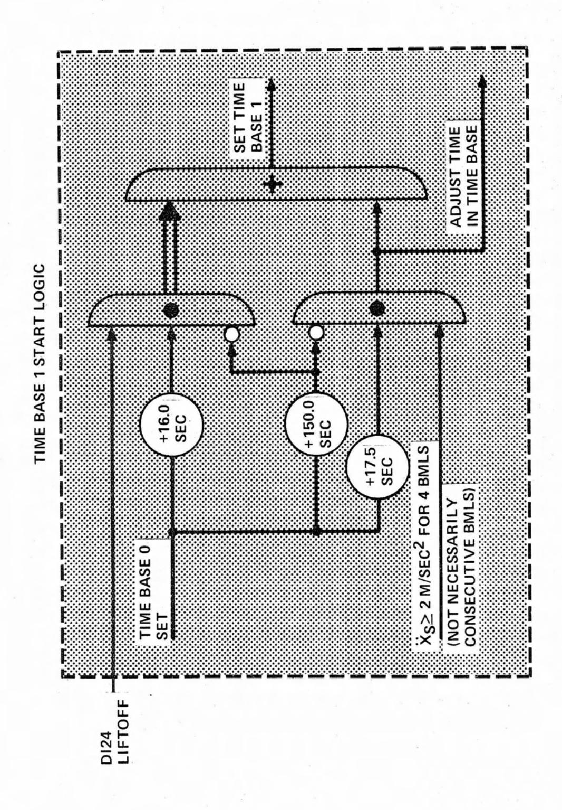
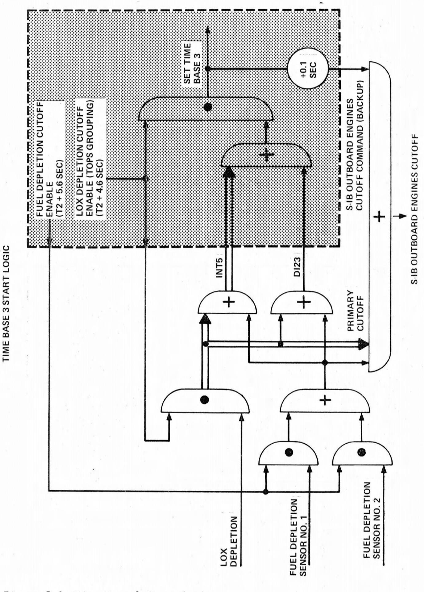
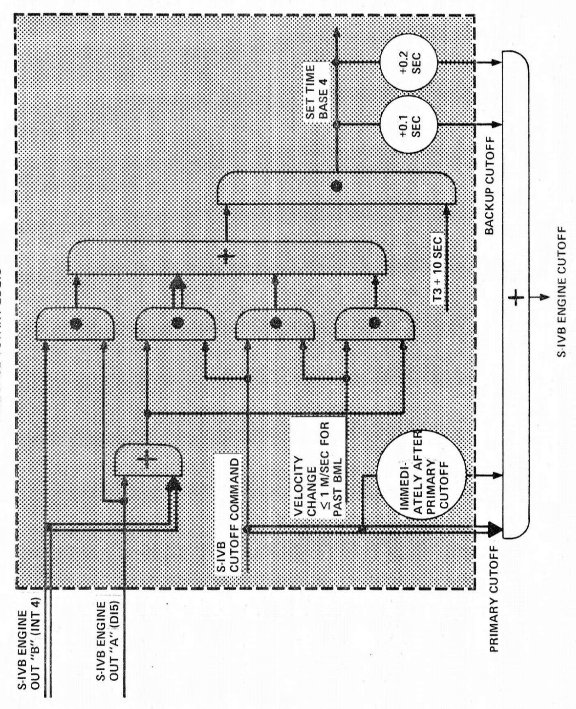
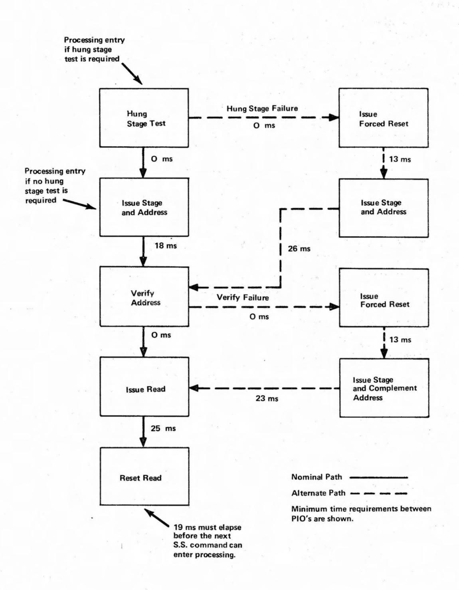
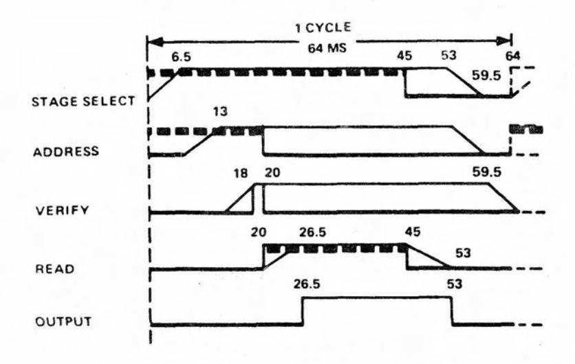
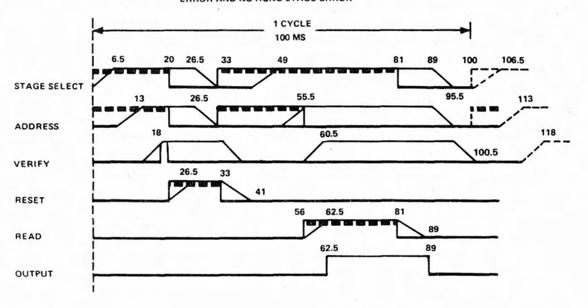
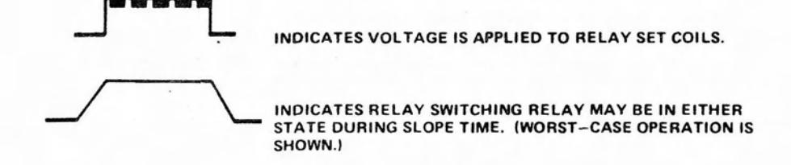

{0}------------------------------------------------

#### SECTION 7

### TIME BASES, DISCRETES, AND INTERRUPTS

#### 7.1 INTRODUCTION

Most of the time-dependent events in the flight program are referenced to important occurrences in the flight to prevent perturbations in one stage from impacting the timing in subsequent stages. To facilitate this timing, time bases must be started upon recognition of these events.

Most discrete outputs (DO) from the LVDC/LVDA to the rest of the Saturn IB system are generated through the stage switch selectors. Each switch selector allows the LVDC to command up to 112 different discrete outputs to each vehicle stage. A detailed explanation of switch selector command processing is contained in Section 9. Thirteen additional discrete output signals can generated by the LVDC.

Two means are available for sending discrete information into the LVDC from the Saturn IB/CSM system and supporting ground equipment: (1) discrete inputs, and (2) interrupts. Three interrupts are controlled internally by the LVDC. (Note: Times marked with an asterisk (\*) are mission-dependent; for exact value, see Event Sequence Timeline in the individual mission requirements, Part II.)

#### 7.2 TIME BASES

Time bases are used to reference program events to some key mission event. A time base must be started within 2 ms of the flight program's recognition that the required conditions have been met. When a time base is started, the flight program must execute the following functions:

{1}------------------------------------------------

- Read the real-time clock to establish the time at which the time base began
- 2. Telemeter the real-time clock reading
- 3. Begin accumulating time in the time base
- 4. Set the required mode code bit
- 5. Stop issuing switch selector commands from the previous time base
- 6. Begin issuing switch selector commands from the new time base.

Five primary time bases are required for the Saturn IB flight program and are described below. Backup methods are required for Time Bases 1 through 4. To complement the time base start requirements descriptions, logic diagrams are provided by Figures 7-1 through 7-4. In each figure flight program functions are shown in the shaded area within the broken line while hardware functions are shown outside the broken line. The symbol " $\bullet$ " is used to represent a logical AND gate, giving an output if and only if all inputs to the gate are present. The symbol "+" is used to represent a logical OR gate, giving an output if one or more inputs to the gate is present. A double line input to an OR gate is used to indicate the primary input expected on a nominal mission. A circle in an input line to a logic gate indicates that the complement of the input signal must be used.

# 7.2.1 Time Base O (Guidance Reference Release)

Time Base 0 (TBO) must be initiated when the program recognizes the guidance reference release (GRR) interrupt (INT7). When TBO is started, the sign bit of Mode Code 25 (MC25) must be set; this bit must never be reset.

### 7.2.2 Time Base 1 (Liftoff)

Time Base 1 (TB1) must be initiated in response to the recognition of the liftoff discrete (DI24) which is generated by the

I-7-2 Rev. A

{2}------------------------------------------------

Figure 7-1 Time Base 1 Start Logic

{3}------------------------------------------------

Figure 7-2 Time Base 2 Start Logic

{4}------------------------------------------------

deactuation of the liftoff relay in the IU when the umbilical disconnects. To prevent premature starting of TB1, the program must neither recognize the liftoff discrete nor start TB1 prior to TO + 16.0 seconds (see DI24 description for details of checking this discrete).

A backup method of detecting liftoff (LO) and starting TB1 must be provided by monitoring the vertical acceleration. If the vertical acceleration due to vehicle motion is greater than or equal to 2 m/sec2 for four computation cycles (not necessarily consecutive) after TO + BU2, liftoff is assumed, TB1 will begin and the time in the time base must be set to T1BIAS. If TB1 has not started by TO + BU3, the program will clamp the ladders to zero and go into a one-instruction loop and TB1 must not start. Exit from this loop can be achieved only upon command of the Saturn Ground System Computer (RCA 110A). When TB1 is started, bit 1 of MC25 must be set; this bit must never be reset.

These requirements for setting Time Base 1 are also illustrated by Figure 7-1.

## 7.2.3 Time Base 2 (S-IB Low Level Sensors Dry)

Time Base 2 (TB2) must start upon detecting either INT2 (S-IB Low Level Sensors Dry "A") or DI21 (S-IB Low Level Sensors Dry "B") if the downrange velocity ( $\mathbf{Z}_{S}$ ) exceeds 500 m/sec. To prevent premature starting of Time Base 2, INT2 must be inhibited and DI21 must not be checked until the time of issuance of the "Propellant Level Sensors Enable" switch selector command in Time Base 1. INT2 is the primary Time Base 2 start signal and DI21 is the backup signal. If downrange velocity does not exceed 500 m/sec, the program must set the ladder outputs to zero and enter a one-instruction loop. Use of the downrange velocity reading provides a safeguard against starting TB2 on the pad, should TB1 be erroneously started without liftoff. Furthermore, if TB2 is not established, no subsequent time

{5}------------------------------------------------

bases can be started. This ensures a safe vehicle, requiring at least one additional failure to render the vehicle unsafe on the pad.

To assure initiation of Time Base 2 on the backup if guidance reference failure (GRF) has occurred, the normal Time Base 2 downrange velocity test will be bypassed.

When TB2 is started, bit 6 of MC25 must be set; this bit must never be reset.

These requirements for setting Time Base 2 are also illustrated \*by Figure 7-2.

### 7.2.4 Time Base 3 (S-IB Outboard Engines Cutoff)

Time Base 3 (TB3) must start upon detecting either INT5 (S-IB Outboard Engines Cutoff "A") or DI23 (S-IB Outboard Engines \*Cutoff "B"). To prevent premature starting of Time Base 3, \*INT5 and DI23 must be inhibited until the time of issuance of the "LOX Depletion Cutoff Enable" switch selector command \*(tops grouping) in Time Base 2. INT5 is the primary Time \*Base 3 start signal and DI23 is the backup signal. \*

When TB3 is started, bit 7 of MC25 must be set; this bit must never be reset.

These requirements for setting Time Base 3 are also illustrated \*by Figure 7-3.

### 7.2.5 Time Base 4 (S-IVB Cutoff)

Time Base 4 (TB4) must be started upon the recognition of any two of the following:

I-7-6 Rev. A

{6}------------------------------------------------

Figure 7-3 Time Base 3 Start Logic

Rev. A

{7}------------------------------------------------

Figure 7-4 Time Base 4 Start Logic

{8}------------------------------------------------

- S-IVB Engine Out "A" (DI5)
- S-IVB Engine Out "B" (INT4)
- S-IVB cutoff issued by the LVDC
- Velocity change of less than or equal to 1 m/sec,
   measured by the inertial platform over the last boost
   major loop cycle.

INT4 and the S-IVB cutoff issued by the LVDC are the primary methods of starting this time base, with DI5 and the velocity check as backups.

The check for the start of TB4 must be inhibited until T3 + S4IGTM to allow the S-IVB to reach 90 percent thrust.

When TB4 is started, bit 24 of MC25 must be set; this bit must never be reset.

These requirements for setting Time Base 4 are also illustrated by Figure 7-4.

### 7.3 DISCRETE OUTPUTS (DO)

Although the LVDC has provision for thirteen DO's, only six are currently defined (see Table 7-1).

DO1: Reset Command Decoder

Each time the LVDC receives DCS information from the LVDA, tests will be performed on the validity of the data. If the data is valid, the LVDC will set DO1 which, in turn, resets the command decoder and initiates a computer reset pulse (CRP).

{9}------------------------------------------------

TABLE 7-1 DISCRETE OUTPUTS

| Discrete Output No. | LVDC Bit Position | Function                        |  |  |  |  |
|------------------------|----------------------|---------------------------------|--|--|--|--|
| 1                      | 12                   | Reset Command Decoder (flight   |  |  |  |  |
| 1 (RCA)                | 12                   | Reset RCA-110A (ground)         |  |  |  |  |
| 2                      | 11                   | RCA-110A Interrupt              |  |  |  |  |
| 3                      | 10                   | Spare                           |  |  |  |  |
| 4                      | 9                    | Guidance Reference Failure A    |  |  |  |  |
| 5                      | 8                    | Spare                           |  |  |  |  |
| 6                      | 7                    | Guidance Reference Failure B    |  |  |  |  |
| 7-11                   | 6-2                  | Spares                          |  |  |  |  |
| 12                     | 1                    | LVDA/LVDC Firing CommitEnable   |  |  |  |  |
| 13                     | Sign                 | LVDA/LVDC Firing Commit Inhibit |  |  |  |  |

- DO1: Reset RCA-110A
- (RCA) This DO is used by the ground routines and no requirement is made of the flight program with respect to it.
- DO2: RCA-110A Interrupt

  This DO causes the RCA-110A to respond to requests by the preflight programs.
- DO4: Guidance Reference Failure A

  DO4 is set in the minor loop or by the error
  monitor if gimbal angle processing indicates
  that the platform has failed.
- D06: Guidance Reference Failure B

  D06 is set in the minor loop or by the error

  monitor along with D04 if gimbal angle processing\nindicates that the platform has failed.

{10}------------------------------------------------

DO12: LVDA/LVDC Firing Commit Enable

This DO is usable from GRR until liftoff. This

DO must be set at the completion of boost ini
tialize if the flight program is ready for launch.

If this DO is not set, liftoff will be inhibited.

\*
DO12 must be reset at T1 + 0.0.

DO13: LVDA/LVDC Firing Commit Inhibit

This DO is usable until liftoff, and is set by
a TLC interrupt; if it is set, it will inhibit
liftoff.

### 7.4 DISCRETE INPUTS (DI)

Immediate action by the LVDC in response to discrete inputs (DI) and discrete input spares (DIS) is not essential (except in the case of liftoff, DI24). When knowledge of the state of a discrete is required, a PIO must be issued to read the digital input multiplexer (PIO 057 for discrete inputs; PIO 053 for discrete input spares), There are 32 discrete inputs available to the LVDC: 24 from the DI register (DIR) and 8 in the DIS register (see Table 7-2). When a discrete is present, the appropriate bit in the DIR will be a logic 1 and will be a logic 0 if the DI is not present.

### 7.4.1 DI1: RCA-110A Sync

This DI is used only in the ground routines and is a logic 0 from liftoff (LO) to end of mission (EOM).

There is no requirement for the flight program to monitor this DI.

{11}------------------------------------------------

TABLE 7-2 DISCRETE INPUTS

| Discrete  | LVDC Bit | Franchica                                                      |  |  |  |  |
|-----------|----------|----------------------------------------------------------------|--|--|--|--|
| Input No. | Position | Function                                                       |  |  |  |  |
| 1         | 23       | RCA-110A Sync                                                  |  |  |  |  |
| 2a        | 22       | Command Decoder OM/D "A"                                       |  |  |  |  |
| 2b        | 22       | Command Decoder OM/D 'B'                                       |  |  |  |  |
| 3         | 21       | Spare (See Section 7.4.3)                                      |  |  |  |  |
| 4         | 20       | Spare (see Section 7.4.3) Spare (wired to Control Distributor) |  |  |  |  |
| 5         | 19       | S-IVB Engine Out "A"                                           |  |  |  |  |
| 6         | 18       | Spare (See Section 7.4.6)                                      |  |  |  |  |
| 7         | 17       | Spare (see Section 7.4.6) Spare (wired to ESE)                 |  |  |  |  |
| 8         | 16       | Spare (wired to ESE)                                           |  |  |  |  |
| 9         | 15       | Spacecraft Control of Saturn                                   |  |  |  |  |
| 10        | 14       | Coolant Thermal Switch #1                                      |  |  |  |  |
| 11        | 13       | Coolant Thermal Switch #2                                      |  |  |  |  |
| 12        | 12       | S-IB/S-IVB Separation                                          |  |  |  |  |
| 13        | 11       | Spare (See Section 7.4.13)                                     |  |  |  |  |
| 14        | 10       | S-IB Outboard Engine Out                                       |  |  |  |  |
| 15        | 9        | S-IB Inboard Engine Out                                        |  |  |  |  |
| 16        | 8        | Prepare for Guidance Reference Release                         |  |  |  |  |
| 17        | 7        | Spare                                                          |  |  |  |  |
| 18        | 6        | Spare                                                          |  |  |  |  |
| 19        | 5        | Spare (See Section 7.4.19)                                     |  |  |  |  |
| 20        | 4        | Spacecraft Initiation of S-IVB Engine                          |  |  |  |  |
| 20        |          | Cutoff                                                         |  |  |  |  |
| 21        | 3        | S-IB Low Level Sensors Dry "B"                                 |  |  |  |  |
| 22        | 2        | Manual Initiation of S-IVB                                     |  |  |  |  |
|           |          | Engine Cutoff "B"                                              |  |  |  |  |
| 23        | 1        | S-IB Outboard Engines Cutoff "B"                               |  |  |  |  |
| 24        | Sign     | Liftoff                                                        |  |  |  |  |
| DIS1      | 7        | Spare (not wired)                                              |  |  |  |  |
| DIS2      | 6        | Spare (not wired)                                              |  |  |  |  |
| DIS3      | 5        | Spare (not wired)                                              |  |  |  |  |
| DIS4      | 4        | Spare (not wired)                                              |  |  |  |  |
| DIS5      | 3        | Spare (not wired)                                              |  |  |  |  |
| DIS6      | 2        | Spare (not wired)                                              |  |  |  |  |
| DIS7      | 1        | Spare (not wired)                                              |  |  |  |  |
| DIS8      | Sign     | Spare (not wired)                                              |  |  |  |  |
|           |          |                                                                |  |  |  |  |
|           |          |                                                                |  |  |  |  |
|           |          |                                                                |  |  |  |  |
|           | 1        |                                                                |  |  |  |  |

{12}------------------------------------------------

7.4.2 DI2: Command Decoder OM/D "A" and Command Decoder OM/D "B"

This DI indicates to the LVDC whether a DCS command is a mode or data command. A logic 1 indicates a mode command has been received, and a logic 0 indicates a data command has been received. This DI must be interrogated once upon receipt of each command decoder interrupt (INT8); see Section 10 for details of the required program response to this DI.

- 7.4.3 DI3: Spare (Wired to IU/S-IVB Interface on SA-206 and SA-207, wired to Control Distributor on SA-208 and Subs)
- 7.4.4 DI4: Spare (Wired to Control Distributor)
- 7.4.5 DI5: S-IVB Engine Out "A"

DI5 indicates that the S-IVB engine is out. This DI must be checked once per BML, until recognition, during the interval from T3 + S4IGTM until T4 + 0.0. DI5 is used as one of the inputs to initiate TB4 (see paragraph 7.2.5). Upon detection of DI5, the discrete's presence must be noted as satisfying one of the conditions for initiating TB4, and the check for the discrete must be discontinued.

This DI will be actuated when both of the two "thrust OK" switches in the S-IVB J2 engine indicate that the engine main LOX injection pressure is below operating level. There are no hardware inhibits of this DI, and it will be active during the entire mission.

7.4.6 DI6: Spare (SA-206, SA-207, SA-209 and Subs), Space-craft Separation Indication (SA-208)

I - 7 - 13

{13}------------------------------------------------

### 7.4.7 DI7: Spare (Wired to the ESE)

This is wired to the Electrical Support Equipment (ESE).

### 7.4.8 DI8: Spare (Wired to the ESE)

### 7.4.9 DI9: S/C Control of Saturn

This discrete originates in the Spacecraft (S/C), and indicates to the LVDC that the S/C has taken control of the flight control computer (FCC) and that the LVDC outputs to the FCC are not being accepted. The program must check this DI once per BML from T4 + 5.0\* to T4 + BN $_5$  and once per second from T4 + BN $_5$  to EOM. A detailed description of the required program response to this DI under nominal conditions is found in the Control Switchover Capability description in Section 5. When this DI is recognized, bit 12 of MC27 must be set; this bit is reset when control is returned to the LVDC.

If a guidance reference failure is detected, the program must check for this DI once per BML in the boost mode and once per second in orbit until detected. If DI9 is on after GRF, the attitude error commands must be set to zero for the remainder of the mission. Bit 15 of MC27 must also be set and remain set for the remainder of the mission. If DI9 is on when guidance reference failure is detected, bit 12 of MC27 must remain set as well as bit 15 of MC27.

If the S/C has taken control of the Saturn, this DI is a logic 1; otherwise, it will be a logic 0. The S/C Control of Saturn Enable switch selector command must be issued or DO4 or DO6 must be set in order for the S/C commands to be accepted by the FCC. The S/C Control of Saturn Disable switch selector disables the S/C commands from being accepted by the FCC unless DO4 or DO6 is on. Although the S/C cannot control the FCC un-

{14}------------------------------------------------

less the above conditions are met, the discrete input register will recognize this DI during all periods of flight up to S/C separation, at which time this DI becomes zero and remains in that state until EOM.

# 7.4.10 DI10: Coolant Thermal Switch #1

This DI indicates that the temperature of the environmental control system (ECS) coolant is above the selected control temperature. This input must be checked once every  $300 \, \text{sec-}$  onds, beginning at  $T_{GRR}$  + TM seconds, for use in maintaining the coolant temperature by controlling the water supply to the sublimator. Bit 18 of MC27 is initially set to indicate that the Water Control Valve Logic Inhibit DCS command has not been received.

If the water valve is closed and either DI10 or DI11 is on, the program must issue the switch selector to open the water valve. If the water valve is closed and both DI10 and DI11 are off, no action is taken.

If the water valve is open and both DI10 and DI11 are off, the program must issue the switch selector to close the valve. If the water valve is open and either DI10 or DI11 is on, no action is taken.

If the Water Control Valve Logic Inhibit DCS command has been accepted, DI10 and DI11 are ignored by the program. Bit 18 of MC27 must be reset.

# 7,4.11 DI11: Coolant Thermal Switch #2

See DI10.

{15}------------------------------------------------

# 7.4,12 DI12: S-IB/S-IVB Separation

This DI indicates that the S-IB and S-IVB have separated. This DI is on, logic 1, until separation occurs, at which time it goes off, logic 0. There is no requirement to monitor this DI.

7.4.13 DI13: Spare (206, 207, 208), Spare (Wired to Control Distributor) (209 and Subs)

### 7.4.14 DI14: S-IB Outboard Engine Out

This DI indicates that at least one S-IB outboard engine is out. This DI must be checked once per BML from T1 +  $T_{\rm S1E0}$  until it is detected or until TB3. A detailed description of the required program response is found in the Engine Out Guidance Modifications discussion in Section 4. When this DI is recognized, bit 9 of MC25 must be set; this bit must never be reset. After this DI has been detected, there is no further requirement to check it.

This discrete is activated when at least two of the three "thrust OK" pressure switches in any one of S-IB engines 1 through 4 (outboard engines) indicate main fuel injection pressure has fallen below operating range. When one or more of the engines is not burning, this DI is a logic 1 and is a logic 0 while all the outboard engines are burning. At S-IB/S-IVB separation, this DI will become a logic 0 and will remain in that state until EOM.

# 7.4.15 DI15: S-IB Inboard Engine Out "B"

DI15 indicates that at least one of the S-IB inboard engines is out. This DI must be checked once per BML from T1 +  $\rm T_{S1E0}$  until it is detected or until TB3. A detailed description of the criteria under which this DI must be checked, and the required

I-7-16

{16}------------------------------------------------

program response, is located in the Engine Out Guidance Modifications discussion in Section 4. When this DI is recognized, bit 8 of MC25 must be set; this bit must never be reset. After this DI has been detected, there is no further requirement to check it.

This DI is activated when at least two of the three "thrust OK" pressure switches in any one of S-IB engines 5 through 8 (inboard engines) indicate main fuel injection pressure has fallen below operating range. When one or more of the engines is not burning, this DI is a logic 1, and is a logic 0 while all the inboard engines are burning. At S-IB/S-IVB separation, this DI will become a logic 0 and will remain in that state until the EOM.

### 7.4.16 DI16: Prepare for Guidance Reference Release

This DI is used only by the ground routines. It occurs 5 seconds prior to guidance reference release (GRR) to warn the ground routine that GRR will be occurring soon. There is no requirement for this DI to be monitored by the LVDC flight program. This DI is also referred to as Guidance Reference Release Alert (GRRA).

- 7.4.17 <u>DI17</u>: Spare
- 7.4.18 DI18: Spare
- 7.4.19 DI19: Spare (Wired to IU/S-IVB Interface on SA-206 \* and SA-207, wired to Control Distributor on SA-208 \* and Subs)
- 7.4.20 DI20: Spacecraft Initiation of S-IVB Engine Cutoff

The purpose of this DI is to give the S/C the capability to initiate S-IVB cutoff while the S/C has control of the flight

{17}------------------------------------------------

control computer. There is currently no requirement to check this DI. Discrete Input 22 and Interrupt 6 provide the capability for S/C initiated cutoff.

### 7.4.21 DI21: S-IB Low Level Sensors Dry "B"

This DI indicates that the propellant level in either the S-IB fuel tanks or LOX tanks has dropped below a given level. This DI must be checked once per BML from the time of issuance of the "Propellant Level Sensors Enable" switch selector command until T2 + 0.0. This DI is used as the backup signal for starting Time Base 2 (see Section 7.2.3).

DI21 confirms that either fuel level sensor no. 2 in the S-IB fuel tanks or LOX level sensor no. 3 in the S-IB LOX tanks is activated. This DI will be hardware inhibited until the "Propellant Level Sensors Enable" switch selector command is issued in TB1. This DI is initially a logic 0. If either of these sensors indicates that propellant depletion has occurred, the DI is a logic 1. The S-IB/S-IVB separation causes this discrete to go to a logic 0.

# 7.4.22 DI22: Manual Initiation of S-IVB Engine Cutoff "B"

This discrete indicates the spacecraft initiation of S-IVB cutoff. This DI must be checked once per BML from T3 + BU1 until T4 + 0.0.

If this DI is detected, the S-IVB cutoff switch selector sequence must be issued; this switch selector sequence is a class 2 alternate sequence. The accelerometer zero test must be disabled, and the X and Z accelerometer RTC's must be expanded to 50 m/sec2. Bit 18 of MC25 must be set; this bit must never be reset.

I - 7 - 18

Rev. A

{18}------------------------------------------------

# 7.4.23 DI23: S-IB Outboard Engines Cutoff "B"

This DI indicates that the propellant in the S-IB fuel tanks has depleted. This DI must be checked once per BML from the time of issuance of the "LOX Depletion Cutoff Enable" switch selector command until T3 + 0.0. This DI is used as the back-up signal for starting Time Base 3 (see Section 7.2.4).

DI23 indicates that propellant depletion has occurred when two out of three "thrust OK" pressure switches in at least one outboard engine indicate the main fuel injection pressure in that engine has fallen below operating range, or that either of the two fuel depletion sensors in the S-IB fuel tanks is activated. This DI will be hardware inhibited from the "thrust OK" switches until the "LOX Depletion Cutoff Enable" switch selector command is issued in Time Base 2. It is hardware inhibited from the fuel depletion sensors until the "Fuel Depletion Cutoff Enable" switch selector command is issued.

# 7.4.24 <u>DI24: Liftoff</u>

This DI indicates that liftoff has occurred. DI24 must be interrogated before and after every minor loop (twice every 40 ms) \* during the time from TO + 16.0\* (-0,+40 ms) until TBl. This DI is \* the primary signal used to start TBl (see Time Base 1 start logic). \*

# 7.4.25 DIS1-DIS8: Spares (Not Wired)

### 7.5 INTERRUPTS

Twelve interrupts have been provided in the LVDC in order to permit the interruption of the normal program to free the computer for priority tasks. The LVDC must respond to the interrupt upon completion of the instruction being executed when the interrupt is received, or after interrupts are enabled following interrupt protected logic.

{19}------------------------------------------------

Of the twelve interrupts, nine are external and inform the LVDC of the occurrence of an event which requires immediate action. Three interrupts are provided for functions internal to the LVDC. These are the simultaneous memory error (TLC) and two interrupts whose use is determined by the implementation of the flight program. See Table 7-3.

TABLE 7-3 INTERRUPTS

| Interrupt Storage Register Bit                               | LVDC Data Word Bit Position                                   | Function                                                                 |       |  |  |
|--------------------------------------------------------------------|---------------------------------------------------------------------|--------------------------------------------------------------------------|-------|--|--|
| 1 2 3 4 5 6 7 8b 8a 9 10 11 12 | 11 10 9 8 7 6 5 4 4 3 2 1 Sign} | RCA-110A Interrupt S-IVB Engine Out "B" S-IB Outboard Engines Cutoff "A" | * * * |  |  |

The processing of an interrupt requires that the program complete all the following:

- 1. Establish the mechanism for the return to the main program once the interrupt has been processed
- 2. Prevent the interruption of the processing of the interrupt by any other interrupts except TLC (A TLC interrupt will be allowed to interrupt the processing of any interrupt except another TLC).

{20}------------------------------------------------

- 3. Determine the source of the interrupt
- 4. Perform the functions required by the interrupt
- 5. Remove the inhibit of normally enabled interrupts unless the time is within 60 milliseconds (ms) of S-IVB cutoff, in which case only the inhibit on INT12 is removed to permit the S-IVB cutoff to occur at exactly the correct time
- 6. Return to the main program.

If more than one interrupt occurs at the same time, they must be processed in the following priority sequence: INT9, INT12, external, INT11 (external interrupts will be processed in chronological order).

A brief description of these interrupts and the required response is provided below.

# 7.5.1 INT1: Command LVDA/RCA-110A Interrupt

This signal is used in the Preflight routines and there is no requirement to process it by the flight program. A logic 1 indicates an interrupt from the RCA-110A. A logic 0 indicates no interrupt is present. The line from the RCA-110A breaks at LO and this interrupt will remain a logic 0 until the EOM.

# 7.5.2 INT2: S-IB Low Level Sensors Dry "A"

This interrupt indicates that the propellant level in either the S-IB fuel tanks or LOX tanks has dropped below a given level. This interrupt must be program inhibited until the time of issuance of the "Propellant Level Sensors Enable" switch selector command. This interrupt is used as the primary signal for starting Time Base 2 (see Section 7.2.3). Once this interrupt is received or when Time Base 2 is started, this interrupt must be inhibited for the remainder of the mission.

Rev. A

{21}------------------------------------------------

This interrupt will be activated when either fuel level sensor no. 1 in the S-IB fuel tanks or LOX level sensor no. 3 in the S-IB LOX tanks is activated. This DI will be hardware inhibited until the "Propellant Level Sensors Enable" switch selector command is issued in TB1.

# 7.5.3 INT3: RCA-110A Interrupt

See INT1.

# 7.5.4 INT4: S-IVB Engine Out "B"

This interrupt indicates the S-IVB engine is out. The program rust inhibit this interrupt, except during the period from T3 + S4IGTM until T4 + 0.0. This interrupt is one of the inputs to initiate TB4 as described in paragraph 7.2.5. This interrupt provides a fast response to the engine cutoff in normal operation. However, if none of the other conditions required to satisfy the TB4 start logic are met when the interrupt is received, the interrupt's presence will be noted and the interrupt inhibited. The program will then start TB4 from backup processing when one of the other conditions is satisfied.

This interrupt will be activated when both of the "thrust \*OK" switches in the S-IVB J2 engine indicate that the main \*LOX injection pressure has fallen below operating range. There are no hardware inhibits of this interrupt.

# 7.5.5 INT5: S-IB Outboard Engines Cutoff "A"

This interrupt indicates that the propellant in the S-IB fuel tanks has depleted. This interrupt must be program inhibited until the "LOX Depletion Cutoff Enable" switch selector command is issued. This interrupt is used as the primary signal for starting Time Base 3 (see Section 7.2.4). Once this interrupt is received or when Time Base 3 is started, this interrupt must be inhibited for the remainder of the mission.

Rev. A

{22}------------------------------------------------

This interrupt will be activated when two out of three "thrust OK" pressure switches in at least one outboard engine indicate the main fuel injection pressure in that engine has fallen below operating range, or that either of two fuel depletion sensors in the S-IB fuel tanks is activated. This DI will be hardware inhibited from the "thrust OK" switches until the "LOX Depletion Cutoff Enable" switch selector command is issued in Time Base 2. It is hardware inhibited from the fuel depletion sensors until the "Fuel Depletion Cutoff Enable" switch selector command is issued.

# 7.5.6 INT6: Manual Initiation of S-IVB Engine Cutoff "A"

This interrupt indicates the spacecraft initiation of S-IVB cutoff. The program must inhibit this interrupt, except during the period from T3 + BUI until T4 + 0.0.

If INT6 is detected, the S-IVB cutoff switch selector sequence must be issued; this switch selector sequence is a class 2 alternate sequence. The accelerometer zero test must be disabled, and the X and Z accelerometer TRC's must be expanded to  $50 \text{ m/sec}^2$ . Bit 18 of MC25 must be set; this bit must never be reset.

# 7.5.7 INT7: Guidance Reference Release (GRR)

This interrupt comes from the RCA-110A and indicates that the platform has been released. GRR will occur approximately 17 seconds prior to liftoff. When the LVDC receives GRR, TBO is started; this interrupt is then inhibited for the duration of the mission, and program control is transferred to the flight program.

This interrupt is a logic 0 until GRR, at which time it becomes a logic 1. At liftoff (LO), the state of the interrupt will become a logic 0 and remain in that state until the EOM.

I - 7 - 23

{23}------------------------------------------------

# 7.5.8 INT8A and INT8B: Command Decoder Interrupts "A" and "B"

These interrupts indicate to the LVDC that a DCS command has been received by the command decoder. The program requirements in response to this interrupt are stated in Section 10.

This interrupt must be enabled by the S/C or by the IU Command System Enable switch selector.

# 7.5.9 INT9: TLC - Simultaneous Memory Error

A TLC interrupt indicates that an error is present in both duplex memory locations containing a data word or an instruction word. When this interrupt occurs the TLC code, real time clock reading and the next instruction to be executed must be telemetered. If the vehicle is in a dark period in orbit these values must be compressed. Bit 25 of MC25 must be set; the bit must never be reset. All internal interrupts must be rescheduled, the DOR and ICR must be reset, and the present EMR reading must be ORed with any past EMR accumulations. If a switch selector is being processed when the TLC interrupt occurs, a forced reset must be issued.

After processing the TLC interrupt, the program must return to one of the following areas of the program:

- To the beginning of the BML when in the boost mode
- To compressed data telemetry when in the orbital mode over a dump station
- To any periodic processing which may be waiting when in the orbital mode not over a dump station

{24}------------------------------------------------

• When in a phase initialize to the start of the phase initialization being processed. Note: If a TLC occurs in phase initialization, the program may not return to the beginning of that function; however, D013 will be set by the hardware which will inhibit launch.

If an interrupt was being processed or is present when the program finishes processing the TLC interrupt, the first program function to be processed will be the interrupt.

### 7.5.10 INT10: Spare

# 7.5.11 INT11 and INT12: Internal Function of the LVDC

These two interrupts are provided to the LVDC for functions internal to the computer. INT12 will be used for high priority program functions which have close timing requirements (switch selectors and minor loops) and INT11 will be used for those program functions of lower priority than the above but which must still be processed within close timing tolerances.

In an interrupt occurs and no bit is set in the interrupt storage register, the program must check the INT12 scheduler. If the scheduler indicates that an INT12 should have been generated, the program must process the function called for by the scheduler. If the scheduler indicates that INT12 functions are not required, control must be returned to the interrupted program.

{25}------------------------------------------------

(THIS PAGE HAS BEEN LEFT BLANK INTENTIONALLY.)

{26}------------------------------------------------

#### SECTION 8

### LAUNCH VEHICLE ATTITUDE CONTROL

### 8.1 INTRODUCTION

The flight program functions as a part of the attitude control system by generating vehicle attitude error signals. The launch vehicle attitude, in the form of angular displacements measured by inertial platform gimbal resolvers, is read into the LVDC through LVDA hardware. The attitude error is then computed by differencing the attitude angles with the desired angles computed by the guidance equations. The resulting attitude error is transformed to the body reference frame, limited in magnitude and rate of change, and issued to the flight control system.

The control functions of determining vehicle attitude and computing and issuing attitude error commands are called the minor loop. These functions are performed twenty-five times per second during boost and ten times per second during orbit. The supporting control functions of computing attitude change increments and coefficients for the gimbal-to-body transformation required for attitude error command computations are called minor loop support functions. These functions are performed once per boost major loop (BML) during boost and once per second during orbit.

#### 8.2 MINOR LOOP

The minor loop reads platform gimbal data, evaluates these data, and computes and issues attitude error commands. The gimbal angles are processed in the following order: yaw, pitch, and roll.

{27}------------------------------------------------

The minor loop samples the yaw gimbal resolver, evaluates the yaw gimbal resolver data, computes the yaw attitude angle, and computes and issues the yaw attitude error command. This process is then repeated for the pitch and roll gimbals.

Minor loop functions must be performed every 40 ms during boost and every 100 ms during orbit. However, the start of a minor loop may be delayed while processing of any of the following interrupt-protected program functions is under way. During boost, occasional delays of up to 8 ms may result from interference by switch selector processing. A delay of up to 21 ms may result while processing interrupt protected data output multiplexer (DOM) telemetry. A delay of up to 60 ms may occur just prior to S-IVB cutoff. In orbit, minor loops may be delayed up to 12 ms by command decoder interrupt processing.

# 8.2.1 Gimbal Angle Data

The vehicle attitude angles are sensed by inertial platform resolvers which measure the angles between the three platform gimbals and the mounting frame. Primary, or fine, and backup resolvers are provided for each gimbal.

The fine resolvers are initially selected for attitude determination and are used unless repeated fine resolver errors are detected. A backup resolver is selected for attitude determination only if its corresponding fine resolver shows repeated errors.

The resolver outputs are converted to digital form in the LVDA by a combination of crossover detectors (COD) and redundant eleven bit counters. The resolver data word contains the redundant counter readings and a disagreement bit in the following format: DAAAAAAAAAAAASSSBBBBBBBBBBBBBBBBBBBBBBB

\*

{28}------------------------------------------------

represents the A counter reading, B represents the B counter reading, S represents spare bits, and D represents the disagreement bit. The disagreement bit is an indication from LVDA circuitry that the A and B counters disagree by more than +3 or less than -4 bits.

When a fine resolver is used to determine a gimbal angle, the low order counter bit is approximately equal to 0.00279 degrees, and one fine resolver revolution is equivalent to 5.625 degrees of gimbal rotation. Full scale on each resolver is represented by 2016 counter bits. If a backup resolver is used, the low order bit is approximately equal to 0.0893 degrees; one resolver revolution is equivalent to 180 degrees of gimbal rotation, or 2016 counter bits.

Each actual attitude angle is formed by adding the appropriate fine resolver reading to a high order angle. This high order angle represents the product of 5.625 degrees times the number of fine resolver rotations since guidance reference release (GRR). These fine resolver readings and their corresponding high order angles are initialized at GRR. The pitch and yaw resolver readings and high order angles are initially set to The fine roll resolver readings are initialized to the last fine roll resolver reading made by the Prepare-to-Launch (PTL) routine. The high order roll angle is set to the high order six bits of the angle represented by the last roll backup resolver reading made by the PTL routine. This composite roll angle must be compared to the whole backup roll resolver read-If the backup reading is more than 2.8125 degrees larger than the composite angle, 5.625 degrees must be added to the composite angle. If the backup reading is more than 2.8125 degrees smaller than the composite angle, 5.625 degrees must be subtracted from the composite angle.

The initial value for a past backup resolver reading is set equivalent to the last attitude angle determined by the corresponding fine resolver. Since one backup resolver

{29}------------------------------------------------

\*

### 8.2.2 Gimbal Data Processing

Data representing a gimbal resolver reading must undergo several validity tests before it can be used to compute vehicle attitude and attitude error commands. The A counter readings are tested for reasonableness unless the disagreement bit is on. If the disagreement bit is on, the cause of the disagreement and the correct counter reading are determined before reasonableness testing is processed. A reasonable counter reading is converted from bits to pirads and added to the corresponding high order angle to compute the attitude angle.

### 8.2.2.1 Disagreement Bit Processing

If the disagreement bit is present in a gimbal data word, disagreement bit processing determines, in the following order, what conditions caused the disagreement and which counter reading is valid:

- One counter reading near zero and the other near
   2016 (equivalent to a 360 degree resolver rotation)
- Disagreement bit circuitry error (no actual counter disagreement)
- 3. One or both counters in error
- 4. One multiplexer in error (resolver/COD selectors for input to the counters).

The first three conditions are identified by disagreement bit processing and the fourth is identified by a combination of disagreement bit and reasonableness tests.

{30}------------------------------------------------

During normal operation when a resolver has rotated through 360 degrees, one counter may read slightly above zero while the other indicates slightly less than 2016. To test for this condition, the A and B counter readings are compared. If the A reading is 2012 bits greater than the B reading, or if the B reading is at least 2013 bits greater than the A reading, a 360 degrees resolver rotation has occurred and the readings actually fall within the allowable disagreement limits. If there is no actual disagreement, the A counter reading is selected for reasonableness testing.

If a 360 degree resolver rotation is not indicated, the A and B readings are compared to see if the A reading is more than 3 bits greater or 4 bits smaller than the B reading. If this condition exists, there is a valid disagreement. If a valid disagreement is still not evident, the disagreement bit circuitry is assumed to be in error and the A reading is selected for reasonableness testing. If disagreement bit circuitry errors are detected twice in 0.8 seconds during boost or twice in one second during orbit, disagreement bit processing must be permanently bypassed, counter A readings must be permanently selected for reasonableness testing, and bit 13 of Mode Code 24 must be set.

When valid disagreements are indicated, the counters must be tested by permitting them to count at a known frequency for five LVDC instruction times. If either counter reading differs from 869 by more than three bits, that counter is in error and the other counter is selected for reasonableness testing.

Two erroneous readings from the same counter during 0.8 seconds in boost or in one second during orbit cause disagreement bit processing to be permanently bypassed and the good counter to

{31}------------------------------------------------

be permanently used for reasonableness testing. If this condition is detected, bit 14 (A counter, bad) or bit 15 (B counter, bad) of Mode Code 24 is set to denote the presence of a bad counter.

If both counters are simultaneously in error, reasonableness testing is bypassed, the corresponding attitude angle is not updated and the last attitude error command is reissued.

During a minor loop, occurrence of this condition twice per 0.8 seconds in boost or twice per one second during orbit will cause disagreement bit processing to be permanently bypassed, the guidance reference failure (GRF) discrete outputs (DO4 and DO6) to be set, bits 14 and 15 of Mode Code 24 to be set, and bit 14 of Mode Code 27 (GRF) to be set. If GRF occurs, the last attitude error commands are reissued for the remainder of the mission unless spacecraft control (DI9) is detected (see Section 7.4.9).

If an erroneous counter is not determined to be the cause of the disagreement, it is assumed that the B multiplexer is in error and the A counter reading is selected for reasonableness testing. However, if the A reading is found unreasonable, the A multiplexer is assumed to be erroneous, the B multiplexer is assumed to be operating correctly, the corresponding attitude angle is not updated, and the last attitude error command is reissued. If the A multiplexer is in error twice or the B multiplexer is in error five times in 0.8 seconds in boost, or in one second during orbit, disagreement bit processing is permanently bypassed, the counter corresponding to the correct multiplexer is permanently selected for reasonableness testing, and bit 20 (A multiplexer bad) or 21 (B multiplexer bad) of Mode Code 24 is set to denote the erroneous multiplexer.

{32}------------------------------------------------

#### 8.2.2.2 Reasonableness Tests

The A counter reading or the B counter reading, selected by the disagreement bit processing tests, must undergo two reasonableness tests before it is used to update the vehicle attitude. An unreasonable zero reading or unreasonable reading change is considered in error and is not used to update the vehicle attitude angle. A reasonable reading is converted from bits to pirads and added to the corresponding high order angle to compute the vehicle attitude angle.

The reading is first tested for zero to detect a failure in the power source activating the resolvers. A resolver reading of zero is considered unreasonable if its past reading was zero and if the corresponding attitude error magnitude is greater than or equal to the constant ML6HUN. The values of ML6HUN for all periods of flight are listed in the Event Sequence Timeline Table in Part II.

Non-zero and reasonable zero readings will next be tested to determine if the change between the present and past readings of a resolver is unreasonably large. If the change is smaller than a resolver reasonableness test constant, it is reasonable. If the change is not smaller than the test constant, a legitimate counter overflow (resolver rotation through 360 degrees) is tested for by comparing the change with an overflow test constant. If the change is greater than or equal to the overflow test constant, the resolver reading is reasonable. The resolver reasonableness test constants for the X, Y, and Z fine and backup gimbal resolvers are listed in the Event Sequence Timeline Table of Part II. Each overflow test constant is equal to 2016 bits minus the number of bits representing the corresponding reasonableness test constant.

{33}------------------------------------------------

If an unreasonable resolver reading is detected, the corresponding attitude angle is not updated and the last attitude error command associated with the unreasonable resolver reading is reissued. If a fine resolver is unreasonable three times in 0.8 seconds in boost or in one second during orbit, its corresponding backup resolver is selected for attitude information for the remainder of the mission. The calculation of SMC terms must be inhibited while the resolver reading remains unreasonable.

If a backup resolver reading is unreasonable more than 12 times per 0.8 seconds during boost or more than 6 times per second during orbit, the GRF discretes (D04 and D06) and bit 14 of Mode Code 27 are set by the minor loop. If guidance reference failure occurs, the last attitude error commands will be reissued for the remainder of the mission unless spacecraft control (DI9) is detected (see Section 7.4.9).

If the yaw, roll, or pitch fine resolver fails and the program switches to the backup resolver, bit 7, 9, or 11 of Mode Code 24 is set to denote the Z, X, or Y fine resolver failure. Should a Z, X, or Y backup resolver fail, bit 6, 8, or 10 of Mode Code 24 is set to denote the failure. If this happens, bit 14 of Mode Code 27 is also set to denote GRF.

### 8.2.2.3 Minor Loop Error Telemetry

If a resolver data error is detected by disagreement bit processing or reasonableness testing, special telemetry must be issued from the minor loop in order to identify the error condition. This minor loop error telemetry originates immediately after the error detection under the octal PIO code 570 (PCM tag 0574).

{34}------------------------------------------------

For disagreement bit processing, the minor loop error telemetry contains the contents of the entire resolver data word (disagreement bit, A and B counter readings). If COD counter or multiplexer errors are detected, the contents of the A and B COD counters obtained from the special counter test must also be telemetered. The three unused bits in the duplexed COD counter word are used to denote the specific circuitry, specific counter, or multiplexer error. Table 8-1 shows the LVDC bit configuration for this telemetry.

TABLE 8-1 DISAGREEMENT BIT MINOR LOOP ERROR TELEMETRY FORMAT

|     |    |         | LV | DC B | it P | osition   |                                   |
|-----|----|---------|----|------|------|-----------|-----------------------------------|
| S   | 1- | 11      | 12 | 13   | 14   | 1525      | Description                       |
| 1   | A  | counter | 0  | 0    | 0    | B counter | Counter or multi- plexer error |
| 1   | A  | counter | 0  | 0    | 1    | B counter | Disagreement bit circuitry error  |
| 1   | A  | counter | 0  | 1    | 0    | B counter | A counter error test word         |
| 1   | A  | counter | 0  | 1    | 1    | B counter | B counter error test word         |
| 1   | A  | counter | 1  | 0    | 0    | B counter | Both counters erro test word      |
| 1 - | A  | counter | 1  | 0    | 1    | B counter | B multiplexer erro                |

For resolver data errors detected by reasonableness testing, the minor loop error telemetry contains the past and current values of the resolver data being tested. This error telemetry also denotes the switch from a fine to a backup resolver. The LVDC sign bit is zero and LVDC bits 12, 13, and 14 are used to denote the specific gimbal and associated error. Table 8-2 shows the LVDC bit configuration for reasonableness test error telemetry.

{35}------------------------------------------------

TABLE 8-2 REASONABLENESS TEST MINOR LOOP ERROR TELEMETRY FORMAT

|                                    |      |       | LVI | OC I | 3it | Position |       |                                                            |
|------------------------------------|------|-------|-----|------|-----|----------|-------|------------------------------------------------------------|
| S                                  | 1    | 11    | 12  | 13   | 14  | 15       | 25    | Description                                                |
| 0                                  | Past | value | 0   | 0    | 0   | Current  | value | Pitch gimbal angle failed zero rea- sonableness test |
| 0                                  | Past | value | 0   | 0    | 1   | Current  | value | Roll gimbal angle failed zero rea- sonableness test  |
| 0                                  | Past | value | 0   | 1    | 0   | Current  | value | Yaw gimbal angle failed zero rea- sonableness test   |
| 0                                  | Past | value | 0   | 1    | 1   | Current  | value | Pitch gimbal angle failed reasonable change test     |
| 0                                  | Past | value | 1   | 0    | 0   | Current  | value | Roll gimbal angle failed reasonable change test      |
| 0                                  | Past | value | 1   | 0    | 1   | Current  | value | Yaw gimbal angle failed reasonable change test       |
| 0                                  | Past | value | 1   | 1    | 0   | Current  | value | Roll gimbal angle switched to backup                       |
| 0                                  | Past | value | 1   | 1    | 1   | Current  | value | Pitch gimbal angle switched to backup                      |
| 0                                  | Past | value | 1   | 1    | 1   | Current  | value | Yaw gimbal angle* switched to backup                       |
| *Pitch and yaw codes are identical |      |       |     |      |     | dentical |       |                                                            |

If GRF is detected, minor loop error telemetry is not required and must be inhibited for the remainder of the mission.

# 8.2.3 Attitude Error Commands

After the minor loop attitude commands are computed (Eq. 8.2.1) the attitude error commands will be computed and transmitted

{36}------------------------------------------------

to the LVDA ladders in this order: yaw, pitch, and roll. Equation 8.2.2, in the order of actual solution, is used to compute the attitude error commands in units of ladder bits. Prior to the initial computation of Eq. 8.3.5 through 8.3.10 (see Section 8.3.2), Eq. 8.2.2 must use zero values for the gimbal-to-body transformation coefficients. Before each attitude error command is transmitted to the LVDA ladders, it is magnitude and rate limited. The attitude error commands are then transmitted to the LVDA ladders in sign and magnitude form with the least significant bit representing 0.06 degrees. The error command magnitude and rate limits for the yaw, pitch, and roll channels are listed in the Event Sequence Timeline Table of Part II of this document for all periods of flight.

During all flight phases, the attitude error commands are sent to redundant digital to analog (D/A) ladder networks in the LVDA each minor loop. These commands are normally provided to the flight control computer by ladder channel A. However, channel B is automatically selected by LVDA circuitry if channel A disagrees with a reference channel. Ladder channel A failure is determined each minor loop by checking bit 17 of the error monitor register reading to see if channel B has been selected. Channel A is re-selected each minor loop unless it is known to have failed three times in 0.8 seconds during boost or three times in one second during orbit. If this condition exists, channel B is used for the remainder of the mission and bit 16 of MC24 is set.

If GRF occurs, the attitude error commands (ladder commands) must be frozen at their current values. If DI9 is detected after GRF, the attitude error commands must be set to zero and maintained at zero for the remainder of the mission.

#### 8.3 MINOR LOOP SUPPORT

Minor loop support functions consist of computing attitude change increments and the coefficients for the gimbal-to-body transformation to be used in the minor loop.

I-8-11

{37}------------------------------------------------

### 8.3.1 Attitude Increments

Desired attitude commands  $(\chi_x^{\dagger}, \chi_y^{\dagger}, \chi_z^{\dagger})$  are computed each minor loop by adding the fixed increments  $(\Delta\chi_x^{\dagger}, \Delta\chi_y^{\dagger}, \Delta\chi_z^{\dagger})$  to the previous attitude command values. These attitude increments are computed (Eq. 8.3.1) by dividing the difference between the guidance commands  $(\chi_x, \chi_y, \chi_z)$  and the present minor loop attitude commands by the number of times the attitude commands are to be incremented between minor loop support computations.

The attitude increments must be magnitude limited to provide rate limiting on the minor loop attitude commands. This minimizes vehicle oscillations and control perturbations when the desired and the actual vehicle attitudes differ widely.

The rate at which the attitude commands are to be incremented and the values of the pitch, yaw, and roll attitude increment limits for all periods of flight are listed in the Event Sequence Timeline Table of Part II.

As long as the computed pitch or yaw attitude increments exceed the magnitude limits, the steering misalignment correction calculations used in IGM must be inhibited. The SMC terms must be held at their last computed values while the calculations are inhibited.

### 8.3.2 Gimbal-to-Body Transformation

The attitude errors are computed in the inertial platform gimbal system and must be transformed in the minor loop to provide attitude error signals in the body-reference frame. To compensate for the changing relationship between the two reference frames, the average roll and yaw attitude angles predicted for the next computation cycle are used to

{38}------------------------------------------------

calculate the coefficients. Equations 8.3.2 through 8.3.4 are used to compute the predicted average attitude angles.

Special logic is required in forming the average roll angle to avoid a false average when one value is nearly +1 pirad and the other nearly -1 pirad. If the magnitude of the difference between the computed average roll angle and the present roll attitude is greater than 0.5 pirads, 1 pirad must be added to the computed average. A false yaw angle average cannot occur since yaw guidance commands are limited to ±0.25 pirad (±45 degrees). Equations 8.3.5 through 8.3.10 are used to compute the gimbal-to-body transformation coefficients. The scale factor SF converts the attitude errors from pirads to units required by the LVDA D/A converters. Since the least significant D/A converter bit equals 0.06 degrees, SF equals 3000 bits per pirad.

{39}------------------------------------------------

(THIS PAGE HAS BEEN LEFT BLANK INTENTIONALLY.)

{40}------------------------------------------------

### SECTION 9

#### SWITCH SELECTOR PROCESSING

### 9.1 INTRODUCTION

The initiation of time dependent hardware events in the Saturn IB is accomplished by switch selector commands issued by the LVDC/LVDA. A switch selector in each launch vehicle stage, including the Instrument Unit, decodes the commanded address and activates one of 112 possible output circuits in that stage.

Switch selector processing performs the following flight program functions:

- Actuation of the switch selector command, including the necessary tests, verifications, and issuances
- Proper timing, as specified in the Flight Sequencing Table in Part II
- Adherence to the hierarchy of priorities when alternate flight sequences are requested.

#### 9.2 COMMAND EXECUTION OPERATIONS

The flight program action required to execute switch selector commands consists of the following sequence of program operations: test for hung stage (as necessary), issue the stage and address, verify the address, issue the read command, and issue the read reset.

{41}------------------------------------------------

### 9.2.1 Sequence of Operations

Figure 9-1 shows the sequence of operations required to issue a switch selector command and the minimum elapsed time which must be allowed between software operations for the corresponding hardware functions to be correctly executed. The minimum times shown in Figure 9-1 result from the hardware reaction times shown in Figure 9-2.

### 9.2.1.1 Hung Stage Test

If the switch selector stage select circuitry does not reset after a switch selector command has been issued, a hung stage condition exists. Since the eight command address lines from the LVDA are common to all stage switch selectors, a hung stage condition will activate the switch selector circuitry on the hung stage for all subsequent switch selector commands. A hung stage results in erroneous outputs only when the currently selected stage differs from the stage selected by the previous switch selector command.

To test for a hung stage, the program must read the feedback lines. If the feedback bits are zero, there is no hung stage and the stage and address will be issued. If the feedback bits are not zero, a hung stage exists and a forced reset must be issued. Thirteen milliseconds must elapse between the forced reset and the issuance of the stage and address of the next switch selector command.

The flight program must test for a hung stage prior to issuing any of the following:

The first switch selector command in each new time base

{42}------------------------------------------------

Figure 9-1 Minimum Program Time Requirements

{43}------------------------------------------------

# ONE SWITCH SELECTOR CYCLE WITH FEEDBACK ERROR AND NO HUNG STAGE ERROR

Figure 9-2 Typical Switch Selector Timing Diagram

{44}------------------------------------------------

- The first switch selector command in any alternate switch selector sequences
- Any switch selector command in which the selected stage differs from that of the previous command.

### 9.2.1.2 Stage and Address

After the hung stage test, if it is necessary, the flight program must issue the stage and address. Table 9-1 indicates the stage and address bit format of the Switch Selector Command Word required for the issuance of all Switch Selector commands. Only one stage will be selected by each switch selector command.

TABLE 9-1 SWITCH SELECTOR COMMAND WORD

| Bit Position | Function                              |  |  |  |  |  |
|--------------|---------------------------------------|--|--|--|--|--|
| S            | Read Command                          |  |  |  |  |  |
| 1            | Force Reset of Switch Selector Relays |  |  |  |  |  |
| 2            | IU Stage Selected                     |  |  |  |  |  |
| 3            | Spare                                 |  |  |  |  |  |
| 4            | S-IVB Stage Selected                  |  |  |  |  |  |
| 5            | Spare                                 |  |  |  |  |  |
| 6            | S-IB Stage Selected                   |  |  |  |  |  |
| 7-14         | Stage Address                         |  |  |  |  |  |
| 15-25        | Spares                                |  |  |  |  |  |

{45}------------------------------------------------

The 8-bit coded address is transmitted in parallel via eight output lines from the LVDA to all switch selectors. At the same time, the corresponding stage select lines (two lines from each stage select bit to the corresponding stage switch selector) are activated to enable the desired stage to receive the coded command.

After issuing the stage and address, DOM telemetry of the discrete output register and switch selector register must be issued while the stage and address are in the LVDA switch selector register.

In the nominal sequence (no hung stage detected), 18 ms must elapse between the stage and address issuance and the next operation, that of verifying the address. If a hung stage were detected, 26 ms must elapse before verifying the address. The additional 8 ms is required because of the necessary forced reset.

#### 9.2.1.3 Address Verification

After receiving the address and prior to the actuation of the stage circuitry, the stage switch selector returns the one's complement of the received address to the LVDA via eight feedback lines.

The flight program must sample the eight feedback bits to determine if the commanded transfer is correct. If the command has been correctly interpreted by the switch selector, the eight feedback bits will be the one's complement of the commanded address and the read command must be issued immediately.

A feedback which is not the one's complement of the commanded address is an erroneous feedback word. Erroneous feedback words must be tested to determine if they are zero or non-zero.

{46}------------------------------------------------

All erroneous feedback words which are zero must be further tested for a zero simplex malfunction in the switch selector. If the commanded address contains more than one zero, the feedback mechanism is assumed to have failed (zero simplex malfunction) and nominal processing will be resumed as if the feedback were correct.

All other erroneous feedback words will disagree by one or more bits from the one's complement of the commanded address.

If the erroneous feedback word disagrees by only one bit from the one's complement of the commanded address (which includes the case when the commanded address of a zero feedback word contained only one zero), then the program must issue a forced reset. Thirteen milliseconds later the program must issue the stage and one's complement address. Twenty-three milliseconds must elapse between the issuance of the stage and complement address and the issuance of the read command. DOM telemetry of the complement address must also be issued.

If the feedback work disagrees by more than one bit from the address complement and Channel A (normal operation) is in use, then the following sequence of events must be initiated with the time delays specified above:

- 1. The program must issue a forced reset
- 2. Channel B must be selected
- The stage and complement of the commanded address must be issued
- 4. The read command must be issued.

{47}------------------------------------------------

Bit 12 of the internal control register (ICR) must be set to zero. Bit 17 of Mode Code 24 must be set, this bit must never be reset; and the feedback address must be telemetered. After the program switches to Channel B, Channel A must never be used again. Instead, Channel B will be used for the rest of the mission. Nominal processing of the commanded address, including verification, will be continued using Channel B.

#### 9.2.1.4 Read Command

After an acceptable switch selector stage and address, or complement address, has been issued, the program must issue the read command. This command activates the selected circuitry in the switch selector to produce the command output.

After the read command is issued to the switch selector, the flight program must telemeter the stage, the commanded address, and the real time clock reading when the read command was issued. During the orbital mode when the vehicle is out of electromagnetic view of a telemetry dump station, switch selector commands must be compressed. See Section 11.5 for data compression requirements. The maximum allowable error between the clock value and the actual time the read command is issued is 1.0 ms. The time error must be kept constant for all switch selectors by keeping the number of instructions between the PIOs constant.

The stage must be reloaded in the switch selector register when the read command is issued to provide positive stage identification for real time monitoring (ground support) of the sequencing system.

{48}------------------------------------------------

#### 9.2.1.5 Reset Read

The program will issue the reset of the read command no less than 25 ms after issuing the read command. Processing of the next switch selector command must not start until at least 19 ms after the reset has been issued.

### 9.2.2 Termination of a Command Sequence

To terminate a switch selector command which is in progress, a forced reset must be issued. The hung stage test is invalidated by the forced reset and need not be performed for the next switch selector command issued. Thirteen milliseconds must elapse before initiating the next command.

#### 9.3 TIMING

Timely execution of switch selector commands is a prime requirement of event sequencing. Most switch selector commands must be issued relative to a preset time in a time base. Others such as S-IVB cutoff and telemetry acquisition and loss sequences must be issued relative to calculated conditions. Some, such as ECS water valve command, are issued on the basis of elapsed time and vehicle conditions. Swtich selector commands and their corresponding times are specified by the Flight Sequencing Table in Part II.

Where the commands are listed at intervals greater than  $100~\mathrm{ms}$ , the read command for each event must be issued within  $\pm~50~\mathrm{ms}$  of the assigned execution time unless higher priority switch selectors cause a delay. This tolerance includes the effects of switch selector hardware failures, inaccuracies in recognizing time bases, and delays caused by program interference.

{49}------------------------------------------------

Where the commands are listed at 100 ms intervals, the  $\pm$  50 ms tolerance applies only when there are no detectable switch selector failures. When delays occur due to failures, or when special recovery routines after alternate sequence processing are entered, the delayed commands must be issued as rapidly as normal switch selector processing will allow and in the defined order.

#### 9.4 PRIORITIES

Although most switch selector commands must be issued relative to a corresponding preset time in a time base, others will be issued in response to satisfying certain calculated conditions, vehicle conditions, or predetermined requirements. This criterion introduces two general classifications of switch selector command sequences:

- Nominal flight sequences (any sequence of commands defined at fixed times relative to the initiation of a nominal time base)
- Alternate flight sequences (a command or a sequence of commands not in nominal sequence and issued only when requested).

Alternate sequences are subdivided into four classes. When simultaneous issuance of switch selector sequences is required, the following hierarchy must be enforced:

- 1. Class 1 alternate sequence (highest priority)
- 2. Class 2 alternate sequence
- 3. Nominal flight sequence

{50}------------------------------------------------

- 4. Class 3 alternate sequence
- 5. Class 4 alternate sequence.

### 9.4.1 Class 1 Alternate Sequence

An alternate sequence which replaces any sequence (nominal or alternate) in progress, except Class 4 as noted in Section 9.4.5, will be classified as a Class 1 alternate sequence. When a Class 1 sequence is requested, the current sequence must be terminated immediately (if a command is in progress, the command must be terminated) and the alternate switch selector sequence must be initiated. The interrupted sequence(s) must not be reentered.

Upon completion of the Class 1 sequence, any alternate sequence or nominal time base sequence can be initiated. (An example of a Class 1 sequence is the nominal S-IVB cutoff switch selector sequence, which has the highest priority of all switch selector sequences.)

Note that caution must be exercised when scheduling two Class 1 alternate sequences in the same time interval since a Class 1 sequence can interrupt and replace another Class 1 sequence.

### 9.4.2 Class 2 Alternate Sequence

An alternate sequence which interrupts either the current nominal switch selector sequence or a Class 3 alternate sequence and must be issued in its entirety will be classified as a Class 2 alternate sequence. When requested, the alternate sequence must be initiated immediately (if a switch selector command is in progress, the command must be terminated).

~

{51}------------------------------------------------

Upon completion of the alternate sequence, the program must return to the interrupted sequence. Any switch selector commands in the interrupted sequence, which are delayed because of the alternate sequence, must be issued as rapidly as normal switch selector processing will allow. (An example of a Class 2 sequence is the spacecraft commanded S-IVB cutoff.)

# 9.4.3 Nominal Flight Sequence

The nominal flight sequence commands are separated into individual time base sequences corresponding to the nominally programmed time bases. Each switch selector sequence will begin only on initiation of the appropriate time base.

### 9.4.4 Class 3 Alternate Sequence

An alternate sequence, which interrupts the current nominal switch selector sequence and must be issued in its entirety, will be classified as a Class 3 alternate sequence. However, the alternate sequence must be initiated only when the time until the next switch selector command is greater than 500 milliseconds.

Upon completion of the alternate sequence, the program must return to the interrupted nominal sequence. Any switch selector commands in the interrupted sequence, which are delayed because of the alternate sequence, must be issued as rapidly as normal switch selector processing will allow. (Examples of Class 3 sequences are the Generalized Switch Selector commands and the ECS water valve sequences.)

{52}------------------------------------------------

### 9.4.5 Class 4 Alternate Sequence

An alternate sequence consisting of one or more switch selector commands, which are to be issued intermittently and concurrently with the switch selector sequence in progress, will be considered a Class 4 sequence. Commands from the Class 4 alternate sequence will be issued when the time until the next switch selector command in the current sequence is greater than 500 ms. This requirement must be enforced until the alternate sequence is completed.

A Class 4 sequence can run concurrently with any other alternate sequence or the current nominal sequence. Furthermore, the starting of a new sequence (nominal or alternate Class 1, 2, or 3) does not cancel a Class 4 sequence that is being issued intermittently. The Class 4 sequence will continue to be issued in the new sequence whenever time permits. However, if a Class 4 sequence is requested while another Class 4 sequence is in progress, the new request must be honored and the new sequence will replace the former Class 4 sequence. (An example of Class 4 sequence is the telemetry acquisition sequence.)

{53}------------------------------------------------

(THIS PAGE HAS BEEN LEFT BLANK INTENTIONALLY.)