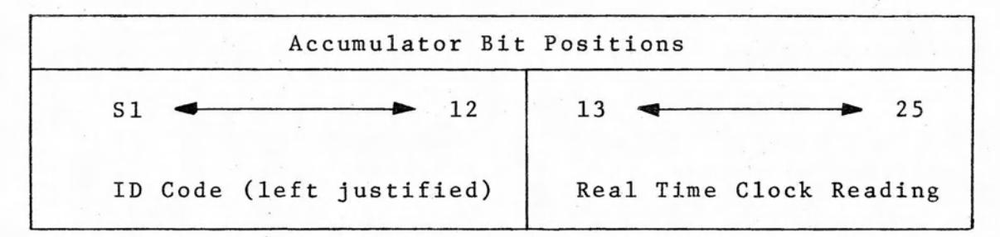
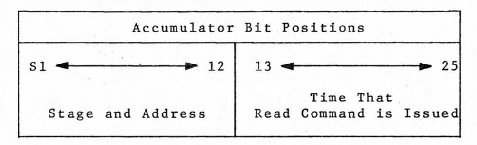

{0}------------------------------------------------

#### SECTION 10

#### DIGITAL COMMAND SYSTEM

#### 10.1 INTRODUCTION

The digital command system (DCS) provides a communication link between the Goddard Network ground stations and the LVDC flight program. The DCS provides a limited real time means of controlling specific flight program timing, navigation, guidance, targeting, sequencing, switch selector functions and obtaining specific program information.

#### 10.2 DCS WORD FORMAT

The format of the 35-bit DCS word transmitted from the Goddard Network stations to the command decoder is shown in Table 10-1. Of these 35 input bits only the 2 interrupt, 2 orbital mode/data (OM/D), and 14 information bits will be used by the LVDA/LVDC. The 2 interrupt bits are logically ANDed in the LVDA and the result is presented to the LVDC as the command decoder interrupt (INT8). The 2 OM/D bits are also ANDed and the result is presented to the LVDC as DI2. The 14 information bits make up the flight program DCS command. These bits are stored in the command decoder register and will be presented to the LVDC in the high order 14 bits (S-13) of the accumulator upon request from the flight program.

#### 10.3 DCS COMMAND VERIFICATION

Upon detection of the command decoder interrupt (INT8), the flight program must determine the status of the OM/D bit. If this bit is 1, a DCS mode command has been received and must be verified. If this bit is 0, a DCS data command has been received and must be verified.

{1}------------------------------------------------

TABLE 10-1 DCS WORD FORMAT

| Command Decoder Bits | LVDC Accumulator Bits                                                                                                                                                                                                                                                                                                                                                                                                                                                                                                                                                                                                                                                                                                                                                                                                                                                                                                                                                                                                                                                                                                                                                                                                                                                                                                                                                                                                                                                                                                                                                                                                                                                                                                                                                                                                                                                                                                                                                                                                                                                                                                       | Bit Significance            |
|-------------------------|--------------------------------------------------------------------------------------------------------------------------------------------------------------------------------------------------------------------------------------------------------------------------------------------------------------------------------------------------------------------------------------------------------------------------------------------------------------------------------------------------------------------------------------------------------------------------------------------------------------------------------------------------------------------------------------------------------------------------------------------------------------------------------------------------------------------------------------------------------------------------------------------------------------------------------------------------------------------------------------------------------------------------------------------------------------------------------------------------------------------------------------------------------------------------------------------------------------------------------------------------------------------------------------------------------------------------------------------------------------------------------------------------------------------------------------------------------------------------------------------------------------------------------------------------------------------------------------------------------------------------------------------------------------------------------------------------------------------------------------------------------------------------------------------------------------------------------------------------------------------------------------------------------------------------------------------------------------------------------------------------------------------------------------------------------------------------------------------------------------------------------|-----------------------------|
| 1-3                     |                                                                                                                                                                                                                                                                                                                                                                                                                                                                                                                                                                                                                                                                                                                                                                                                                                                                                                                                                                                                                                                                                                                                                                                                                                                                                                                                                                                                                                                                                                                                                                                                                                                                                                                                                                                                                                                                                                                                                                                                                                                                                                                                | Vehicle address             |
| 4-6                     |                                                                                                                                                                                                                                                                                                                                                                                                                                                                                                                                                                                                                                                                                                                                                                                                                                                                                                                                                                                                                                                                                                                                                                                                                                                                                                                                                                                                                                                                                                                                                                                                                                                                                                                                                                                                                                                                                                                                                                                                                                                                                                                                | Decoder address             |
| 7*                      | Sign                                                                                                                                                                                                                                                                                                                                                                                                                                                                                                                                                                                                                                                                                                                                                                                                                                                                                                                                                                                                                                                                                                                                                                                                                                                                                                                                                                                                                                                                                                                                                                                                                                                                                                                                                                                                                                                                                                                                                                                                                                                                                                                           | Information bit 14          |
| 8*                      |                                                                                                                                                                                                                                                                                                                                                                                                                                                                                                                                                                                                                                                                                                                                                                                                                                                                                                                                                                                                                                                                                                                                                                                                                                                                                                                                                                                                                                                                                                                                                                                                                                                                                                                                                                                                                                                                                                                                                                                                                                                                                                                                | Command decoder interrupt A |
| 9*                      |                                                                                                                                                                                                                                                                                                                                                                                                                                                                                                                                                                                                                                                                                                                                                                                                                                                                                                                                                                                                                                                                                                                                                                                                                                                                                                                                                                                                                                                                                                                                                                                                                                                                                                                                                                                                                                                                                                                                                                                                                                                                                                                                | Command decoder interrupt B |
| 10*                     |                                                                                                                                                                                                                                                                                                                                                                                                                                                                                                                                                                                                                                                                                                                                                                                                                                                                                                                                                                                                                                                                                                                                                                                                                                                                                                                                                                                                                                                                                                                                                                                                                                                                                                                                                                                                                                                                                                                                                                                                                                                                                                                                | OM/D bit A                  |
| 11                      | Name of the Control of the Control of the Control of the Control of the Control of the Control of the Control of the Control of the Control of the Control of the Control of the Control of the Control of the Control of the Control of the Control of the Control of the Control of the Control of the Control of the Control of the Control of the Control of the Control of the Control of the Control of the Control of the Control of the Control of the Control of the Control of the Control of the Control of the Control of the Control of the Control of the Control of the Control of the Control of the Control of the Control of the Control of the Control of the Control of the Control of the Control of the Control of the Control of the Control of the Control of the Control of the Control of the Control of the Control of the Control of the Control of the Control of the Control of the Control of the Control of the Control of the Control of the Control of the Control of the Control of the Control of the Control of the Control of the Control of the Control of the Control of the Control of the Control of the Control of the Control of the Control of the Control of the Control of the Control of the Control of the Control of the Control of the Control of the Control of the Control of the Control of the Control of the Control of the Control of the Control of the Control of the Control of the Control of the Control of the Control of the Control of the Control of the Control of the Control of the Control of the Control of the Control of the Control of the Control of the Control of the Control of the Control of the Control of the Control of the Control of the Control of the Control of the Control of the Control of the Control of the Control of the Control of the Control of the Control of the Control of the Control of the Control of the Control of the Control of the Control of the Control of the Control of the Control of the Control of the Control of the Control of the Control of the Control of the Control of the Control of the Control o | Decoder address             |
| 12*                     | *Contraction                                                                                                                                                                                                                                                                                                                                                                                                                                                                                                                                                                                                                                                                                                                                                                                                                                                                                                                                                                                                                                                                                                                                                                                                                                                                                                                                                                                                                                                                                                                                                                                                                                                                                                                                                                                                                                                                                                                                                                                                                                                                                                                   | OM/D bit B                  |
| 13-14*                  | 1-2                                                                                                                                                                                                                                                                                                                                                                                                                                                                                                                                                                                                                                                                                                                                                                                                                                                                                                                                                                                                                                                                                                                                                                                                                                                                                                                                                                                                                                                                                                                                                                                                                                                                                                                                                                                                                                                                                                                                                                                                                                                                                                                            | Information bits 13-12      |
| 15-18                   | and the same of the same of the same of the same of the same of the same of the same of the same of the same of the same of the same of the same of the same of the same of the same of the same of the same of the same of the same of the same of the same of the same of the same of the same of the same of the same of the same of the same of the same of the same of the same of the same of the same of the same of the same of the same of the same of the same of the same of the same of the same of the same of the same of the same of the same of the same of the same of the same of the same of the same of the same of the same of the same of the same of the same of the same of the same of the same of the same of the same of the same of the same of the same of the same of the same of the same of the same of the same of the same of the same of the same of the same of the same of the same of the same of the same of the same of the same of the same of the same of the same of the same of the same of the same of the same of the same of the same of the same of the same of the same of the same of the same of the same of the same of the same of the same of the same of the same of the same of the same of the same of the same of the same of the same of the same of the same of the same of the same of the same of the same of the same of the same of the same of the same of the same of the same of the same of the same of the same of the same of the same of the same of the same of the same of the same of the same of the same of the same of the same of the same of the same of the same of the same of the same of the same of the same of the same of the same of the same of the same of the same of the same of the same of the same of the same of the same of the same of the same of the same of the same of the same of the same of the same of the same of the same of the same of the same of the same of the same of the same of the same of the same of the same of the same of the same of the same of the same of the same of the same of the same of th | Decoder address             |
| 19-24*                  | 3-8                                                                                                                                                                                                                                                                                                                                                                                                                                                                                                                                                                                                                                                                                                                                                                                                                                                                                                                                                                                                                                                                                                                                                                                                                                                                                                                                                                                                                                                                                                                                                                                                                                                                                                                                                                                                                                                                                                                                                                                                                                                                                                                            | Information bits 11-6       |
| 25                      |                                                                                                                                                                                                                                                                                                                                                                                                                                                                                                                                                                                                                                                                                                                                                                                                                                                                                                                                                                                                                                                                                                                                                                                                                                                                                                                                                                                                                                                                                                                                                                                                                                                                                                                                                                                                                                                                                                                                                                                                                                                                                                                                | Decoder address             |
| 26-30*                  | 9-13                                                                                                                                                                                                                                                                                                                                                                                                                                                                                                                                                                                                                                                                                                                                                                                                                                                                                                                                                                                                                                                                                                                                                                                                                                                                                                                                                                                                                                                                                                                                                                                                                                                                                                                                                                                                                                                                                                                                                                                                                                                                                                                           | Information bit 5-1         |
| 31-35                   |                                                                                                                                                                                                                                                                                                                                                                                                                                                                                                                                                                                                                                                                                                                                                                                                                                                                                                                                                                                                                                                                                                                                                                                                                                                                                                                                                                                                                                                                                                                                                                                                                                                                                                                                                                                                                                                                                                                                                                                                                                                                                                                                | Decoder address             |

\*These are the only bits of interest to the LVDA/LVDC

The flight program must read the contents of the command decoder register and make several tests on the DCS command (mode or data) before it will be accepted for use. Tests are required in order to determine that the orbital mode/data (OM/D) bit (DI2) is correct, the DCS command sequence bit is correct, the true and complement bits are consistent, and that the command is executable.

To insure that no commands are erroneously rejected, the command decoder must be reset and the DCS error counter must be zeroed at T4+0.

{2}------------------------------------------------

### 10.3.1 DCS Mode Command Verification

When a mode command is received, the following tests must be conducted, in the order listed, before the command will be accepted.

- 1. True-complement test: The 14 information bits transferred from the command decoder to the LVDC accumulator contain redundant information. LVDC bits S through 6 represent the command in true form. LVDC bits 7 through 13 must be the 1's complement of bits S-6. If they are not, the command must not be accepted and DCS error code 10 must be issued.
- Sequence bit test: LVDC bit 6 is designated as the sequence bit. This bit must be 0 for DCS mode commands. If this bit is 1, the command must not be accepted and DCS error code 24 must be issued.
- 3. Terminate command test: If the DCS mode command is the terminate command, then the mode expected test, DCS in progress test, mission acceptance test, and time acceptance test are omitted. The terminate command must be accepted whenever any other DCS command is acceptable.
- 4. Mode expected test: If a DCS mode command is received when a data command is required to complete the requirements of a previous mode command, the mode command must be rejected and DCS error code 20 must be telemetered.

{3}------------------------------------------------

- 5. DCS in progress test: If another DCS routine is presently being processed (i.e., performing a memory dump), then the present mode command must not be accepted and DCS error code 64 must be issued.
- 6. Mission acceptance test: If the DCS mode command is not defined for this mission, it must not be accepted and DCS error code 14 must be issued.
- 7. Time acceptance test: If the DCS mode command is not acceptable at the time it is received, it must be rejected and DCS error code 74 must be issued.

If all these conditions are satisfied, the flight program must: issue Discrete Output 1, which generates a Computer Reset Pulse (CRP); telemeter the proper mode status word twice; and either prepare to receive DCS data commands or perform the commanded function, if no data is required. The format for the mode status word is defined in Table 10-2.

TABLE 10-2 MODE STATUS WORD FORMAT

| LVDC Bit Position | S-5                                    | 6-25 (Octal) |
|----------------------|----------------------------------------|-----------------|
| Data                 | DCS mode command information bits 14-9 | 000000          |

If any test fails, the program must telemeter the appropriate DCS error message twice, monitor the number of consecutive verification failures, and ignore the mode command. No CRP will be issued. The absence of the CRP indicates to the ground station that the command is not accepted by the program. If seven consecutive verification failures occur, an automatic program initiated terminate must be performed, as defined in Section 10.4.5.

..

×

{4}------------------------------------------------

#### 10.3.2 DCS Data Command Verification

The program will accept DCS data commands only after acceptance of a DCS mode command which requires data. When a data command is received, the following tests must be made, in the order listed, before the command is accepted.

- 1. Data legal test: If a data command is not expected (the data requirements for the previous mode command have been met), the data command must not be accepted and DCS error code 04 must be issued.
- True-complement test: As with DCS mode commands, LVDC bits 7-13 must be the 1's complement of bits S-6. If this condition does not exist, the command must not be accepted and DCS error code 44 must be issued.
- 3. Sequence bit test: For DCS data commands, the sequence bit (LVDC bit 6) must be 1 for the odd-numbered data commands of a set and 0 for the even-numbered data commands. (The sequence bit must alternate for successive data commands in a set required by a DCS mode command.) If the sequence bit is incorrect, the DCS data command must not be accepted and DCS error code 60 must be issued.

If all these conditions are satisfied, the program must telemeter the data status word twice, issue Discrete Output 1, and either prepare to receive another data command or if no more data is required, perform the commanded function. The format for the data status word is defined in Table 10-3.

{5}------------------------------------------------

| LVDC Bit Position | S-13                                   | 14-25 (Octal) |
|----------------------|----------------------------------------|------------------|
| Data                 | DCS data command information bits 14-1 | 17776            |

If any test fails, the program must telemeter the appropriate DCS error message twice, monitor the number of consecutive verification failures, and ignore the data command. No CRP will be issued, indicating that the program does not accept the command. If seven consecutive verification failures occur, an automatic program initiated terminate must be performed, as defined in Section 10.4.5.

### 10.3.3 DCS Data Validation

The data for some mode commands require further testing. This testing is done after all the data have been received and formatted.

- end address requested by a memory dump command must be located in an existing memory module and the start module number must be less than or equal to the end module number. If the module numbers are equal, the start sector number must be less than or equal to the end sector number. If the sector numbers are equal, the start address must be less than or equal to the end address. If any of these conditions are not met, the DCS command must not be accepted and DCS error code 50 must be issued.
- Valid time test: The implementation time of a navigation update command must be at least 10 seconds in the future after all the data has been received and formatted. If this condition is not met, the DCS command must not be accepted and DCS error code 54 must be issued.

{6}------------------------------------------------

If either of the above tests is failed, the program must telemeter the appropriate DCS error message twice, and perform an \*automatic program initiated terminate, as defined in Section 10.4.5.\*

### 10.3.4 DCS Error Message

Each time the program rejects a DCS command, an error message must be telemetered. The DCS error message must contain the DCS error code corresponding to the failure, the number of consecutive verification failures, and the 14 information bits. The general format for the DCS error message is defined in Table 10-4. If a DCS error is of the nature that all the data must be received and formatted before the error can be detected, the telemetered error message must not contain a failure count or command information bits. The DCS error codes are defined in Table 10-5. DCS error messages must be telemetered twice at the maximum LVDC telemetry rate.

TABLE 10-4 DCS ERROR MESSAGE FORMAT

| LVDC Bit Position | S-5               | 6-8    | 9-11               | 12-25                       |
|----------------------|-------------------|--------|--------------------|-----------------------------|
| Data                 | DCS error code | Spares | Number of failures | DCS command 14 info bits |

#### 10.4 DCS COMMANDS

The flight program must accept and process the following DCS commands:

- Time base update
- Navigation update
- Generalized switch selector
- Memory Dump

{7}------------------------------------------------

| Error Code No. (Octal)                                                                                                                                                                                                                                                                                                                                                                                                                                                                                                                                                                                                                                                                                                                                                                                                                                                                                                                                                                                                                                                                                                                                                                                                                                                                                                                                                                                                                                                                                                                                                                                                                                                                                                                                                                                                                                                                                                                                                                                                                                                                                                      | DCS Error Mes- sage Bits S-5 | Description                                                                                                                                                                                                                |
|--------------------------------------------------------------------------------------------------------------------------------------------------------------------------------------------------------------------------------------------------------------------------------------------------------------------------------------------------------------------------------------------------------------------------------------------------------------------------------------------------------------------------------------------------------------------------------------------------------------------------------------------------------------------------------------------------------------------------------------------------------------------------------------------------------------------------------------------------------------------------------------------------------------------------------------------------------------------------------------------------------------------------------------------------------------------------------------------------------------------------------------------------------------------------------------------------------------------------------------------------------------------------------------------------------------------------------------------------------------------------------------------------------------------------------------------------------------------------------------------------------------------------------------------------------------------------------------------------------------------------------------------------------------------------------------------------------------------------------------------------------------------------------------------------------------------------------------------------------------------------------------------------------------------------------------------------------------------------------------------------------------------------------------------------------------------------------------------------------------------------------|---------------------------------|----------------------------------------------------------------------------------------------------------------------------------------------------------------------------------------------------------------------------|
| 04                                                                                                                                                                                                                                                                                                                                                                                                                                                                                                                                                                                                                                                                                                                                                                                                                                                                                                                                                                                                                                                                                                                                                                                                                                                                                                                                                                                                                                                                                                                                                                                                                                                                                                                                                                                                                                                                                                                                                                                                                                                                                                                             | 000100                          | Orbital Mode/Data bit is invalid; data command was received when a mode command was expected                                                                                                                               |
| 10                                                                                                                                                                                                                                                                                                                                                                                                                                                                                                                                                                                                                                                                                                                                                                                                                                                                                                                                                                                                                                                                                                                                                                                                                                                                                                                                                                                                                                                                                                                                                                                                                                                                                                                                                                                                                                                                                                                                                                                                                                                                                                                             | 001000                          | True complement test failed for mode command; information bits 7-1 are not the complement of bits 14-8                                                                                                                     |
| 14                                                                                                                                                                                                                                                                                                                                                                                                                                                                                                                                                                                                                                                                                                                                                                                                                                                                                                                                                                                                                                                                                                                                                                                                                                                                                                                                                                                                                                                                                                                                                                                                                                                                                                                                                                                                                                                                                                                                                                                                                                                                                                                             | 001100                          | Mode command invalid; the mode command received is not defined for this mission                                                                                                                                            |
| 20                                                                                                                                                                                                                                                                                                                                                                                                                                                                                                                                                                                                                                                                                                                                                                                                                                                                                                                                                                                                                                                                                                                                                                                                                                                                                                                                                                                                                                                                                                                                                                                                                                                                                                                                                                                                                                                                                                                                                                                                                                                                                                                             | 010000                          | Orbital Mode/Data bit is invalid; mode command was received when expecting a data command                                                                                                                                  |
| 24                                                                                                                                                                                                                                                                                                                                                                                                                                                                                                                                                                                                                                                                                                                                                                                                                                                                                                                                                                                                                                                                                                                                                                                                                                                                                                                                                                                                                                                                                                                                                                                                                                                                                                                                                                                                                                                                                                                                                                                                                                                                                                                             | 010100                          | Mode command sequence bit incorrect; the sequence bit received was 1 instead of 0                                                                                                                                          |
| 34                                                                                                                                                                                                                                                                                                                                                                                                                                                                                                                                                                                                                                                                                                                                                                                                                                                                                                                                                                                                                                                                                                                                                                                                                                                                                                                                                                                                                                                                                                                                                                                                                                                                                                                                                                                                                                                                                                                                                                                                                                                                                                                             | 011100                          | Unable to issue generalized switch selector function at this time, the last requested generalized switch selector function has not been issued                                                                             |
| 44                                                                                                                                                                                                                                                                                                                                                                                                                                                                                                                                                                                                                                                                                                                                                                                                                                                                                                                                                                                                                                                                                                                                                                                                                                                                                                                                                                                                                                                                                                                                                                                                                                                                                                                                                                                                                                                                                                                                                                                                                                                                                                                             | 100100                          | True complement test failed for data command; information bits 7-1 are not the complement of bits 14-8                                                                                                                     |
| 50                                                                                                                                                                                                                                                                                                                                                                                                                                                                                                                                                                                                                                                                                                                                                                                                                                                                                                                                                                                                                                                                                                                                                                                                                                                                                                                                                                                                                                                                                                                                                                                                                                                                                                                                                                                                                                                                                                                                                                                                                                                                                                                             | 101000                          | The start module, sector, and address requested by the memory dump command is greater than the end module, sector, and address; or one or more locations requested by the memory dump command are in a non-existing module |
| 54                                                                                                                                                                                                                                                                                                                                                                                                                                                                                                                                                                                                                                                                                                                                                                                                                                                                                                                                                                                                                                                                                                                                                                                                                                                                                                                                                                                                                                                                                                                                                                                                                                                                                                                                                                                                                                                                                                                                                                                                                                                                                                                             | 101100                          | The time of implementation of a navigation update, execute generalized maneuver, execute maneuver, or return to nominal timeline, is less than 10 sec in the future                                                        |
| 60                                                                                                                                                                                                                                                                                                                                                                                                                                                                                                                                                                                                                                                                                                                                                                                                                                                                                                                                                                                                                                                                                                                                                                                                                                                                                                                                                                                                                                                                                                                                                                                                                                                                                                                                                                                                                                                                                                                                                                                                                                                                                                                             | 110000                          | Data command sequence bit incorrect; the sequence bit must begin with 1 and alternate from 1 to 0 in each sequential data command of a set                                                                                 |
| 64                                                                                                                                                                                                                                                                                                                                                                                                                                                                                                                                                                                                                                                                                                                                                                                                                                                                                                                                                                                                                                                                                                                                                                                                                                                                                                                                                                                                                                                                                                                                                                                                                                                                                                                                                                                                                                                                                                                                                                                                                                                                                                                             | 110100                          | A DCS program is in progress at this time; however, no more data is required; only a terminate mode command can be processed at this time                                                                                  |
| 74                                                                                                                                                                                                                                                                                                                                                                                                                                                                                                                                                                                                                                                                                                                                                                                                                                                                                                                                                                                                                                                                                                                                                                                                                                                                                                                                                                                                                                                                                                                                                                                                                                                                                                                                                                                                                                                                                                                                                                                                                                                                                                                             | 111100                          | The mode command received is defined for this mission but is not acceptable in the present time frame                                                                                                                      |
| THE RESERVE OF THE PARTY OF THE PARTY OF THE PARTY OF THE PARTY OF THE PARTY OF THE PARTY OF THE PARTY OF THE PARTY OF THE PARTY OF THE PARTY OF THE PARTY OF THE PARTY OF THE PARTY OF THE PARTY OF THE PARTY OF THE PARTY OF THE PARTY OF THE PARTY OF THE PARTY OF THE PARTY OF THE PARTY OF THE PARTY OF THE PARTY OF THE PARTY OF THE PARTY OF THE PARTY OF THE PARTY OF THE PARTY OF THE PARTY OF THE PARTY OF THE PARTY OF THE PARTY OF THE PARTY OF THE PARTY OF THE PARTY OF THE PARTY OF THE PARTY OF THE PARTY OF THE PARTY OF THE PARTY OF THE PARTY OF THE PARTY OF THE PARTY OF THE PARTY OF THE PARTY OF THE PARTY OF THE PARTY OF THE PARTY OF THE PARTY OF THE PARTY OF THE PARTY OF THE PARTY OF THE PARTY OF THE PARTY OF THE PARTY OF THE PARTY OF THE PARTY OF THE PARTY OF THE PARTY OF THE PARTY OF THE PARTY OF THE PARTY OF THE PARTY OF THE PARTY OF THE PARTY OF THE PARTY OF THE PARTY OF THE PARTY OF THE PARTY OF THE PARTY OF THE PARTY OF THE PARTY OF THE PARTY OF THE PARTY OF THE PARTY OF THE PARTY OF THE PARTY OF THE PARTY OF THE PARTY OF THE PARTY OF THE PARTY OF THE PARTY OF THE PARTY OF THE PARTY OF THE PARTY OF THE PARTY OF THE PARTY OF THE PARTY OF THE PARTY OF THE PARTY OF THE PARTY OF THE PARTY OF THE PARTY OF THE PARTY OF THE PARTY OF THE PARTY OF THE PARTY OF THE PARTY OF THE PARTY OF THE PARTY OF THE PARTY OF THE PARTY OF THE PARTY OF THE PARTY OF THE PARTY OF THE PARTY OF THE PARTY OF THE PARTY OF THE PARTY OF THE PARTY OF THE PARTY OF THE PARTY OF THE PARTY OF THE PARTY OF THE PARTY OF THE PARTY OF THE PARTY OF THE PARTY OF THE PARTY OF THE PARTY OF THE PARTY OF THE PARTY OF THE PARTY OF THE PARTY OF THE PARTY OF THE PARTY OF THE PARTY OF THE PARTY OF THE PARTY OF THE PARTY OF THE PARTY OF THE PARTY OF THE PARTY OF THE PARTY OF THE PARTY OF THE PARTY OF THE PARTY OF THE PARTY OF THE PARTY OF THE PARTY OF THE PARTY OF THE PARTY OF THE PARTY OF THE PARTY OF THE PARTY OF THE PARTY OF THE PARTY OF THE PARTY OF THE PARTY OF THE PARTY OF THE PARTY OF THE PARTY OF THE PARTY OF THE PARTY OF THE PARTY OF THE PARTY OF THE |                                 |                                                                                                                                                                                                                            |

Rev. A

{8}------------------------------------------------

- Terminate
- ECS water control valve logic inhibit
- Execute generalized maneuver
- Return to nominal timeline
- Execute alternate sequence
- Execute special maneuvers
- Targeting load.

Table 10-6 lists the current DCS mode command assignments, the LVDC 14-bit position format, and the DCS data command requirements. Some of these DCS mode commands may not be required for every mission. The required DCS mode commands and their acceptance times for a particular mission, and any additional commands required for that mission only, will be defined in the Digital Command System commands table in the individual mission requirements. Part II.

### 10.4.1 Time Base Update

Upon acceptance of this DCS mode command, the flight program must increment or decrement the time in the current nominal switch selector sequence reference by an amount specified by an accompanying DCS data command.

The format for the DCS data command information bits is shown in Table 10-7. A 1 in the LVDC sign position signifies a decrement to the time and a 0 signifies an increment. The magnitude of the update will be contained in LVDC bits 1-5.

{9}------------------------------------------------

TABLE 10-6 DCS MODE COMMANDS

| Octal Rep. of LVDC Bit Position | Binary R LVDC B Positi | it         | Definition                        | Data Words |  |
|------------------------------------------|------------------------------|------------|-----------------------------------|---------------|--|
| S-5                                      | S-6                          | 7-13       | (General)                         | Req'd.        |  |
| 10                                       | 0010000                      |            | Time base update                  | 1             |  |
| 11                                       | 0010010                      |            | Navigation update                 | 35            |  |
| 12                                       | 0010100                      | 9-S        | Generalized switch selector       | 2             |  |
| 13                                       | 0010110                      | ts         | Memory dump                       | 6             |  |
| 20                                       | 0100000                      | bi         | Terminate                         | 0             |  |
| 21                                       | 0100010                      | LVDC       | Execute alternate sequence        | 5             |  |
| 32                                       | 0110100                      | of ]       | Targeting load                    | 40            |  |
| 33                                       | 0110110                      | nt         | Execute maneuver A                | 5             |  |
| 34                                       | 0111000                      | leme       | Execute maneuver B                | 5             |  |
| 35                                       | 0111010                      | complement | Execute generalized maneuver      | 20            |  |
| 36                                       | 0111100                      | ပ န        | Return to nominal timeline        | 5             |  |
| 45                                       | 1001010                      | 1          | Water control valve logic inhibit | 0             |  |

TABLE 10-7 TIME BASE UPDATE DCS DATA COMMAND FORMAT

| LVDC Bit Position  | S    | 1            | 2    | 3    | 4    | 5            | 6 | 7 - 13                            | 14-25          |
|-----------------------|------|--------------|------|------|------|--------------|---|-----------------------------------|----------------|
| 14 Information Bits   | 14   | 13           | 12   | 11   | 10   | 9            | 8 | 7 - 1                             |                |
| Bit Sig- nificance | Sign | MSB* data | data | data | data | LSB* data | 1 | 1' Comple- ment of bits S-6 | Unused Bits |

\*MSB (most significant bit); LSB (least significant bit).

{10}------------------------------------------------

The value of the least significant bit (LSB) is 4 seconds and the maximum update possible with a single command is 124 seconds.

The time base update must be implemented as soon as the DCS data command is verified and the data is formatted. Unissued switch selectors, with times earlier than the new time, must be issued at maximum rate. No switch selectors will be omitted or reissued as a result of a time base update.

Time base updates received before previous updates are implemented must be accumulated with the unimplemented update and the entire update must be implemented. Time base updates will not change the times of orbital guidance maneuvers or other time base functions except switch selectors and the telemetered time of station acquisition and loss. Time base updates received in a time base after the last switch selector in the nominal time base sequence has been issued must not be implemented.

Bit 9 of Mode Code 27, which will be initially zero, must change state each time update data is accepted for implementation. A terminate command must not prevent an update from being implemented after a valid DCS data command is received.

### 10.4.2 Navigation Update

This DCS mode command will cause the orbital navigation state vectors (position and velocity components) to be replaced with state vectors supplied from the ground. The new state vectors and the time at which they must be implemented will be contained in 35 DCS data commands. Since only six true information bits are transmitted with each DCS data command, five transmissions are required to form each 26-bit LVDC word. The most significant bit (MSB) of each LVDC word must be transmitted first, and negative quantities must be in two's complement form. The information bit format for the five DCS data commands required for an update quantity is shown in Table 10-8.

I-10-11

{11}------------------------------------------------

TABLE 10-8 NAVIGATION UPDATE, TARGETING LOAD, EXECUTE GENERALIZED

MANEUVER, EXECUTE SPECIAL MANEUVER, OR RETURN TO NOMINAL

TIMELINE DCS DATA COMMAND FORMAT\*

| The second second second second second second second second second second second second second second second second second second second second second second second second second second second second second second second second second second second second second second second second second second second second second second second second second second second second second second second second second second second second second second second second second second second second second second second second second second second second second second second second second second second second second second second second second second second second second second second second second second second second second second second second second second second second second second second second second second second second second second second second second second second second second second second second second second second second second second second second second second second second second second second second second second second second second second second second second second second second second second second second second second second second second second second second second second second second second second second second second second second second second second second second second second second second second second second second second second second second second second second second second second second second second second second second second second second second second second second second second second second second second second second second second second second second second second second second second second second second second second second second second second second second second second second second second second second second second second second second second second second second second second second second second second second second second second second second second second second second second second second second second second second second second second second second second second second secon |            |            |            |            |            |            |       |                |                                                                                                                                                                                                                                                                                                                                                                                                                                                                                                                                                                                                                                                                                                                                                                                                                                                                                                                                                                                                                                                                                                                                                                                                                                                                                                                                                                                                                                                                                                                                                                                                                                                                                                                                                                                                                                                                                                                                                                                                                                                                                                                                |
|--------------------------------------------------------------------------------------------------------------------------------------------------------------------------------------------------------------------------------------------------------------------------------------------------------------------------------------------------------------------------------------------------------------------------------------------------------------------------------------------------------------------------------------------------------------------------------------------------------------------------------------------------------------------------------------------------------------------------------------------------------------------------------------------------------------------------------------------------------------------------------------------------------------------------------------------------------------------------------------------------------------------------------------------------------------------------------------------------------------------------------------------------------------------------------------------------------------------------------------------------------------------------------------------------------------------------------------------------------------------------------------------------------------------------------------------------------------------------------------------------------------------------------------------------------------------------------------------------------------------------------------------------------------------------------------------------------------------------------------------------------------------------------------------------------------------------------------------------------------------------------------------------------------------------------------------------------------------------------------------------------------------------------------------------------------------------------------------------------------------------------|------------|------------|------------|------------|------------|------------|-------|----------------|--------------------------------------------------------------------------------------------------------------------------------------------------------------------------------------------------------------------------------------------------------------------------------------------------------------------------------------------------------------------------------------------------------------------------------------------------------------------------------------------------------------------------------------------------------------------------------------------------------------------------------------------------------------------------------------------------------------------------------------------------------------------------------------------------------------------------------------------------------------------------------------------------------------------------------------------------------------------------------------------------------------------------------------------------------------------------------------------------------------------------------------------------------------------------------------------------------------------------------------------------------------------------------------------------------------------------------------------------------------------------------------------------------------------------------------------------------------------------------------------------------------------------------------------------------------------------------------------------------------------------------------------------------------------------------------------------------------------------------------------------------------------------------------------------------------------------------------------------------------------------------------------------------------------------------------------------------------------------------------------------------------------------------------------------------------------------------------------------------------------------------|
| LVDC Bit Position                                                                                                                                                                                                                                                                                                                                                                                                                                                                                                                                                                                                                                                                                                                                                                                                                                                                                                                                                                                                                                                                                                                                                                                                                                                                                                                                                                                                                                                                                                                                                                                                                                                                                                                                                                                                                                                                                                                                                                                                                                                                                                           | S          | 1          | 2          | 3          | 4          | 5          | 6     | 7 - 13         | 14 - 25                                                                                                                                                                                                                                                                                                                                                                                                                                                                                                                                                                                                                                                                                                                                                                                                                                                                                                                                                                                                                                                                                                                                                                                                                                                                                                                                                                                                                                                                                                                                                                                                                                                                                                                                                                                                                                                                                                                                                                                                                                                                                                                        |
| Informa- tion Bits                                                                                                                                                                                                                                                                                                                                                                                                                                                                                                                                                                                                                                                                                                                                                                                                                                                                                                                                                                                                                                                                                                                                                                                                                                                                                                                                                                                                                                                                                                                                                                                                                                                                                                                                                                                                                                                                                                                                                                                                                                                                                                          | 14         | 13         | 12         | 11         | 10         | 9          | 8     | 7 - 1          |                                                                                                                                                                                                                                                                                                                                                                                                                                                                                                                                                                                                                                                                                                                                                                                                                                                                                                                                                                                                                                                                                                                                                                                                                                                                                                                                                                                                                                                                                                                                                                                                                                                                                                                                                                                                                                                                                                                                                                                                                                                                                                                                |
| Data Command 1                                                                                                                                                                                                                                                                                                                                                                                                                                                                                                                                                                                                                                                                                                                                                                                                                                                                                                                                                                                                                                                                                                                                                                                                                                                                                                                                                                                                                                                                                                                                                                                                                                                                                                                                                                                                                                                                                                                                                                                                                                                                                                              | LVDC S  | LVDC 1  | LVDC 2  | LVDC 3  | LVDC 4  | LVDC 5  |       | f 8         | The state of the state of the state of the state of the state of the state of the state of the state of the state of the state of the state of the state of the state of the state of the state of the state of the state of the state of the state of the state of the state of the state of the state of the state of the state of the state of the state of the state of the state of the state of the state of the state of the state of the state of the state of the state of the state of the state of the state of the state of the state of the state of the state of the state of the state of the state of the state of the state of the state of the state of the state of the state of the state of the state of the state of the state of the state of the state of the state of the state of the state of the state of the state of the state of the state of the state of the state of the state of the state of the state of the state of the state of the state of the state of the state of the state of the state of the state of the state of the state of the state of the state of the state of the state of the state of the state of the state of the state of the state of the state of the state of the state of the state of the state of the state of the state of the state of the state of the state of the state of the state of the state of the state of the state of the state of the state of the state of the state of the state of the state of the state of the state of the state of the state of the state of the state of the state of the state of the state of the state of the state of the state of the state of the state of the state of the state of the state of the state of the state of the state of the state of the state of the state of the state of the state of the state of the state of the state of the state of the state of the state of the state of the state of the state of the state of the state of the state of the state of the state of the state of the state of the state of the state of the state of the state of the state of the state of the s |
| Data Command 2                                                                                                                                                                                                                                                                                                                                                                                                                                                                                                                                                                                                                                                                                                                                                                                                                                                                                                                                                                                                                                                                                                                                                                                                                                                                                                                                                                                                                                                                                                                                                                                                                                                                                                                                                                                                                                                                                                                                                                                                                                                                                                              | LVDC 6  | LVDC 7  | LVDC 8  | LVDC 9  | LVDC 10 | LVDC 11 | **    | ent o s 14- | Bits                                                                                                                                                                                                                                                                                                                                                                                                                                                                                                                                                                                                                                                                                                                                                                                                                                                                                                                                                                                                                                                                                                                                                                                                                                                                                                                                                                                                                                                                                                                                                                                                                                                                                                                                                                                                                                                                                                                                                                                                                                                                                                                           |
| Data Command 3                                                                                                                                                                                                                                                                                                                                                                                                                                                                                                                                                                                                                                                                                                                                                                                                                                                                                                                                                                                                                                                                                                                                                                                                                                                                                                                                                                                                                                                                                                                                                                                                                                                                                                                                                                                                                                                                                                                                                                                                                                                                                                              | LVDC 12 | LVDC 13 | LVDC 14 | LVDC 15 | LVDC 16 | LVDC 17 | ce Bi | omplemer bits  | Unused                                                                                                                                                                                                                                                                                                                                                                                                                                                                                                                                                                                                                                                                                                                                                                                                                                                                                                                                                                                                                                                                                                                                                                                                                                                                                                                                                                                                                                                                                                                                                                                                                                                                                                                                                                                                                                                                                                                                                                                                                                                                                                                         |
| Data Command 4                                                                                                                                                                                                                                                                                                                                                                                                                                                                                                                                                                                                                                                                                                                                                                                                                                                                                                                                                                                                                                                                                                                                                                                                                                                                                                                                                                                                                                                                                                                                                                                                                                                                                                                                                                                                                                                                                                                                                                                                                                                                                                              | LVDC 18 | LVDC 19 | LVDC 20 | LVDC 21 | LVDC 22 | LVDC 23 | ednen | o s c          | Ω                                                                                                                                                                                                                                                                                                                                                                                                                                                                                                                                                                                                                                                                                                                                                                                                                                                                                                                                                                                                                                                                                                                                                                                                                                                                                                                                                                                                                                                                                                                                                                                                                                                                                                                                                                                                                                                                                                                                                                                                                                                                                                                              |
| Data Command 5                                                                                                                                                                                                                                                                                                                                                                                                                                                                                                                                                                                                                                                                                                                                                                                                                                                                                                                                                                                                                                                                                                                                                                                                                                                                                                                                                                                                                                                                                                                                                                                                                                                                                                                                                                                                                                                                                                                                                                                                                                                                                                              | LVDC 24 | LVDC 25 | Х          | Х          | Х          | Х          | S     | 1 de           |                                                                                                                                                                                                                                                                                                                                                                                                                                                                                                                                                                                                                                                                                                                                                                                                                                                                                                                                                                                                                                                                                                                                                                                                                                                                                                                                                                                                                                                                                                                                                                                                                                                                                                                                                                                                                                                                                                                                                                                                                                                                                                                                |

\*The format presented in Table 10-8 is for only one 26-bit LVDC word and must be repeated for each LVDC word.

\*\*The sequence bit must alternate 1 and 0 for each data command starting with a 1 for the first data command of the first LVDC word. For Execute Generalized Maneuver DCS commands, this format will only be used for the quantities  $Y_{ref}$ ,  $Z_{ref}$ , and  $X_{ref}$  (see Section 10.4.6).

{12}------------------------------------------------

The seven update quantities must be transmitted in the order  $\dot{z}_S$ ,  $\dot{x}_S$ ,  $\dot{y}_S$ ,  $z_S$ ,  $x_S$ ,  $y_S$ , and implementation time (NUPTIM). The velocity components must be in meters per second, scaled 14. The position components must be in meters, scaled 23. The implementation time must be in seconds, referenced from guidance reference release (GRR) and scaled 15. After all the update data is accepted and formatted, the time of implementation must be 10 seconds or more in the future. If not, the update must be rejected, an automatic program initiated terminate must be performed as defined in Section 10.4.5, and DCS error code 54 must be issued. Any update awaiting implementation must not be affected.

If the update is accepted, the seven quantities must be stored in memory module 4, sector 15, locations 371 through 377, in the order received. Bit 8 of MC27 must be set to 1 when an update is accepted, and reset to zero when the update is implemented.

A navigation update accepted before a previous update is implemented will replace the previous update. A terminate command must not prevent an update after the thirty-fifth valid data word is received.

The navigation update discussion in Section 5 describes the requirements for implementing the new state vectors into the orbital navigation computations.

### 10.4.3 Generalized Switch Selector

This DCS mode command will provide the capability to issue any IU or S-IVB switch selector event specified by two accompanying DCS data commands. If this DCS mode command is received while a previous generalized switch selector event is waiting to be issued, the new DCS mode command must be

I - 10 - 13

{13}------------------------------------------------

rejected and DCS error code 34 must be issued. The ground station may repeat the request until the previous event is serviced at which time the DCS mode command will be accepted. The information bit format for the two DCS data commands is shown in Table 10-9 (address bits must be in true form). The switch selector event specified is a class 3 alternate sequence.

TABLE 10-9 GENERALIZED SWITCH SELECTOR
DCS\_DATA\_COMMAND\_FORMAT

| LVDC Bit Position  | S           | 1              | 2         | 3         | 4         | 5         | 6 | 7 - 13                             | 14 - 25 |
|-----------------------|-------------|----------------|-----------|-----------|-----------|-----------|---|------------------------------------|---------|
| Informa- tion Bits | 14          | 13             | 12        | 11        | 10        | 9         | 8 | 7 - 1                              | Bits    |
| Data Command 1     | IU Stage | S-IVB Stage |           | Addr 8 | Addr 7 | Addr 6 | 1 | 1's Comple- ment of bits S-6 |         |
| Data Command 2     | Addr 5   | Addr 4      | Addr 3 | Addr 2 | Addr 1 | х         | 0 | 0105 5-0                           | Un      |

Issuance of the generalized switch selector event must be attempted as soon as the data is verified and formatted. If the program is already servicing a preprogrammed switch selector command, the generalized switch selector command must be preserved until there is adequate free time (500 ms) for its issuance. A terminate command must not prevent the issuance of a generalized switch selector event after the DCS data commands are accepted.

### 10.4.4 Memory Dump

This DCS mode command causes the flight program to telemeter the contents of a specified portion (one or more memory words) of the LVDC memory. The complete start and end addresses of the portion of memory to be telemetered will be specified by six accompanying DCS data commands. The start module, sector, 

{14}------------------------------------------------

and address requested must be less than or equal to the end module, sector, and address requested. The information bit format for the six DCS data commands is shown in Table 10-10.

TABLE 10-10 MEMORY DUMP DCS DATA COMMAND FORMAT

| LVDC Bit Position  | S                      | 1                  | 2                  | 3                             | 4                  | 5                      | 6  | 7-13          | 14-25                                                                                                                                                                                                                                                                                                                                                                                                                                                                                                                                                                                                                                                                                                                                                                                                                                                                                                                                                                                                                                                                                                                                                                                                                                                                                                                                                                                                                                                                                                                                                                                                                                                                                                                                                                                                                                                                                                                                                                                                                                                                                                                          |
|--------------------------|------------------------|--------------------|--------------------|-------------------------------|--------------------|------------------------|----|---------------|--------------------------------------------------------------------------------------------------------------------------------------------------------------------------------------------------------------------------------------------------------------------------------------------------------------------------------------------------------------------------------------------------------------------------------------------------------------------------------------------------------------------------------------------------------------------------------------------------------------------------------------------------------------------------------------------------------------------------------------------------------------------------------------------------------------------------------------------------------------------------------------------------------------------------------------------------------------------------------------------------------------------------------------------------------------------------------------------------------------------------------------------------------------------------------------------------------------------------------------------------------------------------------------------------------------------------------------------------------------------------------------------------------------------------------------------------------------------------------------------------------------------------------------------------------------------------------------------------------------------------------------------------------------------------------------------------------------------------------------------------------------------------------------------------------------------------------------------------------------------------------------------------------------------------------------------------------------------------------------------------------------------------------------------------------------------------------------------------------------------------------|
| Infor- mation Bits | 14                     | 13                 | 12                 | 11                            | 10                 | 9                      | 8. | 7-1           |                                                                                                                                                                                                                                                                                                                                                                                                                                                                                                                                                                                                                                                                                                                                                                                                                                                                                                                                                                                                                                                                                                                                                                                                                                                                                                                                                                                                                                                                                                                                                                                                                                                                                                                                                                                                                                                                                                                                                                                                                                                                                                                                |
| Data Command 1     | Start Addr 8     | Start Addr 7 | Start Addr 6 | Start Addr 5            | Start Addr 4 | Start Addr 3     | 1  | -             |                                                                                                                                                                                                                                                                                                                                                                                                                                                                                                                                                                                                                                                                                                                                                                                                                                                                                                                                                                                                                                                                                                                                                                                                                                                                                                                                                                                                                                                                                                                                                                                                                                                                                                                                                                                                                                                                                                                                                                                                                                                                                                                                |
| Data Command 2     | Start Addr 2     | Start Addr 1 | Х                  | Start Module MSB        | Start Module    | Start Module LSB | 0  | of            | bits                                                                                                                                                                                                                                                                                                                                                                                                                                                                                                                                                                                                                                                                                                                                                                                                                                                                                                                                                                                                                                                                                                                                                                                                                                                                                                                                                                                                                                                                                                                                                                                                                                                                                                                                                                                                                                                                                                                                                                                                                                                                                                                           |
| Data Command 3     | Start Sector MSB | Start Sector    | Start Sector    | Start Sector LSB        | X                  | Х                      | 1  | . ب           | Unused                                                                                                                                                                                                                                                                                                                                                                                                                                                                                                                                                                                                                                                                                                                                                                                                                                                                                                                                                                                                                                                                                                                                                                                                                                                                                                                                                                                                                                                                                                                                                                                                                                                                                                                                                                                                                                                                                                                                                                                                                                                                                                                         |
| Data Command 4     | End Addr 8       | End Addr 7   | End Addr 6   | End Addr 5              | End Addr 4   | End Addr 3       | 0  | compl Bits | Ω                                                                                                                                                                                                                                                                                                                                                                                                                                                                                                                                                                                                                                                                                                                                                                                                                                                                                                                                                                                                                                                                                                                                                                                                                                                                                                                                                                                                                                                                                                                                                                                                                                                                                                                                                                                                                                                                                                                                                                                                                                                                                                                              |
| Data Command 5     | End Addr 2       | End Addr 1   | х                  | End Mod <b>u</b> le MSB | End Module      | End Module LSB   | 1  | 1's           | To be a second or second or second or second or second or second or second or second or second or second or second or second or second or second or second or second or second or second or second or second or second or second or second or second or second or second or second or second or second or second or second or second or second or second or second or second or second or second or second or second or second or second or second or second or second or second or second or second or second or second or second or second or second or second or second or second or second or second or second or second or second or second or second or second or second or second or second or second or second or second or second or second or second or second or second or second or second or second or second or second or second or second or second or second or second or second or second or second or second or second or second or second or second or second or second or second or second or second or second or second or second or second or second or second or second or second or second or second or second or second or second or second or second or second or second or second or second or second or second or second or second or second or second or second or second or second or second or second or second or second or second or second or second or second or second or second or second or second or second or second or second or second or second or second or second or second or second or second or second or second or second or second or second or second or second or second or second or second or second or second or second or second or second or second or second or second or second or second or second or second or second or second or second or second or second or second or second or second or second or second or second or second or second or second or second or second or second or second or second or second or second or second or second or second or second or second or second or second or second or second or second or second or second or second o |
| Data Command 6     | End Sector MSB   | End Sector      | End Sector      | End Sector LSB          | Х                  | Х                      | 0  |               |                                                                                                                                                                                                                                                                                                                                                                                                                                                                                                                                                                                                                                                                                                                                                                                                                                                                                                                                                                                                                                                                                                                                                                                                                                                                                                                                                                                                                                                                                                                                                                                                                                                                                                                                                                                                                                                                                                                                                                                                                                                                                                                                |

As soon as the sixth DCS data command is verified, the program must verify that none of the portion of memory requested is from a non-existing module. If the addresses are valid, the program must begin dumping data starting at the specified start address. Blocks of 16 LVDC words must be intermixed with other LVDC telemetry until all requested memory locations have been telemetered.

\* \*

\*

{15}------------------------------------------------

If the number of memory locations requested is not a multiple of 16, the last block telemetered must include less than 16 words, ending with the last word requested. The telemetry tags for each word of a block are defined in Telemetry Tags Table 11-8. The first word of a block must identify the information in the block by indicating the module, sector, and address of the telemetered data. One block of data will be telemetered approximately every 400 ms.

If the start address and end address are the same, the program must telemeter only one data word. If a memory dump is requested from an odd-numbered (duplex) module, the corresponding addresses from the duplex even-numbered (primary) module must be telemetered. The output format of the memory dump is shown in Table 10-11. The header word must include the module, sector, and address of the first data location in the block of 16 consecutive data locations.

TABLE 10-11 MEMORY DUMP FORMAT

| LVDC Accum- ulator | S        | 1 | 2        | 3        | 4 | 5 | 6        | 7        | 8 | 9 | 10 | 11 | 12 | 13 | 14       | 15-25 |
|-----------------------|----------|---|----------|----------|---|---|----------|----------|---|---|----|----|----|----|----------|-------|
| Header Word        | MSB M | М | LSB M | MSB S | S | S | LSB S | MSB A | A | A | A  | A  | A  | A  | LSB A | 00    |
| Data Words         | D        | D | D        | D        | D | D | D        | D        | D | D | D  | D  | D  | D  | D        | DD    |

NOTE: M, S, A = module, sector, and address, respectively of the first data location in the present block

D = data bits

{16}------------------------------------------------

Once a dump has been started, only a terminate command will be accepted by the program. Other mode commands received during a dump must be rejected and DCS error code 64 must be issued. Receipt of a terminate command any time before the last block is completed must stop the dump.

#### 10.4.5 Terminate

This DCS command will cause the flight program to terminate the receipt of multiple word commands or terminate a memory dump in progress. Upon receipt of this command, the flight program must do the following:

- Terminate any multiple-word DCS commands prior to the receipt of the last valid data word
- Terminate any commands which have failed to be validated by the LVDC
- Terminate a memory dump prior to the telemetry of the last block of data
- Return to the configuration required to accept a new mode command.

The terminate command will have no effect on the execution of a DCS routine whose data requirements have been met and validated, except for the memory dump routine. The terminate command must be enabled whenever the command decoder interrupt is enabled.

Under certain specified conditions, an automatic program initiated terminate must be performed. These specific conditions are detailed within each applicable DCS command description section. A program initiated terminate must provide all the functions of the DCS terminate command except early memory dump termination.

{17}------------------------------------------------

### 10.4.6 Execute Generalized Maneuver

This DCS mode command will provide the capability to initiate either an inertial attitude hold or a track local reference orbital maneuver with any attitude within the limitations defined in Section 8.3.2. The five data quantities required by this mode command, their units and scaling, are described in Table 10-12.

TABLE 10-12 EXECUTE GENERALIZED MANEUVER PARAMETERS

| Parameter        | Definition                                                                    | Units  | Scaling |
|------------------|-------------------------------------------------------------------------------|--------|---------|
| T som | Time in current time base to start the generalized orbital maneuver           | sec    | 15      |
| GOMTYP           | Type of generalized orbital maneuver (Inertial hold or track local reference) | N/A    | N/A     |
| Yref             | Y reference angle                                                             | pirads | 0       |
| Zref             | Z reference angle                                                             | pirads | 0       |
| Xref             | X reference angle                                                             | pirads | 0       |

These parameters will be contained in 20 DCS data commands. Since only six true information bits are transmitted with each DCS data command, five transmissions are required to form each 26-bit LVDC word. Since the GOMTYP parameter only requires two bit locations, it is transmitted in the spare location of the fifth data word of  $T_{\rm SOM}$ . The most significant bit of each LVDC word must be transmitted first, and negative quantities must be in two's complement form. The five parameters must be transmitted in the order  $T_{\rm SOM}$ ,  $T_{\rm SOM}$ ,  $T_{\rm COMTYP}$ ,  $T_{\rm ref}$ ,  $T_{\rm ref}$ . The information bit format for the first 5 data commands containing

{18}------------------------------------------------

 $T_{SOM}$  and GOMTYP is shown in Table 10-13, and the information bit format for the remaining 15 data commands containing  $Y_{ref}$ ,  $Z_{ref}$ , and  $X_{ref}$  is shown in Table 10-8. The GOMTYP parameter must also be set by the program, as defined in Table 10-14, if an execute special maneuver or return to nominal timeline command is accepted.

TABLE 10-13 EXECUTE GENERALIZED MANEUVER
TIME AND TYPE DCS DATA
COMMAND FORMAT\*

| LVDC Bit Position  | S                  | 1                       | 2                            | 3                            | 4                | 5                | 6      | 7 - 13                    | 14-25   |
|-----------------------|--------------------|-------------------------|------------------------------|------------------------------|------------------|------------------|--------|---------------------------|---------|
| Informa- tion Bits | 14                 | 13                      | 12                           | 11                           | 10               | 9                | 8      | 7 - 1                     |         |
| Data Command 1  | T SOM   | TSOM                    | TSOM                         | T SOM             | TSOM             | TSOM             |        |                           |         |
| Data Command 2  | T SOM   | T SOM        | TSOM                         | T SOM             | T SOM | T SOM | t**    | t of 14-8              | S       |
| Data Command 3  | T SOM   | T SOM        | TSOM                         | T SOM             | T SOM | T SOM | ce Bi  | complement der bits 14 | ed Bits |
| Data Command 4  | TSOM               | T SOM        | T SOM             | T SOM             | TSOM             | T SOM | Sequen | 1's com decoder        | Unused  |
| Data Command 5  | · T som | T SOM LSB | GOM- TYP LOCAL REF. | GOM- TYP INRTL HOLD | Х                | х                |        |                           |         |

\*The format for  $Y_{ref}$ ,  $Z_{ref}$ ,  $X_{ref}$  is contained in Table 10-8.

\*\*The sequence bit must alternate 1 and 0 for each data command, starting with a 1 for data command 1 above, and will continue to alternate until the last data command of  $X_{ref}$  is received.

\*

\*

{19}------------------------------------------------

TABLE 10-14 GOMTYP (GENERALIZED ORBITAL MANEUVER TYPE STATUS WORD) FORMAT

| LVDC Bit | Bit Significance                                    | Bit Set Method |
|-------------|-----------------------------------------------------|-------------------|
| S           | Local Reference Maneuver Commanded               | DCS Command    |
| 1           | Inertial Reference Maneuver Commanded            | DCS Command    |
| 2           | Return to Nominal Timeline Commanded             | Set by Program |
| 3           | Special Maneuver A Commanded                     | Set by Program |
| 4           | Special Maneuver B Commanded                     | Set by Program |
| Note        | Whenever any bit of GOMTY all other GOMTYP bits mus |                   |

After all the data is accepted and formatted,  $T_{SOM}$  must be tested to determine if it is in the future. If  $T_{SOM}$  is zero or some time in the past, the execute generalized maneuver command must be implemented within one computation cycle. If  $T_{SOM}$  is in the future, the execute generalized maneuver command must be scheduled at that time. When the command is accepted, the five parameters must be stored in memory module 2, sector 07, locations 373 through 377 in the order  $Y_{ref}$ ,  $Z_{ref}$ ,  $X_{ref}$ ,  $X_{ref}$ ,  $X_{ref}$ ,  $X_{ref}$ ,  $X_{ref}$ ,  $X_{ref}$ ,  $X_{ref}$ ,  $X_{ref}$ ,  $X_{ref}$ ,  $X_{ref}$ ,  $X_{ref}$ ,  $X_{ref}$ ,  $X_{ref}$ ,  $X_{ref}$ ,  $X_{ref}$ ,  $X_{ref}$ ,  $X_{ref}$ ,  $X_{ref}$ ,  $X_{ref}$ ,  $X_{ref}$ ,  $X_{ref}$ ,  $X_{ref}$ ,  $X_{ref}$ ,  $X_{ref}$ ,  $X_{ref}$ ,  $X_{ref}$ ,  $X_{ref}$ ,  $X_{ref}$ ,  $X_{ref}$ ,  $X_{ref}$ ,  $X_{ref}$ ,  $X_{ref}$ ,  $X_{ref}$ ,  $X_{ref}$ ,  $X_{ref}$ ,  $X_{ref}$ ,  $X_{ref}$ ,  $X_{ref}$ ,  $X_{ref}$ ,  $X_{ref}$ ,  $X_{ref}$ ,  $X_{ref}$ ,  $X_{ref}$ ,  $X_{ref}$ ,  $X_{ref}$ ,  $X_{ref}$ ,  $X_{ref}$ ,  $X_{ref}$ ,  $X_{ref}$ ,  $X_{ref}$ ,  $X_{ref}$ ,  $X_{ref}$ ,  $X_{ref}$ ,  $X_{ref}$ ,  $X_{ref}$ ,  $X_{ref}$ ,  $X_{ref}$ ,  $X_{ref}$ ,  $X_{ref}$ ,  $X_{ref}$ ,  $X_{ref}$ ,  $X_{ref}$ ,  $X_{ref}$ ,  $X_{ref}$ ,  $X_{ref}$ ,  $X_{ref}$ ,  $X_{ref}$ ,  $X_{ref}$ ,  $X_{ref}$ ,  $X_{ref}$ ,  $X_{ref}$ ,  $X_{ref}$ ,  $X_{ref}$ ,  $X_{ref}$ ,  $X_{ref}$ ,  $X_{ref}$ ,  $X_{ref}$ ,  $X_{ref}$ ,  $X_{ref}$ ,  $X_{ref}$ ,  $X_{ref}$ ,  $X_{ref}$ ,  $X_{ref}$ ,  $X_{ref}$ ,  $X_{ref}$ ,  $X_{ref}$ ,  $X_{ref}$ ,  $X_{ref}$ ,  $X_{ref}$ ,  $X_{ref}$ ,  $X_{ref}$ ,  $X_{ref}$ ,  $X_{ref}$ ,  $X_{ref}$ ,  $X_{ref}$ ,  $X_{ref}$ ,  $X_{ref}$ ,  $X_{ref}$ ,  $X_{ref}$ ,  $X_{ref}$ ,  $X_{ref}$ ,  $X_{ref}$ ,  $X_{ref}$ ,  $X_{ref}$ ,  $X_{ref}$ ,  $X_{ref}$ ,  $X_{ref}$ ,  $X_{ref}$ ,  $X_{ref}$ ,  $X_{ref}$ ,  $X_{ref}$ ,  $X_{ref}$ ,  $X_{ref}$ ,  $X_{ref}$ ,  $X_{ref}$ ,  $X_{ref}$ ,  $X_{ref}$ ,  $X_{ref}$ ,  $X_{ref}$ ,  $X_{ref}$ ,  $X_{ref}$ ,  $X_{ref}$ ,  $X_{ref}$ ,  $X_{ref}$ ,  $X_{ref}$ ,  $X_{ref}$ ,  $X_{ref}$ ,  $X_{ref}$ ,  $X_{ref}$ ,  $X_{ref}$ ,  $X_{ref}$ ,  $X_{ref}$ ,  $X_{ref}$ ,  $X_{ref}$ ,  $X_{ref}$ ,  $X_{ref}$ ,  $X_{ref}$ ,  $X_{ref}$ ,  $X_{ref}$ ,  $X_{ref}$ 

An execute generalized maneuver command accepted before a pending execute generalized maneuver, execute special maneuver or return to nominal timeline command is implemented, will replace the pending command. A terminate command must not prevent this command from being executed after the 20th valid data command is received. If a command is pending when a new orbital primary time base is started, the command will not be executed and the contents of memory module 2, sector 07, locations 373 through 377 must be zeroed.

{20}------------------------------------------------

When the time (TB) in the current time base becomes greater than or equal to the initiation time ( $T_{SOM}$ ), the program must initiate either an inertial hold or track local reference maneuver according to the value of GOMTYP.

If the maneuver is an inertial hold,  $Y_{ref}$ ,  $Z_{ref}$ , and  $X_{ref}$  will be used as the predefined angles specified in the inertial platform gimbal system and will be implemented as described in the inertial attitude hold discussion in Section 5.5. Bit 11 of MC27 will be set for the duration of this maneuver.

If the maneuver is a track local reference, the sines and cosines of  $Y_{ref}$  and  $Z_{ref}$  must be computed. The sine and cosine of  $Y_{ref}$  will be used as the sine and cosine of the desired in-plane attitude with respect to the local reference, the sine and cosine of  $Z_{ref}$  will be used as the sine and cosine of the desired rotation out of the  $X_4$ - $Z_4$  plane and  $X_{ref}$  will be used as the desired roll attitude. Using these values, the track local reference maneuver as described in Section 5.5 must be computed. Bit 10 of MC27 must be set for the duration of this maneuver.

The program will continue to execute this maneuver until further DCS action initiates another execute generalized maneuver, execute special maneuver, or return to nominal timeline command.

Bit 19 of MC27 must be set upon the implementation of a valid execute generalized maneuver. This bit will be reset upon implementation of a return to nominal timeline or execute special maneuver command.

I-10-21

Rev. A

{21}------------------------------------------------

### 10.4.7 Return to Nominal Timeline

This DCS mode command will provide the capability to return to the preprogrammed orbital attitude timeline after other DCS action has been initiated to override the preprogrammed timeline. The mode command requires that the time to return to nominal timeline ( $T_{\rm RNTL}$ ) be sent in five DCS data commands. Since only six true information bits are transmitted with each DCS data command, five transmissions are required to form  $T_{\rm RNTL}$ . The most significant bit of each LVDC word must be transmitted first. The variable  $T_{\rm RNTL}$  must be in seconds, scaled 15. The information bit format for the five data commands is contained in Table 10-8.

After all the data is accepted and formatted,  $T_{RNTL}$  must be tested to determine if it is in the future. If  $T_{RNTL}$  is zero or some time in the past, the return to nominal timeline to command must be implemented within one computation cycle. If  $T_{RNTL}$  is in the future, the return to nominal timeline command thust be scheduled at that time. When the command is accepted, the stored in the same memory location in which  $T_{SOM}$  is stored (module 2, sector 07, location 377). A 1 must be stored in bit 2 and all other bits zeroed in the location in which the GOMTYP is stored (module 2, sector 07, location 376). The memory locations containing  $Y_{ref}$ ,  $Z_{ref}$ , and  $X_{ref}$  for a pending execute generalized maneuver must be zeroed (module 2, sector 07, locations 373 through 375).

A return to nominal timeline command accepted before a pending return to nominal timeline, execute generalized maneuver, or execute special maneuver command is implemented, will replace the pending command. A terminate command must not prevent this command from being executed after the fifth valid data command is received. If a command is pending when a new orbital primary time base is started, the command must not be executed and the contents of memory module 2, sector 07, locations 373 through 377 must be zeroed.

\*

\*

\*

\*

×

{22}------------------------------------------------

When time (TB) in the current time base becomes greater than or equal to  $T_{\rm RNTL}$ , the program must terminate any alternate maneuvers being executed, return to the preprogrammed orbital timeline, and reset bit 19 of MC27.

The program will continue to execute the preprogrammed time-line until further DCS action initiates another alternate maneuver.

### 10.4.8 ECS Water Control Valve Logic Inhibit

This DCS mode command will inhibit the programmed ECS water control valve logic. Once this inhibit command is received, the ECS water control valve logic must be bypassed for the remainder of the mission. There is no provision to remove this inhibit once it is applied. Any further changes to the water control valve position must be commanded via the generalized switch selector command. No data commands are required for this function and the terminate command will have no effect on the inhibit. The switch selector issued is a class 3 alternate sequence.

If the inhibit command is received, Bit 18 of Mode Code 27 (which must be initialized to 1 at GRR to indicate that the water control valve logic is active) must be reset to zero.

### 10.4.9 Execute Special Maneuvers

When required, either one or two DCS commands must provide the capability to initiate special preprogrammed orbital maneuvers

I - 10 - 23

Rev. A

{23}------------------------------------------------

A or B. In general, a special maneuver will not be an inertial hold or track local reference as defined in Section 5.5.

Each execute maneuver command will provide the capability to initiate a special maneuver command at a transmitted time or at the time of command acceptance, as dictated by mission requirements. The time,  $T_{\rm SOM}$ , at which the special maneuver is to be executed must be contained in 5 DCS data commands. Since only six true information bits are transmitted with each DCS data command, five transmissions are required to form the 26-bit LVDC word. The most significant bit of the LVDC word must be transmitted first. The variable  $T_{\rm SOM}$  must be in seconds, scaled 15.

After the data is accepted and formatted,  $T_{SOM}$  must be tested to determine if it is in the future. If  $T_{SOM}$  is zero or some time in the past, the execute special maneuver command must be implemented within one computation cycle. If  $T_{SOM}$  is in the future, the execute generalized maneuver command must be scheduled at that time. When the command is accepted,  $T_{SOM}$  must be stored in memory module 2, sector 07, location 377. If the execute maneuver A or execute maneuver B command is accepted, a 1 must be stored in bit 3 (maneuver A) or bit 4 (maneuver B), respectively, and all other bits zeroed in the location in which GOMTYP is stored (module 2, sector 07, location 376).

An execute special maneuver command accepted before a pending execute generalized maneuver, execute special maneuver or return to a nominal timeline command is implemented will replace the pending command. If a command is pending when a new orbital time base is started, the command will not be executed and memory module 2, sector 07, location 377 will be zeroed.

{24}------------------------------------------------

When the time in the current time base becomes greater than or equal to the initiation time  $(T_{SOM})$ , the program must initiate the corresponding special maneuver. The program will continue to execute this maneuver until further DCS action initiates another execute special maneuver, execute generalized maneuver, or return to nominal timeline command.

A specific mode code bit must be set at implementation of each execute special maneuver command. This bit will be reset upon implementation of an execute generalized maneuver or return to nominal timeline command. Specific mode code bit assignments will be made when the corresponding execute special maneuvers are defined.

At present, Execute Maneuver A and Execute Maneuver B are not defined.

### 10.4.10 Execute Alternate Sequence

When required, this DCS mode command will provide the capability to initiate up to fifteen different preprogrammed alternate sequences. The two data quantities required by this mode command, their units and scaling, are defined in Table 10-15.

These parameters will be contained in five DCS data commands. Since only six true information bits are transmitted with each DCS data command, five transmissions are required to form the 26-bit LVDC word containing  $T_{\rm SEQ}$ . Since the SEQNUM indicator only requires four bit locations, it is transmitted in the spare location of the fifth data word of  $T_{\rm SEQ}$ . The most significant bit of each word must be transmitted first. The information bit format for the five data commands is shown in Table 10-16.

{25}------------------------------------------------

TABLE 10-15 EXECUTE ALTERNATE SEQUENCE PARAMETERS

| Time in current time base to start the alternate                                                  | sec                                            | 15                                                                                                       |
|---------------------------------------------------------------------------------------------------|------------------------------------------------|----------------------------------------------------------------------------------------------------------|
| sequence; referenced to TBB, the current time base time biased by any time base\nupdates received |                                                |                                                                                                          |
| Four bit indicator selecting one of fifteen preprogrammed alternate sequences                     | N/A                                            | N/A                                                                                                      |
|                                                                                                   | updates received  Four bit indicator selecting | time biased by any time base updates received  Four bit indicator selecting one of fifteen preprogrammed |

TABLE 10-16 EXECUTE ALTERNATE SEQUENCE TIME AND NUMBER DATA COMMAND FORMAT

| LVDC Bit Position  | S                | 1                       | 2                | 3                | 4                | 5                | 6 | 7-13                              | 14-25    |
|-----------------------|------------------|-------------------------|------------------|------------------|------------------|------------------|---|-----------------------------------|----------|
| Informa- tion Bits | 14               | 13                      | 12               | 11               | 10               | 9                | 8 | 7-1                               |          |
| Data Command 1  | T SEQ MSB  | T SEQ        | T SEQ | TSEQ             | TSEQ             | TSEQ             | 1 |                                   |          |
| Data Command 2  | TSEQ             | TSEQ                    | T SEQ | T SEQ | T SEQ | T SEQ | 0 | nt of 14-8                     |          |
| Data Command 3  | T SEQ | T SEQ        | T SEO | T SEQ | T SEQ | T SEQ | 1 | 1's complement decoder bit 14- | sed bits |
| Data Command 4  | TSEQ             | T SEQ        | T SEQ | T SEQ | T SEQ | T SEQ | 0 | 1's decc                       | Unused   |
| Data Command 5  | T SEQ | T SEQ LSB | SEQNUM MSB    | SEQNUM           | SEQNUM           | SEQNUM: LSB   | 1 |                                   |          |

NOTE: SEQNUM will be used to select up to 15 different alternate sequences by transmitting the 15 bit configurations  $01_8$  through  $17_8$ .

{26}------------------------------------------------

After the data is accepted and formatted, SEQNUM must be tested to determine if it is legal. If the value of SEQNUM is zero or is undefined for the present mission, the command must be rejected, DCS error message 70 must be telemetered as defined in Section 10.3.4, a terminate must be issued by the LVDC, and any other DCS alternate sequence previously accepted and pending must remain unaffected. If the value of SEQNUM is defined for the present mission,  $T_{\rm SEQ}$  must be tested to determine if it is in the future. If  $T_{\rm SEQ}$  is zero or some time in the past, the selected alternate sequence must be requested immediately and issued within normal switch selector priorities applicable to the class of the specific alternate sequence. If  $T_{\rm SEQ}$  is in the future, the selected alternate sequence must be scheduled at that time. When the command is accepted,  $T_{\rm SEQ}$  and SEQNUM must be stored in memory module TBD, sector TBD, locations TBD and TBD, respectively.

An execute alternate sequence command accepted before a pending execute alternate sequence command is implemented will replace the pending command. If a command is pending when a new orbital primary time base is started, the command will not be executed and memory module TBD, sector TBD, locations TBD and TBD will be zeroed.

When an alternate sequence command is implemented, a bit in MC27 must be set to 1. When the alternate sequence command is implemented, this bit must be reset to zero. This bit indicates that an alternate sequence is pending but does not identify which alternate sequence, since that information is available in memory module TBD, sector TBD, locations TBD and TBD.

At present, no preprogrammed DCS alternate sequences are defined. Switch selector alternate sequence classes, telemetry mode code bits, and other specific details of implementation will be defined when requirements for individual DCS alternate sequences are defined.

{27}------------------------------------------------

### 10.4.11 Targeting Load

This DCS command will provide the capability to load eight targeting parameters into the LVDC. These eight parameters, their units and scaling are described in Table 10-17.

TABLE 10-17 TARGETING LOAD PARAMETERS

| Parameter             | Definition                                    | Units      | Scaling |
|-----------------------|-----------------------------------------------|------------|---------|
| V T        | Desired insertion velocity                    | m/sec      | 14      |
| R T        | Desired insertion radius                      | meters     | 23      |
| $\theta_{\mathbf{T}}$ | Desired insertion flight path angle           | pirads     | 0       |
| i                     | Desired orbital inclination                   | pirads     | 0       |
| $^{\lambda}_{0}$      | Longitude of the desired descending node      | pirads     | 0       |
| λ                     | Rate of change of $\lambda_0$                 | pirads/sec | -15     |
| T GRRO     | Nominal GRR time in terms of $T_{\mbox{GMT}}$ | sec        | 17      |
| TLCK                  | Checksum Factor                               | N/A        | N/A     |

This targeting will be contained in 40 DCS data commands. Since only six true information bits are transmitted with each DCS data command, five transmissions are required to form each 26-bit LVDC word. The MSB of each LVDC word must be transmitted first, and negative quantities must be in two's complement form. The eight targeting quantities must be transmitted in the order  $V_T$ ,  $R_T$ ,  $\theta_T$ , i,  $\lambda_0$ ,  $\dot{\lambda}$ ,  $T_{GRRO}$ , TLCK. The information bit format for the five DCS data commands required for an

{28}------------------------------------------------

update quantity is shown in Table 10-8. The variable TLCK is a checksum factor which is equal to the two's complement of the sum of the other seven variables. This factor is added to prevent the targeting load command from changing the checksums in the LVDC.

After all the targeting data is accepted and formatted the eight quantities must be stored in memory module 0, Sector 16, locations 360 through 367, in the order received. Targeting currently stored in the above locations must not be affected until all the targeting data is accepted and formatted. A terminate command must not prevent an update after the fortieth valid data word is received.

Acceptance times of this DCS command are discussed in Section 3.2.1.

{29}------------------------------------------------

(THIS PAGE HAS BEEN LEFT BLANK INTENTIONALLY)

{30}------------------------------------------------

#### SECTION 11

#### REAL TIME TELEMETRY AND DATA COMPRESSION

#### 11.1 INTRODUCTION

The flight program must provide telemetry for both real time analysis and post flight evaluation. Continuous real time telemetry must be generated throughout the mission. During orbital mode, certain quantities must be sampled, tested, and stored according to specified norms. This compressed data must be stored in LVDC memory and transmitted during acquisition of designated telemetry dump stations, after the real time telemetry has been processed.

#### 11.2 TELEMETRY SYSTEM INTERFACE

The acceptance rate and the priority of the telemetry, originating from LVDC or LVDA, is determined by the telemetry system. These hardware limitations must be considered in fulfilling the requirements outlined in Section 11.4.

Telemetry data is accepted by the telemetry system at a rate of 240 words per second or one word every 4.167 milliseconds.

Telemetry originating in the LVDC has priority over all LVDA telemetry. If the LVDC were to issue telemetry at the maximum rate, only LVDC data would be transmitted.

All LVDA telemetry is issued through the data output multiplexer (DOM) to the telemetry system. The DOM contains a temporary storage area for up to four data words. Once this storage area is filled, further LVDA data will be ignored until 

{31}------------------------------------------------

a location is cleared by transmitting the data via the telemetry system. The exception is the priority processing of error monitor register (EMR) data. When a bit is set in the EMR, the LVDA generates an error word which is forced into the DOM. If the DOM has an empty location, the error word is loaded into it. If all locations are filled, the error word is forced into one of two locations destroying the data. In either case, the DOM pointers are set to issue the error word telemetry at the first opportunity for DOM telemetry.

#### 11.3 IDENTIFICATION TAGS

Telemetry data is issued using specific codes called process input-output (PIO) tags. The PIO code, the contents of the 26 bit data word, a validity bit, a bit assigning odd parity, and the mode register (with LVDC data) or real time clock bits 3 - 6 (with LVDA data) compose the 40 bit telemetry word. This word is transformed by the telemetry system into a pulse code modulation (PCM) telemetry format, which is transmitted to the ground. The correspondence between the PIO tags and PCM tags is described in the notes following Table 11-8.

The PIO codes, identification codes for the telemetered data, must meet the following specifications. For purposes of discussion, the nine bits of the PIO tag are referred to as bits A9 - A1 (the complement is indicated by an attached "c"), where A9 is the most significant bit.

- Each quantity must have a unique tag for the entire mission, from prelaunch to end of mission (EOM).
- The same tag must be retained for the same quantity from mission to mission.

{32}------------------------------------------------

- For LVDC telemetry, A2 must be equal to 0. For LVDA telemetry, the following is determined by the hardware: A2 will be equal to 1 and the expression, A2 AND A6 AND A1c AND A3c AND A4c AND A5c AND A7c, will be equal to 0.
- For LVDC telemetry, the origin of the data must be indicated by selecting proper values for A9 and A8 as shown in Table 11-1.
- For LVDC telemetry, the mode register must be equal to octal 4 for all command receiver data and octal 3 for all compressed data. The other possible mode register settings (octal 0, 1, 2, 5, 6, and 7) are available for other types of data.

TABLE 11-1 LVDC DATA ORIGIN

| Data Origin          | State of A9 and A8    |
|----------------------|-----------------------|
| LVDC accumulator     | A8 = 0, A9 = 0  or  1 |
| LVDC main memory     | A8 = 1, A9 = 0        |
| LVDC residual memory | A8 = 1, A9 = 1        |

The limitations on LVDC telemetry PIOs discussed in the latter two items above, limit the unique codes for data from the LVDC accumulator to 128 unique identification codes. Data originating from LVDC main memory and residual memory must retain the memory address as the unique identification code. This limits the PIOs for LVDC data from memory to 128 unique codes, 64 from main memory and 64 from residual memory.

The number of LVDA codes is determined by hardware limits; a complete list, including spares, is included in Table 11-8.

{33}------------------------------------------------

### 11.4 GENERAL REQUIREMENTS FOR LVDC AND LVDA TELEMETRY

Telemetry must adhere to following ground rules:

- Data must be telemetered in the computation cycle in which it is generated, whenever possible.
- Data must be telemetered as specified, at regular intervals, when computed, or on occurrence of an event.

The Telemetry Tags Table 11-8 specifies the unique PIO and PCM tag, the frequency and time interval for telemetry (when applicable), and the scaling and units (when applicable) for each quantity that must be telemetered.

### 11.4.1 LVDC Telemetry

For all LVDC telemetry, 4.35 ms (rather than the telemetry buffer sampling interval of 4.167 ms) must elapse between the issuance of LVDC PIOs to assure valid telemetry (i.e., at least one transmission of each word).

#### 11.4.1.1 LVDC Regularly Scheduled Telemetry

Regularly scheduled telemetry must be issued at regular time intervals. For most data (in particular, the navigation quantities), it is adequate to specify that telemetry be issued when the quantities are computed, since they are computed at regular intervals. Other data, for example, the start of a new time base, does not change at regular intervals, yet the requirement is for telemetry at regular intervals.

{34}------------------------------------------------

#### 11.4.1.1.1 Navigation Telemetry

Navigation computations are made once per boost major loop (BML) during the boost mode and once per 8 seconds during orbital mode. All specified navigation quantities must be telemetered in the computation cycle in which they are computed. These quantities include the position, velocity, and acceleration vectors due to thrust, gravitation, and drag (orbital mode only).

### 11.4.1.1.2 Guidance Quantities

The guidance commands, the changes in the guidance commands and the time that these updates are valid, and the attitude of the vehicle must be telemetered once per BML during boost mode and once per second during orbital mode.

#### 11.4.1.1.3 Accelerometer Data

The accelerometers must be read in both boost and orbital modes. In boost, the accelerometer readings are used in navigation computations; in orbit, they are read for telemetry purposes only.

In boost, the accelerometers must be read twice during each BML. The first set of readings must be those used in the navigation computations. The time,  $\mathbf{T}_{as}$ , associated with these readings must mark the beginning of the boost major loop. The other set of readings must match those forced onto the DOM for telemetry. The same real time clock reading, taken after the extra set has been read and stored, must be associated with each set of readings.

{35}------------------------------------------------

In orbital mode, the accelerometer readings made for DOM telemetry must be transmitted once per second via LVDC telemetry. In addition, the accelerometers must be sampled and compressed as discussed in Section 11.5.2.1.

#### 11.4.1.1.4 IGM Guidance Parameters

All Iterative Guidance Mode (IGM) quantities specified in the Telemetry Tags Table 11-8 must be telemetered when computed. This means that when a quantity is no longer computed (which is the case for  $K_1$ ,  $K_2$ ,  $K_3$ ,  $K_4$ , at the initiation of  $\tilde{\chi}$ -steering guidance), it is no longer necessary to telemeter it.

#### 11.4.1.1.5 Mode Code Words

Mode code words 24, 25, and 27 are special status words. The criteria for setting the bits of each word are discussed in the applicable sections of the EDD. A summary of the significance of each bit is given in the Mode Code Description Table 11-13.

Mode code words 24, 25, and 27 must be telemetered every BML during the boost mode and once per second during orbital mode. The telemetry of these words must be done in such a way as to ensure that the telemetered status of these words reflects the events in the computation cycle from which they are telemetered.

Since the real time telemetry of the mode code words is transmitted from the Goddard Network to MCC in eight-bit segments, \* bits 24 and 25 of MC24 and MC27 must not be assigned for a particular mission unless absolutely necessary.

{36}------------------------------------------------

### 11.4.1.1.6 Special Telemetry

The time at which the current time base started must be telemetered to allow an accurate determination of switch selector command times. This information must be telemetered once every BML during boost mode and once per second during orbital mode, but will change only when a new time base begins.

The special codes shown in Table 11-2 are necessary to adequately mark the end of the telemetry during each computation cycle and to mark the beginning of the telemetry for the next cycle.

TABLE 11-2 ETC/BTC TELEMETRY

| Symbol Symbol                | Data Word                 |
|------------------------------|---------------------------|
| ETC (end of telemetry cycle) | 7 0 7 0 7 0 7 0 6         |
| BTC (begin telemetry cycle)  | Computation cycle counter |

The ETC word must be telemetered immediately after all LVDC telemetry is completed in each BML in boost mode or in each one second interval in orbital mode; the BTC word must be telemetered just prior to the beginning of the telemetry cycle. The redundancy is necessary since interrupts can destroy these LVDC words.

The discrete input register (DIR), the internal control register (ICR), and the discrete output register (DOR), must be telemetered once during each BML in boost mode and once per second during orbital mode.

The error monitor register (EMR) will be read into the LVDC each time it is PIOed. All readings of the EMR within each BML in boost mode must be ORed together into a single word

{37}------------------------------------------------

and telemetered in the same BML, at which time the  $\underline{OR}$ ed word must be reset. In orbital mode, a one second accumulation and an eight second accumulation of  $\underline{OR}$ ed EMR readings must be telemetered at a regular once per second frequency and once per eight second frequency, respectively. The one second accumulated  $\underline{OR}$ ed word must be reset after the telemetry is issued. The eight second accumulation must continue to be  $\underline{OR}$ ed with subsequent EMR readings. When a dump station loss is processed it must be reset.

#### 11.4.1.2 LVDC On Occurrence Telemetry

Special telemetry is required when events significant to the flight sequence occur. The occurrence of these events is indicated by the setting of particular bits in discrete hard-ware registers as outputs from the LVDC (discrete output register or switch selector register) and as inputs to LVDC (discrete input register, interrupt storage register or switch selector feedback register).

In addition, the start time of each time base in conjunction with a special indication of whether the time base was initiated nominally or on the backup test must be telemetered.

#### 11.4.1.2.1 Discrete Register Inputs and Outputs

An indication of the discrete inputs (DIs) given in Table 11-3 must be telemetered when detected in the BML during boost mode.

{38}------------------------------------------------

TABLE 11-3 DISCRETE INPUTS

| Discrete Input | Function                                        |
|----------------|-------------------------------------------------|
| DI5            | S-IVB Engine Out "A"                            |
| DI14           | S-IB Outboard Engine Out                        |
| DI15           | S-IB Inboard Engine Out                         |
| DI21           | S-IB Low Level Sensors Dry "B"                  |
| DI22           | Manual Initiation of S-IVB Engine Cutoff "B" |
| DI 23          | S-IB Outboard Engines Cutoff "B"                |
| DI24           | Liftoff                                         |

An indication of the discrete outputs (DOs) given in Table 11-4 must be telemetered when set or reset by the flight program.

TABLE 11-4 DISCRETE OUTPUTS

| Discrete Output | Function                        |
|-----------------|---------------------------------|
| DO4 and DO6     | Guidance Reference Failure      |
| D012            | LVDA/LVDC Firing Commit Enable  |
| D013            | LVDA/LVDC Firing Commit Inhibit |

An indication of the interrupts (INTs) given in Table 11-5 must be telemetered when recognized by the flight program.

TABLE 11-5 INTERRUPTS

| Interrupt | Function                          |
|-----------|-----------------------------------|
| INT2      | S-IB Low Level Sensors Dry "A"    |
| INT4      | S-IVB Engine Out "B"              |
| INT5      | S-IB Outboard Engines Cutoff "A"  |
| INT6      | Manual Initiation of S-IVB Engine |
|           | Cutoff "A"                        |
| INT7      | Guidance Reference Release        |
| INT9      | Simultaneous Memory Error (TLC)   |
|           |                                   |

{39}------------------------------------------------

The telemetry of the DIs and INTs requires unique ID codes which are specified in the Telemetry Tags Table 11-8. The telemetry of the DOs requires the contents of the DOR as the ID code. These ID codes, left justified, must be contained in the 13 high order bits of the telemetry word. The 13 low order bits must contain the real time clock reading at the time that the flight program detected the event. The required format is defined in Figure 11-1.

Figure 11-1

In the event of a switch selector verification failure, the contents of the feedback register must be telemetered.

The stage, address, and real time clock reading at the time the read command is issued must be telemetered for each switch selector that is issued. The required format is defined in Figure 11-2.

Figure 11-2

{40}------------------------------------------------

### 11.4.1.2.2 Special Time Base Start Telemetry

The real time clock reading associated with the initiation of TBO, TB1, TB2, and TB3 must be telemetered. If TB1 is initiated on the backup test, a special indication must be telemetered with an associated real time clock reading. The required format is defined in Figure 11-1 and the specific ID codes are given in the Telemetry Tags Table 11-8.

An indication of which two of the four possible conditions initiated TB4 must be telemetered at T4+0. The specific ID codes for each of the four possible conditions are defined in the Telemetry Tags Table 11-8. The codes of the two conditions that initiated TB4 must be <u>ORed</u> together and used as the ID code for telemetry. The required format is defined in Figure 11-1.

### 11.4.2 LVDA Telemetry

LVDA telemetry data includes nominal minor loop data and information on LVDA registers and hardware interfaces. All LVDA telemetry is issued through the DOM to the telemetry system. The PIOs for all available LVDA telemetry are defined in the Telemetry Tags Table 11-8. The hardware-determined data formats are described in the LVDC/LVDA Programmers manual. 1

Telemetry of certain LVDA data must be guaranteed at regular intervals or on occurrence. An interval, of at least 8.334 ms since the last LVDC telemetry PIO or the last LVDA PIO, must be provided to ensure that an empty DOM word is available.

1 IBM: Programmer's Operating Manual, Saturn V LVDC, LVDA,
Programmable Test Controller, NAS8-11561, August 1, 1965

{41}------------------------------------------------

#### 11.4.2.1 LVDA Regularly Scheduled Telemetry

From every minor loop, each of the three crossover detector (COD) counter readings (fine or backup, whichever is in use) combined with the respective ladder output must be telemetered.

The following hardware data must be telemetered at least once per BML during boost mode (except during the high speed cutoff loop) and once per second during orbital mode:

- Internal control register (ICR)
- · Crossover detector and power supply word
- Error monitor register (EMR)
- Discrete input register (DIR)
- X, Y, and Z accelerometer readings
- X, Y, and Z backup gimbals.

#### 11.4.2.2 LVDA On-Occurrence Telemetry

A special PIO must be issued immediately after the switch selector stage and address have been loaded into the switch selector register to telemeter switch selector and discrete output register driver outputs.

#### 11.5 DATA COMPRESSION

During orbital mode, significant time intervals will occur during which the vehicle will be out of electromagnetic view

{42}------------------------------------------------

of a telemetry dump station. During these intervals, data must be processed and stored in the LVDC for later transmission when the vehicle comes within the acquisition region of the next telemetry dump station. The processing and storing of these data is referred to as data compression.

### 11.5.1 General Data Compression Requirements

The following requirement must apply for all compressed data:

- Data compression must be programmed for a minimum of nine hours. (A new compressed data time base may be initiated, if necessary.)
- Storage requirements must be based on a maximum compression period of 5700 seconds.
- If the maximum storage allocation in a particular table is exceeded between dump stations, the most recent data must be compressed over the oldest data in the affected table. This condition is called table wraparound.
- Each data word or set of data words must have stored with it a word containing a unique identification (ID) code and an associated time accurate to 1.1 seconds. The ID code and time must be stored in the same relative locations for all data. The associated time must be the time at which the data is stored.

{43}------------------------------------------------

#### 11.5.2 Data to be Compressed

Compressed data can be conveniently divided into three groups:

- Group A: time compressed data, in which quantities are sampled and stored at regular intervals
- Group B: occurrence compressed data, in which data describing certain events are stored when the events occur
- Group C: amplitude compressed data, in which regularly sampled quantities are stored only when a change is detected.

A summary of the compressed data is given in Table 11-6. The Compressed Data Table 11-14 defines the required data, the ID codes, and the data formats.

TABLE 11-6 COMPRESSED DATA SUMMARY

| Group | Data                                                                      |
|-------|---------------------------------------------------------------------------|
| A     | Fine gimbal angles  Backup gimbal angles  Accelerometer outputs           |
| В     | Discrete outputs  TLC HOP constants  Switch selector stages and addresses |
| С     | Error monitor register contents  Mode code 24  Discrete inputs            |

{44}------------------------------------------------

#### 11.5.2.1 Group A: Time Compressed Data

Group A data includes the fine and backup gimbal angle readings and the accelerometer readings.

The fine gimbal angles and backup gimbal angles must be read and stored once every  $100 \ (+7.2, -0.0)$  seconds. The accelerometers must be read and stored once every  $50 \ (+3.6, -0.0)$  seconds. Each of the three sets of readings must be stored with a unique ID code. The individual readings (X, Y, and Z) must also be distinguished by ID codes.

#### 11.5.2.2 Group B: Occurrence Compressed Data

Group B data includes discrete outputs (DO), switch selector stages and addresses, and TLC HOP constants.

The discrete output register (DOR) must be stored whenever DO4 or DO6 is set or reset in the register by the flight program.

The stage and address of each switch selector that is issued must be stored.

The TLC HOP constant must be stored when a TLC (simultaneous memory error) is detected.

Each of the above data words must be identifiable by a unique ID code.

### 11.5.2.3 Group C: Amplitude Compressed Data

Group C data consists of the error monitor register (EMR) contents, Mode Code 24, and discrete inputs (DI).

{45}------------------------------------------------

The composite error monitor register word must be stored once every 60 (+4.3, -0.0) seconds if any bit is on. This word is formed by <u>OR</u>ing the previous composite EMR word with the contents of the EMR at a once per second rate during the 60 (+4.3, -0.0) second interval. The composite EMR word must be reset to zero after its contents have been stored.

Mode Code 24 must be sampled once per second and stored if any bit has changed during the past second.

The discrete input register (DIR) must be sampled once every  $50 \ (+3.6, -0.0)$  seconds and stored if a change has occurred.

Each of the above data words must have a unique ID code.

#### 11.5.3 Telemetry of Compressed Data

Although the compressed data must be telemetered while in acquisition of telemetry dump stations, it has the lowest priority of all orbital functions. Real time telemetry and processing of interrupts will consume about 25 percent of the time over dump stations. The remaining time can be devoted to telemetering compressed data. This will allow all compressed data tables (1650 items) to be telemetered in 36 seconds.

Table 11-7 shows the storage allocation requirements of each compressed data table. The duplex storage requirement defines the minimum size required for each table in order to contain at least the maximum specified number of samples.

The following ground rules apply to compressed data telemetry:

• The three low order bits of the mode register must be used to distinguish compressed data from other telemetry. The mode register setting for compressed data must be octal 3. \*

\*

\*

{46}------------------------------------------------

- Empty storage locations in the compressed data tables must not be telemetered.
- Compressed data must be telemetered in the same order that it is stored in each table.
- Each compressed data table must be telemetered with a different telemetry PIO tag. (The specific PIO tags are defined in the Telemetry Tags Table 11-8.)
- All items in any one table must be telemetered with the same telemetry PIO tag. In every case, one complete entry must be telemetered before the next is processed. However, since it is possible that the compressed data dump will have to be terminated before all data is telemetered, the program must telemeter the compressed data in such a way as to ensure that each table is at least partially emptied over each dump station.
- If an entire compressed data table is telemetered over a dump station, a special code must be telemetered to indicate the end of the table. This cycle must be continued until loss of the current dump station. (The specific PIO codes are defined in the Telemetry Tags Table 11-8.)
- If an entire table is not telemetered over a telemetry dump station, the oldest data that has not been telemetered must be the first data to be telemetered at the next telemetry dump station. If table wraparound has occurred during the compression period, the oldest data remaining must be the first data to be telemetered.

{47}------------------------------------------------

 If table wraparound occurs in any table during a compression period, the entire table must be dumped over the next dump station, beginning with the oldest data.

TABLE 11-7 COMPRESSED DATA STORAGE REQUIREMENTS

| Table |                                          | Location per Sample | Maximum No. of Samples | Storage Require- ment (Duplex Locations) |
|-------|------------------------------------------|---------------------------|------------------------------|------------------------------------------------|
| 2     | Gimbal angles                            | 8                         | 59                           | 472                                            |
| 3     | Composite                                | 2                         | 101                          | 202                                            |
| , ,   | EMR word                                 | 2                         | 101                          | 202                                            |
|       |                                          |                           |                              |                                                |
| 4     | Discrete in- puts, dis- crete out- |                           |                              |                                                |
|       | puts, switch selectors,                  | 2                         |                              | 512                                            |
|       | TLC, and MC24                         |                           |                              |                                                |
| 5     | Accelerome- ters                      | 4                         | 116                          | 464                                            |
|       | Total                                    |                           |                              | 1650                                           |

{48}------------------------------------------------

TABLE 11-8 TELEMETRY TAGS

{49}------------------------------------------------

|           |                      |                    |                                   |                           |                                                                                                             |                                 |                              |                                                                                                           | ,                                                                                                           |                      |                                                    |                                                                       |                                           |
|-----------|----------------------|--------------------|-----------------------------------|---------------------------|-------------------------------------------------------------------------------------------------------------|---------------------------------|------------------------------|-----------------------------------------------------------------------------------------------------------|-------------------------------------------------------------------------------------------------------------|----------------------|----------------------------------------------------|-----------------------------------------------------------------------|-------------------------------------------|
|           | Units                | pirads             | sec                               | sec                       | E                                                                                                           | sec                             | pirads                       | E                                                                                                         | E                                                                                                           | 1/m                  | m/sec 2                                 | m/sec 2                                                    | m/sec 2                        |
|           | Scal- ing         | 0                  | 15                                | 15                        | 23                                                                                                          | 15                              | 0                            | 23                                                                                                        | 23                                                                                                          | -22                  | 7                                                  | 4                                                                     | 4                                         |
|           | Frequency (Segments) | $c_1^{(1-6)}$      | RS 1 (6)               | C 1 (1-6)      | C 1 (1-6)                                                                                        | c 1 (1)              | c 1 (1)           | c 1 (1-6)                                                                                      | c 1 (1-6)                                                                                        | $c_1^{(1-6)}$        | C 1 (1-6)                               | C 1 (1-6)                                                  | c 1 (1-6)                      |
| LVDC DATA | Description          | Pitch gimbal angle | Updated time in current time base | Time in current time base | $Z_{S}$ component of radius vector $\overline{R}$ computed by either boost navigation or orbital navigation | Deviation from nominal GRR time | Inclination of orbital plane | $X_S$ component of radius vector $\overline{R}$ computed by either boost navigation or orbital navigation | $\Upsilon_{S}$ component of radius vector $\overline{R}$ computed in boost navigation or orbital navigation | Reciprocal of radius | $\mathbf{Z}_{G}$ component of gravity acceleration | ${\boldsymbol{K}}_{\boldsymbol{G}}$ component of gravity acceleration | $Y_{G}$ component of gravity acceleration |
|           | EDD Symbol        | о х             | TBB                               | TB                        | s.z                                                                                                         | TD                              | H                            | ×S                                                                                                        | Y S                                                                                                         | 1/R                  | 2. G.g.                                         | X.Gg                                                                  | Y. Gg                                     |
|           | PCM Tag           | 1412               | 0414                              | 1414                      | 0416                                                                                                        | 1416                            | 1420                         | 0422                                                                                                      | 0424                                                                                                        | 0426                 | 0430                                               | 0432                                                                  | 0434                                      |
|           | PIO Tag           | 025                | 030                               | 031                       | 034                                                                                                         | 035                             | 041                          | 044                                                                                                       | 050                                                                                                         | 054                  | 090                                                | 790                                                                   | 070                                       |
|           | Mode Reg.         | 0                  | 0                                 | 0                         | 0                                                                                                           | 0                               | 0                            | 0                                                                                                         | 0                                                                                                           | 0                    | 0                                                  | 0                                                                     | 0,                                        |

{50}------------------------------------------------

TABLE 11-8 TELEMETRY TAGS (CONTINUED)

|              |            |            |               | LVDC DATA                                                                            |                      |              |                  |
|--------------|------------|------------|---------------|--------------------------------------------------------------------------------------|----------------------|--------------|------------------|
| Mode Reg. | PIO Tag | PCM Tag | EDD Symbol | Description                                                                          | Frequency (Segments) | Scal- ing | Units            |
| 0            | 074        | 0436       | TBA           | Time of station acquisition in TB4 including biases (+50ms, $-0ms$ )                 | c 1 (6)   | 1.5          | ပ ပ မ လ |
| 0            | 075        | 1436       | S, S          | Switch selector function indication at time the read command is issued               | 0, (1-6)             | N/A          | N/A              |
| 0            | 100        | 0440       | TLTSEC        | Time of position extrapolation                                                       | RS 1 (6)  | 15           | sec              |
| 0            | 105        | 1442       | TBL           | Time of station loss in TB4                                                          | c 1 (6)   | 15           | sec              |
| 0            | 110        | 0444       | s z           | Lincidually plases (+50ms, -0ms) $Z_{S}$ component of velocity vector $\overline{V}$ | c 1 (1-6) | 14           | m/sec            |
| 0            | 114        | 0446       | ×s.           | $X_{S}$ component of velocity vector $\overline{V}$                                  | c 1 (1-6) | 14           | m/sec            |
| 0            | 120        | 0450       | ۶. ۲.      | $Y_{\text{Sctor}}$ velocity                                                          | c 1 (1-6) | 14           | m/sec            |
| 0            | 124        | 0452       | ٥             | Total space-fixed velocity                                                           | $c_1(1-6)$           | 14           | m/sec            |
| 0            | 134        | 0456       | ZS            | $z_{\rm S}$ extrapolated position                                                    | c 1 (6)   | 23           | Ħ                |
| 0            | 144        | 0462       | ×S            | $X_{S}$ extrapolated position                                                        | c 1 (6)   | 23           | E                |
| 0            | 150        | 0464       | YS            | $Y_S$ extrapolated position                                                          | C 1 (6)   | 23           | B                |
| 0            | 174        | 0476       | N/A           | Real time clock reading associated with T in boost and TLTSEC in orbit               | C 1 (1-6) | N/A          | s m b            |
|              |            |            |               |                                                                                      |                      |              |                  |

{51}------------------------------------------------

TABLE 11-8 TELEMETRY TAGS (CONTINUED)

|           | Units                | sec                              | N/A                    | N/A                        | N/A                                          | N/A                                           | N/A                                           | Ħ                                                                 | N/A                                                              |   |
|-----------|----------------------|----------------------------------|------------------------|----------------------------|----------------------------------------------|-----------------------------------------------|-----------------------------------------------|-------------------------------------------------------------------|------------------------------------------------------------------|---|
|           | Scal- ing U       | 10                               | N/A                    | N/A                        | N/A                                          | N/A                                           | N/A                                           | 23                                                                | N/A                                                              |   |
|           | Frequency (Segments) | C 1 (3)               | RS ML (1-5) | $RS_{1}(6)$ $RS_{ML}(1-5)$ | $RS_{\mathrm{ML}}(1-5)$ $RS_{\mathrm{1}}(6)$ | RS ML (1-5) RS 1 (6) | $RS_{ML}^{\perp}(1-5)$ $RS_{1}^{\perp}(6)$ | c 1 (3-6)                                              | $\mathrm{RS}_{\mathrm{ML}}$ (1-5) $\mathrm{RS}_{\mathrm{1}}$ (6) |   |
| LVDC DATA | Description          | S-IVB IGM time-to-go before EMRC | Mode Code 24           | Mode Code 27               | Mode Code 25                                 | Discrete output register (DOR) status word    | Internal control register (ICR) status word   | $\mathbf{Z}_4$ component of radius vector $\overline{\mathbf{R}}$ | Error monitor register (EMR) status word                         |   |
|           | EDD Symbol        | Tli                              | MC24                   | MC27                       | MC25                                         | DOR                                           | ICR                                           | 24                                                                | EMR 1                                                 |   |
|           | PCM                  | 0 2 0 0                          | 1506                   | 0510                       | 1510                                         | 1512                                          | 1514                                          | 0516                                                              | 1516                                                             |   |
|           | PIO                  | 400                              | 415                    | 420                        | 421                                          | 425                                           | 431                                           | 434                                                               | 435                                                              | - |
|           | Mode Reg.         | 0                                | 0                      | 0                          | 0                                            | 0                                             | 0                                             | 0                                                                 | 0                                                                |   |

{52}------------------------------------------------

TABLE 11-8 TELEMETRY TAGS (CONTINUED)

|           | - Units              | N/A                          |                                                                                                                                                                                                       | Ħ                                                                 | N/A                            |                     | E                                               | N/A              |                                                                                                                                          |
|-----------|-------------------------|------------------------------|-------------------------------------------------------------------------------------------------------------------------------------------------------------------------------------------------------|-------------------------------------------------------------------|--------------------------------|---------------------|-------------------------------------------------|------------------|------------------------------------------------------------------------------------------------------------------------------------------|
|           | Scal.                   | N/A                          |                                                                                                                                                                                                       | 23                                                                | N/A                            |                     | 23                                              | N/A              |                                                                                                                                          |
|           | Frequency (Segments) | 02(1-6)                      |                                                                                                                                                                                                       | c 1 (3-6)                                              | $RS_{ML}$ (1-5)                | RS 1 (6) | $C_1(3-4)$                                      | 02(1-5)          |                                                                                                                                          |
| LVDC DATA | 1 Description           | System interrupt indication: | Octal         Interrupt           00000         INT7           20200         INT2           30300         INT5           22220         INT6           40400         INT4           35774         INT9 | $\mathbb{X}_4$ component of radius vector $\overline{\mathbb{R}}$ | Discrete input register status |                     | $Y_V$ component of radius vector $\overline{R}$ | Time base start: | Octal Code         Time Base           0000         TB0           1010         TB1           2020         TB2           3030         TB3 |
|           | EDD Symbol           | INI                          |                                                                                                                                                                                                       | X 4                                                    | DIR                            |                     | ${\bf v}_{\bf v}$                               | TBi              |                                                                                                                                          |
|           | PCM Tag              | 1520                         |                                                                                                                                                                                                       | 0522                                                              | 1522                           |                     | 0524                                            | 1526             |                                                                                                                                          |
|           | PIO Tag              | 441                          |                                                                                                                                                                                                       | 777                                                               | 445                            |                     | 450                                             | 455              |                                                                                                                                          |
|           | Mode Reg.            | 0                            |                                                                                                                                                                                                       | 0                                                                 | 0                              | .*                  | 0                                               | 0                |                                                                                                                                          |

{53}------------------------------------------------

TABLE 11-8 TELEMETRY TAGS (CONTINUED)

|           | Units                   |                                                                                     |               |                    |      |      |      | Sec                   | N/A                   | sec                       | N/A                   |                                                                               | pirads      |
|-----------|-------------------------|-------------------------------------------------------------------------------------|---------------|--------------------|------|------|------|-----------------------|-----------------------|---------------------------|-----------------------|-------------------------------------------------------------------------------|-------------|
|           | Scal- ing            |                                                                                     |               |                    |      |      |      | 10                    | N/A                   | 10                        | N/A                   |                                                                               | 0           |
|           | Frequency (Segments) |                                                                                     |               |                    |      |      |      | $C_1(3-4)$            | 01(1-6)               | c 1 (3-4)      | 02(1-4)               |                                                                               | once (1)    |
| LVDC DATA | Description             | two conditions on which TB4 initiated must be indicated ORing the associated codes: | Condition     | INT4 (S-IVB Engine |      | C    |      | to-go to S-IVB cutoff | save of TLC interrupt | IGM time-to-go after EMRC | ete input indication: | 1 Code Discrete 002 DI14 004 DI15 020 DI24 020 DI21 222 DI22 030 DI23 040 DI5 | azimuth     |
|           | EDD Symbol           | The tr was in by OR                                                           | Octa1 Code | 1000               | 0200 | 0030 | 0004 | T* Time-to-go         | N/A HOP s             | T 31 S-IVB     | DI Discrete           | 0ctal C 0002 0004 1010 2020 2222 3030 4040               | Az Platform |
|           | PCM Tag              |                                                                                     | •             |                    |      |      |      | 0530                  | 1530                  | 0532                      | 1532                  |                                                                               | 0534        |
|           | PIO Tag              |                                                                                     |               |                    |      |      |      | 760                   | 461                   | 494                       | 465                   |                                                                               | 470         |
|           | Mode Reg.            |                                                                                     |               |                    |      |      | ž    | 0                     | 0                     | 0                         | 0                     | *                                                                             | 0           |

{54}------------------------------------------------

TABLE 11-8 TELEMETRY TAGS (CONTINUED)

|           |                      |                                                                                 |              |   |   | , | , |  |    |
|-----------|----------------------|---------------------------------------------------------------------------------|--------------|------|---|---|---|--|----|
|           | Units                | ¥                                                                               |              |      |   |   |   |  |    |
|           | Un                   | N/A                                                                             |              |      |   |   |   |  |    |
|           |                      |                                                                                 |              |      |   |   |   |  |    |
|           | Scal- ing         | A                                                                               |              |      |   |   | , |  | 4  |
|           | 1 1                  | N/A                                                                             |              |      |   |   |   |  |    |
| -         | Frequency (Segments) |                                                                                 |              |      |   |   |   |  |    |
|           | quer                 | 02(1-3)                                                                         |              |      |   |   |   |  |    |
|           | rec                  | 02 (1                                                                           |              |      |   |   |   |  |    |
|           | = =                  |                                                                                 |              |      |   |   |   |  |    |
|           |                      |                                                                                 |              |      |   |   |   |  |    |
|           |                      |                                                                                 |              |      |   |   |   |  |    |
| A         |                      | т                                                                               |              |      | • |   |   |  |    |
| LVDC DATA | п                    | Indication of Time Base start on the backup test with the following code: | 1 1          |      |   |   |   |  | ,  |
| DC        | Description          | tup                                                                             | Event TB1 |      |   |   |   |  |    |
| LV        | rip                  | Tin                                                                             |              |      |   |   |   |  |    |
|           | esc                  | of he b                                                                      |              |      |   |   |   |  |    |
|           |                      | ion n tl                                                                     | ode          |      |   |   |   |  |    |
|           |                      | t ol                                                                            | 1010         |      |   |   |   |  |    |
|           |                      | Indicatio start on with the                                               | 0ctal 101 |      |   |   |   |  |    |
|           |                      | HOB                                                                             | 0            |      |   |   |   |  |    |
|           | EDD Symbol        | ¥                                                                               |              |      |   |   |   |  |    |
|           | Sy                   | N/A                                                                             |              |      |   |   |   |  |    |
|           | W 80                 | 1536                                                                            |              |      |   |   |   |  |    |
|           | rag Tag              | 12                                                                              |              |      |   |   |   |  | ۵, |
|           | PIO Tag           | 475                                                                             |              |      |   |   |   |  |    |
|           | Mode Reg.         | 0                                                                               |              |      |   |   |   |  | 4  |
|           | R                    |                                                                                 |              |      |   |   |   |  |    |

{55}------------------------------------------------

TABLE 11-8 TELEMETRY TAGS (CONTINUED)

|           | Units                   | N/A                  | pirads                                      | pirads                                      | pirads                                      | m/sec 2   | m/sec 2                                       | m/sec 2                               | В                  | N/A                                                           |    |  |
|-----------|-------------------------|----------------------|---------------------------------------------|---------------------------------------------|---------------------------------------------|----------------------|----------------------------------------------------------|--------------------------------------------------|--------------------|---------------------------------------------------------------|----|--|
|           | Scal- ing            | N/A                  | 0                                           | 0                                           | 0                                           | 4                    | 4                                                        | 4                                                | 19                 | N/A                                                           | Ţ. |  |
|           | Frequency (Segments) | 01(1-6)              | C 1 (1-6)                        | $c_1^{(1-6)}$                               | $c_1^{(1-6)}$                               | C 1 (6)   | C 1 (6)                                       | c 1 (6)                               | (9) T ) | RS 8 (6)                                           |    |  |
| LVDC DATA | Description             | SS feedback in error | Minor loop rate-limited $\chi_{\mathbf{z}}$ | Minor loop rate-limited $\chi_{\mathbf{x}}$ | Minor loop rate-limited $\chi_{\mathbf{y}}$ | $\sum_{\text{flon}}$ | $\mathbf{X}_{\mathbf{S}}$ component of drag acceleration | ${\rm Y}_{\rm S}$ component of drag acceleration | Vehicle altitude   | Accumulated EMR <u>OR</u> ed during orbital navigation passes |    |  |
|           | EDD Symbol           | N/A                  | × ×                                         | ××                                          | ×, x                                        | ZDS                  | x DS                                          | YDS                                              | ч                  | EMR 8                                              |    |  |
|           | PCM Tag              | 0540                 | 1540                                        | 1542                                        | 1544                                        | 0550                 | 0552                                                     | 0554                                             | 0556               | 1556                                                          |    |  |
|           | PIO Tag              | 200                  | 501                                         | 505                                         | 511                                         | 520                  | 524                                                      | 530                                              | 534                | 535                                                           |    |  |
| ,         | Mode Reg.            | 0                    | 0                                           | 0                                           | 0                                           | 0                    | 0                                                        | 0                                                | 0                  | 0                                                             |    |  |

{56}------------------------------------------------

TABLE 11-8 TELEMETRY TAGS (CONTINUED)

|           | Units                   | sec                        | ပ မ ဇ                                       | N/A                                              | N/A                                              | N/A                                              | m/sec                                  | m/sec                                | m/sec                | m/sec                                        | m/sec                                 | m/sec                                 |
|-----------|-------------------------|----------------------------|---------------------------------------------------|--------------------------------------------------|--------------------------------------------------|--------------------------------------------------|----------------------------------------|--------------------------------------|----------------------|----------------------------------------------|---------------------------------------|---------------------------------------|
|           | Scal- ing            | 10 s                       | 15 s                                              | N/A N                                            | N/A N                                            | N/A N                                            |                                        |                                      |                      |                                              |                                       |                                       |
|           |                         | 7                          |                                                   | Z                                                |                                                  |                                                  | 14                                     | 14                                   | 14                   | 14                                           | 14                                    | 14                                    |
|           | Frequency (Segments) | C 1 (4)         | RS ML (1-5) RS 1 (6)     | 0, (1-6)                                         | ${\rm RS}_{\rm ML}$ (1-5) ${\rm RS}_{\rm 1}$ (6) | ${\rm RS}_{\rm ML}$ (1-5) ${\rm RS}_{\rm 1}$ (6) | C 1 (1-5)                   | C 1 (1-5)                 | c 1 (1-5) | C 1 (1-5)                         | c 1 (1-5)                  | c 1 (1-5)                  |
| LVDC DATA | Description             | High speed loop time-to-go | Start time of current time base measured from GRR | Minor loop error (format specified in Section 8) | End of telemetry cycle: Octal 707070706       | Beginning of telemetry cycle                     | $Z_{S}$ component of measured velocity | X S component of measured |                      | $Z_{\text{S}}$ component of gravity velocity | $X_{s}$ component of gravity velocity | $Y_{S}$ component of gravity velocity |
|           | EDD Symbol           | T3i                        | II                                                | N/A                                              | ETC                                              | BIC                                              | . Z                                    | · ×                                  | Y m                  | Zsg                                          | X Sg                                  | Y Sg                                  |
|           | PCM Tag              | 0562                       | 1570                                              | 0574                                             | 1574                                             | 1576                                             | 2410                                   | 2412                                 | 2414                 | 2436                                         | 2440                                  | 2442                                  |
|           | PIO Tag              | 544                        | 561                                               | 570                                              | 571                                              | 575                                              | 020                                    | 024                                  | 030                  | 074                                          | 100                                   | 104                                   |
|           | Mode Reg.            | 0                          | 0                                                 | 0                                                | 0                                                | 0                                                | н                                      | Н                                    | н                    | н                                            | Н                                     | 1                                     |

{57}------------------------------------------------

TABLE 11-8 TELEMETRY TAGS (CONTINUED)

|           | Units                   | m/sec 2                         | m/sec 2                                | m/sec 2                                           | m/sec 2          | N/A                           | pirads                                                               | pirads                                                               | pirads                                            | .05m/sec                                                             | .05m/sec                                                | .05m/sec                                                |
|-----------|-------------------------|--------------------------------------------|---------------------------------------------------|--------------------------------------------------------------|-----------------------------|-------------------------------|----------------------------------------------------------------------|----------------------------------------------------------------------|---------------------------------------------------|----------------------------------------------------------------------|---------------------------------------------------------|---------------------------------------------------------|
| 2"        | Scal- ing            | 9                                          | 9                                                 | 9                                                            | 9                           | N/A                           | 0                                                                    | 0                                                                    | 0                                                 | N/A                                                                  | N/A                                                     | N/A                                                     |
|           | Frequency (Segments) | c 1 (1-5)                       | C 1 (1-5)                              | c 1 (1-5)                                         | C 1 (1-5)        | 0 2 (1-6)          | C 1 (1-6)                                                 | C 1 (1-6)                                                 | C 1 (1-6)                              | $RS_{\mathrm{ML}}^{\mathrm{(1-5)}}$ $RS_{\mathrm{1}}^{\mathrm{(6)}}$ | ${\rm RS}_{\rm ML}(1-5)$ ${\rm RS}_{1}(6)$           | $RS_{\mathrm{ML}}^{1}(1-5)$ $RS_{1}(6)$                 |
| LVDC DATA | Description             | $Z_{S}$ component of measured acceleration | X S component of measured acceleration | $\mathbf{Y}_{\mathbf{S}}$ component of measured acceleration | Total measured acceleration | Indication of a change in DOR | Computed change in $\chi_{\mathbf{Z}}^{\prime}$ per boost major loop | Computed change in $\chi_{\mathbf{x}}^{\prime}$ per boost major loop | Computed change in $\chi_y'$ per boost major loop | Extra Z accelerometer reading (not required during HSL)              | Extra X accelerometer reading (not required during HSL) | Extra Y accelerometer reading (not required during HSL) |
|           | EDD Symbol           | Z                                          | :×                                                | Y. m                                                         | (F/M)                       | N/A                           | ΔX                                                                   | $^{\Delta}$                                                          | $\Delta x_{\mathbf{y}}$                           | N/A                                                                  | N/A                                                     | N/A                                                     |
|           | PCM Tag              | 2454                                       | 2456                                              | 2460                                                         | 2462                        | 3512                          | 3522                                                                 | 3524                                                                 | 3526                                              | 3540                                                                 | 3542                                                    | 3544                                                    |
|           | PIO Tag              | 130                                        | 134                                               | 140                                                          | 144                         | 425                           | 445                                                                  | 451                                                                  | 455                                               | 501                                                                  | 505                                                     | 511                                                     |
|           | Mode Reg.            | 7                                          | П                                                 | -                                                            | 1                           | -1                            | П                                                                    | П                                                                    | Н                                                 | П                                                                    | П                                                       | -                                                       |

{58}------------------------------------------------

TABLE 11-8 TELEMETRY TAGS (CONTINUED)

|           | Units                   | s ៕ b                                                                                              | swb                                                                                     | sec 2 /m                      | sec 2 /m     | s e c                                                                     | sec                                                                      | pirads               | E                                                                                                                                                                                                                                                                                                                                                                                                                                                                                                                                                                                                                                                                                                                                                                                                                                                                                                                                                                                                                                                                                                                                                                                                                                                                                                                                                                                                                                                                                                                                                                                                                                                                                                                                                                                                                                                                                                                                                                                                                                                                                                                              | m/sec                                                                                                                                                                 | m/sec                                              |
|-----------|-------------------------|----------------------------------------------------------------------------------------------------|-----------------------------------------------------------------------------------------|------------------------------------------|-------------------------|---------------------------------------------------------------------------|--------------------------------------------------------------------------|----------------------|--------------------------------------------------------------------------------------------------------------------------------------------------------------------------------------------------------------------------------------------------------------------------------------------------------------------------------------------------------------------------------------------------------------------------------------------------------------------------------------------------------------------------------------------------------------------------------------------------------------------------------------------------------------------------------------------------------------------------------------------------------------------------------------------------------------------------------------------------------------------------------------------------------------------------------------------------------------------------------------------------------------------------------------------------------------------------------------------------------------------------------------------------------------------------------------------------------------------------------------------------------------------------------------------------------------------------------------------------------------------------------------------------------------------------------------------------------------------------------------------------------------------------------------------------------------------------------------------------------------------------------------------------------------------------------------------------------------------------------------------------------------------------------------------------------------------------------------------------------------------------------------------------------------------------------------------------------------------------------------------------------------------------------------------------------------------------------------------------------------------------------|-----------------------------------------------------------------------------------------------------------------------------------------------------------------------|----------------------------------------------------|
|           | Scal- ing            | N/A                                                                                                | N/A                                                                                     | -02                                      | -02                     | 10                                                                        | 10                                                                       | 0                    | 23                                                                                                                                                                                                                                                                                                                                                                                                                                                                                                                                                                                                                                                                                                                                                                                                                                                                                                                                                                                                                                                                                                                                                                                                                                                                                                                                                                                                                                                                                                                                                                                                                                                                                                                                                                                                                                                                                                                                                                                                                                                                                                                             | 14                                                                                                                                                                    | 14                                                 |
|           | Frequency (Segments) | ${}^{RS}_{ML}$ (1-5) ${}^{RS}_{1}$ (6)                                                             | ${\rm RS}_{\rm ML}^{\rm (1-5)}$ ${\rm RS}_{\rm 1}^{\rm (6)}$                            | C 1 (3-4)                     | $c_1(3-4)$              | c 1 (3)                                                        | c 1 (4)                                                       | $c_1(3-4)$           | C 1 (3-4)                                                                                                                                                                                                                                                                                                                                                                                                                                                                                                                                                                                                                                                                                                                                                                                                                                                                                                                                                                                                                                                                                                                                                                                                                                                                                                                                                                                                                                                                                                                                                                                                                                                                                                                                                                                                                                                                                                                                                                                                                                                                                                           | c 1 (3-4)                                                                                                                                                  | C 1 (3-4)                               |
| LVDC DATA | Description             | Real time clock reading associated with the extra accelerometer readings (not required during HSL) | Real time clock reading associated with $\Delta\chi$ updating (not required during HSL) | Reciprocal of total acceleration $(F/M)$ | Smoothed value of (M/F) | Ratio of mass to mass flow rate for the IGM phase before S-IVB EMRC | Ratio of mass to mass flow rate for the IGM phase after S-IVB EMRC | Terminal range angle | $X_{\begin{subarray}{c} V_{\begin{subarray}{c} V_{\begin{subarray}{c} V_{\begin{subarray}{c} V_{\begin{subarray}{c} V_{\begin{subarray}{c} V_{\begin{subarray}{c} V_{\begin{subarray}{c} V_{\begin{subarray}{c} V_{\begin{subarray}{c} V_{\begin{subarray}{c} V_{\begin{subarray}{c} V_{\begin{subarray}{c} V_{\begin{subarray}{c} V_{\begin{subarray}{c} V_{\begin{subarray}{c} V_{\begin{subarray}{c} V_{\begin{subarray}{c} V_{\begin{subarray}{c} V_{\begin{subarray}{c} V_{\begin{subarray}{c} V_{\begin{subarray}{c} V_{\begin{subarray}{c} V_{\begin{subarray}{c} V_{\begin{subarray}{c} V_{\begin{subarray}{c} V_{\begin{subarray}{c} V_{\begin{subarray}{c} V_{\begin{subarray}{c} V_{\begin{subarray}{c} V_{\begin{subarray}{c} V_{\begin{subarray}{c} V_{\begin{subarray}{c} V_{\begin{subarray}{c} V_{\begin{subarray}{c} V_{\begin{subarray}{c} V_{\begin{subarray}{c} V_{\begin{subarray}{c} V_{\begin{subarray}{c} V_{\begin{subarray}{c} V_{\begin{subarray}{c} V_{\begin{subarray}{c} V_{\begin{subarray}{c} V_{\begin{subarray}{c} V_{\begin{subarray}{c} V_{\begin{subarray}{c} V_{\begin{subarray}{c} V_{\begin{subarray}{c} V_{\begin{subarray}{c} V_{\begin{subarray}{c} V_{\begin{subarray}{c} V_{\begin{subarray}{c} V_{\begin{subarray}{c} V_{\begin{subarray}{c} V_{\begin{subarray}{c} V_{\begin{subarray}{c} V_{\begin{subarray}{c} V_{\begin{subarray}{c} V_{\begin{subarray}{c} V_{\begin{subarray}{c} V_{\begin{subarray}{c} V_{\begin{subarray}{c} V_{\begin{subarray}{c} V_{\begin{subarray}{c} V_{\begin{subarray}{c} V_{\begin{subarray}{c} V_{\begin{subarray}{c} V_{\begin{subarray}{c} V_{\begin{subarray}{c} V_{\begin{subarray}{c} V_{\begin{subarray}{c} V_{\begin{subarray}{c} V_{\begin{subarray}{c} V_{\begin{subarray}{c} V_{\begin{subarray}{c} V_{\begin{subarray}{c} V_{\begin{subarray}{c} V_{\begin{subarray}{c} V_{\begin{subarray}{c} V_{\begin{subarray}{c} V_{\begin{subarray}{c} V_{\begin{subarray}{c} V_{\begin{subarray}{c} V_{\begin{subarray}{c} V_{\begin{subarray}{c} V_{\begin{subarray}{c} V_{\begin{subarray}{c} V_{\begin{subarray}{c} V_{\begin{subarray}{$ | $Z_{\begin{subarray}{c} V \\ \begin{subarray}{c} c \end{subarray}}^{\begin{subarray}{c} Z \\ \begin{subarray}{c} c \end{subarray}}$ component of velocity vectors $V$ | $X_{\bf V}$ component of velocity vector $\bar{V}$ |
|           | EDD Symbol           | N/A                                                                                                | DCRTC                                                                                   | (M/F)                                    | (M/F) S      | $\tau_1$                                                                  | T.3                                                                      | $\phi^{\mathrm{L}}$  | x v                                                                                                                                                                                                                                                                                                                                                                                                                                                                                                                                                                                                                                                                                                                                                                                                                                                                                                                                                                                                                                                                                                                                                                                                                                                                                                                                                                                                                                                                                                                                                                                                                                                                                                                                                                                                                                                                                                                                                                                                                                                                                                                 | $z^{V}$                                                                                                                                                               | хх                                                 |
|           | PCM                     | 3546                                                                                               | 4412                                                                                    | 7977                                     | 9955                    | 4502                                                                      | 4504                                                                     | 4506                 | 4512                                                                                                                                                                                                                                                                                                                                                                                                                                                                                                                                                                                                                                                                                                                                                                                                                                                                                                                                                                                                                                                                                                                                                                                                                                                                                                                                                                                                                                                                                                                                                                                                                                                                                                                                                                                                                                                                                                                                                                                                                                                                                                                           | 4516                                                                                                                                                                  | 4522                                               |
|           | PIO Tag              | 515                                                                                                | 024                                                                                     | 150                                      | 154                     | 404                                                                       | 410                                                                      | 414                  | 424                                                                                                                                                                                                                                                                                                                                                                                                                                                                                                                                                                                                                                                                                                                                                                                                                                                                                                                                                                                                                                                                                                                                                                                                                                                                                                                                                                                                                                                                                                                                                                                                                                                                                                                                                                                                                                                                                                                                                                                                                                                                                                                            | 434                                                                                                                                                                   | 777                                                |
|           | Mode Reg.            | , н                                                                                                | 2                                                                                       | 2                                        | 2                       | 5                                                                         | 2                                                                        | 2                    | 2                                                                                                                                                                                                                                                                                                                                                                                                                                                                                                                                                                                                                                                                                                                                                                                                                                                                                                                                                                                                                                                                                                                                                                                                                                                                                                                                                                                                                                                                                                                                                                                                                                                                                                                                                                                                                                                                                                                                                                                                                                                                                                                              | 7                                                                                                                                                                     | 2                                                  |

{59}------------------------------------------------

TABLE 11-8 TELEMETRY TAGS (CONTINUED)

| - m / m & C . | Units                   | m/sec                                                                                    | Sec                                         | m/sec                                             | m/sec                                                               | m/sec                                             | pirads                                    | pirads                                         | E                                                                   | rad                                           | rad/sec                   | E                                                                   |
|---------------|-------------------------|------------------------------------------------------------------------------------------|---------------------------------------------|---------------------------------------------------|---------------------------------------------------------------------|---------------------------------------------------|-------------------------------------------|------------------------------------------------|---------------------------------------------------------------------|-----------------------------------------------|---------------------------|---------------------------------------------------------------------|
| 14            | Scal- ing            | 14                                                                                       | 10                                          | 14                                                | 14                                                                  | 14                                                | 0                                         | 0                                              | 23                                                                  | 1                                             | -                         | 24                                                                  |
| C1 (3-6)      | Frequency (Segments) | C 1 (3-4)                                                                     | c 1 (3-4)                        | C 1 (3-4)                              | c 1 (3-4)                                                | c 1 (3-4)                              | c 1 (3-4)                      | C 1 (3-4)                           | c 1 (3-4)                                                | c 1 (3-4)                          | C 1 (3-4)      | c 1 (3-4)                                                |
| LVDC DAIA     | Description             | $Y_{\mbox{\scriptsize V}}$ component of velocity vector $\vec{Y}_{\mbox{\scriptsize V}}$ | Correction to the IGM time-to-go $(T_{31})$ | $Z_{V}$ component of velocity-to-be-gained vector | $\mathbf{X}_{\mathbf{V}}$ component of velocity-to-be-gained vector | $Y_{V}$ component of velocity-to-be-gained vector | Velocity correction in yaw guidance angle | Velocity correction in pitch guidance angle | $\mathbf{Y}_{\mathbf{V}}$ component of distance-to-be gained vector | Altitude correction in pitch guidance command | IGM pitch rate correction | $\mathbf{X}_{\mathbf{V}}$ component of distance-to be-gained vector |
|               | EDD Symbol           | , Y                                                                                      | ΔT3                                         | $\Delta z_{v}$                                    | ν×Δ                                                                 | $\Delta \dot{\hat{Y}}_{\mathbf{V}}$               | ××                                        | ××                                             | $\Delta \mathbf{Y}_{\mathbf{V}}$                                    | $^{\rm K}_1$                                  | K 2                       | $\nabla \mathbf{x}_{\mathbf{V}}$                                    |
|               | PCM Tag              | 4524                                                                                     | 4526                                        | 4532                                              | 4534                                                                | 4536                                              | 4540                                      | 4542                                           | 4544                                                                | 4546                                          | 4550                      | 4552                                                                |
|               | PIO Tag              | 450                                                                                      | 454                                         | 494                                               | 470                                                                 | 414                                               | 200                                       | 504                                            | 510                                                                 | 514                                           | 520                       | 524                                                                 |
|               | Mode Reg.            | 2                                                                                        | 7                                           | 5                                                 | 7                                                                   | 7                                                 | 2                                         | 2                                              | 7                                                                   | 7                                             | 2                         | 7                                                                   |

{60}------------------------------------------------

TABLE 11-8 TELEMETRY TAGS (CONTINUED)

|           | Units                   | rad                                       | rad/sec                 | pirads                                         | pirads                                           | pirads                               | pirads                                 | N/A                            | N/A                            | N/A                            | N/A                            | N/A                     | N/A                     | N/A                     | N/A                     |
|-----------|-------------------------|-------------------------------------------|-------------------------|------------------------------------------------|--------------------------------------------------|--------------------------------------|----------------------------------------|--------------------------------|--------------------------------|--------------------------------|--------------------------------|-------------------------|-------------------------|-------------------------|-------------------------|
|           | Scal- ing            | 1                                         | -5                      | 0                                              | 0                                                | 0                                    | 0                                      | N/A                            | N/A                            | N/A                            | N/A                            | N/A                     | N/A                     | N/A                     | N/A                     |
|           | Frequency (Segments) | C 1 (3-4)                      | c 1 (3-4)    | c 1 (3-4)                           | c 1 (3-4)                             | c 1 (3-4)                 | C 1 (3-4)                   | Telem-                         | erered                         | speci- fied                 | in Section                  | 11.5.3                  |                         |                         |                         |
| LVDC DATA | Description             | Altitude correction in yaw guidance angle | IGM yaw rate correction | Yaw guidance command in target plane system | Pitch guidance command in target plane system | Yaw steering misalignment correction | Pitch steering misalignment correction | End of Compressed Data Table 2 | End of Compressed Data Table 3 | End of Compressed Data Table 4 | End of Compressed Data Table 5 | Compressed Data Table 4 | Compressed Data Table 2 | Compressed Data Table 5 | Compressed Data Table 3 |
|           | EDD Symbol           | ж 3                                    | к. 4                 | χ <b>z</b> 4                                   | $\chi_{y4}$                                      | SMCZ                                 | SMCY                                   | N/A                            | N/A                            | N/A                            | N/A                            | N/A                     | N/A                     | N/A                     | N/A                     |
|           | PCM Tag              | 4554                                      | 4556                    | 4564                                           | 4566                                             | 4570                                 | 4572                                   | 7410                           | 6412                           | 7412                           | 6414                           | 7420                    | 6502                    | 6504                    | 9059                    |
|           | PIO Tag              | 530                                       | 534                     | 550                                            | 554                                              | 560                                  | 564                                    | 021                            | 024                            | 025                            | 030                            | 041                     | 404                     | 410                     | 414                     |
|           | Mode Reg.            | 2                                         | 2                       | 2                                              | 7                                                | 2                                    | 2                                      | ٣                              | <u>ش</u>                       | 3                              | 3                              | ٣                       | 3                       | ຕຸ                      | m                       |

{61}------------------------------------------------

TABLE 11-8 TELEMETRY TAGS (CONTINUED)

|           |                         |                      |                |   |                         |                       |                       |                       |                       |                       |                       |                       |                       |                       |                        |                        |
|-----------|-------------------------|----------------------|----------------|------|-------------------------|-----------------------|-----------------------|-----------------------|-----------------------|-----------------------|-----------------------|-----------------------|-----------------------|-----------------------|------------------------|------------------------|
|           | Units                   | N/A                  | N/A            |      | N/A                     | N/A                   | N/A                   | N/A                   | N/A                   | N/A                   | N/A                   | N/A                   | N/A                   | N/A                   | N/A                    | N / A                  |
| ,         | Scal- ing            | N/A                  | N/A            |      | N/A                     | N/A                   | N/A                   | N/A                   | N/A                   | N/A                   | N/A                   | N/A                   | N/A                   | N/A                   | N/A                    | N/A                    |
|           | Frequency (Segments) | 02(5,6)              | 02(5,6)        |      | 0, (6)                  | 01(6)                 | 01(6)                 | 01(6)                 | 0, (6)                | 01(6)                 | 01(6)                 | 01(6)                 | 0,(6)                 | 01(6)                 | 0,(6)                  | 0,1(6)                 |
| LVDC DATA | Description             | DCS mode status word | DCS error word |      | Header word/memory dump | Word 1 of memory dump | Word 2 of memory dump | Word 3 of memory dump | Word 4 of memory dump | Word 5 of memory dump | Word 6 of memory dump | Word 7 of memory dump | Word 8 of memory dump | Word 9 of memory dump | Word 10 of memory dump | Word 11 of memory dump |
|           | EDD Symbol           | N/A                  | N/A            |      | N/A                     | N/A                   | N/A                   | N/A                   | N/A                   | N/A                   | N/A                   | N/A                   | N/A                   | N/A                   | N/A                    | N/A                    |
|           | PCM Tag              | 0415                 | 5 1427         |      | 0535                    | 4 0537                | 0541                  | 4 0543                | 0545                  | 4 0547                | 0551                  | 4 0553                | 0555                  | 4 0557                | 0561                   | 4 0563                 |
| 7 :       | le PIO                  | 030                  | 055            |      | 470                     | 474                   | 200                   | 504                   | 510                   | 514                   | 520                   | 524                   | 530                   | 534                   | 540                    | 544                    |
|           | Mode Reg.            | 4                    | 4              |      | 4                       | 4                     | 4                     | 4                     | 4                     | 4                     | 4                     | 4                     | 4                     | 4                     | 4                      | 4                      |

{62}------------------------------------------------

TABLE 11-8 TELEMETRY TAGS (CONTINUED)

| 1   |          |               | LVDC DAIA              |                         |              |       |
|-----|----------|---------------|------------------------|-------------------------|--------------|-------|
| PIO | PCM      | EDD Symbol | Description            | Frequency (Segments) | Scal- ing | Units |
|     | 550 0565 | N/A           | Word 12 of memory dump | 01(6)                   | N/A          | N/A   |
| -   | 554 0567 | N/A           | Word 13 of memory dump | 01(6)                   | N/A          | N/A   |
| _   | 560 0571 | N/A           | Word 14 of memory dump | 01(6)                   | N/A          | N/A   |
| -   | 564 0573 | N/A           | Word 15 of memory dump | 0,1(6)                  | N/A          | N/A   |
| _   | 570 0575 | N/A           | Word 16 of memory dump | 0,1(6)                  | N/A          | N/A   |
| -   | 574 0577 | N/A           | DCS data status word   | 02(5,6)                 | N/A          | N/A   |
|     |          |               |                        |                         |              |       |
|     |          |               |                        |                         |              |       |
|     |          |               |                        |                         |              |       |
|     |          |               |                        |                         |              |       |
|     |          |               |                        |                         |              |       |
|     |          |               |                        |                         |              |       |
|     |          |               |                        | F.                      |              |       |
|     |          | * 1           |                        |                         |              |       |
|     |          |               |                        |                         |              |       |

{63}------------------------------------------------

|                    |            | LVDA DATA                                               |
|--------------------|------------|---------------------------------------------------------|
| Program PIO Tag | PCM Tag | Description                                             |
| 002                | 000        | Error time word                                         |
| 900                | 041        | Mode register                                           |
| 012                | 042        | Discrete output register reset                          |
| 016                | 043        | Discrete output register set                            |
| 022                | 044        | Internal control register set (not required during HSL) |
| 023                | 104        | Error monitor register (not required during HSL)        |
| 026                | 045        | Internal control register reset                         |
| 036                | 047        | Switch selector register                                |
| 042                | 020        | CIU address                                             |
| 043                | 110        | Command receiver                                        |
| 052                | 052        | Switch selector and discrete output drivers             |
| 053                | 112        | Discrete input spares (not required during HSL)         |
| 057                | 113        | Discrete input register (not required during HSL)       |
| 990                | 055        | Crossover detector and power supply word (not required  |
| 190                | 115        | CIU feedback                                            |
| 077                | 117        | Switch selector feedback                                |

{64}------------------------------------------------

TABLE 11-8 TELEMETRY TAGS (CONTINUED)

|                                                                                                                                                                                                                                                                                                                                                                                                                                                                                                                                                                                                                                                                                                                                                                                                                                                                                                                                                                                                                                                                                                                                                                                                                                                                                                                                                                                                                                                                                                                                                                                                                                                                                                                                                                                                                                                                                                                                                                                                                                                                                                                                |                                                                                                                                                                                                                                                                                                                                                                                                                                                                                                                                                                                                                                                                                                                                                                                                                                                                                                                                                                                                                                                                                                                                                                                                                                                                                                                                                                                                                                                                                                                                                                                                                                                                                                                                                                                                                                                                                                                                                                                                                                                                                                                                | LVDA DATA                                         |
|--------------------------------------------------------------------------------------------------------------------------------------------------------------------------------------------------------------------------------------------------------------------------------------------------------------------------------------------------------------------------------------------------------------------------------------------------------------------------------------------------------------------------------------------------------------------------------------------------------------------------------------------------------------------------------------------------------------------------------------------------------------------------------------------------------------------------------------------------------------------------------------------------------------------------------------------------------------------------------------------------------------------------------------------------------------------------------------------------------------------------------------------------------------------------------------------------------------------------------------------------------------------------------------------------------------------------------------------------------------------------------------------------------------------------------------------------------------------------------------------------------------------------------------------------------------------------------------------------------------------------------------------------------------------------------------------------------------------------------------------------------------------------------------------------------------------------------------------------------------------------------------------------------------------------------------------------------------------------------------------------------------------------------------------------------------------------------------------------------------------------------|--------------------------------------------------------------------------------------------------------------------------------------------------------------------------------------------------------------------------------------------------------------------------------------------------------------------------------------------------------------------------------------------------------------------------------------------------------------------------------------------------------------------------------------------------------------------------------------------------------------------------------------------------------------------------------------------------------------------------------------------------------------------------------------------------------------------------------------------------------------------------------------------------------------------------------------------------------------------------------------------------------------------------------------------------------------------------------------------------------------------------------------------------------------------------------------------------------------------------------------------------------------------------------------------------------------------------------------------------------------------------------------------------------------------------------------------------------------------------------------------------------------------------------------------------------------------------------------------------------------------------------------------------------------------------------------------------------------------------------------------------------------------------------------------------------------------------------------------------------------------------------------------------------------------------------------------------------------------------------------------------------------------------------------------------------------------------------------------------------------------------------|---------------------------------------------------|
| Program PIO Tag                                                                                                                                                                                                                                                                                                                                                                                                                                                                                                                                                                                                                                                                                                                                                                                                                                                                                                                                                                                                                                                                                                                                                                                                                                                                                                                                                                                                                                                                                                                                                                                                                                                                                                                                                                                                                                                                                                                                                                                                                                                                                                             | PCM Tag                                                                                                                                                                                                                                                                                                                                                                                                                                                                                                                                                                                                                                                                                                                                                                                                                                                                                                                                                                                                                                                                                                                                                                                                                                                                                                                                                                                                                                                                                                                                                                                                                                                                                                                                                                                                                                                                                                                                                                                                                                                                                                                     | Description                                       |
| 103                                                                                                                                                                                                                                                                                                                                                                                                                                                                                                                                                                                                                                                                                                                                                                                                                                                                                                                                                                                                                                                                                                                                                                                                                                                                                                                                                                                                                                                                                                                                                                                                                                                                                                                                                                                                                                                                                                                                                                                                                                                                                                                            | 120                                                                                                                                                                                                                                                                                                                                                                                                                                                                                                                                                                                                                                                                                                                                                                                                                                                                                                                                                                                                                                                                                                                                                                                                                                                                                                                                                                                                                                                                                                                                                                                                                                                                                                                                                                                                                                                                                                                                                                                                                                                                                                                            | Real time clock reading (not required during HSL) |
| 107                                                                                                                                                                                                                                                                                                                                                                                                                                                                                                                                                                                                                                                                                                                                                                                                                                                                                                                                                                                                                                                                                                                                                                                                                                                                                                                                                                                                                                                                                                                                                                                                                                                                                                                                                                                                                                                                                                                                                                                                                                                                                                                            | 121                                                                                                                                                                                                                                                                                                                                                                                                                                                                                                                                                                                                                                                                                                                                                                                                                                                                                                                                                                                                                                                                                                                                                                                                                                                                                                                                                                                                                                                                                                                                                                                                                                                                                                                                                                                                                                                                                                                                                                                                                                                                                                                            | Z accelerometer reading (not required during HSL) |
| 117                                                                                                                                                                                                                                                                                                                                                                                                                                                                                                                                                                                                                                                                                                                                                                                                                                                                                                                                                                                                                                                                                                                                                                                                                                                                                                                                                                                                                                                                                                                                                                                                                                                                                                                                                                                                                                                                                                                                                                                                                                                                                                                            | 123                                                                                                                                                                                                                                                                                                                                                                                                                                                                                                                                                                                                                                                                                                                                                                                                                                                                                                                                                                                                                                                                                                                                                                                                                                                                                                                                                                                                                                                                                                                                                                                                                                                                                                                                                                                                                                                                                                                                                                                                                                                                                                                            | Y accelerometer reading (not required during HSL) |
| 127                                                                                                                                                                                                                                                                                                                                                                                                                                                                                                                                                                                                                                                                                                                                                                                                                                                                                                                                                                                                                                                                                                                                                                                                                                                                                                                                                                                                                                                                                                                                                                                                                                                                                                                                                                                                                                                                                                                                                                                                                                                                                                                            | 125                                                                                                                                                                                                                                                                                                                                                                                                                                                                                                                                                                                                                                                                                                                                                                                                                                                                                                                                                                                                                                                                                                                                                                                                                                                                                                                                                                                                                                                                                                                                                                                                                                                                                                                                                                                                                                                                                                                                                                                                                                                                                                                            | X accelerometer reading (not required during HSL) |
| 137                                                                                                                                                                                                                                                                                                                                                                                                                                                                                                                                                                                                                                                                                                                                                                                                                                                                                                                                                                                                                                                                                                                                                                                                                                                                                                                                                                                                                                                                                                                                                                                                                                                                                                                                                                                                                                                                                                                                                                                                                                                                                                                            | 127                                                                                                                                                                                                                                                                                                                                                                                                                                                                                                                                                                                                                                                                                                                                                                                                                                                                                                                                                                                                                                                                                                                                                                                                                                                                                                                                                                                                                                                                                                                                                                                                                                                                                                                                                                                                                                                                                                                                                                                                                                                                                                                            | Interrupt storage register                        |
| 203                                                                                                                                                                                                                                                                                                                                                                                                                                                                                                                                                                                                                                                                                                                                                                                                                                                                                                                                                                                                                                                                                                                                                                                                                                                                                                                                                                                                                                                                                                                                                                                                                                                                                                                                                                                                                                                                                                                                                                                                                                                                                                                            | 140                                                                                                                                                                                                                                                                                                                                                                                                                                                                                                                                                                                                                                                                                                                                                                                                                                                                                                                                                                                                                                                                                                                                                                                                                                                                                                                                                                                                                                                                                                                                                                                                                                                                                                                                                                                                                                                                                                                                                                                                                                                                                                                            | Backup gimbal 1 (2) (not required during HSL)     |
| 223                                                                                                                                                                                                                                                                                                                                                                                                                                                                                                                                                                                                                                                                                                                                                                                                                                                                                                                                                                                                                                                                                                                                                                                                                                                                                                                                                                                                                                                                                                                                                                                                                                                                                                                                                                                                                                                                                                                                                                                                                                                                                                                            | 144                                                                                                                                                                                                                                                                                                                                                                                                                                                                                                                                                                                                                                                                                                                                                                                                                                                                                                                                                                                                                                                                                                                                                                                                                                                                                                                                                                                                                                                                                                                                                                                                                                                                                                                                                                                                                                                                                                                                                                                                                                                                                                                            | Z fine gimbal                                     |
| 233                                                                                                                                                                                                                                                                                                                                                                                                                                                                                                                                                                                                                                                                                                                                                                                                                                                                                                                                                                                                                                                                                                                                                                                                                                                                                                                                                                                                                                                                                                                                                                                                                                                                                                                                                                                                                                                                                                                                                                                                                                                                                                                            | 146                                                                                                                                                                                                                                                                                                                                                                                                                                                                                                                                                                                                                                                                                                                                                                                                                                                                                                                                                                                                                                                                                                                                                                                                                                                                                                                                                                                                                                                                                                                                                                                                                                                                                                                                                                                                                                                                                                                                                                                                                                                                                                                            | Y coarse gimbal                                   |
| 243                                                                                                                                                                                                                                                                                                                                                                                                                                                                                                                                                                                                                                                                                                                                                                                                                                                                                                                                                                                                                                                                                                                                                                                                                                                                                                                                                                                                                                                                                                                                                                                                                                                                                                                                                                                                                                                                                                                                                                                                                                                                                                                            | 150                                                                                                                                                                                                                                                                                                                                                                                                                                                                                                                                                                                                                                                                                                                                                                                                                                                                                                                                                                                                                                                                                                                                                                                                                                                                                                                                                                                                                                                                                                                                                                                                                                                                                                                                                                                                                                                                                                                                                                                                                                                                                                                            | Z coarse gimbal                                   |
| 247                                                                                                                                                                                                                                                                                                                                                                                                                                                                                                                                                                                                                                                                                                                                                                                                                                                                                                                                                                                                                                                                                                                                                                                                                                                                                                                                                                                                                                                                                                                                                                                                                                                                                                                                                                                                                                                                                                                                                                                                                                                                                                                            | 151                                                                                                                                                                                                                                                                                                                                                                                                                                                                                                                                                                                                                                                                                                                                                                                                                                                                                                                                                                                                                                                                                                                                                                                                                                                                                                                                                                                                                                                                                                                                                                                                                                                                                                                                                                                                                                                                                                                                                                                                                                                                                                                            | Crossover detector spare 1                        |
| 273                                                                                                                                                                                                                                                                                                                                                                                                                                                                                                                                                                                                                                                                                                                                                                                                                                                                                                                                                                                                                                                                                                                                                                                                                                                                                                                                                                                                                                                                                                                                                                                                                                                                                                                                                                                                                                                                                                                                                                                                                                                                                                                            | 156                                                                                                                                                                                                                                                                                                                                                                                                                                                                                                                                                                                                                                                                                                                                                                                                                                                                                                                                                                                                                                                                                                                                                                                                                                                                                                                                                                                                                                                                                                                                                                                                                                                                                                                                                                                                                                                                                                                                                                                                                                                                                                                            | Backup gimbal 3 (Y) (not required during HSL)     |
| 303                                                                                                                                                                                                                                                                                                                                                                                                                                                                                                                                                                                                                                                                                                                                                                                                                                                                                                                                                                                                                                                                                                                                                                                                                                                                                                                                                                                                                                                                                                                                                                                                                                                                                                                                                                                                                                                                                                                                                                                                                                                                                                                            | 160                                                                                                                                                                                                                                                                                                                                                                                                                                                                                                                                                                                                                                                                                                                                                                                                                                                                                                                                                                                                                                                                                                                                                                                                                                                                                                                                                                                                                                                                                                                                                                                                                                                                                                                                                                                                                                                                                                                                                                                                                                                                                                                            | Backup gimbal 2 (X) (not required during HSL)     |
| 313                                                                                                                                                                                                                                                                                                                                                                                                                                                                                                                                                                                                                                                                                                                                                                                                                                                                                                                                                                                                                                                                                                                                                                                                                                                                                                                                                                                                                                                                                                                                                                                                                                                                                                                                                                                                                                                                                                                                                                                                                                                                                                                            | 162                                                                                                                                                                                                                                                                                                                                                                                                                                                                                                                                                                                                                                                                                                                                                                                                                                                                                                                                                                                                                                                                                                                                                                                                                                                                                                                                                                                                                                                                                                                                                                                                                                                                                                                                                                                                                                                                                                                                                                                                                                                                                                                            | Crossover detector spare 3                        |
| 323                                                                                                                                                                                                                                                                                                                                                                                                                                                                                                                                                                                                                                                                                                                                                                                                                                                                                                                                                                                                                                                                                                                                                                                                                                                                                                                                                                                                                                                                                                                                                                                                                                                                                                                                                                                                                                                                                                                                                                                                                                                                                                                            | 176                                                                                                                                                                                                                                                                                                                                                                                                                                                                                                                                                                                                                                                                                                                                                                                                                                                                                                                                                                                                                                                                                                                                                                                                                                                                                                                                                                                                                                                                                                                                                                                                                                                                                                                                                                                                                                                                                                                                                                                                                                                                                                                            | Spare backup gimbal 4                             |
| 327                                                                                                                                                                                                                                                                                                                                                                                                                                                                                                                                                                                                                                                                                                                                                                                                                                                                                                                                                                                                                                                                                                                                                                                                                                                                                                                                                                                                                                                                                                                                                                                                                                                                                                                                                                                                                                                                                                                                                                                                                                                                                                                            | 165                                                                                                                                                                                                                                                                                                                                                                                                                                                                                                                                                                                                                                                                                                                                                                                                                                                                                                                                                                                                                                                                                                                                                                                                                                                                                                                                                                                                                                                                                                                                                                                                                                                                                                                                                                                                                                                                                                                                                                                                                                                                                                                            | Crossover detector spare 2                        |
| 333                                                                                                                                                                                                                                                                                                                                                                                                                                                                                                                                                                                                                                                                                                                                                                                                                                                                                                                                                                                                                                                                                                                                                                                                                                                                                                                                                                                                                                                                                                                                                                                                                                                                                                                                                                                                                                                                                                                                                                                                                                                                                                                            | 166                                                                                                                                                                                                                                                                                                                                                                                                                                                                                                                                                                                                                                                                                                                                                                                                                                                                                                                                                                                                                                                                                                                                                                                                                                                                                                                                                                                                                                                                                                                                                                                                                                                                                                                                                                                                                                                                                                                                                                                                                                                                                                                            | Spare coarse gimbal 4                             |
| Collective constitution of the second collective constitution of the second collective constitution of the second collective collective collective collective collective collective collective collective collective collective collective collective collective collective collective collective collective collective collective collective collective collective collective collective collective collective collective collective collective collective collective collective collective collective collective collective collective collective collective collective collective collective collective collective collective collective collective collective collective collective collective collective collective collective collective collective collective collective collective collective collective collective collective collective collective collective collective collective collective collective collective collective collective collective collective collective collective collective collective collective collective collective collective collective collective collective collective collective collective collective collective collective collective collective collective collective collective collective collective collective collective collective collective collective collective collective collective collective collective collective collective collective collective collective collective collective collective collective collective collective collective collective collective collective collective collective collective collective collective collective collective collective collective collective collective collective collective collective collective collective collective collective collective collective collective collective collective collective collective collective collective collective collective collective collective collective collective collective collective collective collective collective collective collective collective collective collective collective collective collective collective collective collective collective collective collect | The same of the same of the same of the same of the same of the same of the same of the same of the same of the same of the same of the same of the same of the same of the same of the same of the same of the same of the same of the same of the same of the same of the same of the same of the same of the same of the same of the same of the same of the same of the same of the same of the same of the same of the same of the same of the same of the same of the same of the same of the same of the same of the same of the same of the same of the same of the same of the same of the same of the same of the same of the same of the same of the same of the same of the same of the same of the same of the same of the same of the same of the same of the same of the same of the same of the same of the same of the same of the same of the same of the same of the same of the same of the same of the same of the same of the same of the same of the same of the same of the same of the same of the same of the same of the same of the same of the same of the same of the same of the same of the same of the same of the same of the same of the same of the same of the same of the same of the same of the same of the same of the same of the same of the same of the same of the same of the same of the same of the same of the same of the same of the same of the same of the same of the same of the same of the same of the same of the same of the same of the same of the same of the same of the same of the same of the same of the same of the same of the same of the same of the same of the same of the same of the same of the same of the same of the same of the same of the same of the same of the same of the same of the same of the same of the same of the same of the same of the same of the same of the same of the same of the same of the same of the same of the same of the same of the same of the same of the same of the same of the same of the same of the same of the same of the same of the same of the same of the same of the same of the same of the sa |                                                   |

{65}------------------------------------------------

| LVDA DATA | Description        | gimbal   | gimbal   | gimbal   | detector spare 4 |  |     |  |  |
|-----------|--------------------|----------|----------|----------|------------------|--|-----|--|--|
|           |                    | X coarse | Y fine g | X fine g | Crossover        |  |     |  |  |
|           | PCM Tag         | 170      | 172      | 174      | 175              |  |     |  |  |
|           | Program PIO Tag | 343      | 353      | 363      | 367              |  | e y |  |  |

{66}------------------------------------------------

#### NOTES ON TABLE 11-8

#### LVDC Telemetry Data

The requirements for each LVDC telemetry quantity are specified in Table 11-8 as follows:

- Unique combination of mode register and PIO tag
- Unique PCM tags
- Telemetry frequency: at regular intervals (RS), when computed (C), or on occurrence (O) as defined in Table 11-9
- Telemetry time intervals: In order to clearly specify the time interval during which data is to be telemetered, it is convenient to subdivide the mission into the six segments defined in Table 11-10.
- Binary scaling, when applicable
- Units, when applicable
- Special codes for PIOs 0441, 0455, 0465, and 0475 to be used as specified in Section 11.4.1.2.

{67}------------------------------------------------

## NOTES ON TABLE 11-8 (CONTINUED)

TABLE 11-9 TELEMETRY FREQUENCY DEFINITION

| Frequency | Associated Subscript       |
|-----------|----------------------------|
|           | ML - once per BML          |
| RS        | 1 - once per second        |
|           | 8 - once per eight seconds |
|           |                            |
|           | 1 - once                   |
| С         | 5 - five times             |
|           |                            |
|           | 1 - once                   |
| 0         | 2 - twice                  |
|           | 5 - five times             |

TABLE 11-10 TELEMETRY SEGMENT DEFINITION

| Segment | Description                                      |
|---------|--------------------------------------------------|
| 1       | T0+0 until T1+0                                  |
| 2       | T1+0 until T3+0                                  |
| 3       | T3+0 until IGM phase change at S-IVB EMRC        |
| 4       | IGM phase change at S-IVB EMRC until T4+0        |
| 5       | T4+0 until T4+BN 5 (orbit initialize) |
| 6       | T4+BN 5 until end of mission          |

{68}------------------------------------------------

#### NOTES ON TABLE 11-8 (CONTINUED)

#### LVDA Telemetry Data

All LVDA PIO tags, and the corresponding PCM tags, are given.

### Telemetry Format

Table 11-11 shows the format of a 40-bit telemetry word:

- D1-D26 represent the data in order of MSB (most significant bit) to LSB (least significant bit)
- T1-T12 represent the PCM tag, in order of MSB to LSB, for LVDC data; T4-T11 represent the PCM tag, right justified, for LVDA data. The specific PCM tags for all data are defined in Table 11-8.

Table 11-12 depicts how the tag bits are determined for both LVDC and LVDA data:

- RT3-RT6 represent the Real Time Clock bit 3 through
   6, in order of LSB to MSB.
- M1-M3 represent the mode register contents in order of LSB to MSB.
- A1-A9 represent the PIO tag in order of LSB to MSB.

  (An attached "c" designates the complement.)

{69}------------------------------------------------

TABLE 11-11 40-BIT TELEMETRY WORD

| 3 3 3 3 3 3 3 3 4 1 2 3 4 5 6 7 8 9 0   | D D D D D D D D D D D D D D 1 1 2 3 4 5 6 7 8 9 0 |
|--------------------------------------------|---------------------------------------------------|
| 2 2 2 2 2 2 2 2 2 3 1 2 3 4 5 6 7 8 9 0 | D D D D D D D D D D D D D D D D D D D             |
| 1 1 1 1 1 1 1 1 1 1 2 1 2 3 4 5 6 7 8 9 0  | TTTTTTTTT 1 1 1 1 1 1 1 1 1 1 1 1 1 1 1        |
| 1 2 3 4 5 6 7 8 9 0                        | TTT                                               |

TABLE 11-12 TAG BITS

|                | -   | -   |     | -           | -  |                 |    |    | the state of the state of the state of the state of the state of the state of the state of the state of the state of the state of the state of the state of the state of the state of the state of the state of the state of the state of the state of the state of the state of the state of the state of the state of the state of the state of the state of the state of the state of the state of the state of the state of the state of the state of the state of the state of the state of the state of the state of the state of the state of the state of the state of the state of the state of the state of the state of the state of the state of the state of the state of the state of the state of the state of the state of the state of the state of the state of the state of the state of the state of the state of the state of the state of the state of the state of the state of the state of the state of the state of the state of the state of the state of the state of the state of the state of the state of the state of the state of the state of the state of the state of the state of the state of the state of the state of the state of the state of the state of the state of the state of the state of the state of the state of the state of the state of the state of the state of the state of the state of the state of the state of the state of the state of the state of the state of the state of the state of the state of the state of the state of the state of the state of the state of the state of the state of the state of the state of the state of the state of the state of the state of the state of the state of the state of the state of the state of the state of the state of the state of the state of the state of the state of the state of the state of the state of the state of the state of the state of the state of the state of the state of the state of the state of the state of the state of the state of the state of the state of the state of the state of the state of the state of the state of the state of the state of the state of the s |     |     | -   |
|----------------|-----|-----|-----|-------------|----|-----------------|----|----|--------------------------------------------------------------------------------------------------------------------------------------------------------------------------------------------------------------------------------------------------------------------------------------------------------------------------------------------------------------------------------------------------------------------------------------------------------------------------------------------------------------------------------------------------------------------------------------------------------------------------------------------------------------------------------------------------------------------------------------------------------------------------------------------------------------------------------------------------------------------------------------------------------------------------------------------------------------------------------------------------------------------------------------------------------------------------------------------------------------------------------------------------------------------------------------------------------------------------------------------------------------------------------------------------------------------------------------------------------------------------------------------------------------------------------------------------------------------------------------------------------------------------------------------------------------------------------------------------------------------------------------------------------------------------------------------------------------------------------------------------------------------------------------------------------------------------------------------------------------------------------------------------------------------------------------------------------------------------------------------------------------------------------------------------------------------------------------------------------------------------------|-----|-----|-----|
| Tag Bits       | T1  | T2  | T3  | T4          | T5 | T6              | T7 | T8 | T9                                                                                                                                                                                                                                                                                                                                                                                                                                                                                                                                                                                                                                                                                                                                                                                                                                                                                                                                                                                                                                                                                                                                                                                                                                                                                                                                                                                                                                                                                                                                                                                                                                                                                                                                                                                                                                                                                                                                                                                                                                                                                                                             | T10 | T11 | T12 |
| LVDC Telemetry | WZ. | M   | A1  | A2c ="1" | A8 | A9              | A7 | A6 | A5                                                                                                                                                                                                                                                                                                                                                                                                                                                                                                                                                                                                                                                                                                                                                                                                                                                                                                                                                                                                                                                                                                                                                                                                                                                                                                                                                                                                                                                                                                                                                                                                                                                                                                                                                                                                                                                                                                                                                                                                                                                                                                                             | A4  | A3  | M3  |
| LVDA Telemetry | RTS | RT4 | RT3 | A2c ="0" | A1 | Alc OR A8 | A7 | A6 | A5                                                                                                                                                                                                                                                                                                                                                                                                                                                                                                                                                                                                                                                                                                                                                                                                                                                                                                                                                                                                                                                                                                                                                                                                                                                                                                                                                                                                                                                                                                                                                                                                                                                                                                                                                                                                                                                                                                                                                                                                                                                                                                                             | A4  | A3  | RT6 |

{70}------------------------------------------------

## TABLE 11-13 MODE CODE DESCRIPTION

|                                 | Mode Code                                                                 | 24                                                       |
|---------------------------------|---------------------------------------------------------------------------|----------------------------------------------------------|
| Bit No.                      | Set Bit Indication                                                        | Reset Bit                                                |
| s } 1 }                      | Channel disagreement in Z accelerometer reading or unreasonable Z reading | These bits must be reset once per BML during boost mode. |
| 2 }                             | Channel disagreement in X accelerometer reading or unreasonable X reading | These bits must be reset once per BML during boost mode. |
| 4 <b>}</b> 5 <b>}</b>           | Channel disagreement in Y accelerometer reading or unreasonable Y reading | These bits must be reset once per BML during boost mode. |
| 6 <del> </del> 7 <del> </del> 7 | Unreasonable Z (yaw) gimbal angle readings                                | These bits must never be reset after they have been set. |
|                                 |                                                                           |                                                          |
| 8 9                             | Unreasonable X (roll) gimbal angle readings                               | These bits must never be reset after they have been set. |
|                                 |                                                                           |                                                          |
| 10 11                        | Unreasonable Y (pitch) gimbal angle readings                              | These bits must never be reset after they have been set. |
|                                 |                                                                           |                                                          |
|                                 | P                                                                         |                                                          |
| 12                              | Spare                                                                     |                                                          |
| 13                              | Gimbal Angle Disagreement Bit status                                      | This bit must never be reset once it has been set.       |
| 14                              | A COD Counter Failure                                                     | This bit must never be reset after it has been set.      |

{71}------------------------------------------------

TABLE 11-13 MODE CODE DESCRIPTION (CONTINUED)

|       | Mode Code 2                                           | 4                                                      |
|-------|-------------------------------------------------------|--------------------------------------------------------|
| Bit   |                                                       |                                                        |
| No.   | Set Bit Indication                                    | Reset Bit                                              |
| 15    | B COD Counter Failure                                 | This bit must never be reset after it has been set.    |
| 16    | Continual selection of ladder B                       | This bit must never be reset once it has been set.     |
| 17    | Switch selector feedback error, Channel B selected | This bit must never be reset once it has been set.     |
| 18    | Expanded accelerometer zero test in use               | This bit must be reset at T3+0.0.                      |
| 19    | Unacceptable zero reading in Y accelerometer channel. | This bit must be reset once per BML during boost mode. |
| 20    | "A" COD (crossover detector) multiplexer failure      | These bits must never be reset                         |
| 21    | "B" COD (crossover detector) multiplexer failure      | after they have been set.                              |
| 22    | Unacceptable zero reading in Z accelerometer channel  | These bits must be reset                               |
| 23    | Unacceptable zero reading in X accelerometer channel  | once per BML during boost mode.                        |
| 24-25 | Spares                                                |                                                        |
|       |                                                       |                                                        |

{72}------------------------------------------------

|    | Mode Code                                                                                                                                                                        | 25                                                                                                                   |
|----|----------------------------------------------------------------------------------------------------------------------------------------------------------------------------------|----------------------------------------------------------------------------------------------------------------------|
| it | Set Bit Indication                                                                                                                                                               | Reset Bit                                                                                                            |
| S  | Begin Time Base 0. Guidance Reference Release (INT7)                                                                                                                             | This bit must never be reset after it has been set.                                                                  |
| 1  | Begin Time Base 1. Liftoff Discrete (DI24), or vertical acceleration is greater than or\nequal to the acceleration due to gravity by 2 m/sec 2 for 4 BMLs.            | This bit must never be reset after it has been set.                                                                  |
| 2  | Initiate S-IB pitch and roll guidance (Vehicle clears LUT or $T_c \ge T_{S0}$ )                                                                                                  | This bit must never be reset after it has been set.                                                                  |
| 3  | Roll maneuver complete $( \Theta_{x}  \leq 0.5^{\circ})$                                                                                                                         | This bit must never be reset after it has been set.                                                                  |
| 1  | Spare                                                                                                                                                                            |                                                                                                                      |
| 5  | Terminate S-IB time-tilt pitch program and freeze pitch command. $(T_c \ge T_{ar})$                                                                                              | This bit must never be reset after it has been set.                                                                  |
| 5  | Begin Time Base 2. S-IB Low Level Sensors Dry "A" (INT2) or S-IB Low Level Sensors Dry "B" (DI21), plus down- range velocity > 500 m/sec (bypass in case of GRF). | This bit must never be reset after it has been set.                                                                  |
| 7  | Begin Time Base 3. S-IB Outboard Engines Cutoff "A" (INT5) or S-IB Outboard Engines Cutoff "B" (DI23).                                                                           | This bit must never be reset after it has been set.                                                                  |
| 3  | S-IB Inboard Engine Out. (DI15 recognized)                                                                                                                                       | This bit must never be reset after it has been set. (This bit is set nominally upon detection of DI15 at S-IB IECO). |
| )  | S-IB Outboard Engine Out. (DI14 recognized)                                                                                                                                   | This bit must never be reset after it has been set.                                                                  |

{73}------------------------------------------------

| Mode Code 25 |                                                                                                                                                                                                                                       |                                                                                |  |  |  |  |
|--------------|---------------------------------------------------------------------------------------------------------------------------------------------------------------------------------------------------------------------------------------|--------------------------------------------------------------------------------|--|--|--|--|
| Bit No.   | Set Bit Indication                                                                                                                                                                                                                    | Reset Bit                                                                      |  |  |  |  |
| 10           | Steering misalignment correction (SMC) calculations active.                                                                                                                                                                           | This bit must be reset during periods in which SMC calculations are inhibited. |  |  |  |  |
| 11           | Spare                                                                                                                                                                                                                                 | 71.1 .1. A SELECTION OF                                                        |  |  |  |  |
| 12           | S-IVB IGM Before EMRC. This bit is set on initiation of IGM (T3+T3 IGM ).                                                                                                                                                  | This bit must never be reset after it has been set.                            |  |  |  |  |
| 13           | $\frac{\text{S-IVB IGM After EMRC}}{\text{bit is set when } T_{\text{li}}} \leq 0.$                                                                                                                                                   | This bit must never be reset after it has been set.                            |  |  |  |  |
| 14-17        | Spares                                                                                                                                                                                                                                |                                                                                |  |  |  |  |
| 18           | Manual initiation of S-IVB cut- off. (Recognition of INT6 or DI22)                                                                                                                                                              | This bit must never be reset after it has been set.                            |  |  |  |  |
| 19           | Spare                                                                                                                                                                                                                                 |                                                                                |  |  |  |  |
| 20           | Issued read command for S-IVB Engine Start On switch selector in Time Base 3.                                                                                                                                                         | This bit must never be reset after it has been set.                            |  |  |  |  |
| 21           | Spare                                                                                                                                                                                                                                 |                                                                                |  |  |  |  |
| 22           | Begin terminal ( $\tilde{\chi}$ -Steering) guidance in Time Base 3. (Time-to-go to S-IVB cutoff is less than $\epsilon_2$ seconds.)                                                                                                   | This bit must never be reset after it has been set.                            |  |  |  |  |
| 23           | Issued read command for S-IVB Cutoff No. 1 On switch selector in Time Base 3.                                                                                                                                                         | This bit must never be reset after it has been set.                            |  |  |  |  |
| 24           | Begin Time Base 4. Recognition of two of the following in Time Base 3:  1) INT4  2) DI5  3) Issued S-IVB cutoff switch selector command  4) Low accelerometer pulse count (velocity change less than or equal to 1 m/sec for one BML) | This bit must never be reset after it has been set.                            |  |  |  |  |

{74}------------------------------------------------

# TABLE 11-13 MODE CODE DESCRIPTION (CONTINUED)

| Bit No. Bit Set Indication Reset Bit  25 TLC (INT9), simultaneous after it has been set.  This bit must never be reset after it has been set. |     |           | 5 | Mode Code 2 |                                 |     |
|-----------------------------------------------------------------------------------------------------------------------------------------------|-----|-----------|---|-------------|---------------------------------|-----|
| 25 TLC (INT9), simultaneous This bit must never be reset                                                                                      |     |           |   |             |                                 |     |
|                                                                                                                                               |     | Reset Bit |   | on          | Bit Set Indicati                | NO. |
|                                                                                                                                               | set |           |   | neous       | TLC (INT9), simultamemory error | 25  |
|                                                                                                                                               |     |           |   |             |                                 |     |
|                                                                                                                                               |     |           |   |             |                                 |     |
|                                                                                                                                               |     |           |   |             |                                 |     |
|                                                                                                                                               |     |           |   |             |                                 |     |
|                                                                                                                                               |     | 7 A       |   |             |                                 |     |
|                                                                                                                                               |     |           |   |             | No. 10 William Processing       |     |
|                                                                                                                                               |     |           |   |             |                                 |     |
|                                                                                                                                               |     |           |   |             |                                 |     |
|                                                                                                                                               |     |           |   |             | . • •                           |     |
|                                                                                                                                               |     |           |   |             |                                 |     |
|                                                                                                                                               |     |           |   |             |                                 |     |
|                                                                                                                                               | *>  |           |   |             |                                 |     |
|                                                                                                                                               |     |           |   |             |                                 |     |
|                                                                                                                                               |     |           |   |             |                                 |     |
|                                                                                                                                               |     |           |   |             |                                 |     |
|                                                                                                                                               |     |           |   |             |                                 |     |
|                                                                                                                                               |     |           |   |             |                                 |     |
|                                                                                                                                               |     |           |   |             |                                 |     |
|                                                                                                                                               |     |           |   |             |                                 |     |
|                                                                                                                                               |     |           |   |             |                                 |     |
|                                                                                                                                               |     |           |   |             |                                 |     |
|                                                                                                                                               |     |           |   |             |                                 |     |
|                                                                                                                                               |     |           |   |             |                                 |     |
|                                                                                                                                               |     |           |   |             |                                 |     |
|                                                                                                                                               |     |           |   |             |                                 |     |
|                                                                                                                                               |     |           |   |             |                                 |     |
|                                                                                                                                               |     |           |   |             |                                 |     |
|                                                                                                                                               |     |           |   |             |                                 |     |
|                                                                                                                                               |     |           |   |             |                                 |     |
|                                                                                                                                               |     |           |   |             |                                 |     |
|                                                                                                                                               |     |           |   |             | a second                        |     |
|                                                                                                                                               |     |           |   |             |                                 |     |
|                                                                                                                                               |     |           |   |             |                                 |     |

{75}------------------------------------------------

|            | Mode Code 27                                                                                                      |                                                                                                                        |  |  |  |  |
|------------|-------------------------------------------------------------------------------------------------------------------|------------------------------------------------------------------------------------------------------------------------|--|--|--|--|
| Bit No. | Bit Set Indication                                                                                                | Reset Bit                                                                                                              |  |  |  |  |
| S          | Powered flight DCS inhibit removed                                                                                | This bit must be reset each time the DCS is inhibited.                                                                 |  |  |  |  |
| 1-7        | Spares                                                                                                            |                                                                                                                        |  |  |  |  |
| 8          | Navigation Update DCS command accepted                                                                            | This bit must be reset after the update is incorporated.                                                               |  |  |  |  |
| 9          | Time Base Update DCS command accepted                                                                             | The state of this bit will initially be zero and must be changed each time an update is accepted.                      |  |  |  |  |
| 10         | Local reference maneuver in progress                                                                              | This bit must be reset when bit 11, 12, 16 or 17 of MC27 is set.                                                       |  |  |  |  |
| 11         | Inertial attitude hold in progress                                                                                | This bit must be reset when bit 10, 12, 16 or 17 of MC27 is set.                                                       |  |  |  |  |
| 12         | S/C in control (DI9 recognized)                                                                                   | This bit must be reset when control is returned to the LVDC.  If GRF occurs while this bit is set, it must remain set. |  |  |  |  |
| 13         | Spare                                                                                                             |                                                                                                                        |  |  |  |  |
| 14         | Guidance Reference Failure discretes (DO4/DO6) are set.                                                           | This bit must never be reset after it has been set.                                                                    |  |  |  |  |
| 15         | S/C has assumed control of the Saturn after GRF detection (DI9 recognized after DO4 and DO6 set.)        | This bit must never be reset after it has been set.                                                                    |  |  |  |  |
| 16         | Tracking local reference after S/C control (This bit remains set until time for next programmed maneuver.)        | This bit must be reset when bit 10, 11, 12 or 17 of MC27 is set.                                                       |  |  |  |  |
| 17         | Inertial attitude hold maneuver after S/C control (This bit remains set until time for next programmed maneuver.) | This bit must be reset when bit 10, 11, 12 or 16 of MC27 is set.                                                       |  |  |  |  |

{76}------------------------------------------------

|       | Mode Code                                                                                        | 27                                                                                                                                              |
|-------|--------------------------------------------------------------------------------------------------|-------------------------------------------------------------------------------------------------------------------------------------------------|
| Bit   |                                                                                                  |                                                                                                                                                 |
| No.   | Bit Set Indication                                                                               | Reset Bit                                                                                                                                       |
| 18    | Water Control Valve Logic Inhibit DCS command not accepted (This bit is nominally set.) | This bit must be reset upon acceptance of the Water Control Valve Logic Inhibit DCS command This bit will never be set after it has been reset. |
| 19    | Execute Generalized Maneuver DCS command accepted                                                | This bit must be reset upon acceptance of a Return to Nominal Timeline DCS command or Execute Special Maneuver command                          |
| 20-25 | Spares                                                                                           | Zittati opitial imitativa opimiani                                                                                                              |

{77}------------------------------------------------

| *DOI: TO THE PARTY OF THE PARTY OF THE PARTY OF THE PARTY OF THE PARTY OF THE PARTY OF THE PARTY OF THE PARTY OF THE PARTY OF THE PARTY OF THE PARTY OF THE PARTY OF THE PARTY OF THE PARTY OF THE PARTY OF THE PARTY OF THE PARTY OF THE PARTY OF THE PARTY OF THE PARTY OF THE PARTY OF THE PARTY OF THE PARTY OF THE PARTY OF THE PARTY OF THE PARTY OF THE PARTY OF THE PARTY OF THE PARTY OF THE PARTY OF THE PARTY OF THE PARTY OF THE PARTY OF THE PARTY OF THE PARTY OF THE PARTY OF THE PARTY OF THE PARTY OF THE PARTY OF THE PARTY OF THE PARTY OF THE PARTY OF THE PARTY OF THE PARTY OF THE PARTY OF THE PARTY OF THE PARTY OF THE PARTY OF THE PARTY OF THE PARTY OF THE PARTY OF THE PARTY OF THE PARTY OF THE PARTY OF THE PARTY OF THE PARTY OF THE PARTY OF THE PARTY OF THE PARTY OF THE PARTY OF THE PARTY OF THE PARTY OF THE PARTY OF THE PARTY OF THE PARTY OF THE PARTY OF THE PARTY OF THE PARTY OF THE PARTY OF THE PARTY OF THE PARTY OF THE PARTY OF THE PARTY OF THE PARTY OF THE PARTY OF THE PARTY OF THE PARTY OF THE PARTY OF THE PARTY OF THE PARTY OF THE PARTY OF THE PARTY OF THE PARTY OF THE PARTY OF THE PARTY OF THE PARTY OF THE PARTY OF THE PARTY OF THE PARTY OF THE PARTY OF THE PARTY OF THE PARTY OF THE PARTY OF THE PARTY OF THE PARTY OF THE PARTY OF THE PARTY OF THE PARTY OF THE PARTY OF THE PARTY OF THE PARTY OF THE PARTY OF THE PARTY OF THE PARTY OF THE PARTY OF THE PARTY OF THE PARTY OF THE PARTY OF THE PARTY OF THE PARTY OF THE PARTY OF THE PARTY OF THE PARTY OF THE PARTY OF THE PARTY OF THE PARTY OF THE PARTY OF THE PARTY OF THE PARTY OF THE PARTY OF THE PARTY OF THE PARTY OF THE PARTY OF THE PARTY OF THE PARTY OF THE PARTY OF THE PARTY OF THE PARTY OF THE PARTY OF THE PARTY OF THE PARTY OF THE PARTY OF THE PARTY OF THE PARTY OF THE PARTY OF THE PARTY OF THE PARTY OF THE PARTY OF THE PARTY OF THE PARTY OF THE PARTY OF THE PARTY OF THE PARTY OF THE PARTY OF THE PARTY OF THE PARTY OF THE PARTY OF THE PARTY OF THE PARTY OF THE PARTY OF THE PARTY OF THE PARTY OF THE PARTY OF THE PARTY OF THE PARTY OF THE PARTY OF THE PARTY | <b>p</b>                                                                  | Para                                                                                                                                            |                                                                                                                                                        | -                                                                                                                                                   |
|--------------------------------------------------------------------------------------------------------------------------------------------------------------------------------------------------------------------------------------------------------------------------------------------------------------------------------------------------------------------------------------------------------------------------------------------------------------------------------------------------------------------------------------------------------------------------------------------------------------------------------------------------------------------------------------------------------------------------------------------------------------------------------------------------------------------------------------------------------------------------------------------------------------------------------------------------------------------------------------------------------------------------------------------------------------------------------------------------------------------------------------------------------------------------------------------------------------------------------------------------------------------------------------------------------------------------------------------------------------------------------------------------------------------------------------------------------------------------------------------------------------------------------------------------------------------------------------------------------------------------------------------------------------------------------------------------------------------------------------------------------------------------------------------------------------------------------------------------------------------------------------------------------------------------------------------------------------------------------------------------------------------------------------------------------------------------------------------------------------------------------|---------------------------------------------------------------------------|-------------------------------------------------------------------------------------------------------------------------------------------------|--------------------------------------------------------------------------------------------------------------------------------------------------------|-----------------------------------------------------------------------------------------------------------------------------------------------------|
| Bit Description                                                                                                                                                                                                                                                                                                                                                                                                                                                                                                                                                                                                                                                                                                                                                                                                                                                                                                                                                                                                                                                                                                                                                                                                                                                                                                                                                                                                                                                                                                                                                                                                                                                                                                                                                                                                                                                                                                                                                                                                                                                                                                                | Bits S-9 - Identification Code T - Time from GRR in 1/2 sec per bit | Bits S-2 - Identification Code D - Disagreement Bit A - Yaw Fine Gimbal Angle Reading (Channel A) B - Yaw Fine Gimbal Angle Reading (Channel B) | Bits S-2 - Identification Code  D - Disagreement Bit  A - Roll Fine Gimbal Angle  Reading (Channel A)  B - Roll Fine Gimbal Angle  Reading (Channel B) | Bits S-2 - Identification Code D - Disagreement Bit A - Pitch Fine Gimbal Angle Reading (Channel A) B - Pitch Fine Gimbal Angle Reading (Channel B) |
| LVDC Bit Assignment S 1 2 3 4 5 6 7 8 9 0 1 2 3 4 5                                                                                                                                                                                                                                                                                                                                                                                                                                                                                                                                                                                                                                                                                                                                                                                                                                                                                                                                                                                                                                                                                                                                                                                                                                                                                                                                                                                                                                                                                                                                                                                                                                                                                                                                                                                                                                                                                                                                                                                                                                                                            | 000000001111111111111                                                     | 0010AAAAAAAABBBBBBBBBBBBBBBBBBBBBBBBBBB                                                                                                         | 0100AAAAAAAABBBBBBBBBBBB                                                                                                                               | 0 1 1 D A A A A A A A A A B B B B B B B B B B                                                                                                       |
| Word No.                                                                                                                                                                                                                                                                                                                                                                                                                                                                                                                                                                                                                                                                                                                                                                                                                                                                                                                                                                                                                                                                                                                                                                                                                                                                                                                                                                                                                                                                                                                                                                                                                                                                                                                                                                                                                                                                                                                                                                                                                                                                                                                    | 1                                                                         | 7                                                                                                                                               | 2                                                                                                                                                      | 4                                                                                                                                                   |
| Table No.                                                                                                                                                                                                                                                                                                                                                                                                                                                                                                                                                                                                                                                                                                                                                                                                                                                                                                                                                                                                                                                                                                                                                                                                                                                                                                                                                                                                                                                                                                                                                                                                                                                                                                                                                                                                                                                                                                                                                                                                                                                                                                                   | 2                                                                         |                                                                                                                                                 |                                                                                                                                                        |                                                                                                                                                     |
| Sample Rate                                                                                                                                                                                                                                                                                                                                                                                                                                                                                                                                                                                                                                                                                                                                                                                                                                                                                                                                                                                                                                                                                                                                                                                                                                                                                                                                                                                                                                                                                                                                                                                                                                                                                                                                                                                                                                                                                                                                                                                                                                                                                                                 | Once every 100 (+7.2, -0.0)                                               |                                                                                                                                                 | +                                                                                                                                                      |                                                                                                                                                     |
| Description                                                                                                                                                                                                                                                                                                                                                                                                                                                                                                                                                                                                                                                                                                                                                                                                                                                                                                                                                                                                                                                                                                                                                                                                                                                                                                                                                                                                                                                                                                                                                                                                                                                                                                                                                                                                                                                                                                                                                                                                                                                                                                                    | Three Fine Gimbal Angles                                            |                                                                                                                                                 |                                                                                                                                                        |                                                                                                                                                     |
| Group                                                                                                                                                                                                                                                                                                                                                                                                                                                                                                                                                                                                                                                                                                                                                                                                                                                                                                                                                                                                                                                                                                                                                                                                                                                                                                                                                                                                                                                                                                                                                                                                                                                                                                                                                                                                                                                                                                                                                                                                                                                                                                                          | ď                                                                         |                                                                                                                                                 |                                                                                                                                                        |                                                                                                                                                     |

{78}------------------------------------------------

-X

TABLE II-14 COMPRESSED DATA (CONTINUED)

| _                                                       |                                                                           |                                                                                                                                                     |                                                                                                                                                       |                                                                                                                                                         |
|---------------------------------------------------------|---------------------------------------------------------------------------|-----------------------------------------------------------------------------------------------------------------------------------------------------|-------------------------------------------------------------------------------------------------------------------------------------------------------|---------------------------------------------------------------------------------------------------------------------------------------------------------|
| Bit Description                                         | Bits S-9 - Identification Code T - Time from GRR in 1/2 sec per bit | Bits S-2 - Identification Code D - Disagreement Bit A - Yaw Backup Gimbal Angle Reading (Channel A) B - Yaw Backup Gimbal Angle Reading (Channel B) | Bits S-2 - Identification Code D - Disagreement Bit A - Roll Backup Gimbal Angle Reading (Channel A) B - Roll Backup Gimbal Angle Reading (Channel B) | Bits S-2 - Identification Code D - Disagreement Bit A - Pitch Backup Gimbal Angle Reading (Channel A) B - Pitch Backup Gimbal Angle Reading (Channel B) |
| LVDC Bit Assignment S 1 2 3 4 5 6 7 8 9 0 1 2 3 4 5 6 7 | 10000000010TTTTTTTTTTTTTTTTTT                                             | 101DAAAAAAAAABBBBBBBBBB                                                                                                                             | 1 1 0 D A A A A A A A A A B B B B B B B B B B                                                                                                         | 111DAAAAAAAAABBBBBBBB                                                                                                                                   |
| Word No.                                             | S                                                                         | 9                                                                                                                                                   | 7                                                                                                                                                     | 00                                                                                                                                                      |
| Table No.                                            | 7                                                                         |                                                                                                                                                     |                                                                                                                                                       |                                                                                                                                                         |
| Sample Rate                                          | Once every 100 (+7.2, -0.0)                                               |                                                                                                                                                     |                                                                                                                                                       | 40,                                                                                                                                                     |
| Description                                             | Three Back- up Gimbal Angles                                        |                                                                                                                                                     |                                                                                                                                                       |                                                                                                                                                         |
| Group                                                   | A                                                                         |                                                                                                                                                     |                                                                                                                                                       |                                                                                                                                                         |

{79}------------------------------------------------

TABLE 11-14 COMPRESSED DATA (CONTINUED)

| Bit Description                                                            | Bits S-9 - Identification Code T - Time from GRR in 1/2 sec per bit | Bits S-1 - Identification Code A - Z Accelerometer Channel A B - Z Accelerometer Channel B | Bits S-1 - Identification Code A - X Accelerometer Channel A B - X Accelerometer Channel B | Bits S-I - Identification Code A - Y Accelerometer Channel A B - Y Accelerometer Channel B |
|----------------------------------------------------------------------------|---------------------------------------------------------------------------|--------------------------------------------------------------------------------------------------|--------------------------------------------------------------------------------------------------|--------------------------------------------------------------------------------------------------|
| LVDC Bit Assignment S 1 2 3 4 5 6 7 8 9 0 1 2 3 4 5 6 7 8 9 0 1 2 3 4 5 | 0000000111111111111111                                                    | 0 1 A A A A A A A A A A B B B B B B B B B                                                        | 1 O A A A A A A A A A A B B B B B B B B B                                                        | 1 1 A A A A A A A A A A B B B B B B B B                                                          |
| Word No.                                                                | 1                                                                         | 2                                                                                                | ь                                                                                                | 4                                                                                                |
| Table No.                                                               | S                                                                         |                                                                                                  | 3.4535                                                                                           |                                                                                                  |
| Sample Rate                                                             | Once every 50 (+3.6, -0.0)                                                | 800000                                                                                           |                                                                                                  |                                                                                                  |
| Group Description                                                          | X, Y, Z Acceler- ometers                                            |                                                                                                  | 2                                                                                                |                                                                                                  |
| Group                                                                      | A                                                                         |                                                                                                  | · ·                                                                                              |                                                                                                  |

{80}------------------------------------------------

TABLE 11-14 COMPRESSED DATA (CONTINUED)

|                                                                            |                                                                           |                                                  | 8                                                                         | 181                                                        |                                                                           | 9.81                                                                                                                                                          |
|----------------------------------------------------------------------------|---------------------------------------------------------------------------|--------------------------------------------------|---------------------------------------------------------------------------|------------------------------------------------------------|---------------------------------------------------------------------------|---------------------------------------------------------------------------------------------------------------------------------------------------------------|
| Bit Description                                                            | Bits S-9 - Identification Code T - Time from GRR in 1/2 sec per bit | Bits S-2 - Identification Code D - D013 - D01 | Bits S-9 - Identification Code T - Time from GRR in 1/2 sec per bit | Bits S-2 - Identification Code S - Stage A - Address | Bits S-9 - Identification Code T - Time from GRR in 1/2 sec per bit | Bits S-2 - Identification Code A - Instruction Module B - Data Sector C - Data Module D - Instruction Address E - Instruction Sector S - Instruction Syllable |
| LVDC Bit Assignment S 1 2 3 4 5 6 7 8 9 0 1 2 3 4 5 6 7 8 9 0 1 2 3 4 5 | 0000001001177777777777777777777                                           | 001000000000000000000000000000000                | 1 0 0 0 0 0 1 0 1 1 1 1 1 1 1 1 1 1 1 1                                   | 10100008888888888000000000000000000000                     | 110000101011111111111                                                     | 111ABBBCCCDDDDDDDBEEEEAA                                                                                                                                      |
| Word No.                                                                | 1                                                                         | 2a                                               | S                                                                         | 9                                                          | 7                                                                         | ∞                                                                                                                                                             |
| Table No.                                                               | 4                                                                         |                                                  | 4                                                                         |                                                            | 4                                                                         |                                                                                                                                                               |
| Sample Rate                                                             | At Occurrence                                                          |                                                  | At Occurrence                                                          |                                                            | At Occurrence                                                          |                                                                                                                                                               |
| Description                                                                | D04 and D06                                                               |                                                  | Switch Selector Stage and Address                                |                                                            | TLC HOP Constant Identi- fier                                    |                                                                                                                                                               |
| Group                                                                      | æ                                                                         |                                                  |                                                                           |                                                            |                                                                           |                                                                                                                                                               |

{81}------------------------------------------------

TABLE 11-14 COMPRESSED DATA (CONTINUED)

| Bit Description                                                            | Bits S-9 - Identification Code T - Time from GRR in 1/2 sec per bit | E - EMR Image                         | Bits S-9 - Identification Code T - Time from GRR in 1/2 sec per bit | Bits S-2 - Identification Code D - DI21 - DI1 | Bits S-9 - Identification Code T - Time from GRR in 1/2 sec per bit | Bits S-2 - Identification Code S - Bits S-22 of MC24 |
|----------------------------------------------------------------------------|---------------------------------------------------------------------------|---------------------------------------|---------------------------------------------------------------------------|--------------------------------------------------|---------------------------------------------------------------------------|---------------------------------------------------------|
| LVDC Bit Assignment S 1 2 3 4 5 6 7 8 9 0 1 2 3 4 5 6 7 8 9 0 1 2 3 4 5 | 10000001101111111111                                                      | E E E E E E E E E E E E E E E E E E E | 00000010011111111111                                                      | 0 0 1 0 0 0 0 0 0 0 0 0 0 0 0 0 0 0 0 0          | 010000100011111111111                                                     | 0115555555555555555555555                               |
| Word No.                                                                | -                                                                         | 2                                     | 1                                                                         | 2b                                               | 2                                                                         | 4                                                       |
| Table No.                                                               | 2                                                                         |                                       | 4                                                                         |                                                  | 4                                                                         |                                                         |
| Sample Rate                                                             | Once every 60 (+4.3, -0.0) seconds if                            | a change has occurred              | Once every 50 (+3.6, -0.0) seconds if a change has occurred               |                                                  | Once every second if a change has occurred                       |                                                         |
| Description                                                                | Composite Error Monitor                                             | register.                             | Discrete Inputs                                                        |                                                  | Mode Code 24                                                           |                                                         |
| Group                                                                      | U .                                                                       |                                       |                                                                           |                                                  |                                                                           |                                                         |