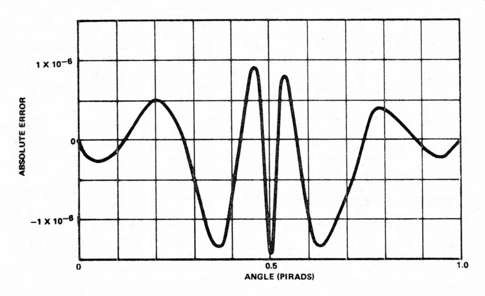
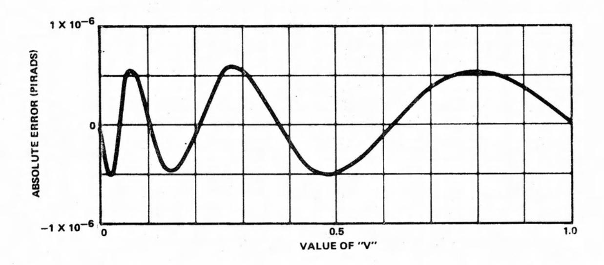
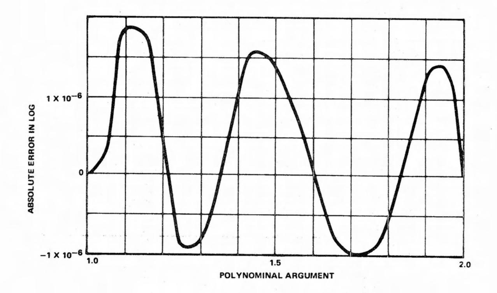

{0}------------------------------------------------

#### PREFLIGHT TESTS

#### 12.1 INTRODUCTION

To make the LVDC flight program usable during preflight vehicle tests, special flight program test options must be provided. These options must provide simulation of flight-like conditions which exercise the interfaces between the LVDC/LVDA and the remainder of the vehicle, and must allow preflight linkage tests, which exercise the control system and allow ground communication via the Digital Command System (DCS).

#### 12.2 FLIGHT SIMULATION

A flight simulation option must provide the capability to demonstrate integrity of the LVDC memory, issue switch selector commands, issue special LVDA ladder profiles, and accept certain discretes and interrupts. Flight simulation must have two modes: repeatable and non-repeatable.

#### 12.2.1 Repeatable

The repeatable flight simulation mode will provide the capability to execute a portion of the LVDC memory logic with an exact predictability. This capability must be furnished to provide a check on the integrity of the memory. This test mode will use the actual flight equations; however, to insure complete predictability, the following modifications must be made to nominal flight input processing.

- Substitution of stored acceleration profile for accelerometer input
- Substitution of internal timing for external sequencing events

{1}------------------------------------------------

- Substitution of computed guidance angles for attitude angles
- Substitution of preset typical targeting load data for the indeterminate DCS targeting load parameters.

The use of the stored acceleration or  $(F/M)_{\rm C}$  profile will assure that the program will bypass the accelerometer error processing; thus, providing predictable input to the boost navigation equations. The stored acceleration or  $(F/M)_{\rm C}$  profile is generated as a function of prestored vehicle mass, mass flow rate, and thrust values based on vehicle performance predictions (Eq. 4.2.12, 4.2.13, and 12.2.1). The resulting acceleration is then used in Eq. 12.2.2 to produce velocity changes which replace the velocity changes normally read from external accelerometers. The velocity changes computed from  $(F/M)_{\rm C}$  will drive the navigation equations and produce a boost trajectory.

The use of internal timing will allow the program to insure that event dependent processing occurs at fixed times. The nominal time base start times, as specified in the Event Sequence Timeline Table in Part II, will be used to internally force time base initiation at the nominal time.

The use of guidance angles will allow predictable resolution of the  $(F/M)_{\rm C}$  profile and will also assure bypassing the flight program gimbal angle error processing. Minor loop processing will essentially be reduced to processing the ladder profiles, as discussed in Section 12.2.2.5.

The use of preset typical targeting load data in place of DCS targeting data is necessary to assure predictable input to the guidance equations.

In order to allow simultaneous LVDC and stage testing, the re-peatable test mode must bypass switch selector output proces-sing. This feature will also allow repeatable test execution

I - 12 - 2

Rev. A

{2}------------------------------------------------

during the terminal countdown without causing erroneous stage sequencing on the pad.

The repeatable mode must have a means of initializing all hardware and software functions that would influence the predictability of flight simulation execution. The areas requiring processing include:

- The status of the real-time clock and the two internal interrupt counters
- The variable data words in LVDC memory
- The activation of logic to bypass external input sampling.

The termination of a repeatable test run will be a function of internal processing of T4+145 seconds. Upon termination of each repeatable test run, LVDC memory occupied by the flight program must have a bit-by-bit configuration identical to the configuration at the end of any other repeatable run made with that program. This will provide the capability to verify that memory has not been altered from the verified state, and that the LVDC is functioning normally. The technique that will be used to verify memory will be under the control of the RCA-110A. Each memory sector will be summed and the sector sums will be compared against a predetermined set of memory sums. Any deviation from the predetermined sums will imply that either the memory has been altered or that the LVDC/LVDA has malfunctioned.

#### 12.2.2 Non-Repeatable

The non-repeatable flight simulation mode must provide the capability to selectively satisfy the following objectives:

{3}------------------------------------------------

- Verify correct accelerometer interface
- Verify proper gimbal angle interface
- Verify proper acceptance of vehicle inputs
- Verify proper use of switch selector interface
- Issue ladder commands to exercise the flight control system.

The non-repeatable mode differs from the repeatable in that acceptance of external inputs causes timing differences which affect the LVDC operation and, hence, result in non-repeatable (non-compare) memory checksums. The following external inputs must be accepted depending on test definition:

- Accelerometer readings
- Gimbal readings
- Vehicle interrupts and discretes
- Switch selector processing for designated stages.

#### 12.2.2.1 Accelerometer Interface

The verification of the interface between the LVDC/LVDA and the accelerometers can only be accomplished in tests that include a powered-up platform which becomes inertial at GRR in the test countdown. This interface will be verified in the following manner for powered-up platform runs. Since the platform is inertial, earth's rotational effects will be measured by the accelerometers. This expected earth rotational effect will be computed by Eq. 12.2.3.

{4}------------------------------------------------

The LVDC/LVDA, through the flight program, will read and process accelerometer readings and subtract the expected readings from the actual readings, Eq. 12.2.4. Any discrepancy between the expected and the actual reading will result in abnormal navigation and guidance results. These abnormalities will in turn cause the S-IVB cutoff time to vary outside nominal limits, thereby providing an indication of an error.

#### 12.2.2.2 Gimbal Interface

The verification of the interface between the LVDC/LVDA and the gimbals is accomplished in much the same manner as the accelerometer verification. Again, the inertial platform must be powered up for gimbal interface verification. For repeatable simulations, this gimbal interface will be accomplished by the following method. The expected gimbal readings due to the earth's rotation are calculated using Eq. 12.2.5 through 12.2.7. The attitude errors are calculated using Eq. 12.2.8 and 12.2.9.

These attitude errors, if any, are combined with the increments from the ladder profiles as defined in Section 12.2.2.5 to generate the ladder commands. Since all ladder commands are recorded on strip charts during preflight tests, any unexpected ladder signal will be immediately noticeable and will indicate either platform alignment error or erroneous gimbal operation. Although erroneous gimbal readings will result in abnormal ladder outputs, the trajectory flown will not be affected since the commanded attitude angles, and not the gimbal angles, are used to resolve the accelerometer vector.

{5}------------------------------------------------

#### 12.2.2.3 Vehicle Interrupt and Discrete Interface

Since in the non-repeatable simulation mode, external interrupts must be enabled and the vehicle discrete input register must be sampled, indications of time base initiation events can be set through the ground computer to force the flight program to initiate the desired time bases. Thus, proper recognition of vehicle inputs by the LVDC/LVDA can be verified.

#### 12.2.2.4 Switch Selector Interface

Non-repeatable flight simulation mode must provide the capability to issue switch selector commands for selected vehicle stages. By monitoring LVDC issuance of switch selector commands, it will be possible to verify that all interfaces between LVDC/LVDA and the vehicle via the switch selector are correct. It will also be possible to simulate failures in the switch selector and, thereby, force the flight program to take corrective action as defined in Section 9.

#### 12.2.2.5 Flight Control Computer Interface

Another function of flight simulation will be the issuance of a series of prestored ladder profiles. Execution of these profiles will exercise the flight control computer by issuing a series of ramps at specified times. Proper functioning of the control computer can be determined by monitoring its output in response to these inputs.

The required profiles are defined in the Flight Simulation Ladder Profiles Figure in Part II. The slope of the ramps shown in the figure must be one degree per second. The square waves must be generated at the maximum allowable ladder rate, 

{6}------------------------------------------------

maintained at the specified level for at least two seconds, then returned to zero at the maximum allowable ladder rate.

The levels shown must be commanded with a tolerance of  $\pm 1$  ladder bit. The profiles must be issued at the times specified with a tolerance of  $\pm 200$  milliseconds.

#### 12.3 FLIGHT SIMULATION OPTIONS

In order to allow flexibility in operating the flight program in the flight simulation mode, the capability to select combinations of operating conditions must be available. A flight simulation indicator word will be loaded into the LVDC via the gound computer. The word will supply the following information:

- Flight simulation selected
- Switch selector status
- Repeatable/non-repeatable option
- Data compression status
- Platform status
- · Test site indication.

An explanation of these options is given in the following paragraphs.

#### 12.3.1 Flight Simulation Selected

Since the indicator word is examined in flight as well as flight simulation, the indicator must be set to flight simulation status prior to each preflight test run. All flight

{7}------------------------------------------------

simulation runs, then, upon completion, must reset the indi-cator to flight status.

#### 12.3.2 Switch Selector Status

Since all stages of the launch vehicle may not be powered during a flight simulation test, this option must be provided to issue switch selector commands to selected stages only.

## 12.3.3 Repeatable/Non-Repeatable

The selection of the repeatable or non-repeatable option will be controlled through this indication.

#### 12.3.4 Data Compression Status

This option must be provided to bypass the storing of compressed data over the preflight LVDC programs, thus eliminating the need to reload the preflight programs after every flight simulation run.

#### 12.3.5 Platform Status

As defined earlier, the LVDC programs must have the capability to test LVDC/LVDA platform interfaces. Under some conditions, it will be necessary to make flight simulation runs without powering the platform. When the platform interface is not exercised, Eq. 12.2.3 and 12.2.5 through 12.2.9 are not solved by the LVDC programs.

## 12.3.6 Test Site Indicator

As is shown in Eq. 12.2.3 and 12.2.5, the earth's rotational effects on the platform are functions of the test site latitude

{8}------------------------------------------------

and total gravity acceleration at the test site. This indi-cator, therefore, determines whether Huntsville or KSC values should be used.

#### 12.4 PREFLIGHT LINKAGE TESTS

The LVDC program must provide the access linkage to allow the preflight logic to exercise certain portions of the flight logic during vehicle tests. The two tests presently defined are the Guidance and Control (G & C) Steering Test and the Preflight Command Receiver Test.

## 12.4.1 G & C Steering Linkage

The G & C Steering Test requires that the preflight program use the flight program's Minor Loop logic to monitor and respond to testing of the ST-124M inertial platform. The flight program must provide the access linkage from the preflight program to allow the following processing:

- The initialization of linkage parameters between the preflight and the flight routines
- The initialization of required transformation matrices
- The initialization of gimbal input parameters
- The initialization of gimbal reading processing parameters
- The initialization of timekeeping and scheduling parameters.

{9}------------------------------------------------

This initialization must insure the complete activation of all logic required for subsequent execution of the Minor Loop by the preflight program as required by test procedures.

## 12.4.2 Preflight Command Receiver Linkage

The Preflight Command Receiver test, also known as the Houston Interface test, requires that the preflight program use the flight program's Digital Command System (DCS) logic to respond to and process DCS commands from Mission Control Center in Houston for checkout of the vehicle Command Receiver system. The flight logic must provide the access linkage from the preflight logic to allow the following processing:

- The initialization of linkage parameters between the preflight and flight programs
- The initialization of all logic switches and processing parameters
- The initialization of timekeeping and scheduling parameters.

This initialization must insure that all mission dependent commands are enabled and that DCS processing is activated as defined for actual flight. In order to prevent undesirable program action such as issuance of Generalized Switch Selector commands, the flight program must insure that all command response remains internal to the DCS logic.

{10}------------------------------------------------

#### ALGORITHMS

#### 13.1 INTRODUCTION

Elementary functions and mathematical procedures must be computed by the algorithms and techniques described below. Logic necessary to make the algorithms flexible enough to accept inputs in the ranges expected is also defined.

The angular unit to be used in the flight program and in these algorithms is the pirad. One pirad is equal to  $\pi$  radians, or 180 degrees. For example,

$$45^{\circ} = 45^{\circ} \left( \frac{1 \text{ pirad}}{180^{\circ}} \right) = 0.25 \text{ pirad}$$

.628 radians = .628 radians  $(\frac{1 \text{ pirad}}{\pi \text{ radians}})$  = 0.20 pirads

All principal angles are in the range of -1.0 to +1.0 when expressed in pirads.

The polynomials cited in this section for the calculation of sines, arctangents, and natural logarithms are Chebyshev approximations. 

The coefficients are converted to be compatible with flight program units.

#### 13.2 SINE-COSINE ALGORITHM

The sine-cosine algorithm uses a polynomial approximation of the sine function. The sine polynomial is

Approximations for Digital Computers, by Cecil Hastings, Jr. (Princeton University Press, 1955).

{11}------------------------------------------------

$$\sin \alpha = 3.1415897\alpha - 5.1673678\alpha^{3} + 2.5436052\alpha^{5} - 0.55839693\alpha^{7}$$
 (13.2.1)2

for -  $0.5 \le \alpha \le 0.5$ .

Given the angle  $\alpha'$  in pirads, the quadrant in which  $\alpha'$  lies must be determined and the two associated quantities,  $\overline{\alpha}$  and  $\widetilde{\alpha}$  must be computed according to Table 13-1.

| Table 13-1 SINE/ | COSINE | ARGUMENT | SELECTION |
|------------------|--------|----------|-----------|
|------------------|--------|----------|-----------|

| α' Quadrant | $\overline{\alpha}$ | ã      |
|----------------|---------------------|--------|
| I              | α'                  | 0.5-α' |
| II             | 1.0-α'              | 0.5-α' |
| III            | -1.0-α'             | 0.5+α' |
| IV             | α'                  | 0.5+α' |
|                |                     |        |

The quantities  $\bar{\alpha}$  and  $\tilde{\alpha}$  are now such that both lie between -0.5 and 0.5, satisfying the following identities:

$$\sin \alpha' = \sin \overline{\alpha}$$
  
 $\cos \alpha' = \sin \widetilde{\alpha}$ 

The numbers  $\alpha$  and  $\alpha$  are substituted into the polynomial to obtain  $\alpha$  and  $\cos$   $\alpha$ , respectively.

The error characteristics of the sine-cosine algorithm are shown in Fig. 13-1.

Parenthetical numbers in right field of page identify equations; a comprehensive list of equations for all sections of this document is presented in Section 14.

{12}------------------------------------------------

#### 13.3 ARCTANGENT ALGORITHM

The arctangent algorithm uses a polynomial approximation to the arctangent function. This algorithm requires both the numerator Y and the denominator Z of the arctangent argument. An associated number V is computed from the following.

$$V = \frac{|Z| - |Y|}{|Z| + |Y|}$$

The principal arctangent of V, for  $-1.0 \le V \le 1.0$ , is calculated from the polynomial

Arctan V = 
$$0.31830264V - 0.10587734V^3$$
  
+  $0.06160678V^5 - 0.037061733V^7$   
+  $0.016760072V^9 - 0.0037309738V^{11}$  (13.3.1)

Since  $-1.0 \le V \le 1.0$ , the principal arctangent satisfies the inequality  $-0.25 \le Arctan \ V \le 0.25$ .

The algorithm thus determines Arctan  $(\frac{Y}{Z})$ , from Table 13-2, such that the inequality

$$-1.0 \leq Arctan \left(\frac{Y}{Z}\right) \leq 1.0$$

is satisfied.

TABLE 13-2 ARCTANGENT POLYNOMIAL ARGUMENT

| Y               | Z               | Arctan (Y/Z)                                     |
|-----------------|-----------------|--------------------------------------------------|
| +,0 +,0 - | +,0 - +,0 | 0.25-Arctan V 0.75+Arctan V -0.25+Arctan V |
| -               | -               | -0.75-Arctan V                                   |

{13}------------------------------------------------

The error characteristics for this algorithm are shown in Figure 13-2.

Figure 13-1 Error Characteristics of the Sine-Cosine Algorithm

Figure 13-2 Error Characteristics for Arctangent Algorithm

{14}------------------------------------------------

#### 13.4 NATURAL LOGARITHM ALGORITHM

The natural logarithm algorithm uses a limited range polynomial combined with appropriate algebraic identities to extend the range for greater usefulness.

To find the logarithm of a number  $\alpha$ , the flight program must first determine a number  $\alpha'$  and an integer N such that  $1.0 \le \alpha' \le 2.0$  and  $\alpha' = \alpha 2.0^{-N}$ . The natural logarithm of  $\alpha'$  will then be determined by evaluating the following polynomial:

$$\begin{array}{rllllllllllllllllllllllllllllllllllll$$

Finally, the relation

$$\ln \alpha = \ln(2.0^{N}\alpha') = N \ln 2.0 + \ln \alpha' = 0.6931471806 N + \ln \alpha'$$
(13.4.2)

will be used to calculate the natural logarithm of  $\alpha$ . The algorithm must accept  $\alpha$  in the range  $0.125 < \alpha < 8.0$ .

The error characteristics for this algorithm are given in Figure 13-3.

# 13.5 SQUARE ROOT ALGORITHM

The square root algorithm is derived from Newton's method of successive approximations. Given some positive number  $X = (=x^2)$ , the square root of X will be obtained by iterating the expression

$$x_{i+1} = 0.5(x_i + \frac{X}{x_i}), i = 0,1,2,3,...,$$
 (13.5.1)

{15}------------------------------------------------

Figure 13-3 Error Characteristics for Natural Logarithm Algorithm

where  $x_0$  is an initial guess for the square root of X. Following this procedure,  $x_1 \to \sqrt{\chi}$  as  $i \to \infty$ .

Four iterations are required to calculate square roots to an accuracy of six decimal places for  $\Delta x_0 = |x_0 - \sqrt{x}| < 0.50 \sqrt{x}$ . Three iterations are required for  $\Delta x_0 < 0.10 \sqrt{x}$ ; two iterations are required for  $\Delta x_0 < 0.01 \sqrt{x}$ ; and a single iteration is sufficient for  $\Delta x_0 < 0.001 \sqrt{x}$ .

In order to insure sufficient accuracy, the square root algorithm must be iterated three times each time the routine is called.

## 13.6 INVERSE SQUARE ROOT ALGORITHM

The inverse square root algorithm is a variation of Newton's method. The approximation for  $1.0/\sqrt{X}$  will be obtained by iterating the expression

{16}------------------------------------------------

$$x_{i+1} = 0.5 x_i (3.0-x_i^2 X), i = 0,1,2,3,...$$
 (13.6.1)

where  $x_0$  is an initial guess for the inverse square root of X. These iterations produce  $x_i \rightarrow 1.0/\sqrt{X}$  as  $i \rightarrow \infty$ .

Six iterations are required to calculate inverse square roots to an accuracy of six decimal places for  $\Delta x_0 = |x_0 - 1.0/\sqrt{x}| < 0.50(1.0/\sqrt{x})$ . Three iterations are required for  $\Delta x_0 < 0.10(1.0/\sqrt{x})$ ; two iterations are required for  $\Delta x_0 < 0.01(1.0/\sqrt{x})$ ; and a single iteration is sufficient for  $\Delta x_0 < 0.001(1.0/\sqrt{x})$ .

#### 13.7 VECTOR DOT PRODUCT

The method to be used in calculating the dot product of two vectors  $\overline{A}$  and  $\overline{B}$  is

$$\overline{A} \cdot \overline{B} = A_x B_x + A_y B_y + A_z B_z, \qquad (13.7.1)$$

where  $A_x$ ,  $A_y$ ,  $A_z$  and  $B_x$ ,  $B_y$ ,  $B_z$  are the components of  $\overline{A}$  and  $\overline{B}$ , respectively.

#### 13.8 VECTOR CROSS PRODUCT

The method to be used to obtain the cross product vector  $\overline{C}$  of two vectors  $\overline{A}$  and  $\overline{B}$  is given by

$$\overline{C} = \begin{bmatrix} C_{x} \\ C_{y} \\ C_{z} \end{bmatrix} = \begin{bmatrix} (A_{y}B_{z} - A_{z}B_{y}) \\ (A_{z}B_{x} - A_{x}B_{z}) \\ (A_{x}B_{y} - A_{y}B_{x}) \end{bmatrix} = \overline{A} \times \overline{B}$$
(13.8.1)

where  $A_x$ ,  $A_y$ , and  $A_z$  and  $B_x$ ,  $B_y$ ,  $B_z$  are the components of  $\overline{A}$  and  $\overline{B}$ , respectively, and  $C_x$ ,  $C_y$ ,  $C_z$  are the components of the cross product vector  $\overline{C}$ .

{17}------------------------------------------------

(THIS PAGE HAS BEEN LEFT BLANK INTENTIONALLY.)

{18}------------------------------------------------

#### SECTION 14

#### EQUATIONS

#### 14.1 INTRODUCTION

This section lists the equations defined by this document. The equations are appropriately numbered by sections for easy reference to the sections of the text.

In these equations, the liberty has been taken to define the equality sign according to the commonly accepted computer language meaning; that is, the symbol "=" shall mean "is replaced by" or "is set equal to." 

{19}------------------------------------------------

(THIS PAGE HAS BEEN LEFT BLANK INTENTIONALLY.)

{20}------------------------------------------------

#### 14.2 EQUATIONS

## [MSG] Matrix

$$[MSG] = \begin{bmatrix} \cos \phi_L & \sin \phi_L \sin A_z & -\sin \phi_L \cos A_z \\ -\sin \phi_L & \cos \phi_L \sin A_z & -\cos \phi_L \cos A_z \\ 0 & \cos A_z & \sin A_z \end{bmatrix}$$
(2.3.1)

## [MG4] Matrix

$$[MG4] = \begin{bmatrix} \cos \lambda & 0 & \sin \lambda \\ & \sin i \sin \lambda & \cos i & -\sin i \cos \lambda \\ & -\cos i \sin \lambda & \sin i & \cos i \cos \lambda \end{bmatrix}$$
 (2.3.2)

## [MBS] Matrix

$$MBS11 = \cos \Theta_{v} \cos \Theta_{z}$$

$$MBS12 = -\cos \theta_{x} \cos \theta_{y} \sin \theta_{z} + \sin \theta_{x} \sin \theta_{y}$$

MBS13 = 
$$\sin \theta_x \cos \theta_y \sin \theta_z + \cos \theta_x \sin \theta_y$$

$$MBS21 = sin \Theta_{z}$$

$$MBS22 = \cos \theta_{x} \cos \theta_{z}$$

$$MBS23 = -\sin \theta_x \cos \theta_z$$

MBS31 = 
$$-\sin \theta_v \cos \theta_z$$

MBS32 = 
$$\cos \theta_x \sin \theta_y \sin \theta_z + \sin \theta_x \cos \theta_y$$

MBS33 = 
$$-\sin \theta_x \sin \theta_y \sin \theta_z + \cos \theta_x \cos \theta_y$$
 (2.3.3)

{21}------------------------------------------------

## [M4V] Matrix

$$[\text{M4V}] = \begin{bmatrix} \cos \phi_{\text{T}} & 0 & \sin \phi_{\text{T}} \\ 0 & 1 & 0 \\ -\sin \phi_{\text{T}} & 0 & \cos \phi_{\text{T}} \end{bmatrix} \tag{2.3.4}$$

## [MS4] Matrix

 $MS411 = \cos \lambda \cos \phi_{T}$ 

 $MS412 = \cos \lambda \sin \phi_L \sin A_z + \sin \lambda \cos A_z$ 

 $MS413 = -\cos \lambda \sin \phi_L \cos A_z + \sin \lambda \sin A_z$ 

 $MS421 = sin i sin \lambda cos \phi_L - cos i sin \phi_L$ 

MS422 =  $\sin i \sin \lambda \sin \phi_L \sin A_z + \cos i \cos \phi_L \sin A_z$ -  $\sin i \cos \lambda \cos A_z$ 

MS423 = -sin i sin  $\lambda$  sin  $\phi_L$  cos  $A_z$  - cos i cos  $\phi_L$  cos  $A_z$  - sin i cos  $\lambda$  sin  $A_z$ 

 $\texttt{MS431} = -\cos i \sin \lambda \cos \phi_L - \sin i \sin \phi_L$ 

MS432 = -cos i sin  $\lambda$  sin  $\phi_L$  sin  $A_z$  + sin i cos  $\phi_L$  sin  $A_z$  + cos i cos  $\lambda$  cos  $A_z$ 

MS433 =  $\cos i \sin \lambda \sin \phi_L \cos A_z - \sin i \cos \phi_L \cos A_z$ +  $\cos i \cos \lambda \sin A_z$  (2.3.5)

{22}------------------------------------------------

## [MGA] Matrix

$$[MGA] = \begin{bmatrix} \cos \theta_{R} & 0 & \sin \theta_{R} \\ 0 & 1 & 0 \\ -\sin \theta_{R} & 0 & \cos \theta_{R} \end{bmatrix}$$
 (2.3.6)

## [MSA] Matrix

$$\texttt{MSA11} = \cos \Theta_{R} \cos \phi_{L}$$

$$\texttt{MSA12} = \cos \theta_{R} \sin \phi_{L} \sin A_{z} + \sin \theta_{R} \cos A_{z}$$

$$\mathsf{MSA13} = -\mathsf{cos} \ \Theta_{\mathbf{R}} \ \mathsf{sin} \ \phi_{\mathbf{L}} \ \mathsf{cos} \ \mathsf{A}_{\mathbf{z}} + \mathsf{sin} \ \Theta_{\mathbf{R}} \ \mathsf{sin} \ \mathsf{A}_{\mathbf{z}}$$

$$MSA21 = -sin \phi_{I}$$

$$MSA22 = cos \phi_L sin A_z$$

$$MSA23 = -\cos \phi_L \cos A_z$$

$$MSA31 = -sin \Theta_R cos \phi_L$$

$$\texttt{MSA32} = -\texttt{sin} \ \theta_{\texttt{R}} \ \texttt{sin} \ \phi_{\texttt{L}} \ \texttt{sin} \ \texttt{A}_{\texttt{z}} \ + \ \texttt{cos} \ \theta_{\texttt{R}} \ \texttt{cos} \ \texttt{A}_{\texttt{z}}$$

$$MSA33 = \sin \theta_{R} \sin \phi_{L} \cos A_{z} + \cos \theta_{R} \sin A_{z} \qquad (2.3.7)$$

#### [MSV] Matrix

MSV11 = 
$$\cos \phi_T \cos \lambda \cos \phi_L - \sin \phi_T \cos i \sin \lambda \cos \phi_L$$
 -  $\sin \phi_T \sin i \sin \phi_L$ 

$$\begin{split} \text{MSV12} &= & \cos \, \phi_{T} \, \cos \, \lambda \, \sin \, \phi_{L} \, \sin \, A_{z} \, + \, \cos \, \phi_{T} \, \sin \, \lambda \, \cos \, A_{z} \\ &- \, \sin \, \phi_{T} \, \cos \, i \, \sin \, \lambda \, \sin \, \phi_{L} \, \sin \, A_{z} \\ &+ \, \sin \, \phi_{T} \, \sin \, i \, \cos \, \phi_{L} \, \sin \, A_{z} \\ &+ \, \sin \, \phi_{T} \, \cos \, i \, \cos \, \lambda \, \cos \, A_{z} \end{split}$$

{23}------------------------------------------------

## [MSV] Matrix (continued)

$$\begin{split} \text{MSV13} &= -\cos \, \phi_{\text{T}} \, \cos \, \lambda \, \sin \, \phi_{\text{L}} \, \cos \, A_{\text{z}} \, + \, \cos \, \phi_{\text{T}} \, \sin \, \lambda \, \sin \, A_{\text{z}} \\ &+ \, \sin \, \phi_{\text{T}} \, \cos \, i \, \sin \, \lambda \, \sin \, \phi_{\text{L}} \, \cos \, A_{\text{z}} \\ &- \, \sin \, \phi_{\text{T}} \, \sin \, i \, \cos \, \phi_{\text{L}} \, \cos \, A_{\text{z}} \\ &+ \, \sin \, \phi_{\text{T}} \, \cos \, i \, \cos \, \lambda \, \sin \, A_{\text{z}} \end{split}$$

MSV21 =  $\sin i \sin \lambda \cos \phi_L - \cos i \sin \phi_L$ 

MSV22 =  $\sin i \sin \lambda \sin \phi_L \sin A_z + \cos i \cos \phi_L \sin A_z$  -  $\sin i \cos \lambda \cos A_z$ 

MSV23 = -sin i sin  $\lambda$  sin  $\phi_L$  cos  $A_z$  - cos i cos  $\phi_L$  cos  $A_z$  - sin i cos  $\lambda$  sin  $A_z$ 

 $\begin{tabular}{lllllllllllllllllllllllllllllllllll$ 

$$\begin{split} \text{MSV32} &= -\sin \ \phi_{\text{T}} \ \cos \ \lambda \ \sin \ \phi_{\text{L}} \ \sin \ A_{\text{z}} - \sin \ \phi_{\text{T}} \ \sin \ \lambda \ \cos \ A_{\text{z}} \\ &- \cos \ \phi_{\text{T}} \ \cos \ i \ \sin \ \lambda \ \sin \ \phi_{\text{L}} \ \sin \ A_{\text{z}} \\ &+ \cos \ \phi_{\text{T}} \ \sin \ i \ \cos \ \phi_{\text{L}} \ \sin \ A_{\text{z}} \\ &+ \cos \ \phi_{\text{T}} \ \cos \ i \ \cos \ \lambda \ \cos \ A_{\text{z}} \end{split}$$

 $\begin{array}{llllllllllllllllllllllllllllllllllll$ 

## [MEG] Matrix

$$[MEG] = \begin{bmatrix} \cos \theta_E & \sin \theta_E & 0 \\ 0 & 0 & -1 \\ -\sin \theta_E & \cos \theta_E & 0 \end{bmatrix}$$
(2.3.9)

{24}------------------------------------------------

## [MES] Matrix

 $\texttt{MES11} = \cos \phi_L \cos \Theta_E$ 

 $\texttt{MES12} = \cos \phi_L \sin \Theta_E$ 

 $MES13 = sin \phi_{I}$ 

 $\texttt{MES21} = \sin \phi_{L} \sin A_{z} \cos \Theta_{E} - \cos A_{z} \sin \Theta_{E}$ 

MES22 =  $\sin \phi_L \sin A_z \sin \theta_E + \cos A_z \cos \theta_E$ 

MES23 =  $-\cos \phi_L \sin A_z$ 

 $\texttt{MES31} = -\sin \phi_L \cos A_z \cos \Theta_E - \sin A_z \sin \Theta_E$ 

MES32 =  $-\sin \phi_L \cos A_z \sin \theta_E + \sin A_z \cos \theta_E$ 

 $MES33 = \cos \phi_L \cos A_z \qquad (2.3.10)$ 

{25}------------------------------------------------

(THIS PAGE HAS BEEN LEFT BLANK INTENTIONALLY.)

{26}------------------------------------------------

#### Platform Azimuth

$$T_{D} = T_{L}' - 5 - T_{GRRO}$$
 (3.2.1)

$$\lambda = \lambda_0 - \dot{\lambda} \ (T_p) \tag{3.2.2}$$

$$A_z = A_{00} + A_{01}i + A_{10}\lambda + A_{11}i\lambda$$
 (3.2.3)

## Flight Descending Node

$$T_{D} = T_{GMT} - T_{GRR0}$$
 (3.4.1)

$$\lambda = \lambda_0 - \dot{\lambda}(T_D) \tag{3.4.2}$$

# Initial Position, Velocity, and Gravitational Acceleration Vectors Calculations

$$\overline{R_S} = R_L \begin{bmatrix} \cos(\phi_L - \phi_L^{\dagger}) \\ \sin(\phi_L - \phi_L^{\dagger}) & \sin A_z \\ -\sin(\phi_L - \phi_L^{\dagger}) & \cos A_z \end{bmatrix}$$
(3.4.3)

$$\overline{V}_{S} = R_{L} \omega_{E} \pi \begin{bmatrix} 0 \\ \cos \phi_{L}^{\dagger} \cos A_{z} \\ \cos \phi_{L}^{\dagger} \sin A_{z} \end{bmatrix}$$
(3.4.4)

$$Y_G = -X_S \sin\phi_L + Y_S \cos\phi_L \sin A_z - Z_S \cos\phi_L \cos A_z$$
 (3.4.5)

$$S = -\frac{\mu}{R^3} \left\{ 1 + J \left( \frac{a_e}{R} \right)^2 \left[ 1 - 5 \left( \frac{Y_G}{R} \right)^2 \right] \right\}$$
 (3.4.6)

$$P = -\frac{\mu}{R^2} \left(\frac{a_e}{R}\right)^2 \left(\frac{2JY_G}{R}\right)$$
 (3.4.7)

{27}------------------------------------------------

# Initial Position, Velocity, and Gravitational Acceleration Vectors Calculations (Continued)

$$\frac{\overline{G}_{S}}{G_{S}} = S \overline{R}_{S} + P \begin{bmatrix}
-\sin\phi_{L} \\
\cos\phi_{L} \sin A_{z} \\
-\cos\phi_{L} \cos A_{z}
\end{bmatrix}$$
(3.4.8)

{28}------------------------------------------------

## Expected Velocity Changes Using Past Acceleration

$$\overline{\Delta V_{f}} = \begin{bmatrix} \Delta V_{fx} \\ \Delta V_{fy} \\ \Delta V_{fz} \end{bmatrix} = 20(F/M)\Delta T \begin{bmatrix} \cos \Theta_{y} \cos \Theta_{z} \\ \sin \Theta_{z} \\ -\sin \Theta_{y} \cos \Theta_{z} \end{bmatrix}$$
(4.2.1)

## Disagreement Test

$$|\Delta A_{x} - \Delta B_{x}| \leq 2 \text{ bits}$$

$$\Delta V_{Mx} = \begin{cases} \Delta A_{x} \text{ for A channel used} \\ \Delta B_{x} \text{ for B channel used} \end{cases}$$

$$(4.2.1.1)$$

Same for Y and Z channel

#### Zero Test Values

$$\begin{cases} A_{c0} = 20(F/M)\Delta T \sin (2^{\circ}) \\ A_{c0} = 20(F/M)\Delta T \sin (6^{\circ}) \end{cases}$$

$$|\overline{\Delta V_f}| \leq A_{c0}$$
(4.2.3.1)

#### Reasonableness Test

$$(0.5\overline{\Delta V_{\rm f}} - 20 {\rm RTC} \ \Delta T) \leq \overline{\Delta V_{\rm M}} \leq (1.5\overline{\Delta V_{\rm f}} + 20 {\rm RTC} \ \Delta T)$$

$$\text{for } \overline{\Delta V_{\rm f}} \geq 0 \qquad (4.2.4)$$

$$(1.5\overline{\Delta V_{\rm f}} - 20 {\rm RTC} \ \Delta T) \leq \overline{\Delta V_{\rm M}} \leq (0.5\overline{\Delta V_{\rm f}} + 20 {\rm RTC} \ \Delta T)$$

$$\text{for } \overline{\Delta V_{\rm f}} < 0 \qquad (4.2.5)$$

{29}------------------------------------------------

#### Velocity Accumulation

$$\frac{\overline{\Delta V}}{\overline{\Delta V}_{B}} = \begin{cases}
\frac{\overline{\Delta V}_{M}}{\overline{\Delta V}_{B}} & \text{for reasonable accelerometer readings} \\
\frac{\overline{\Delta V}_{B}}{\overline{\Delta V}_{B}} & \text{for unreasonable accelerometer readings}
\end{cases} (4.2.6)$$

$$\overline{V}_{M} = \begin{bmatrix} \dot{x}_{M} \\ \dot{y}_{M} \\ \dot{z}_{M} \end{bmatrix} = \overline{V}_{M} + \overline{\Delta V}$$
(4.2.7)

## F/M Calculations

$$\overline{V}_{m} = \begin{bmatrix} \dot{X}_{m} \\ \dot{Y}_{m} \\ \dot{Z}_{m} \end{bmatrix} = \frac{\overline{V}_{M}}{20}$$
(4.2.8)

$$\overline{A}_{m} = \begin{bmatrix} \ddot{X}_{m} \\ \ddot{Y}_{m} \\ \vdots \\ \ddot{Z}_{m} \end{bmatrix} = \frac{\overline{V}_{m} - (\overline{V}_{m})_{past}}{\Delta T}$$
(4.2.9)

$$F/M = \left(\ddot{X}_{m}^{2} + \ddot{Y}_{m}^{2} + \ddot{Z}_{m}^{2}\right)^{1/2} \tag{4.2.10}$$

#### Reciprocal Acceleration Filter

$$(M/F)_{S} = MFK1(M/F)_{1} + MFK2(M/F)_{2} + MFK3(M/F)_{3}$$
  
+  $MFK4(M/F)_{4} + MFK5(M/F)_{S1} + MFK6(M/F)_{S2}$   
+  $MFK7(M/F)_{S3} + MFK8(M/F)_{S4}$  (4.2.11)

{30}------------------------------------------------

## Backup Accelerations

$$M_{cb} = M_{i} - \dot{M}_{k} \Delta T$$
 (j,k) = (1,1), (2,2), (2,3) (4.2.12)

$$(F/M)_{c} = F_{k}/M_{ch}$$
  $k = 1, 2, 3$  (4.2.13)

## Calculated Velocity Changes Using Backup Acceleration

$$\overline{\Delta V_{B}} = \begin{bmatrix} \Delta V_{Bx} \\ \Delta V_{By} \\ \Delta V_{Bz} \end{bmatrix} = 20 (F/M)_{c} \Delta T \begin{bmatrix} \cos \theta_{y} \cos \theta_{z} \\ \sin \theta_{z} \\ -\sin \theta_{y} \cos \theta_{z} \end{bmatrix}$$
(4.2.14)

#### Position and Velocity Calculations

$$\begin{cases} \Delta X_{Sg} = (\dot{X}_{Sg} + \frac{1}{2} \ddot{X}_{Sg} \Delta T) \Delta T \\ \Delta Y_{Sg} = (\dot{Y}_{Sg} + \frac{1}{2} \ddot{Y}_{Sg} \Delta T) \Delta T \\ \Delta Z_{Sg} = (\dot{Z}_{Sg} + \frac{1}{2} \ddot{Z}_{Sg} \Delta T) \Delta T \end{cases}$$

$$(4.3.1)$$

$$\begin{cases} \Delta X_{mf} = \frac{1}{2} (\dot{X}_{m} + [\dot{X}_{m}]past) \Delta T \\ \Delta Y_{mf} = \frac{1}{2} (\dot{Y}_{m} + [\dot{Y}_{m}]past) \Delta T \\ \Delta Z_{mf} = \frac{1}{2} (\dot{Z}_{m} + [\dot{Z}_{m}]past) \Delta T \end{cases}$$

$$(4.3.2)$$

$$\begin{cases} X_{S} = X_{S} + \Delta X_{Sg} + \Delta X_{mf} + \dot{X}_{0} \Delta T \\ Y_{S} = Y_{S} + \Delta Y_{Sg} + \Delta Y_{mf} + \dot{Y}_{0} \Delta T \\ Z_{S} = Z_{S} + \Delta Z_{Sg} + \Delta Z_{mf} + \dot{Z}_{0} \Delta T \end{cases}$$

$$(4.3.3)$$

{31}------------------------------------------------

## Position and Velocity Calculations (Continued)

$$\begin{cases} \dot{x}_{Sg} = \dot{x}_{Sg} + \frac{1}{2} (\ddot{x}_{Sg} + [\ddot{x}_{Sg}]past) \Delta T \\ \dot{y}_{Sg} = \dot{y}_{Sg} + \frac{1}{2} (\ddot{y}_{Sg} + [\ddot{y}_{Sg}]past) \Delta T \\ \dot{z}_{Sg} = \dot{z}_{Sg} + \frac{1}{2} (\ddot{z}_{Sg} + [\ddot{z}_{Sg}]past) \Delta T \end{cases}$$
(4.3.4)

$$\begin{cases} \dot{x}_{S} = \dot{x}_{m} + \dot{x}_{Sg} + \dot{x}_{0} \\ \dot{y}_{S} = \dot{y}_{m} + \dot{y}_{Sg} + \dot{y}_{0} \\ \dot{z}_{S} = \dot{z}_{m} + \dot{z}_{Sg} + \dot{z}_{0} \end{cases}$$
(4.3.5)

$$v = (\dot{x}_S^2 + \dot{y}_S^2 + \dot{z}_S^2)^{1/2} \tag{4.3.5.1}$$

## Gravitational Acceleration

$$Y_{G} = -X_{S} \sin \phi_{L} + Y_{S} \cos \phi_{L} \sin A_{z}$$

$$-Z_{S} \cos \phi_{L} \cos A_{z}$$
(4.3.6)

$$\mathbf{R} = (\mathbf{X_S}^2 + \mathbf{Y_S}^2 + \mathbf{Z_S}^2)^{-1/2} \tag{4.3.7}$$

$$S_{34} = H \left(\frac{a_e}{R}\right)^3 \left(\frac{Y_G}{R}\right) \left[3-7\left(\frac{Y_G}{R}\right)^2\right] + \frac{D}{7}\left(\frac{a_e}{R}\right)^4 \left[3-42\left(\frac{Y_G}{R}\right)^2 + 63\left(\frac{Y_G}{R}\right)^4\right]$$
(4.3.8)

$$P_{34} = \frac{H}{5} \left(\frac{a_e}{R}\right) \left[15 \left(\frac{Y_G}{R}\right)^2 - 3\right] + \frac{D}{7} \left(\frac{a_e}{R}\right)^2 \left(\frac{Y_G}{R}\right) \left[12 - 28 \left(\frac{Y_G}{R}\right)^2\right]$$

$$(4.3.9)$$

$$S = -\frac{\mu}{R^3} \left\{ 1 + J \left( \frac{a_e}{R} \right)^2 \left[ 1 - 5 \left( \frac{Y_G}{R} \right)^2 \right] + S_{34} \right\}$$
 (4.3.10)

I-14-14 Rev. A

{32}------------------------------------------------

Gravitational Acceleration (Continued)

$$P = -\frac{\mu}{R^2} \left(\frac{a_e}{R}\right)^2 \left\{2J \left(\frac{Y_G}{R}\right) + P_{34}\right\}$$
 (4.3.11)

$$\frac{G_{S}}{G_{S}} = S \frac{R_{S}}{R_{S}} + P \begin{bmatrix}
-\sin \phi_{L} \\
\cos \phi_{L} \sin A_{z} \\
-\cos \phi_{L} \cos A_{z}
\end{bmatrix}$$
(4.3.12)

## Time-tilt Computations

$$T_c = T_{as} - T1 + T_d$$
 (4.4.1)

$$\chi_{y} = \begin{cases} \sum_{j=0}^{3} F_{1j} \left( T_{c} - \Delta T_{f} \right)^{j} & \text{for } T_{S0} \leq T_{c} - \Delta T_{f} < T_{S1} \\ \sum_{j=0}^{3} F_{2j} \left( T_{c} - \Delta T_{f} \right)^{j} & \text{for } T_{S1} \leq T_{c} - \Delta T_{f} < T_{S2} \\ \sum_{j=0}^{3} F_{3j} \left( T_{c} - \Delta T_{f} \right)^{j} & \text{for } T_{S2} \leq T_{c} - \Delta T_{f} < T_{ar} \end{cases}$$
(4.4.2)

$$\chi_{z} = \left[\frac{\text{YAWC}(K) - \text{YAWC}(K-1)}{\text{TYAW}(K) - \text{TYAW}(K-1)}\right] (T_{c} - \text{TYAW}(K)) + \text{YAWC}(K)$$
 (4.4.2.1)

for  $\chi_z$  computations K = 2, 3, 4...25 and  $TYAW(K-1) \leq T_c < TYAW(K)$ 

## S-IB Engine Out Freeze Time

$$\Delta T_{f} = \begin{cases} B_{11} & T_{E0} + B_{12} & T_{E0} < T_{f1} \\ B_{21} & T_{E0} + B_{22} & T_{f1} \le T_{E0} < T_{f2} \\ 0 & T_{f2} \le T_{E0} \end{cases}$$
(4.4.3)

(4.4.4)

{33}------------------------------------------------

#### S-IB Engine Out Freeze Time (Continued)

$$TMEFRZ = T_c + \Delta T_f$$
 (4.4.5)

$$T_{ar} = T_{ar} + \Delta T_{f} - C_{arl} \quad \text{if } T_{EO} < T_{far} \qquad (4.4.6) \quad *$$

$$T_{ar} = T_{ar} + \Delta T_{f}$$
 if  $T_{far} \leq T_{EO}$ 

#### First Phase Time-to-go Calculation

$$\tau_1 = V_{\text{ex1}} \left( \frac{M}{F} \right)_S \tag{4.4.7}$$

$$T_{1i} = T_{1i} - \Delta T \tag{4.4.8}$$

#### Second Phase Time-to-go Initialization

$$T_{1i} = 0.0$$
 (4.4.9)

$$\alpha_{f} = \frac{\tau_{10}}{T_{10} + \tau_{1}} \tag{4.4.10}$$

$$\tau_{3N} = \frac{{}^{M}_{GR} - \alpha_{f} \dot{M}_{2} T_{10}}{\dot{M}_{3}}$$
(4.4.11)

#### Second Phase Artificial τ Calculations

$$\tau_{3M} = v_{ex3} \left(\frac{M}{F}\right)_{S} \tag{4.4.12}$$

$$\tau_{3K} = \tau_{3N} - P_{C}$$
 (4.4.13)

$$\tau_3 = \tau_{3K} + \left(\tau_{3M} - \tau_{3K}\right) \left(\frac{P_C}{P_{GVP}}\right)^4$$
 (4.4.14)

$$P_{C} = P_{C} + \Delta T \tag{4.4.15}$$

{34}------------------------------------------------

## Second Phase Time-to-go Calculations

$$\tau_3 = V_{ex3} \left(\frac{M}{F}\right)_S \tag{4.4.16}$$

$$T_{3i} = T_{3i} - \Delta T \tag{4.4.17}$$

## Transformation of Position and Velocity to 4-System

$$\overline{R_{\Delta}} = [MS4] \overline{R_{S}}$$
 (4.4.18)

$$\overline{V_4} = [MS4] \overline{V_S}$$
 (4.4.19)

#### IGM Intermediate Parameters

$$L_1 = V_{ex1} \ln \left( \frac{\tau_1}{\tau_1 - T_{1i}} \right)$$
 (4.4.20)

$$J_{1} = L_{1}\tau_{1} - V_{ex} T_{1}$$
 (4.4.21)

$$S_1 = L_1 T_{1i} - J_1 \tag{4.4.22}$$

$$Q_1 = S_1 \tau_1 - \frac{1}{2} V_{ex1} T_{1i}^2$$
 (4.4.23)

$$P_1 = J_1 \tau_1 - \frac{1}{2} V_{ex1} T_{11}^2$$
 (4.4.24)

$$U_1 = Q_1 \tau_1 - \frac{1}{6} V_{ex_1} T_{11}^3$$
 (4.4.25)

$$L'_{3} = V_{ex3} \ln \left( \frac{\tau_{3}}{\tau_{3} - T_{3i}} \right)$$
 (4.4.26)

{35}------------------------------------------------

## IGM Intermediate Parameters (Continued)

$$L_{y}' = L_{1} + L_{3}'$$
 (4.4.27)

$$J_{3}' = L_{3}' \tau_{3} - V_{ex3} T_{3j}$$
 (4.4.28)

## Total Time-to-go Prediction

$$T* = T_{1i} + T_{3i}$$
 (4.4.29)

## Range Angle

$$\phi_{i} = Arctan \left( \frac{Z_{i}}{X_{i}} \right) \tag{4.4.30}$$

## Predicted Terminal Range Angle

$$\delta_{2} = V T * - J'_{3} + L'_{y} T_{3i} - \left(\frac{ROV}{V_{ex3}}\right) \left[\left(\tau_{1} - T_{1i}\right) L_{1} + \left(\tau_{3} - T_{3i}\right) L'_{3}\right] \left[L'_{y} + V - V_{T}\right]$$
(4.4.31)

$$\phi_{iT} = \left(\frac{1}{R_T}\right) \left(S_1 + \delta_2\right) \frac{\cos\Theta_T}{\pi} \tag{4.4.32}$$

$$\phi_{T} = \phi_{i} + \phi_{iT} \qquad (4.4.33)$$

## Terminal Position, Velocity, and Gravity

$$X_{VT} = R_{T} \tag{4.4.34}$$

$$\dot{X}_{VT} = V_{T} \sin \Theta_{T} \tag{4.4.35}$$

{36}------------------------------------------------

## Terminal Position, Velocity, and Gravity (Continued)

$$\dot{Y}_{VT} = 0$$
 (4.4.36)

$$Z_{VT} = V_{T} \cos \Theta_{T}$$
 (4.4.37)

$$\ddot{X}_{VgT} = G_{T} \tag{4.4.38}$$

$$Y_{VgT} = 0$$
 (4.4.39)

$$\ddot{Z}_{VgT} = 0$$
 (4.4.40)

$$\phi_{\mathbf{T}} = \phi_{\mathbf{T}} \tag{4.4.41}$$

$$[MSV] = [M4V][MS4]$$
 (4.4.42)

$$\overline{R_{V}} = [M4V] \overline{R_{4}}$$
 (4.4.43)

$$\overline{V}_{V} = [M4V] \overline{V}_{4}$$

$$\overline{G_V} = [MSV] \overline{G_S}$$
 (4.4.45)

## Estimated Velocity-to-be-gained

$$\overline{G_{V}^{*}} = \frac{1}{2} \left( \overline{G_{TV}} + \overline{G_{V}} \right) \tag{4.4.46}$$

$$\overline{\Delta V_{V}^{\dagger}} = \overline{V_{TV}} - \overline{V_{V}} - T * \overline{G_{V}^{*}}$$
(4.4.47)

{37}------------------------------------------------

## Improved Estimate of Total Time-to-go

$$\Delta L_{3} = \frac{1}{2} \left[ \frac{(\Delta V_{V}^{'})^{2}}{L_{y}^{'}} - L_{y}^{'} \right]$$
 (4.4.48)

$$L_3 = L_3' + \Delta L_3$$
 (4.4.49)

$$\Delta T_3' = \Delta L_3 \left( \frac{\tau_3 - T_{3i}}{v_{ex3}} \right) \tag{4.4.50}$$

$$T_{3i} = T_{3i} + \Delta T_{3}'$$
 (4.4.52)

$$T^* = T_{1i} + T_{3i} \tag{4.4.53}$$

## Improved Estimate of Velocity-to-be-gained

$$\overline{\Delta V_{V}} = \overline{\Delta V_{V}^{\dagger}} - \Delta T_{3}^{\dagger} \overline{G_{V}^{\star}}$$
(4.4.54)

## Preliminary Guidance Commands Satisfying Velocity

#### Constraint

$$\tilde{\chi}_{y} = Arctan \left( \frac{\Delta \dot{x}_{y}}{\Delta \dot{z}_{y}} \right)$$
 (4.4.55)

$$\tilde{\chi}_{z} = \operatorname{Arctan} \left[ \frac{\Delta \dot{Y}_{V}}{\left(\Delta \dot{X}_{V}^{2} + \Delta \dot{Z}_{V}^{2}\right)^{1/2}} \right]$$
(4.4.56)

{38}------------------------------------------------

## Position Correction Terms

$$J_3 = J_3^{\dagger} + T_{3i} \Delta L_3$$
 (4.4.51)

$$S_{3} = L_{3}T_{31} - J_{3}$$
 (4.4.57)

$$Q_{3} = S_{3}\tau_{3} - \frac{1}{2}V_{ex3}T_{3i}^{2}$$
 (4.4.58)

$$L_{v} = L_{1} + L_{3}$$
 (4.4.59)

$$J_{y} = J_{1} + J_{3} + L_{3} T_{1i}$$
 (4.4.60)

$$S_y = S_1 - J_3 + L_y T_{3i}$$
 (4.4.61)

$$Q_y = Q_1 + Q_3 + S_3 T_{1i} + J_1 T_{3i}$$
 (4.4.62)

$$K_{y} = \frac{L_{y}}{J_{y}} \tag{4.4.63}$$

$$D_{y} = S_{y} - K_{y}Q_{y}$$
 (4.4.64)

$$\Delta Y_{V} = Y_{V} + \dot{Y}_{V}T^* + \frac{1}{2} \ddot{Y}_{Vg}^*T^{*2} + S_{y} \sin \tilde{\chi}_{z}$$
 (4.4.65)

$$K_3 = \frac{\Delta Y_V}{D_V \cos \tilde{\chi}_Z}$$
 (4.4.66)

$$K_4 = K_v K_3$$
 (4.4.67)

$$P_{3} = J_{3} \left( \tau_{3} + 2T_{1i} \right) - \frac{1}{2} V_{ex3} T_{3i}^{2}$$
 (4.4.68)

$$U_{3} = Q_{3} \left( \tau_{3} + 2T_{1i} \right) - \frac{1}{6} V_{ex3} T_{3i}^{3}$$
 (4.4.69)

$$L_{p} = L_{y} \cos \tilde{\chi}_{z} \tag{4.4.70}$$

{39}------------------------------------------------

## Position Correction Terms (Continued)

$$C_2 = \cos \tilde{\chi}_z + K_3 \sin \tilde{\chi}_z \tag{4.4.71}$$

$$C_{4} = K_{4} \sin \tilde{\chi}_{z} \tag{4.4.72}$$

$$J_{p} = J_{y}C_{2} - C_{4} \left( P_{1} + P_{3} + L_{3}T_{11}^{2} \right)$$
 (4.4.73)

$$S_{p} = S_{v}C_{2} - Q_{v}C_{4} \tag{4.4.74}$$

$$Q_{p} = Q_{y}C_{2} - C_{4} \left(U_{1} + U_{3} + S_{3}T_{11}^{2} + T_{31}P_{1}\right)$$
 (4.4.75)

$$K_{p} = \frac{L_{p}}{J_{p}}$$
 (4.4.76)

$$D_{p} = S_{p} - K_{p}Q_{p} \tag{4.4.77}$$

$$\Delta X_{V} = X_{V} - X_{VT} + \dot{X}_{V} T^* + \frac{1}{2} \ddot{X}_{Vg}^* T^{*2} + S_{p} \sin \tilde{\chi}_{v}$$
 (4.4.78)

$$K_1 = \frac{\Delta X_V}{D_p \cos \tilde{\chi}_y} \tag{4.4.79}$$

$$K_2 = K_p K_1$$
 (4.4.80)

## Corrected Guidance Commands in 4-System Satisfying

#### Position Constraint

$$\chi_{y4} = \tilde{\chi}_y - \frac{1}{\pi} \left( K_1 - K_2 \Delta T_N \right) - \phi_T - \frac{1}{2}$$
 (4.4.81)

$$\chi_{z_4} = \tilde{\chi}_z - \frac{1}{\pi} \left( K_3 - K_4 \Delta T_N \right)$$
 (4.4.82)

{40}------------------------------------------------

## Steering Misalignment Correction Terms

$$SMCY = SMCY \left\{ \frac{\ddot{z}_{m} + \ddot{x}_{m} \tan \left[ \frac{1}{2} \left( \chi_{y} + \left[ \chi_{y} \right]_{past} \right) - SMCY \right]}{\ddot{x}_{m} - \ddot{z}_{m} \tan \left[ \frac{1}{2} \left( \chi_{y} + \left[ \chi_{y} \right]_{past} \right) - SMCY \right]} \right\} \frac{\Delta T}{\pi}$$

$$(4.4.83)$$

$$SMCZ = SMCZ \left\{ \frac{\sin \left[ \frac{1}{2} \left( \chi_z + \left[ \chi_z \right]_{past} \right) - SMCZ \right] - \left( \frac{M}{F} \right) \ddot{\Upsilon}_m}{\cos \left[ \frac{1}{2} \left( \chi_z + \left[ \chi_z \right]_{past} \right) - SMCZ \right]} \right\} \frac{\Delta T}{\pi}$$
 (4.4.84)

#### Thrust Vector Transformation

$$\overline{F_{S}'} = \left[MS4\right]^{T} \begin{bmatrix} \cos \chi_{y_{4}} \cos \chi_{z_{4}} \\ \sin \chi_{z_{4}} \\ -\sin \chi_{y_{4}} \cos \chi_{z_{4}} \end{bmatrix}$$

$$(4.4.85)$$

# Final Guidance Commands in S-System Corrected for Thrust Misalignment

$$\chi_{y} = Arctan \left( \frac{-F'_{Sz}}{F'_{Sx}} \right) + SMCY \qquad (4.4.86)$$

$$\chi_{z} = Arctan \left[ \frac{F'_{Sy}}{(1-F'_{Sy}^{2})^{1/2}} \right] + SMCZ$$
 (4.4.87)

#### High Speed Loop for S-IVB Cutoff

$$\Delta T_b = \Delta V_b \Delta T \left(\frac{1}{V - V'}\right) \tag{4.4.88}$$

$$T_{3i} = T_{3i} - \Delta T_{b} \tag{4.4.89}$$

{41}------------------------------------------------

## High Speed Loop for S-IVB Cutoff (Continued)

$$T_{3i} = T_{3i} - \Delta T$$
 (4.4.90)

$$A'' = \frac{\left[ (V-V') \Delta T' - (V'-V'') \Delta T \right]}{\Delta T' \Delta T} \tag{4.4.91}$$

$$A' = A'' \Delta T + \left(\frac{V - V'}{\Delta T}\right) \tag{4.4.92}$$

$$T_{3i} = \frac{V_T - \Delta V_b - V}{A' + A''T_{3i}}$$
 (4.4.93)

$$T_{CO} = T_{3i} + T_{as}$$
 (4.4.94)

{42}------------------------------------------------

## Position for Orbital Guidance

$$\overline{R}_{OG} = (\overline{R})_{t} + T_{SON}(\overline{V})_{t}$$
 (5.4.1)

## Integration Scheme

$$\begin{cases} (\overline{R})_{t-4} = (\overline{R})_{t-8} + 4(\overline{V})_{t-8} + 8(\overline{A})_{t-8} \\ (\overline{V})_{t-4} = (\overline{V})_{t-8} + 4(\overline{A})_{t-8} \end{cases}$$
(5.4.2)

$$(\overline{A})_{t-4} = (\overline{G})_{t-4} + (\overline{A}_{\overline{D}})_{t-4}$$
 (5.4.3)

$$\begin{cases} (\overline{R}_{p})_{t} = (\overline{R})_{t-8} + 8(\overline{V})_{t-8} + 32(\overline{A})_{t-4} \\ (\overline{V}_{p})_{t} = (\overline{V})_{t-4} + 8(\overline{A})_{t-4} \end{cases}$$

$$(5.4.4)$$

$$(\overline{A}_{p})_{t} = (\overline{G}_{p})_{t} + (\overline{A}_{pp})_{t}$$
 (5.4.5)

$$\begin{pmatrix}
(\overline{\Delta}\overline{R})_{t} = 8(\overline{V})_{t-8} + \frac{32}{3} [(\overline{A})_{t-8} + 2(\overline{A})_{t-4}] \\
+ (\overline{\Delta}R_{SAV})_{t-8} + 8(\overline{\Delta}V_{SAV})_{t-8}
\end{pmatrix}$$

$$\begin{pmatrix}
(\overline{R})_{t} = (\overline{R})_{t-8} + (\overline{\Delta}R)_{t} \\
(\overline{\Delta}V)_{t} = \frac{4}{3} [(\overline{A})_{t-8} + 4(\overline{A})_{t-4} + (\overline{A}_{\overline{p}})_{t}] + (\overline{\Delta}V_{SAV})_{t-8} \\
(\overline{V})_{t} = (\overline{V})_{t-8} + (\overline{\Delta}V)_{t}
\end{pmatrix} (5.4.6)$$

$$\left\langle (\overline{R})_{t} = (\overline{R})_{t-8} + (\overline{\Delta R})_{t} \right\rangle$$

$$(\overline{\Delta V})_{t} = \frac{4}{3} [(\overline{A})_{t-8} + 4(\overline{A})_{t-4} + (\overline{A}_{p})_{t}] + (\overline{\Delta V}_{SAV})_{t-8}$$

$$(\overline{V})_{t} = (\overline{V})_{t-8} + (\overline{\Delta V})_{t}$$
 (5.4.6)

$$(\overline{A})_t = (\overline{G})_t + (\overline{A}_{\overline{D}})_t$$
 (5.4.7)

#### Drag Acceleration

$$h = R - a_e + (a_e - b)(\frac{Y_G}{R})^2$$
 (5.4.8)

{43}------------------------------------------------

## Drag Acceleration (Continued)

$$\rho = \begin{cases} 0 & \text{for } h > h_2 \\ \rho_0 + \rho_1 h + \rho_2 h^2 + \rho_3 h^3 + \rho_4 h^4 + \rho_5 h^5 & \text{for } h_2 \ge h \ge h_1 \\ \rho_c & \text{for } h_1 > h \end{cases}$$

$$(5.4.9)$$

$$\begin{cases} \overline{v_r} = \overline{v_S} - \overline{\omega_{ES}} \times \overline{R_S} \\ v_r = (v_{rx}^2 + v_{ry}^2 + v_{rz}^2) \end{cases}$$
(5.4.10)

$$\cos \alpha = \frac{1}{v_r} \left[ v_{rx} \cos \theta_y \cos \theta_z + v_{ry} \sin \theta_z - v_{rz} \sin \theta_y \cos \theta_z \right]$$
 (5.4.11)

$$C_{D} = \sum_{j=1}^{5} C_{Dj} (\cos \alpha)^{j-1}$$
 (5.4.12)

$$\overline{A_{DS}} = -\rho C_D K_D V_r \overline{V_r}$$
(5.4.13)

## Inertial Guidance Commands

$$\begin{cases} \chi_{x} = ROLLA \\ \chi_{y} = SPITCH \\ \chi_{z} = SYAW \end{cases}$$
 (5.5.1)

## Track Local Reference Guidance Commands

$$\overline{R_4} = [MS4] \overline{R_S}$$
 (5.5.2)

$$R_{\mu} = (X_{\mu}^2 + Z_{\mu}^2)^{1/2} \tag{5.5.3}$$

{44}------------------------------------------------

#### Track Local Reference Guidance Commands (Continued)

$$\begin{cases} \sin \chi_{y_4} = \text{SPITCH} & \left(\frac{-Z_4}{R_4}\right) + \text{CPITCH} & \left(\frac{-X_4}{R_4}\right) \\ \cos \chi_{y_4} = \text{CPITCH} & \left(\frac{-Z_4}{R_4}\right) - \text{SPITCH} & \left(\frac{-X_4}{R_4}\right) \end{cases}$$
 (5.5.4)

$$\begin{cases} \sin \chi_{Z_4} = SYAW \\ \cos \chi_{Z_4} = CYAW \end{cases}$$
 (5.5.5)

$$\chi_{x} = ROLLA \tag{5.5.6}$$

# Inertial Hold Guidance Commands (upon return of control from S/C to IU)

$$\begin{cases} \chi_{x} = \Theta'_{x} \\ \chi'_{y} = \Theta'_{x} \\ \chi_{y} = \Theta'_{y} \\ \chi'_{y} = \Theta'_{y} \\ \chi_{z} = \Theta'_{z} \\ \chi'_{z} = \Theta'_{z} \end{cases}$$

$$(5.5.7)$$

# Track Local Horizontal Guidance Commands (upon return of control from S/C to IU)

$$\chi_{\mathbf{x}} = \Theta_{\mathbf{x}}^{\dagger} \tag{5.5.8}$$

$$\overline{P}_{S} = \begin{bmatrix}
\cos \Theta'_{y} \cos \Theta'_{z} \\
\sin \Theta'_{z} \\
-\sin \Theta'_{y} \cos \Theta'_{z}
\end{bmatrix}$$
(5.5.9)

{45}------------------------------------------------

# Track Local Horizontal Guidance Commands (upon return of control from S/C to IU)

$$\overline{P}_{4} = \begin{bmatrix} P_{4x} \\ P_{4y} \\ P_{4z} \end{bmatrix} = [MS4] \overline{P}_{S}$$

$$(5.5.10)$$

$$\begin{cases} \sin \chi_{z_{+}} = P_{+y} \\ \cos \chi_{z_{+}} = (1 - \sin^{2} \chi_{z_{+}}) \end{cases}^{1/2}$$
(5.5.11)

$$\begin{cases}
\phi_{SO} = Arctan \left(\frac{Z_{4}}{X_{4}}\right) \\
\phi_{P} = Arctan \left(\frac{-P_{4Z}}{P_{4X}}\right) \\
\alpha_{LH} = \phi_{SO} + \phi_{P} + 0.5
\end{cases} (5.5.12)$$

$$\begin{cases} \text{SPITCH} = \sin \alpha_{\text{LH}} \\ \text{CPITCH} = \cos \alpha_{\text{LH}} \\ \text{SYAW} = \sin \chi_{z_4} \\ \text{CYAW} = \cos \chi_{z_4} \\ \text{ROLLA} = \Theta_{\text{X}}^{\dagger} \end{cases}$$

$$(5.5.13)$$

## Telemetry Station Acquisition Test

$$\Theta_{R} = \omega_{E} \quad T_{as} \tag{5.6.1}$$

{46}------------------------------------------------

## Telemetry Station Acquisition Test (Continued)

$$\begin{bmatrix} x_A \\ y_A \\ z_A \end{bmatrix} = [MSA] \begin{bmatrix} x_S \\ y_S \\ z_S \end{bmatrix}$$
(5.6.2)

$$\overline{R}_{A} = \begin{bmatrix} X_{A} \\ Y_{A} \\ Z_{A} \end{bmatrix}$$
(5.6.3)

$$\overline{C_{A}}(i) = \begin{bmatrix} C_{Ax}(i) \\ C_{Ay}(i) \\ C_{Az}(i) \end{bmatrix}$$
(5.6.4)

$$d_{A}(i) = \overline{R_{A} \cdot C_{A}}(i) - R_{STA}$$
 (5.6.5)

{47}------------------------------------------------

(THIS PAGE HAS BEEN LEFT BLANK INTENTIONALLY.)

{48}------------------------------------------------

#### Attitude Error Commands

$$\begin{cases}
\chi'_{x} = \chi'_{x} + \Delta \chi'_{x} \\
\chi'_{y} = \chi'_{y} + \Delta \chi'_{y} \\
\chi'_{z} = \chi'_{z} + \Delta \chi'_{z}
\end{cases} (8.2.1)$$

$$\begin{cases}
\Delta Z = \Theta'_{z} - \chi'_{z} \\
YAW = A_{5} \Delta Z - A_{4} \Delta Y \\
\Delta Y = \Theta'_{y} - \chi'_{y} \\
PITCH = A_{1} \Delta Y + A_{2} \Delta Z \\
\Delta X = \Theta'_{x} - \chi'_{x} \\
ROLL = A_{6} \Delta X + A_{3} \Delta Y
\end{cases} (8.2.2)$$

#### Attitude Increments

$$\begin{cases} \Delta \chi'_{x} = (\chi_{x} - \chi'_{x}) / [(MLR)(\Delta T_{N})] \\ \Delta \chi'_{y} = (\chi_{y} - \chi'_{y}) / [(MLR)(\Delta T_{N})] \\ \Delta \chi'_{z} = (\chi_{z} - \chi'_{z}) / [(MLR)(\Delta T_{N})] \end{cases}$$
(8.3.1)

(8.2.2)

## Gimbal-to-Body Transformation

$$\begin{cases} \chi'_{xp} = \chi'_{x} + \Delta \chi'_{x} [(MLR)(\Delta T_{N})] \\ \chi'_{zp} = \chi'_{z} + \Delta \chi'_{z} [(MLR)(\Delta T_{N})] \end{cases}$$

$$\Theta_{xa} = \frac{1}{2} (\chi'_{xp} + \Theta'_{x})$$

$$\Theta_{za} = \frac{1}{2} (\chi'_{zp} + \Theta'_{z})$$

$$(8.3.2)$$

{49}------------------------------------------------

$$A_{1} = SF \cos(\theta_{xa}) \cos(\theta_{za}) \qquad (8.3.5)$$

$$A_{2} = SF \sin(\theta_{xa}) \qquad (8.3.6)$$

$$A_{3} = SF \sin(\theta_{za}) \qquad (8.3.7)$$

$$A_{4} = SF \sin(\theta_{xa}) \cos(\theta_{za}) \qquad (8.3.8)$$

$$A_{5} = SF \cos(\theta_{xa}) \qquad (8.3.9)$$

$$A_{6} = SF \qquad (8.3.10)$$

{50}------------------------------------------------

#### Computed Acceleration Profile

$$\begin{bmatrix} \ddot{x}_{S} \\ \ddot{y}_{S} \\ \ddot{z}_{S} \end{bmatrix} = [MBS] \begin{bmatrix} \left(\frac{F}{M}\right)_{C} \\ 0 \\ 0 \end{bmatrix}$$
(12.2.1)

SETTING THE PROPERTY OF SE

## Computed Velocity Changes

$$\begin{cases} \dot{x}_{S} = \frac{1}{2} \left( \ddot{x}_{S} + \left[ \ddot{x}_{S} \right]_{past} \right) \Delta T \\ \dot{\dot{y}}_{S} = \frac{1}{2} \left( \ddot{y}_{S} + \left[ \ddot{y}_{S} \right]_{past} \right) \Delta T \\ \dot{z}_{S} = \frac{1}{2} \left( \ddot{z}_{S} + \left[ \ddot{z}_{S} \right]_{past} \right) \Delta T \end{cases}$$

$$(12.2.2)$$

## Velocity Increments

$$\begin{cases} \Delta V_{gx} = 20G_{L}[\sin^{2}\phi_{L} + \cos \omega_{E}T_{as} \cos^{2}\phi_{L}] \Delta T \\ \Delta V_{gy} = 20G_{L}\cos \phi_{L}[\cos A_{z} \sin \omega_{E}T_{as} \\ - (1 - \cos \omega_{E}T_{as})\sin A_{z}\sin \phi_{L}] \Delta T \end{cases}$$

$$\Delta V_{gz} = 20G_{L}\cos \phi_{L}[\sin A_{z} \sin \omega_{E}T_{as} \\ + (1 - \cos \omega_{E}T_{as})\cos A_{z}\sin \phi_{L}] \Delta T \qquad (12.2.3)$$

$$\begin{cases} \Delta V_{x} = \Delta V_{cx} + \Delta V_{fx} - \Delta V_{gx} \\ \Delta V_{y} = \Delta V_{cy} + \Delta V_{fy} - \Delta V_{gy} \\ \Delta V_{z} = \Delta V_{cz} + \Delta V_{fz} - \Delta V_{gz} \end{cases}$$

$$(12.2.4)$$

{51}------------------------------------------------

## Expected Gimbal Angles

$$\begin{cases} \dot{\Theta}_{xe} = \omega_{E} [\sin \phi_{L} + \cos \phi_{L} \tan \Theta_{ze} \sin(\Theta_{xe} + A_{z})] \\ \dot{\Theta}_{ye} = -\omega_{E} \cos \phi_{L} \sin(\Theta_{xe} + A_{z}) (\frac{1}{\cos \Theta_{ze}}) \\ \dot{\Theta}_{ze} = \omega_{E} \cos \phi_{L} \cos(\Theta_{xe} + A_{z}) \end{cases}$$
(12.2.5)
$$\begin{cases} \Delta \Theta_{xe} = \frac{1}{2} (\dot{\Theta}_{xe} + [\dot{\Theta}_{xe}]_{past}) \Delta T \\ \Delta \Theta_{ye} = \frac{1}{2} (\dot{\Theta}_{ye} + [\dot{\Theta}_{ye}]_{past}) \Delta T \\ \Delta \Theta_{ze} = \frac{1}{2} (\dot{\Theta}_{ze} + [\dot{\Theta}_{ze}]_{past}) \Delta T \end{cases}$$
(12.2.6)
$$\begin{cases} \Theta_{xe} = \Theta_{xe} + \Delta \Theta_{xe} \\ \Theta_{ye} = \Theta_{ye} + \Delta \Theta_{ye} \\ \Theta_{ze} = \Theta_{ze} + \Delta \Theta_{ze} \end{cases}$$
(12.2.7)

## Attitude Errors

$$\begin{cases}
\chi_{\mathbf{x}}^{"} = \chi_{\mathbf{x}}^{"} + \Delta \Theta_{\mathbf{x}e} \\
\chi_{\mathbf{y}}^{"} = \chi_{\mathbf{y}}^{"} + \Delta \Theta_{\mathbf{y}e} \\
\chi_{\mathbf{z}}^{"} = \chi_{\mathbf{z}}^{"} + \Delta \Theta_{\mathbf{z}e}
\end{cases}$$

$$\begin{cases}
\Delta \mathbf{x} = \Theta_{\mathbf{x}} - \chi_{\mathbf{x}}^{"} \\
\Delta \mathbf{y} = \Theta_{\mathbf{y}} - \chi_{\mathbf{y}}^{"} \\
\Delta \mathbf{z} = \Theta_{\mathbf{z}} - \chi_{\mathbf{z}}^{"}
\end{cases}$$

$$(12.2.8)$$

(12.2.7)

{52}------------------------------------------------

## Sine-Cosine Algorithm

$$\sin \alpha = 3.1415897\alpha - 5.1673678\alpha^3 + 2.5436052\alpha^5 - 0.55839693\alpha^7$$
 (13.2.1)

## Arctangent Algorithm

Arctan V = 
$$0.31830264V - 0.10587734V^3$$
  
+ $0.06160678V^5 - 0.037061733V^7$   
+ $0.016760072V^9 - 0.00373097V^{11}$  (13.3.1)

## Natural Logarithm Algorithm

$$1n \alpha' = 0.99990167(\alpha'-1.0) - 0.49787544(\alpha'-1.0)^{2} +0.31765005(\alpha'-1.0)^{3} - 0.19376149(\alpha'-1.0)^{4} +0.08556927(\alpha'-1.0)^{5} - 0.01833831(\alpha'-1.0)^{6}$$
(13.4.1)

$$\ln \alpha = \ln(2.0^{N}\alpha') = N \ln 2.0 + \ln \alpha' = 0.6931471806 N + \ln \alpha'$$
 (13.4.2)

#### Square Root Algorithm

$$x_{i+1} = 0.5(x_i + \frac{X}{x_i}), \quad i = 0,1,2,3,...$$
 (13.5.1)

#### Inverse Square Root Algorithm

$$x_{i+1} = 0.5x_i(3.0 - x_i^2X), i = 0,1,2,3,...$$
 (13.6.1)

## Vector Dot Product

$$\overline{A} \cdot \overline{B} = A_x B_x + A_y B_y + A_z B_z$$
 (13.7.1)

{53}------------------------------------------------

## Vector Cross Product

$$\overline{C} = \begin{bmatrix} C_{x} \\ C_{y} \\ C_{z} \end{bmatrix} = \begin{bmatrix} A_{y}B_{z} - A_{z}B_{y} \\ A_{z}B_{x} - A_{x}B_{z} \\ A_{x}B_{y} - A_{y}B_{x} \end{bmatrix} = \overline{A} \times \overline{B}$$
(13.8.1)