NASA S & T Library  
Washington, DC 20546

SE 008-001-1

OFFICE OF MANNED  
SPACE FLIGHT

APOLLO PROGRAM

# PROJECT APOLLO COORDINATE SYSTEM STANDARDS

JUNE 1965

The NASA logo, featuring the word "NASA" in white capital letters inside a black circle, with a white swoosh or arrow pointing upwards and to the right.

NATIONAL AERONAUTICS AND SPACE ADMINISTRATION  
WASHINGTON, D.C. 20546UNITED STATES GOVERNMENT

# Memorandum

National Aeronautics and  
Space Administration

M-C MA 1461

TO : Distribution

DATE: 1 Jun 1965

FROM : Apollo Program Director

SUBJECT: Project Apollo Coordinate System Standards

The document transmitted herewith contains the approved Coordinate System Standards for the Apollo Program.

The provisions of M-D MB 1400 (Apollo LV and SC Coordinate Axis and Notation System) dated June 1, 1964 are superseded by this document and all copies should be destroyed.

The provisions of M-DE 8000.006 (Mass Properties Standard) dated June 1, 1963 are consistent with this document.

The provisions of AFMTCM 80-4 (Air Force Missile Test Center Standardized Theoretical Trajectory Magnetic Tape Format) are unaffected by this document.

Samuel C. Phillips  
Major General, USAF

## Distribution

MSC/R. R. Gilruth (60)  
MSFC/W. von Braun (50)  
KSC/K. H. Debus (30)  
MAP/Col. M. L. Seccomb (2)  
MAS/T. H. Thompson (5)  
MAT/J. H. Disher (5)  
MAO/J. K. Holcomb (5)  
MAR/G. A. Lemke (5)  
MT/E. Z. Gray (5)  
Bellcomm/J. A. Hornbeck (25)  
MA-2/T. A. Keegan (2)

PROJECT APOLLO COORDINATE  
SYSTEM STANDARDS## ABSTRACT

This document contains the Project Apollo Coordinate System Standards (PACSS). It is the result of the combined efforts of representatives from GSFC, KSC, MSC, MSFC and Bellcomm. The standards are primarily derived from past common practice, provide a high degree of uniformity and are such that strict conformance is technically practical.

The majority of the Standard Coordinate Systems are associated with the Earth or Moon and have such uses as site location, ephemerides, trajectory computation and/or transmittal of trajectory information. The remaining Standard Coordinate Systems are referenced to the vehicles (both operating alone and in stacked configurations) or vehicle operations: primarily navigation, guidance and control. Additionally there are Standard Relationships which must exist among specific Standard Coordinate Systems.

All of the Project Apollo Coordinate System Standards (PACSS) are contained in the Appendices. The text provides amplification and explanation of the PACSS.TABLE OF CONTENTS

<table><thead><tr><th><u>Section</u></th><th><u>Title</u></th><th><u>Page</u></th></tr></thead><tbody><tr><td></td><td>ABSTRACT</td><td>1</td></tr><tr><td>1.</td><td>INTRODUCTION</td><td>1</td></tr><tr><td>2.</td><td>APPROACH</td><td>2</td></tr><tr><td>  2.1</td><td>General Coordinate Systems</td><td>2</td></tr><tr><td>  2.2</td><td>Project Apollo Data</td><td>2</td></tr><tr><td>  2.3</td><td>Project Apollo Decisions</td><td>4</td></tr><tr><td>3.</td><td>DISCUSSION OF PROJECT APOLLO<br/>COORDINATE SYSTEM STANDARDS</td><td>5</td></tr><tr><td>  3.1</td><td>General Coordinate Systems Applied<br/>Directly to the Standards</td><td>5</td></tr><tr><td>  3.2</td><td>Project Apollo Data Applied to the<br/>Standards</td><td>7</td></tr><tr><td>  3.3</td><td>Project Apollo Decisions Applied to<br/>the Standards</td><td>9</td></tr><tr><td>    3.3.1</td><td>Relationships Among Coordinate Systems<br/>Related to Apollo Navigation, Guidance<br/>and Control</td><td>10</td></tr><tr><td>    3.3.2</td><td>Relationships Among the Structural<br/>Body Axes of the Apollo Vehicles</td><td>13</td></tr><tr><td>    3.3.3</td><td>Relationships Among Coordinate<br/>Systems Under Backup Conditions</td><td>15</td></tr><tr><td>4.</td><td>SUMMARY</td><td>17</td></tr><tr><td>5.</td><td>GLOSSARY</td><td>18</td></tr><tr><td>6. APPENDIX A:</td><td>Project Apollo Standard Coordinate<br/>Systems</td><td></td></tr><tr><td>7. APPENDIX B:</td><td>Project Apollo Standard Relationships<br/>Existing Among Standard Coordinate<br/>Systems</td><td></td></tr><tr><td>8.</td><td>REFERENCES</td><td></td></tr></tbody></table>1.

## INTRODUCTION

On June 1, 1964, following more than a year of intercenter effort, an OMSF directive (M-D MB 1400) was issued establishing a standard vehicle coordinate system for Apollo. At the August 1964 Panel Review Board meeting it was found that the desired standardization had not in fact been accomplished by this directive. As a result a new effort was begun involving GSFC, KSC, MSC, MSFC and Bellcomm; the scope of this effort extended beyond vehicle axes and included all coordinate systems involved in Apollo interface data exchange. Complete involvement of the participating organizations was solicited so that the resulting standards would be the best possible set, worthy of unqualified adoption within Project Apollo and acceptable to all participants.

The resulting Project Apollo Coordinate System Standards (PACSS)\* are contained in this document. It has been organized such that all PACSS appear in the Appendices in concise language suited to literal interpretation. The body of the text attempts to define the approach and reveal underlying patterns among the coordinate systems.

In all applications the particular PACSS being used must be explicitly identified.

---

\*Users of AMR must submit data to the Range in a standardized format established by the Air Force Missile Test Center and described in Reference 1. These standards, which are outside NASA control, deviate from the PACSS in several instances.2.

## APPROACH

This section is devoted to explaining the methods employed in the development of the Project Apollo Coordinate System Standards (PACSS) and thereby provides a means of understanding the logic of the approach. Basically a coordinate system provides a reference frame within which a physical problem is mathematically formulated and/or data are collected, analyzed or transmitted. The coordinate system chosen for use is usually selected based on the requirements of the specific problem. The Apollo project may be thought of as a collection of related problems, each with its own preferred reference frame. The purpose of this document is to establish a practical minimum number of well defined coordinate systems to be used for interface data exchange purposes. The Approach Diagram on page 3 represents the framework for the development of the PACSS and is explained in the following subsections.

2.1

### General Coordinate Systems

Past practice provided a wealth of coordinate systems from which appropriate selections were made for standardization in Project Apollo. Often the definitions were quite entangled with the specific functional use; separating them resulted in a group of general coordinate systems which were defined in a basic and fundamental manner. A number of these general coordinate systems were placed directly in the PACSS without elaboration. The remaining systems in the general grouping required further definition in order to be useful.

2.2

### Project Apollo Data

Certain of the general coordinate systems were not immediately applicable to Project Apollo, simply because of the excessively general nature of their definition. With the introduction of specific Apollo physical data the ambiguity present in many of these definitions was removed and they became acceptable as Apollo Standard Coordinate Systems. However, a few coordinate systems still required additional information before they became applicable.```
graph TD; A((GENERAL COORDINATE SYSTEMS  
(SECTION 3.1))) --> B((PROJECT APOLLO DATA  
(SECTION 3.2))); A --> C((PROJECT APOLLO DECISIONS  
(SECTION 3.3))); A --> D((PROJECT APOLLO COORDINATE SYSTEM STANDARDS  
(SECTION 3 AND APPENDICES))); B --> C; D --> C;
```

The diagram illustrates the approach for the Apollo coordinate system. It consists of four main nodes connected by arrows indicating the flow of information and dependencies:

- **GENERAL COORDINATE SYSTEMS (SECTION 3.1)**: The starting point, which provides input to the other three nodes.
- **PROJECT APOLLO DATA (SECTION 3.2)**: Receives input from the General Coordinate Systems and feeds into the Project Apollo Decisions node.
- **PROJECT APOLLO DECISIONS (SECTION 3.3)**: Receives input from the General Coordinate Systems, Project Apollo Data, and Project Apollo Coordinate System Standards.
- **PROJECT APOLLO COORDINATE SYSTEM STANDARDS (SECTION 3 AND APPENDICES)**: Receives input from the General Coordinate Systems and feeds into the Project Apollo Decisions node.

APPROACH DIAGRAM2.3

Project Apollo Decisions

Adequate definition of the remaining coordinate systems was attained by incorporating information concerning specific Apollo project decisions. Generally these decisions consisted of ground rules and constraints relating to the use of the Standard Coordinate Systems. Furthermore, by recording Standard Relationships which must exist among certain coordinate systems during various phases of the mission, additional standards were created. Consequently, there is a meaningful distinction between a Standard Coordinate System and a Project Apollo Coordinate System Standard (PACSS); the latter is the general category and includes the former.3. DISCUSSION OF PROJECT APOLLO COORDINATE SYSTEM STANDARDS

The complete set of Project Apollo Coordinate System Standards are contained in the Appendices. The discussion in this section is keyed to the Approach Diagram (page 3) and presents additional information concerning these coordinate system standards. The Appendices consist almost entirely of figures, generally one standard per figure. Figures A-1 through A-13 in Appendix A define Project Apollo Standard Coordinate Systems. Figures B-1 through B-3 in Appendix B define Standard Relationships among two or more Standard Coordinate Systems; in each of these cases the relationship itself is an Apollo Standard. In the following discussion frequent reference will be made to these figures.

A tabulation of the general coordinate systems to be applied to Project Apollo is presented in Table I, page 6. These systems have been subdivided for convenience according to whether they are rotating or non-rotating with respect to space-direction fixed axes and according to the body to which they are referenced, i.e., Earth, Moon, or vehicle. Table I contains only the standardized names of the coordinate systems and is introduced here to establish perspective.

3.1 General Coordinate Systems Applied Directly to the Standards

There are a number of the general coordinate systems shown in Table I which can be applied directly to Project Apollo without further information or modification, specifically:

<table><tr><td>Geographic Polar</td><td>Figure A-1</td></tr><tr><td>Selenographic Polar</td><td>Figure A-2</td></tr><tr><td>Radar</td><td>Figure A-3<br/>(a through d)</td></tr><tr><td>Geocentric Inertial</td><td>Figure A-4</td></tr></table>TABLE I

TABULATION OF GENERAL COORDINATE SYSTEMS

<table border="1">
<thead>
<tr>
<th colspan="4">THE CENTER OF THE COORDINATE SYSTEM IS REFERENCED TO THE:</th>
</tr>
<tr>
<th>VEHICLE</th>
<th>EARTH</th>
<th>MOON</th>
<th></th>
</tr>
</thead>
<tbody>
<tr>
<td>
<ul>
<li>● STRUCTURAL BODY AXES (DYNAMICAL BODY AXES)</li>
<li>● MASS PROPERTIES</li>
</ul>
</td>
<td>
<ul>
<li>● GEOGRAPHIC POLAR</li>
<li>● RADAR</li>
<li>● EARTH-FIXED LAUNCH SITE</li>
<li>● EARTH-CENTERED LAUNCH DERIVED</li>
</ul>
</td>
<td>
<ul>
<li>● SELENOGRAPHIC POLAR</li>
</ul>
</td>
<td>ROTATING</td>
</tr>
<tr>
<td>
<ul>
<li>● PLATFORM-ACCELEROMETER</li>
</ul>
</td>
<td>
<ul>
<li>● GEOCENTRIC INERTIAL</li>
<li>● IMPACT PREDICTION QUASI-INERTIAL</li>
<li>● EARTH-MOON PLANE</li>
<li>● ORBITAL ELEMENTS</li>
<li>● NAVIGATION</li>
</ul>
</td>
<td>
<ul>
<li>● SELENOCENTRIC INERTIAL</li>
<li>● EARTH-MOON PLANE</li>
<li>● NAVIGATION</li>
</ul>
</td>
<td>NON-ROTATING</td>
</tr>
<tr>
<td colspan="4">THE AXES OF THE COORDINATE SYSTEM ARE:</td>
</tr>
</tbody>
</table><table>
<tr>
<td>Impact Prediction Quasi-Inertial</td>
<td>Figure A-5</td>
</tr>
<tr>
<td>Earth-Moon Plane</td>
<td>Figure A-6</td>
</tr>
<tr>
<td>Orbital Elements</td>
<td>Figure A-7</td>
</tr>
</table>

It is interesting to note that all of these systems are either Earth or Moon Referenced. The remaining systems listed in Table I require additional project information in order to become well-defined standards.

### 3.2 Project Apollo Data Applied to the Standards

The definitions of the Standard Coordinate Systems introduced in this section are completed by the application of specific Apollo data to the rotating vehicle referenced coordinate systems of Table I which are otherwise ambiguous.

The general standard for the Structural Body Axes\* system (Figure 1, page 8) only specifies that the X axis lies along the vehicle longitudinal axis, the origin is located with respect to a reference point on the longitudinal axis and the Z axis is defined by a vehicle benchmark. Thus, in order to obtain each specific Project Apollo standard it was necessary to define the hardware-related origin of the system and the appropriate benchmark defining the positive Z axis for each of the Apollo vehicles. The Structural Body Axes systems for the Apollo vehicles are:

#### A. Launch Vehicles

##### 1. Saturn I and IB (Figure A-8a).

The origin is located on the longitudinal axis 100 inches below the gimbal reference plane. Position I (alternatively, fin I) defines the positive Z direction.

---

\*The Dynamical Body Axes system for any configuration is obtained by a pure translation of the appropriate Structural Body Axes system to the instantaneous center of mass of that configuration (see Section 3.3.2).

The diagram illustrates a 3D coordinate system for a vehicle. A vertical cylinder represents the vehicle's body. The X-axis is a vertical line passing through the center of the cylinder, with an arrow pointing upwards and labeled 'X'. A solid black dot on the X-axis is labeled 'ORIGIN REFERENCE POINT'. Below this point, on the same vertical line, is a label 'ORIGIN'. A dashed vertical line extends from the 'ORIGIN' point down to the base of the cylinder. A horizontal dashed line extends from the 'ORIGIN' point to the right, ending at an asterisk labeled 'Z AXIS BENCHMARK'. A solid line with an arrow at the end extends from the 'ORIGIN' point to the right, labeled 'Z'. A solid line with an arrow at the end extends from the 'ORIGIN' point downwards and to the left, labeled 'Y'. The X, Y, and Z axes form a right-handed coordinate system.

TYPE: Rotating, vehicle referenced

ORIGIN: Located on the vehicle's longitudinal axis and defined with respect to a specified reference point, which is fixed relative to the vehicle structure.

#### ORIENTATION AND LABELING

The X axis lies along the longitudinal axis of the vehicle, positive in the nominal direction of positive thrust acceleration.

The Z axis is perpendicular to the X axis and lies in the plane defined by the X axis and a specified vehicle benchmark, positive toward the benchmark.

The Y axis completes a standard right-handed system.

The Dynamical Body Axes system is defined as a pure translation of the Structural Body Axes system to the instantaneous vehicle center of gravity.

Figure 1 STRUCTURAL BODY AXES (Dynamical Body Axes)2. Saturn V (Figure A-8b).

The origin is located on the longitudinal axis 100 inches below the gimbal reference plane. Position I defines the positive Z axis.

B. Command and Service Module (Figure A-8c)

The origin is located on the longitudinal axis 1000 inches below the mold line of the CSM heat shield main structure ablator interface. The benchmark defining the positive Z axis is an alignment target (labeled +Z) at the top of the service module.

C. Lunar Excursion Module (Figure A-8d)

The origin is located 200 inches below the LEM Ascent stage base. The positive Z axis is not defined by a physical benchmark; however, the center of the LEM exit hatch serves as a reference benchmark. Thus the positive Z axis is parallel to the center line of the exit hatch.

The Mass Properties system (Figure A-9), in which the mass characteristics of the space vehicle and its systems, subsystems and components are described, is consistent in axes orientation and labeling with the CSM Structural Body Axes. The origin of this system is not specified uniquely; thus, for interchange of mass property data, it is essential that the origin be explicitly stated.\*

3.3 Project Apollo Decisions Applied to the Standards

This section is primarily concerned with the description and/or specification of Standard Relationships which exist among various members of the Apollo Standard Coordinate Systems. In the development of these Standard Relationships, which arise from basic project decisions, the four general coordinate systems remaining in Table I are introduced and defined.

---

\*The origin for CSM and LEM mass data is the same as for the CSM Structural Body Axes. The origin for the launch vehicle is the same as for the launch vehicle Structural Body Axes.3.3.1 Relationships Among Coordinate Systems Related to Apollo Navigation, Guidance and Control

Several interrelationships exist among the coordinate systems involved in the navigation, guidance and control functions; these interrelationships are basically the same for the Launch Vehicle, CSM, CM and LEM. The Dynamical Body Axes, Platform-Accelerometer and Navigation coordinate systems are common to all powered flight phases and these are discussed first. Several additional systems which apply only during the launch phase are treated later.

The Dynamical Body Axes system of a particular vehicle is always translatable with its Structural Body Axes system. Consistent use of the standard axes designations results in a "normally expected" orientation of the vehicle with respect to the flight path. For example, in the Launch Vehicle and CSM the axes commonly termed pitch\*, roll and yaw are identical with the y, x and z directions, respectively. This is not so in the LEM because the pitch, roll and yaw designations (y, z, x, respectively) have been assigned in a manner which is consistent with astronaut orientation rather than one which is consistent with common vehicle practice.

The Platform-Accelerometer system is used for vehicle attitude reference and to define the orientation of the accelerometers. The orientation of the Platform-Accelerometer system is determined at the time of erection of the platform. Gimbal angles relate the position of the Dynamical Body Axes to this space-direction fixed system.

The Navigation system has its origin centered in a specified (usually the dominant) central body and is translatable with the Platform-Accelerometer system for computational convenience. Specific operational orientations for the Platform-Accelerometer and Navigation coordinate systems will vary throughout the Mission.

---

\*Because of the inconsistent definitions of pitch, roll and yaw with respect to the x, y and z Body Axes systems, it is recommended that these terms not be depended upon to define directions of vehicle or platform axes.The Dynamical Body Axes, Platform-Accelerometer and Navigation systems have interrelated roles during powered flight. The rules for the operational use of these systems are generally such as to keep them all as nearly in alignment as possible during any powered flight interval. A typical relative alignment of these three systems is shown for the spacecraft in Figure 2 (page 12), where the central body pictured is the Moon. The Platform-Accelerometer system is aligned with the X axis in the general direction of positive thrust (typically this may be either the initial or average thrust direction for the burn). The Y axis direction is defined by the vector cross product of the positive X axis into the vehicle position vector; the Z axis completes a standard right handed system.

The relative alignment of these three systems is basically the same for the launch vehicle as for the spacecraft. However, the Platform-Accelerometer Y axis becomes ill defined for the Earth launch since the thrust vector (X axis) and the position vector are nearly colinear. Therefore, at launch the Platform-Accelerometer axes are defined with the X axis along the local reference ellipsoid normal\*, positive outward and the Z axis in the plane defined by the X axis and aiming azimuth, positive down range.

Similarly, when launching from the Moon the LEM Platform-Accelerometer system is aligned with the X axis along a reference vertical and the Z axis in the direction of the aiming azimuth.

For the launch phase, conditions are sufficiently invariant from mission to mission that specific standards can be defined. The following four Standard Coordinate Systems are associated with launch vehicle navigation, guidance and control.

<table><tr><td>Earth-Fixed Launch Site</td><td>Figure A-10</td></tr><tr><td>Earth-Centered Launch<br/>Derived</td><td>Figure A-11</td></tr><tr><td>Launch Vehicle Platform-<br/>Accelerometer</td><td>Figure A-12</td></tr><tr><td>Launch Vehicle Navigation</td><td>Figure A-13</td></tr></table>

---

\*The reference ellipsoid is chosen to best fit the geoid or some portion of it; the Apollo standard is the 1960 Fischer ellipsoid.The diagram illustrates the relationships between three coordinate systems in a simplified planar view:

- **MOON:** Represented by a circle with a central point. A coordinate system is centered at the moon, with the **NAVIGATION** system's **z**-axis pointing towards the top-left and its **x**-axis pointing towards the bottom-left.
- **PLATFORM - ACCELEROMETER:** Represented by a rectangular block. It has its own coordinate system with a **z**-axis pointing towards the top-left and an **x**-axis pointing towards the bottom-left.
- **DYNAMICAL BODY AXES:** Represented by a dashed line extending from the platform. It has its own coordinate system with a **z**-axis pointing towards the top-right and an **x**-axis pointing towards the bottom-left.

The diagram shows the relative orientations of these three systems, with solid lines indicating translatable systems and dashed lines indicating systems that are not translatable.

NOTE: COORDINATE SYSTEMS WHICH ARE  
 TRANSLATABLE HAVE BEEN DRAWN  
 WITH A SOLID LINE.

FIGURE 2 RELATIONSHIPS OF SPACECRAFT DYNAMICAL BODY AXES, PLATFORM-  
 ACCELEROMETER AND NAVIGATION COORDINATE SYSTEMS  
 (SIMPLIFIED PLANAR VIEW)The Earth-Fixed Launch Site system is rotating with the Earth and oriented in the direction of launch. It is expressed in terms of the reference ellipsoid and requires an exact specification of both the launch site location and the aiming azimuth for the trajectory. This system leads to the definition of the Launch Vehicle Platform-Accelerometer system at guidance reference release time when the gyros are uncaged and the stable platform becomes space-direction fixed. The Earth-Centered Launch Derived system is defined to be translatable at all times with the Earth-Fixed Launch Site system. The Launch Vehicle Navigation system is in turn defined to be identical to the Earth-Centered Launch Derived system at guidance reference release time. Thus, two rotating systems, the Earth-Fixed Launch Site and the Earth-Centered Launch Derived, give rise to two non-rotating systems, the Launch Vehicle Platform-Accelerometer and the Launch Vehicle Navigation at guidance reference release time. A typical relative alignment of the systems in this category is shown in Figure 3 (page 14).

### 3.3.2 Relationships Among the Structural Body Axes of the Apollo Vehicles

The Structural Body Axes systems as assigned in section 3.2 exhibit a common property, which is illustrated in Figure B-1\*. Here the three Apollo vehicles are shown side by side, each in its preferred powered flight attitude. Each vehicle, if operating independently, would choose this orientation to lift off and proceed down range in the positive Z direction. This Standard Relationship results from previous common practice, including pilot orientation with respect to the flight path (see Reference 3).

There are two separate multi-vehicle configurations in Project Apollo. The first occurrence is at Earth launch, where the Standard Relationship between the Structural Body Axes of the three vehicles is as shown in Figure B-2\*.

---

\*The Structural Body Axes are the subjects of discussion; however, to preserve clarity, the Dynamical Body Axes are pictured in this figure. The Structural and Dynamical Body Axes are translatable.The diagram illustrates the coordinate systems used for a launch from the equator into an equatorial orbit. It shows a rectangular 'PLATFORM-ACCELEROMETER' with a 'DYNAMICAL BODY' attached. The platform has a coordinate system with axes X (up), Y (right), and Z (down). The dynamical body has its own coordinate system with axes X (left), Y (up), and Z (down). A dashed line represents the launch trajectory from the 'EARTH-FIXED LAUNCH SITE' to the 'EARTH-CENTERED LAUNCH DERIVED' navigation system. The navigation system is shown as a circle with axes X (up), Y (right), and Z (down). The trajectory is shown as a dashed line with arrows indicating the direction of travel.

NOTE: THE AXES ORIENTATION OF THE PLATFORM-ACCELEROMETER AND NAVIGATION SYSTEMS ARE DEFINED BY THE EARTH-FIXED LAUNCH SITE AND EARTH-CENTERED LAUNCH DERIVED SYSTEMS AT GUIDANCE REFERENCE RELEASE TIME.

COORDINATE SYSTEMS WHICH ARE TRANSLATABLE ARE DRAWN WITH THE SAME TYPE LINE (SOLID OR DASHED).

FIGURE 3 EARTH LAUNCH RELATED COORDINATE SYSTEMS  
(PICTURED FOR A LAUNCH FROM THE EQUATOR INTO AN EQUATORIAL ORBIT)The second is the normal docked configuration of the CSM/LEM spacecraft. The assignment of the Structural Body Axes for each individual vehicle is independent of its position in either of the stacked configurations. The implicit decision is that the standardization of coordinate systems for the individual vehicles is basically more important than having all coordinate systems translatable either at launch or in the docked configuration\*. This is equivalent to treating the inactive vehicles as an inert payload.

A Structural Body Axes coordinate system can be defined for each multi-vehicle stack. The Standard Relationship defining this coordinate system requires that it be identical with the Structural Body Axes system of the primary or thrusting vehicle. Thus the space vehicle Structural Body Axes system shown in Figure B-3 is the same as that of the launch vehicle. For a multi-vehicle configuration, the origin of the Dynamical Body Axes is located at the center of mass of the configuration and not at the center of mass of the primary (thrusting) vehicle.

### 3.3.3 Relationships Among Coordinate Systems Under Backup Conditions

The pattern of the PACSS is such as to keep the separate vehicles autonomous and the coordinate systems consistent from vehicle to vehicle. It is thus necessary to carefully define the appropriate coordinate systems to be used when a multi-vehicle configuration exists. For the Structural Body Axes systems it has already been stated in section 3.3.2 that the coordinate system for any stack shall be that of the primary or thrusting vehicle, all other vehicles being considered inert. In cases where backup guidance must be ready to take over at any time, specific ground rules are necessary. The following simple rules provide consistent relations among the coordinate systems under backup guidance situations.

---

\*It should be noted that the individual vehicle coordinate systems could not have been assigned in any way that would allow them to be translatable for both stacked configurations.- ● The backup Platform-Accelerometer coordinate system shall be translatable with that of the primary.
- ● The Dynamical Body Axes of the primary (thrusting) vehicle shall always be used, i.e. steering commands shall be transmitted in the coordinate system of the primary vehicle regardless of the source.4.

## SUMMARY

The Project Apollo Coordinate System Standards consist of the following kinds of information:

- ● definition of Standard Coordinate Systems consisting of
  - a. a descriptive name
  - b. position of the origin
  - c. orientation, positive direction and labeling of the axes
  - d. a time derivative notation
- ● definition of Standard Relationships existing among Standard Coordinate Systems

All PACSS are contained in the Appendices; in general, one standard per page. There are twelve Standard Coordinate Systems (Figures A-1 through A-7 and A-10 and A-11) referenced to the Earth or Moon and generally applicable in defining positions and/or velocities of sites, vehicles and other bodies. Seven Standard Coordinate Systems (Figures A-8 and A-9 and A-12 and A-13) are related to the specific vehicles and vehicle dynamics including navigation, guidance and control. The standardization of relationships (Figures B-1 through B-3) is primarily among systems in this latter group.

The most important underlying pattern in the standards is the use of the same basic coordinate system definitions for each vehicle including its navigation, guidance and control. Multi-vehicle and/or backup situations are controlled through the definition of Standard Relationships among the coordinate systems associated with the individual vehicles. Practical control of all such situations is not possible by standardization alone and thus normal practice should include identification of the standard coordinate system being used and/or configuration sketches.5.

## GLOSSARY

REFERENCE ELLIPSOID is an ellipsoid chosen to best fit the geoid or some portion of it. For the Earth, an oblate spheroid is normally used. The Apollo standard is the 1960 Fischer ellipsoid. More detailed information is available in Reference 2.

REFERENCED, as used in describing a coordinate system, indicates the body with which the origin of the system is associated. This terminology is used in preference to the word "fixed" which connotes a rigid attachment of the coordinate system to the associated body. For example, the Geographic Polar system defined with respect to the prime meridian and the equatorial plane is rigidly "fixed" in the Earth; whereas, the Geocentric Inertial system defined with respect to the vernal equinox and the equatorial plane is not "fixed" in the Earth but is referenced to it.

ROTATING is used to indicate coordinate systems whose axes exhibit angular motion with respect to space fixed directions. There are no constraints on the motion of the origin of such a system.

NON-ROTATING is used to indicate coordinate systems whose axes exhibit no angular motion with respect to space fixed directions. However, there are no constraints on the motion of the origin of such a system.

TRANSLATABLE coordinate systems have the property that similarly labeled axes are parallel and have the same positive directions.6. APPENDIX A

Project Apollo Standard Coordinate Systems

This Appendix contains the figures depicting the nineteen Standard Coordinate Systems. In the use of these standards, the dot convention for indicating time derivatives shall be adhered to when appropriate.LIST OF PROJECT APOLLO STANDARD

COORDINATE SYSTEMS

<table><thead><tr><th><u>Figure</u></th><th><u>Title</u></th></tr></thead><tbody><tr><td>A-1</td><td>Geographic Polar</td></tr><tr><td>A-2</td><td>Selenographic Polar</td></tr><tr><td>A-3a</td><td>Radar (AZ-EL)</td></tr><tr><td>A-3b</td><td>Radar (HA-DEC)</td></tr><tr><td>A-3c</td><td>Radar (X-Y 30 ft.)</td></tr><tr><td>A-3d</td><td>Radar (X-Y 85 ft.)</td></tr><tr><td>A-4</td><td>Geocentric Inertial</td></tr><tr><td>A-5</td><td>Impact Prediction Quasi-Inertial</td></tr><tr><td>A-6</td><td>Earth-Moon Plane</td></tr><tr><td>A-7</td><td>Orbital Elements</td></tr><tr><td>A-8a</td><td>Saturn I and IB Launch Vehicle<br/>Structural Body Axes</td></tr><tr><td>A-8b</td><td>Saturn V Launch Vehicle Structural<br/>Body Axes</td></tr><tr><td>A-8c</td><td>CSM Structural Body Axes</td></tr><tr><td>A-8d</td><td>LEM Structural Body Axes</td></tr><tr><td>A-9</td><td>Mass Properties</td></tr><tr><td>A-10</td><td>Earth-Fixed Launch Site</td></tr><tr><td>A-11</td><td>Earth-Centered Launch Derived</td></tr><tr><td>A-12</td><td>Launch Vehicle Platform-Accelerometer</td></tr><tr><td>A-13</td><td>Launch Vehicle Navigation</td></tr></tbody></table>## STANDARD COORDINATE SYSTEM 1

### GEOGRAPHIC POLAR

**TYPE:** Rotating, Earth referenced

**ORIGIN:** The center of the Earth

**ORIENTATION AND LABELING:**

$\lambda$  is the longitude measured positive eastward from the prime (Greenwich) meridian to the meridian containing the point of interest.

$\delta$  is the geocentric declination (angle between the geocentric radius vector and the true equatorial plane) measured positive north and negative south of the true equatorial plane.

The geodetic latitude  $\phi$  is the angle defined by the intersection of the reference ellipsoid normal through the point of interest and the true equatorial plane, positive north and negative south of the true equatorial plane.

The geocentric latitude  $\psi$  is the angle between the true equatorial plane and the radius vector to the point of intersection of the reference ellipsoid and the reference ellipsoid normal passing through the point of interest, measured positive north and negative south of the true equatorial plane.

The altitude  $H$  is the perpendicular distance from the reference ellipsoid to the point of interest.

$R$  is the magnitude of the geocentric radius vector to the point of interest.

$V$  is the magnitude of the velocity (inertial or Earth-fixed) of the vehicle.

$\sigma$  is the azimuth from north of the velocity vector projected on a plane normal to the geocentric radius vector to the vehicle.

$\gamma$  is the flight path angle measured positive upward to the velocity vector from the plane normal to the geocentric radius vector.

Subscripts are used to distinguish between the Earth-fixed and the inertial quantities. Specifically  $V_E$ ,  $\sigma_E$  and  $\gamma_E$  define the Earth-fixed velocity and  $V_I$ ,  $\sigma_I$  and  $\gamma_I$  define the inertial velocity.

FIGURE A-1## STANDARD COORDINATE SYSTEM 2 SELENOGRAPHIC POLAR

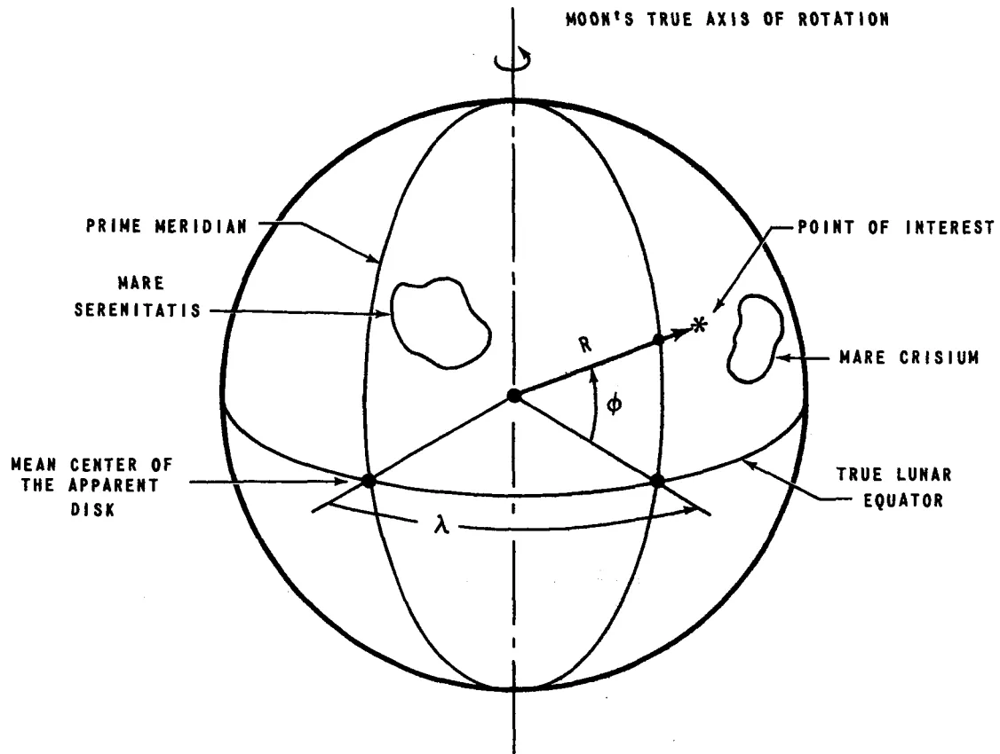

The diagram illustrates the Selenographic Polar coordinate system on a spherical model of the Moon. A vertical dashed line represents the Moon's True Axis of Rotation, with a curved arrow indicating counter-clockwise rotation. The Prime Meridian is a vertical line passing through the center of the Moon. The True Lunar Equator is a horizontal line passing through the center. The Mean Center of the Apparent Disk is marked on the equator. Mare Serenitatis is shown as a shaded region on the left side of the equator, and Mare Crisium is shown as a shaded region on the right side. A point of interest is marked with an asterisk (\*). A line segment labeled R connects the center of the Moon to the point of interest. The angle  $\phi$  is the latitude, measured from the true lunar equator to the line segment R. The angle  $\lambda$  is the longitude, measured along the equator from the prime meridian to the meridian containing the point of interest.

TYPE: Rotating, Moon referenced

ORIGIN: The center of the Moon

### ORIENTATION AND LABELING:

The prime meridian passes through the mean center of the apparent disk, which is the  $0^\circ$  latitude,  $0^\circ$  longitude point.

The latitude  $\phi$  is the angle defined by the intersection of the selenocentric radius vector to the point of interest and the true lunar equatorial plane, positive north (toward Mare Serenitatis) and negative south of the true lunar equator.

The longitude  $\lambda$  is the angle measured along the equatorial arc from the prime meridian to the meridian containing the point of interest, positive eastward (toward Mare Crisium).

R is the radial distance from the selenocenter to the point of interest.

FIGURE A-2## STANDARD COORDINATE SYSTEM 3a

### RADAR (AZ-EL)

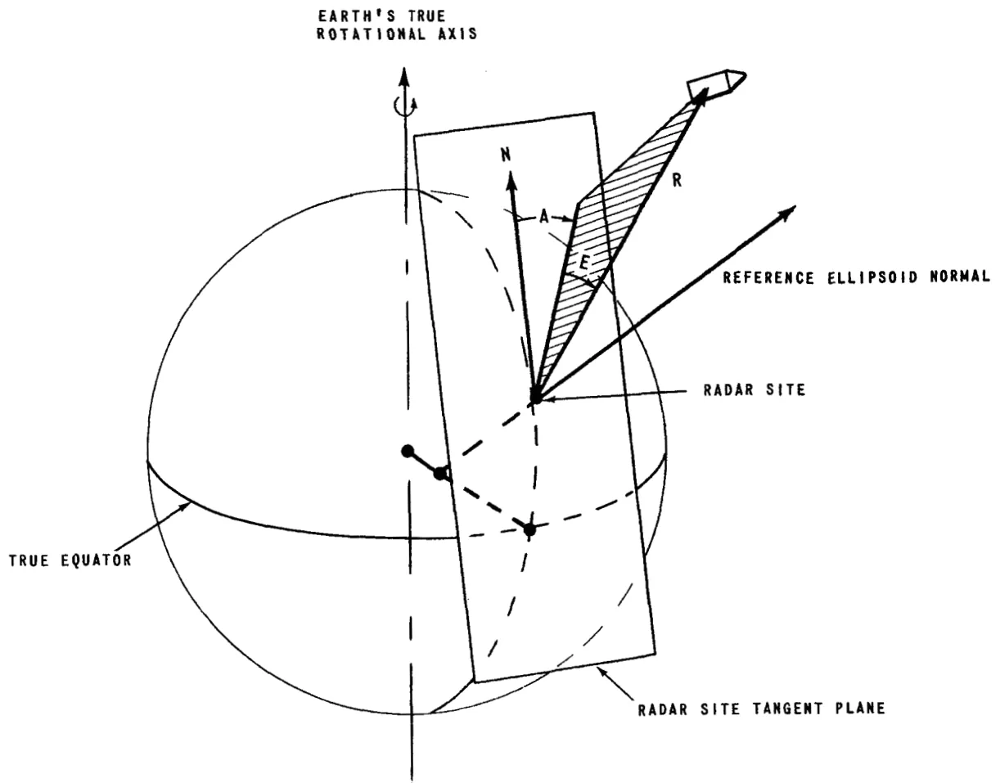

The diagram illustrates the Standard Coordinate System 3a for Radar (AZ-EL). It shows a sphere representing the Earth with a vertical dashed line labeled 'EARTH'S TRUE ROTATIONAL AXIS' and a horizontal dashed line labeled 'TRUE EQUATOR'. A 'RADAR SITE' is marked on the sphere's surface. A 'RADAR SITE TANGENT PLANE' is shown as a vertical rectangle tangent to the sphere at the radar site. A 'REFERENCE ELLIPSOID NORMAL' is a line passing through the radar site and perpendicular to the tangent plane. A slant range vector 'R' originates from the radar site and points to a vehicle. The angle 'A' is the azimuth, measured clockwise from the true north (indicated by a vertical arrow 'N') to the projection of the slant range vector onto the tangent plane. The angle 'E' is the elevation, measured positive above the tangent plane to the slant range vector.

**TYPE:** Rotating, Earth referenced

**ORIGIN:** The intersection of the radar axes

**ORIENTATION AND LABELING:**

The radar site tangent plane contains the site and is perpendicular to the reference ellipsoid normal which passes through the radar site.

R is the slant range to the vehicle.

A is the azimuth angle measured clockwise from true north to the projection of the slant range vector onto the radar site tangent plane.

E is the elevation angle measured positive above the radar site tangent plane to the slant range vector.

FIGURE A-3a## STANDARD COORDINATE SYSTEM 3b

### RADAR (HA-DEC)

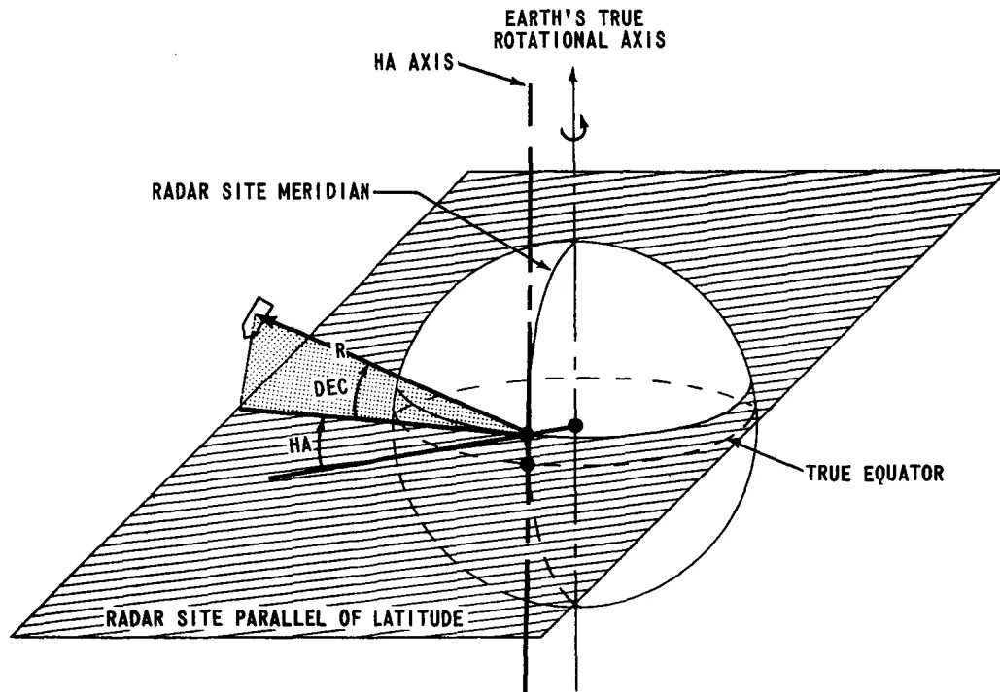

The diagram illustrates the Standard Coordinate System 3b for Radar (HA-DEC). It shows a 3D coordinate system centered at the radar site. The vertical axis is labeled 'EARTH'S TRUE ROTATIONAL AXIS' and 'HA AXIS'. A horizontal plane is labeled 'RADAR SITE PARALLEL OF LATITUDE'. A vertical plane passing through the HA axis is labeled 'RADAR SITE MERIDIAN'. A point on the radar site parallel of latitude is labeled 'TRUE EQUATOR'. A vector 'R' represents the slant range to a vehicle. The angle 'HA' (Hour Angle) is measured from the radar site meridian plane to the plane containing the vehicle and the radar site. The angle 'DEC' (Declination) is measured from the radar site parallel of latitude to the vehicle.

TYPE: Rotating, Earth referenced

ORIGIN: The point of intersection of the hour angle axis with the plane of the declination gear

#### ORIENTATION AND LABELING:

R is the slant range\* to the vehicle.

The HA axis is parallel to the Earth's true rotational axis. The declination axis is parallel to the true equator and perpendicular to the HA axis.

The hour angle (HA) is measured positive westward in the plane of the local radar site parallel of latitude, from the radar site meridian plane to the plane perpendicular to the equator and containing the vehicle and the radar site.

The declination (DEC) is the angle measured from the radar site parallel of latitude to the vehicle, positive north and negative south of this plane.

---

\* Range rate (R) data is also generally available in this system.

FIGURE A-3b## STANDARD COORDINATE SYSTEM 3c

### RADAR (X-Y 30 ft.)

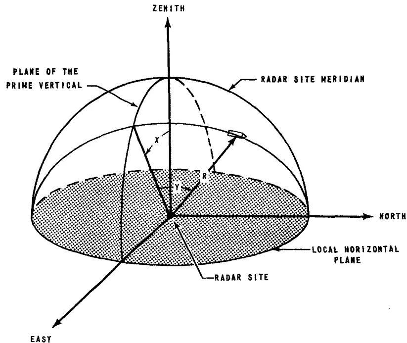

The diagram illustrates the Standard Coordinate System 3c for a Radar (X-Y 30 ft.). It shows a hemisphere centered at the Radar Site. The vertical axis is labeled ZENITH. The horizontal plane is labeled LOCAL HORIZONTAL PLANE. The intersection of the vertical axis and the horizontal plane is the RADAR SITE. The RADAR SITE MERIDIAN is a vertical plane passing through the RADAR SITE. The PLANE OF THE PRIME VERTICAL is a vertical plane passing through the RADAR SITE. The X axis is the intersection of the horizontal plane and the meridian plane. The Y axis is perpendicular to the X axis. The slant range R is the distance from the RADAR SITE to a vehicle. The angle X is measured in the plane of the radar site prime vertical from the zenith to the projection of the slant range vector onto this plane. The angle Y is the angle between the slant range vector and its projection onto the plane of the radar site prime vertical. The NORTH and EAST directions are indicated on the horizontal plane.

TYPE: Rotating, Earth referenced

ORIGIN: At the intersection of the X axis and the plane of the Y axis gear

#### ORIENTATION AND LABELING:

R is the slant range\* from the radar site to the vehicle.

The X axis lies along the intersection of the horizontal plane and the meridian plane at the radar site. The Y axis is perpendicular to the X axis.

X is the angle measured in the plane of the radar site prime vertical from the zenith to the projection of the slant range vector onto this plane, positive eastward.

Y is the angle between the slant range vector and its projection onto the plane of the radar site prime vertical, positive when the slant range vector is north of the plane and negative when it is south of it.

(When the radar antenna is directed toward the zenith, the X and Y angles are zero and the Y axis is perpendicular to the radar site meridian plane.)

\*Range rate (R) data is also generally available in this system.

FIGURE A-3c## STANDARD COORDINATE SYSTEM 3d

RADAR (X-Y 85 ft.)

![Diagram of a Standard Coordinate System 3d for a radar. It shows a hemisphere with a shaded LOCAL HORIZONTAL PLANE at the base. The origin is the RADAR SITE. A vertical line points to ZENITH. A vertical plane is labeled PLANE OF THE PRIME VERTICAL. A vertical line is labeled RADAR SITE MERIDIAN. A slant range vector R is shown from the origin to a point. The angle X is measured from the zenith to the projection of R onto the meridian plane. The angle Y is measured from the meridian plane to R. The horizontal plane is oriented with SOUTH and EAST directions indicated by arrows.](40c2a1f64b3709067421e68d3b692c9a_3_img.webp)

TYPE: Rotating, Earth referenced

ORIGIN: At the intersection of the X axis and the plane of the Y axis gear

### ORIENTATION AND LABELING:

R is the slant range\* from the radar site to the vehicle.

The X axis lies along the intersection of the horizontal plane and the plane of the prime vertical at the radar site. The Y axis is perpendicular to the X axis.

X is the angle measure in the meridian plane of the radar site from the zenith to the projection of the slant range vector onto this plane, positive southward.

Y is the angle between the slant range vector and its projection onto the meridian plane of the radar site, positive when the slant range vector is east of the meridian plane and negative when it is west of it.

(When the radar antenna is directed toward the zenith, the X and Y angles are zero and the Y axis is perpendicular to the radar site prime vertical plane.)

---

\* Range rate ( $\dot{R}$ ) data is also generally available in this system.

FIGURE A-3d## STANDARD COORDINATE SYSTEM 4 GEOCENTRIC INERTIAL

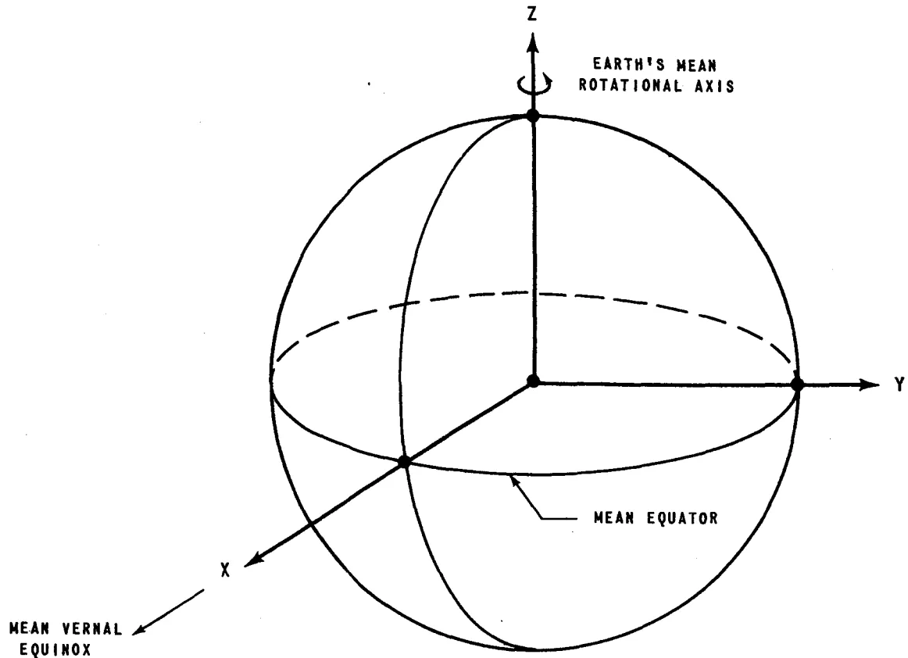

The diagram illustrates the Standard Coordinate System 4 (Geocentric Inertial) centered on the Earth. The Z-axis is vertical, pointing upwards along the Earth's mean rotational axis, which is indicated by a curved arrow. The Y-axis is horizontal, pointing to the right. The X-axis is diagonal, pointing towards the bottom-left. The mean equator is shown as a horizontal ellipse. The X-axis is labeled 'MEAN VERNAL EQUINOX' with an arrow pointing to its tip. The Y-axis is labeled 'Y' at its tip. The Z-axis is labeled 'EARTH'S MEAN ROTATIONAL AXIS' with an arrow pointing to its tip. The mean equator is labeled 'MEAN EQUATOR' with an arrow pointing to the ellipse.

TYPE: Non-rotating, Earth referenced

ORIGIN: The center of the Earth

### ORIENTATION AND LABELING:

The Z axis is directed along the Earth's mean rotational axis, positive north.

The X axis is directed toward the mean vernal equinox.

The Y axis completes a standard right-handed system.

The epoch will generally be the nearest beginning of a Besselian year. However, special applications may involve other epochs. Consequently, in any transmission of related data, the reference epoch used should be clearly stated.

This system is translatable to a Selenocentric Inertial system.

FIGURE A-4## STANDARD COORDINATE SYSTEM 5 IMPACT PREDICTION QUASI-INERTIAL

![Diagram of the Standard Coordinate System 5 (Standard Coordinate System 5) for impact prediction in a quasi-inertial frame. The diagram shows a sphere representing Earth with a vertical Z-axis labeled 'EARTH'S TRUE ROTATIONAL AXIS'. A horizontal plane represents the 'TRUE EQUATOR'. A 'PRIME MERIDIAN' is shown as a vertical line on the sphere's surface. A 3D coordinate system is defined with the Z-axis pointing up, the X-axis pointing towards the bottom right, and the Y-axis pointing towards the top right. The X and Y axes intersect at the center of the sphere, and the X-Y plane is the Earth's true equatorial plane.](9098fe608918ac04d2b5241e8daf27eb_2_img.webp)

TYPE: Non-rotating, Earth referenced

ORIGIN: The center of the Earth

### ORIENTATION AND LABELING:

This system is redefined at the beginning of each computational cycle. It is an inertial system\* for the duration of each computational cycle.

The Z axis is along the Earth's true rotational axis, positive north.

The positive X axis intersects the prime (Greenwich) meridian at the beginning of each computational cycle.

The Y axis completes a standard right-handed system.

(The X-Y plane is the Earth's true equatorial plane.)

---

\*Velocities expressed in this system are inertial velocities.

FIGURE A-5## STANDARD COORDINATE SYSTEM 6

### EARTH-MOON PLANE

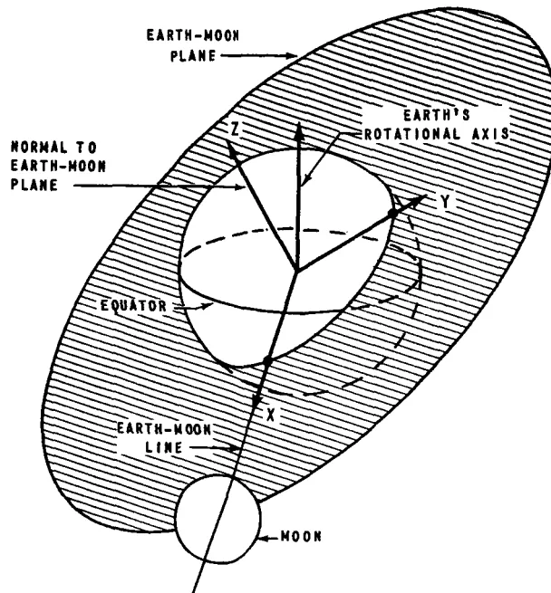

The diagram illustrates the Earth-Moon Plane coordinate system. It shows a large, shaded elliptical region representing the Earth-Moon plane. Within this plane, a smaller circle represents the Earth, with its equator and rotational axis labeled. A line labeled 'EARTH-MOON LINE' extends from the center of the Earth towards a smaller circle representing the Moon. A coordinate system is centered at the Earth's center, with the Z-axis pointing upwards, perpendicular to the Earth-Moon plane. The X-axis lies along the Earth-Moon line, pointing towards the Moon. The Y-axis completes a standard right-handed system. Labels include 'EARTH-MOON PLANE', 'NORMAL TO EARTH-MOON PLANE', 'EARTH'S ROTATIONAL AXIS', 'EQUATOR', 'EARTH-MOON LINE', 'MOON', 'X', 'Y', and 'Z'.

TYPE: Non-rotating

ORIGIN: The center of the specified central body  
(Earth or Moon: The Earth-centered system  
is shown in this Figure.)

#### ORIENTATION AND LABELING:

This system is redefined at the beginning of each computational cycle. It is an inertial system\* for the duration of each computational cycle.

The X axis lies along the Earth-Moon line at the beginning of each computational cycle, positive away from the Earth toward the Moon.

The Z axis is normal to the Earth-Moon plane, and parallel to the Moon's angular momentum vector, positive in a northerly direction.

The Y axis completes a standard right-handed system.

(The X-Y plane is normal to the Moon's angular momentum vector.)

This system is translatable to a selenocentric Earth-Moon Plane system. In this case the positive X axis lies along the extended Earth-Moon line and is directed away from the Earth.

---

\* Velocities expressed in this system are inertial velocities.

FIGURE A-6## STANDARD COORDINATE SYSTEM 7 ORBITAL ELEMENTS

![Diagram of the Standard Coordinate System 7 for orbital elements. It shows Earth at the center with the North Polar Axis. An orbital plane is tilted at an angle 'i' from the North Polar Axis. The vehicle's angular momentum vector is shown perpendicular to the orbital plane. The orbit is an ellipse with semi-major axis '2a', perigee, and apogee. The ascending node is the point where the orbit crosses the celestial equator from south to north. The celestial equator is the intersection of the orbital plane and the Earth's equator. The vernal equinox is the intersection of the celestial equator and the orbital plane. The right ascension of the ascending node is the angle 'Ω' from the vernal equinox to the ascending node. The argument of perigee is the angle 'ω' from the ascending node to the perigee. The true anomaly 'f' is the angle from the perigee to the vehicle's current position.](4351f37670f6ae5018dd2d5d6945276a_2_img.webp)

TYPE: Non-rotating, Earth referenced

ORIGIN: The center of the Earth

ORIENTATION AND LABELING:

$a$  is the semi-major axis of the orbit.

$e$  is the eccentricity of the orbit.

$f$ , the true anomaly, is the geocentric angular displacement of the vehicle measured in the orbit plane from perigee, positive in the direction of travel in the orbit.

$\Omega$ , the right ascension of the ascending node, is the angle measured eastward from the vernal equinox along the equator to that intersection with the orbit where the vehicle passes from south to north.

$\omega$ , the argument of perigee, is the angle measured in the orbit plane between the ascending node and perigee, positive in the direction of travel in the orbit.

$i$ , the inclination of the orbital plane, is the angle between the north polar axis and the vehicle angular momentum vector.

FIGURE A-7## STANDARD COORDINATE SYSTEM 8a

### SATURN I AND IB LAUNCH VEHICLE STRUCTURAL BODY AXES

GIMBAL REFERENCE PLANE  
(VEHICLE STATION 100)

POSITION I

Z

Y

X

**TYPE:** Rotating, vehicle referenced

**ORIGIN:** On the longitudinal axis, 100 inches below the gimbal reference plane

**ORIENTATION AND LABELING:**

The X axis lies along the longitudinal axis of the vehicle, positive in the nominal direction of positive thrust acceleration.

Position I (alternatively fin I) defines the positive Z direction.

The Y axis completes a standard right-handed system.

The Dynamical Body Axes system, which has its origin at the vehicle's instantaneous center of mass, is translatable with the Structural Body Axes system.

Launch Complexes 34 and 37 will be used for Saturn I and IB launchings. The positive Z axis of the erected vehicle will be directed approximately  $100^{\circ} 12'$  east of north for Launch Complex 34, and approximately  $90^{\circ} 12'$  east of north for Launch Complex 37.

POSITION I

Z

Y

TOP VIEW

FIGURE A-8aSTANDARD COORDINATE SYSTEM 8b  
SATURN V LAUNCH VEHICLE STRUCTURAL BODY AXES

**TYPE:** Rotating, vehicle referenced  
**ORIGIN:** On the longitudinal axis, 100 inches below the gimbal reference plane  
**ORIENTATION AND LABELING:**  
 The X axis lies along the longitudinal axis of the vehicle, positive in the nominal direction of positive thrust acceleration.  
 Position I defines the positive Z direction.  
 The Y axis completes a standard right-handed system.  
 The Dynamical Body Axes system, which has its origin at the vehicle's instantaneous center of mass, is translatable with the Structural Body Axes system.  
 Launch Complex 39 will be used for Saturn V launchings. The positive Z axis of the erected vehicle will be directed approximately  $90^{\circ} 12'$  east of north for this launch complex.

FIGURE A-8b## STANDARD COORDINATE SYSTEM 8c CSM STRUCTURAL BODY AXES

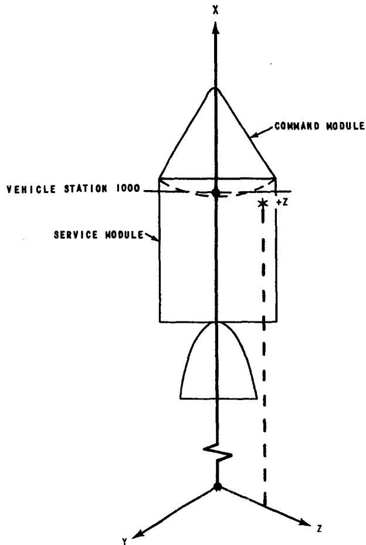

The diagram illustrates the Standard Coordinate System 8c for the CSM Structural Body. It shows a vertical vehicle structure with a Command Module at the top and a Service Module below it. A horizontal line labeled 'VEHICLE STATION 1000' is positioned at the top of the Service Module. The X-axis is a vertical line passing through the center of the vehicle, with an arrow pointing upwards and labeled 'X' at the top. The Y-axis is a horizontal line passing through the center of the vehicle, with an arrow pointing to the left and labeled 'Y' at the bottom. The Z-axis is a vertical line passing through the center of the vehicle, with an arrow pointing downwards and labeled 'Z' at the bottom. A dashed line extends from the top of the Service Module, passing through a point labeled '+Z' (marked with an asterisk) to the Z-axis. The origin of the coordinate system is located on the X-axis, 1,000 inches below the mold line of the heat shield main structure ablator interface.

**TYPE:** Rotating, vehicle referenced

**ORIGIN:** On the longitudinal axis, 1,000 inches below the mold line of the heat shield main structure ablator interface.

### ORIENTATION AND LABELING:

The X axis lies along the longitudinal axis of the vehicle, positive in the nominal direction of positive thrust acceleration.

The benchmark defining the positive Z axis is an alignment target (labeled +Z) at the top of the service module.

The Y axis completes a standard right-handed system.

The dynamical Body Axes system, which has its origin at the vehicle's instantaneous center of mass, is translatable with the Structural Body Axes system.

FIGURE A-8c## STANDARD COORDINATE SYSTEM 8d LEM STRUCTURAL BODY AXES

The diagram illustrates the LEM structural body with its standard coordinate system. The X-axis is vertical, pointing upwards along the centerline of the transfer tunnel. The Z-axis is horizontal, pointing to the right along the centerline of the exit hatch. The Y-axis is diagonal, pointing downwards and to the left. The origin is located 200 inches below the LEM Ascent stage base. The diagram also shows the vehicle station 200 and the centerline of the transfer tunnel.

TYPE: Rotating, vehicle referenced

ORIGIN: Located 200 inches below the LEM Ascent stage base

### ORIENTATION AND LABELING:

The X axis lies along the longitudinal axis (centerline of the transfer tunnel) of the LEM, positive in its nominal direction of positive thrust acceleration.

The positive Z axis is not defined by a physical benchmark; however, the center of the LEM exit hatch serves as a reference benchmark. Thus, the positive Z axis is parallel to the centerline of the exit hatch.

The Y axis completes a standard right-handed system.

The dynamical Body Axes system, which has its origin at the vehicle's instantaneous center of mass, is translatable with the Structural Body Axes system.

FIGURE A-8dSTANDARD COORDINATE SYSTEM 9  
MASS PROPERTIES


The diagram illustrates the standard coordinate system for a Space Launch Vehicle (SLV) used for mass properties calculations. It shows two distinct coordinate systems: one centered at the nose of the vehicle and another centered at the base. The top system has its X-axis pointing vertically upwards from the nose, its Y-axis pointing diagonally upwards and to the right, and its Z-axis pointing horizontally to the left. The bottom system, centered at the base, has its X-axis pointing vertically upwards, its Y-axis pointing diagonally upwards and to the right, and its Z-axis pointing horizontally to the left. A label 'POSITION I' is located at the base of the vehicle, indicating the origin for the bottom coordinate system.

TYPE: Rotating, vehicle referenced

ORIGIN: Two origin are employed with this system: one coincides with the origin of the Launch Vehicle Structural Body Axes system and the other coincides with the origin of the CSM Structural Body Axes system. The former is generally used when transmitting launch vehicle mass properties data and the latter when transmitting spacecraft mass properties data.

ORIENTATION AND LABELING

In all cases the orientation and labeling of the axes is identical with that of the CSM Structural Body Axes system (Standard Coordinate System 8c).

FIGURE A-9## STANDARD COORDINATE SYSTEM 10 EARTH-FIXED LAUNCH SITE

![Diagram of the Standard Coordinate System 10 for an Earth-Fixed Launch Site. The diagram shows a sphere representing Earth with its true rotational axis and true equator. A launch site is marked on the sphere. A reference ellipsoid normal passes through the launch site, defining the X-axis. A launch site tangent plane is shown, containing the launch site and perpendicular to the reference ellipsoid normal. The Z-axis is parallel to the Earth-fixed aiming azimuth, and the Y-axis completes a standard right-handed system. The X-Y-Z plane is the launch site tangent plane.](bd1f5705f07436472e4abb04bd346292_2_img.webp)

The diagram illustrates the Standard Coordinate System 10 for an Earth-Fixed Launch Site. It shows a sphere representing Earth with its true rotational axis and true equator. A launch site is marked on the sphere. A reference ellipsoid normal passes through the launch site, defining the X-axis. A launch site tangent plane is shown, containing the launch site and perpendicular to the reference ellipsoid normal. The Z-axis is parallel to the Earth-fixed aiming azimuth, and the Y-axis completes a standard right-handed system. The X-Y-Z plane is the launch site tangent plane.

**TYPE:** Rotating, Earth referenced

**ORIGIN:** At the intersection of the reference ellipsoid and the normal to it which passes through the launch site.

### ORIENTATION AND LABELING:

The launch site tangent plane contains the site and is perpendicular to the reference ellipsoid normal which passes through the launch site.

The X axis coincides with the reference ellipsoid normal passing through the site, positive upward.

The Z axis is parallel to the Earth-fixed aiming azimuth, defined at guidance reference release time, and is positive downrange.

The Y axis completes a standard right-handed system.

(The Y-Z plane is the launch site tangent plane.)

FIGURE A-10## STANDARD COORDINATE SYSTEM 11 EARTH-CENTERED LAUNCH DERIVED

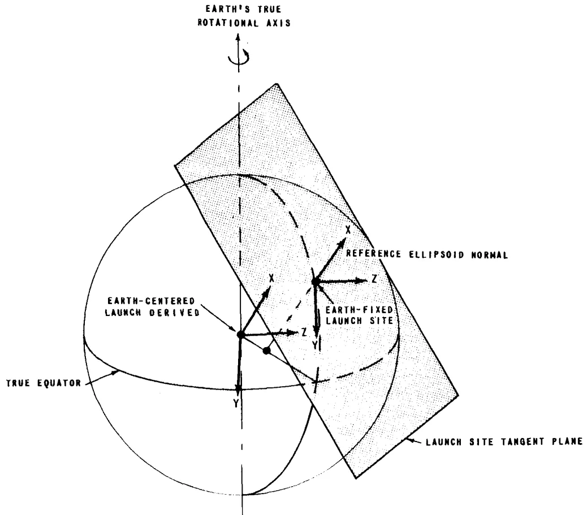

The diagram illustrates the Earth-Centered Launch Derived (ECLD) coordinate system. It shows a sphere representing the Earth with a vertical dashed line labeled 'EARTH'S TRUE ROTATIONAL AXIS' at the top. A horizontal line on the sphere is labeled 'TRUE EQUATOR'. A shaded plane, labeled 'LAUNCH SITE TANGENT PLANE', is tangent to the sphere at a point labeled 'EARTH-FIXED LAUNCH SITE'. A dashed line, labeled 'REFERENCE ELLIPSOID NORMAL', passes through the launch site and is perpendicular to the tangent plane. Two coordinate systems are shown: the 'EARTH-CENTERED LAUNCH DERIVED' system with axes X, Y, and Z originating from the center of the Earth, and the 'EARTH-FIXED LAUNCH SITE' system with axes X, Y, and Z originating from the launch site. The X and Z axes of the Earth-Fixed system are parallel to the Earth-Centered system's axes. The Y axis of the Earth-Fixed system is parallel to the Y axis of the Earth-Centered system. The Y-Z plane of the Earth-Fixed system is parallel to the launch site tangent plane.

TYPE: Rotating, Earth referenced

ORIGIN: The center of the Earth

### ORIENTATION AND LABELING:

The launch site tangent plane contains the site and is perpendicular to the reference ellipsoid normal which passes through the launch site.

The X axis is parallel to the reference ellipsoid normal passing through the launch site and is positive toward the launch site.

The Z axis is parallel to, and positive in the same direction as, the Earth-fixed aiming azimuth.

The Y axis completes a standard right-handed system.

(The Y-Z plane is parallel to the launch site tangent plane).

This system is translatable with the Earth-Fixed Launch Site system.

FIGURE A-11STANDARD COORDINATE SYSTEM 12  
LAUNCH VEHICLE PLATFORM-ACCELEROMETER


The diagram illustrates the Standard Coordinate System 12 for a Launch Vehicle Platform-Accelerometer. It features a spherical reference ellipsoid with a shaded 'STABLE PLATFORM' in the center. A coordinate system is defined with the X-axis pointing upward, the Z-axis pointing downrange, and the Y-axis completing a right-handed system. An inset shows a detailed view of the coordinate system with X, Z, and Y axes.

TYPE: Non-rotating, vehicle referenced

ORIGIN: The intersection of the primary axes of the accelerometer

ORIENTATION AND LABELING:

The X axis is parallel to the reference ellipsoid normal through the launch site, positive upward.

The Z axis is parallel to the aiming azimuth, positive downrange.

The Y axis completes a standard right-handed system.

This system is translatable with the Earth-Fixed Launch Site system at guidance reference release time.

FIGURE A-12## STANDARD COORDINATE SYSTEM 13 LAUNCH VEHICLE NAVIGATION

The diagram illustrates the Standard Coordinate System 13 for Launch Vehicle Navigation. It features a central sphere representing Earth. A vertical dashed line through the center is labeled "EARTH'S AXIS OF ROTATION" with a curved arrow indicating rotation. A horizontal dashed line represents the equator. A solid line passing through the center is labeled "NAVIGATION SYSTEM" with an arrow pointing to it. This line has an X-axis pointing upwards and to the right, a Y-axis pointing downwards and to the left, and a Z-axis pointing downwards and to the right. A label "PLATFORM-ACCELEROMETER SYSTEM TRANSLATED TO THE EARTH'S CENTER" points to the origin of this system. Another set of axes (X, Y, Z) is shown in the upper right, labeled "PLATFORM-ACCELEROMETER SYSTEM IN SPACE". A dashed line connects the origin of the navigation system to the origin of the platform-accelerometer system in space. The navigation system's X and Y axes are parallel to the platform-accelerometer system's X and Y axes, respectively. The Z axis of the navigation system is perpendicular to the X and Y axes, completing a standard right-handed system.

**TYPE:** Non-rotating, Earth referenced

**ORIGIN:** The center of the Earth

**ORIENTATION AND LABELING:**

This system is translatable from the Launch Vehicle Platform-Accelerometer system at guidance reference release for the launch vehicle.

The X axis is parallel to the X axis of the Launch Vehicle Platform-Accelerometer system.

The Y axis is parallel to the Y axis of the Launch Vehicle Platform-Accelerometer system.

The Z axis completes a standard right-handed system.

FIGURE A-13LIST OF PROJECT APOLLO STANDARD RELATIONSHIPS

- B-1                      Dynamical Body Axes Systems
- B-2                      The Orientation of the Launch Vehicle, CSM and LEM Structural Body Axes in the Launch Configuration
- B-3                      Space Vehicle Structural Body Axes7.

APPENDIX B

Project Apollo Standard Relationships Existing  
Among Standard Coordinate Systems

This Appendix contains the figures depicting the three Standard Relationships.STANDARD RELATIONSHIP 1

DYNAMICAL BODY AXES SYSTEMS

NOTE: THE DYNAMICAL BODY AXES ARE STANDARDIZED IN THE SENSE THAT THE POSITIVE Z AXIS IS THE PREFERRED DOWN RANGE DIRECTION FOR EACH VEHICLE, WHEN OPERATING INDEPENDENTLY.

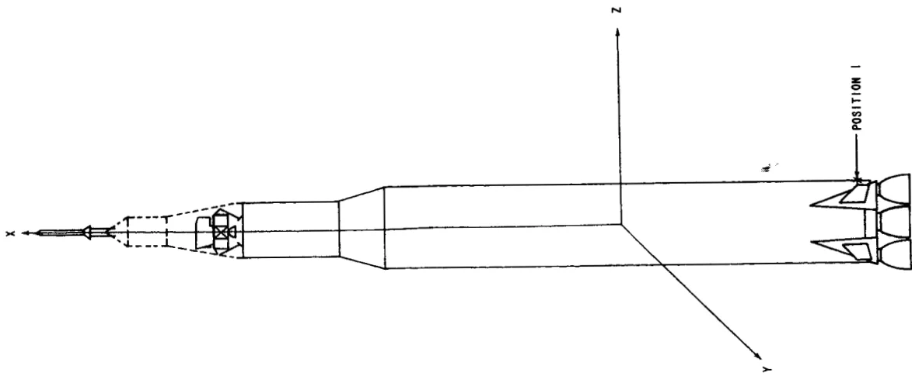

A side-view diagram of a Launch Vehicle. The vehicle is oriented vertically with its nose pointing upwards. A 3D coordinate system is shown with the X-axis pointing forward along the vehicle's longitudinal axis, the Y-axis pointing to the right, and the Z-axis pointing downwards. A label 'POSITION 1' with an arrow points to the nose of the vehicle.

LAUNCH VEHICLE

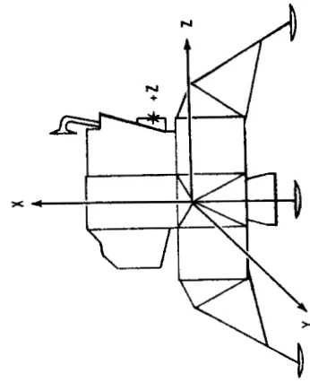

A side-view diagram of a Lunar Excursion Module. The module is shown in a horizontal orientation. A 3D coordinate system is shown with the X-axis pointing forward, the Y-axis pointing to the right, and the Z-axis pointing downwards. A label '+Z' is placed near the top of the module.

LUNAR EXCURSION MODULE

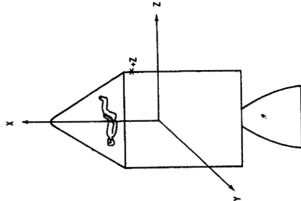

A side-view diagram of a Command and Service Module. The module is shown in a horizontal orientation. A 3D coordinate system is shown with the X-axis pointing forward, the Y-axis pointing to the right, and the Z-axis pointing downwards. A label '+Z' is placed near the top of the module.

COMMAND AND SERVICE MODULE

FIGURE B-1STANDARD RELATIONSHIP 2  
THE ORIENTATION OF THE LAUNCH VEHICLE, CSM AND LEM  
STRUCTURAL BODY AXES IN THE LAUNCH CONFIGURATION

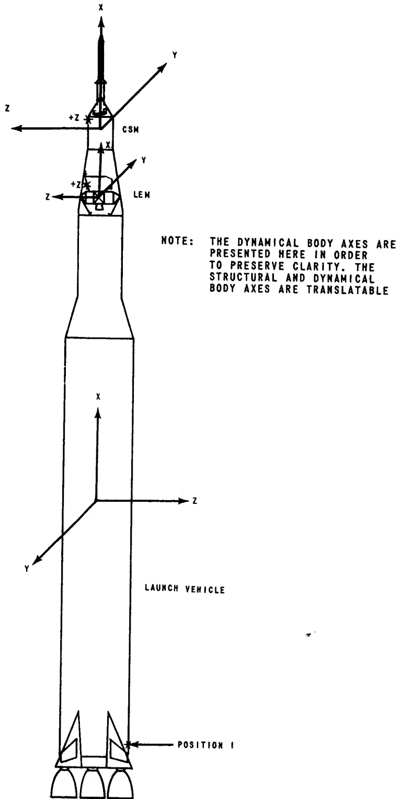

The diagram illustrates the standard relationship between the structural body axes of a launch vehicle, the Command Service Module (CSM), and the Lunar Module (LEM) in a launch configuration. The launch vehicle is shown as a tall, slender cylinder with a nose cone at the top and a service bay at the bottom. The CSM is located in the service bay, and the LEM is positioned below it. Each component has its own set of structural body axes: the launch vehicle has axes X (vertical), Y (lateral), and Z (longitudinal); the CSM has axes X, Y, and Z; and the LEM has axes X, Y, and Z. The axes are shown as arrows originating from the center of each component. A note states: "NOTE: THE DYNAMICAL BODY AXES ARE PRESENTED HERE IN ORDER TO PRESERVE CLARITY. THE STRUCTURAL AND DYNAMICAL BODY AXES ARE TRANSLATABLE". The diagram also shows the launch vehicle's structural body axes (X, Y, Z) and the LEM's structural body axes (X, Y, Z) at the bottom, with a label "POSITION 1" pointing to the LEM's base.

FIGURE B-2STANDARD RELATIONSHIP 3  
SPACE VEHICLE STRUCTURAL BODY AXES

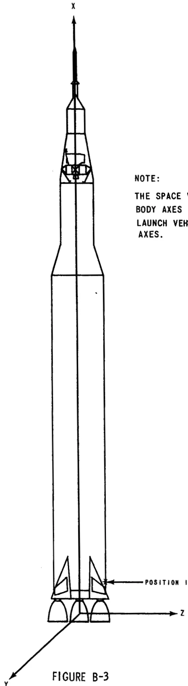

The diagram illustrates the structural body axes of a space vehicle, shown as a vertical rocket. The X-axis is a vertical line passing through the center of the vehicle, with an arrow pointing upwards from the top. The Z-axis is a horizontal line passing through the base of the vehicle, with an arrow pointing to the right. The Y-axis is a diagonal line passing through the base, with an arrow pointing downwards and to the left. At the base of the vehicle, there are four support structures. An arrow labeled 'POSITION 1' points to the rightmost of these support structures. The caption 'FIGURE B-3' is located at the bottom left of the diagram.

NOTE:  
THE SPACE VEHICLE STRUCTURAL BODY AXES ARE IDENTICAL WITH LAUNCH VEHICLE STRUCTURAL BODY AXES.

FIGURE B-3REFERENCES

1. 1. "AFMTC Standardized Theoretical Trajectory Magnetic Tape Format", Headquarters Air Force Missile Test Center, AFMTCM 80-4, January 5, 1964.
2. 2. "Goddard Directory of Tracking Station Locations," Goddard Space Flight Center, X-544-64-176, July 1, 1964
3. 3. "American Standard, Letter Symbols for Aeronautical Sciences", The American Society of Mechanical Engineers, (ASA Y10.7-1954), October, 1954.
4. 4. "Recommendations of Marshall Space Flight Center for Standardization of Coordinate Systems in MSF", MSFC, NASA TM X-54182, March 2, 1965.
5. 5. "Mass Properties Standard", NASA OMSF Program Directive, M-DE 8000.006, Effective June 1, 1963.